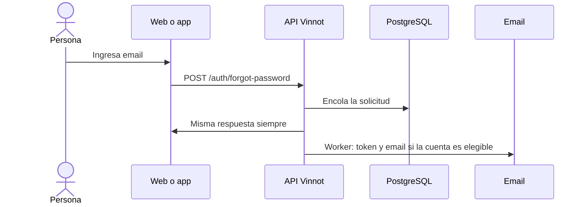

# UC-USR-09 · Solicitar la recuperación de la contraseña

| Campo | Valor |
|---|---|
| ID | `UC-USR-09` |
| Módulo | [Usuarios y cuenta](../README.md) |
| Plataformas | Web, APK |
| Actores | Visitante, Servicio de email |
| IDs en Lucidchart | [WEB UC-AUTH-09](https://lucid.app/lucidchart/9f11a16b-bb5a-42fc-a9e8-0852b17bd241/edit), [APK UC-AUTH-09](https://lucid.app/lucidchart/e095dd25-e8ac-41ba-bf5b-396e1055f217/edit) |
| Requisitos | [`RF-WEB-USR-14`](../requirements.md), [`RF-APK-USR-16`](../requirements.md) |
| Casos de prueba | [`CP-USR-27`](../testing.md), [`CP-USR-28`](../testing.md) |

## Precondiciones

- La persona no recuerda su contraseña.

## Postcondiciones

- Si la cuenta está activa y no bloqueada, recibe un enlace para restablecer la contraseña.

## Flujo principal

1. La persona ingresa su email.
2. La API normaliza el email y encola la solicitud sin buscar la cuenta.
3. El cliente muestra la misma confirmación en todos los casos.
4. El worker busca la cuenta y, si es elegible, emite el token y encola el email.

## Flujos alternativos

- 4a. Email desconocido o cuenta no elegible: no hay efecto.

## Reglas de negocio

- Ni la respuesta, ni su tiempo, ni los errores del proveedor de email revelan si la cuenta existe.
- El token de restablecimiento dura 60 minutos.
- El email no se escribe en los logs.

## Diagrama

[Ver diagrama de «UC-USR-09 · Solicitar la recuperación de la contraseña» completo](https://images.vinnot.com/docs/diagrams/v1/es/modules-users-use-cases-uc-usr-09-request-password-recovery-22f01b345fd1.svg)

Diagrama de componentes en Lucidchart: [WEB UC-AUTH-09](https://lucid.app/lucidchart/9f11a16b-bb5a-42fc-a9e8-0852b17bd241/edit), [APK UC-AUTH-09](https://lucid.app/lucidchart/e095dd25-e8ac-41ba-bf5b-396e1055f217/edit).

## Código

| Capa | Ubicación |
|---|---|
| Endpoints | `POST /auth/forgot-password` |
| Backend | [`AuthController.java`](../../../../../backend/src/main/java/com/vinnot/user/infrastructure/web/controller/AuthController.java), [`ForgotPasswordCommandHandler.java`](../../../../../backend/src/main/java/com/vinnot/user/application/command/handler/ForgotPasswordCommandHandler.java), [`IssueAccountRecoveryService.java`](../../../../../backend/src/main/java/com/vinnot/user/application/service/IssueAccountRecoveryService.java) |
| Web | [`ForgotPasswordPage.tsx`](../../../../../frontend-react/src/presentation/pages/public/ForgotPasswordPage.tsx), [`useAccountActionViewModels.ts`](../../../../../frontend-react/src/presentation/pages/public/useAccountActionViewModels.ts) |
| App | `frontend-mobile/app/(auth)/forgot-password.tsx`, [`AccountActionViews.tsx`](../../../../../frontend-mobile/src/presentation/features/auth/AccountActionViews.tsx) |

## Tests automáticos

- Backend: [`AccountActionCommandHandlersTest.java`](../../../../../backend/src/test/java/com/vinnot/user/application/command/handler/AccountActionCommandHandlersTest.java), [`AccountRecoveryPostgresIntegrationTest.java`](../../../../../backend/src/test/java/com/vinnot/user/application/AccountRecoveryPostgresIntegrationTest.java)
- Web: [`authErrorViewModels.test.tsx`](../../../../../frontend-react/src/presentation/pages/public/authErrorViewModels.test.tsx)
- App: Ninguno
