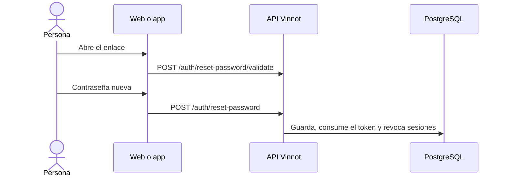

# UC-USR-10 · Restablecer la contraseña desde el enlace

| Campo | Valor |
|---|---|
| ID | `UC-USR-10` |
| Módulo | [Usuarios y cuenta](../README.md) |
| Plataformas | Web, APK |
| Actores | Visitante |
| IDs en Lucidchart | [WEB UC-AUTH-10](https://lucid.app/lucidchart/9f11a16b-bb5a-42fc-a9e8-0852b17bd241/edit), [APK UC-AUTH-10](https://lucid.app/lucidchart/e095dd25-e8ac-41ba-bf5b-396e1055f217/edit) |
| Requisitos | [`RF-WEB-USR-15`](../requirements.md), [`RF-APK-USR-17`](../requirements.md) |
| Casos de prueba | [`CP-USR-29`](../testing.md), [`CP-USR-30`](../testing.md), [`CP-USR-31`](../testing.md) |

## Precondiciones

- La persona recibió un enlace de restablecimiento.

## Postcondiciones

- La contraseña cambia, el token se consume y las sesiones anteriores quedan revocadas.

## Flujo principal

1. La persona abre el enlace.
2. El cliente valida el token antes de mostrar el formulario.
3. La persona ingresa la contraseña nueva y su confirmación.
4. La API valida el token, aplica la política de contraseña, guarda y consume el token.

## Flujos alternativos

- 2a. El token es inválido, ya se usó o venció: el cliente lo avisa al abrir el enlace, no muestra el formulario y ofrece pedir un enlace nuevo.
- 4a. Token inválido, usado o vencido: no se cambia la contraseña.

## Reglas de negocio

- Cambiar la contraseña incrementa `sessionVersion`: los tokens emitidos antes dejan de valer.

## Diagrama

[Ver diagrama de «UC-USR-10 · Restablecer la contraseña desde el enlace» completo](https://images.vinnot.com/docs/diagrams/v1/es/modules-users-use-cases-uc-usr-10-reset-password-bdaa7611d7b0.svg)

Diagrama de componentes en Lucidchart: [WEB UC-AUTH-10](https://lucid.app/lucidchart/9f11a16b-bb5a-42fc-a9e8-0852b17bd241/edit), [APK UC-AUTH-10](https://lucid.app/lucidchart/e095dd25-e8ac-41ba-bf5b-396e1055f217/edit).

## Código

| Capa | Ubicación |
|---|---|
| Endpoints | `POST /auth/reset-password/validate`, `POST /auth/reset-password` |
| Backend | [`AuthController.java`](../../../../../backend/src/main/java/com/vinnot/user/infrastructure/web/controller/AuthController.java), [`ResetPasswordCommandHandler.java`](../../../../../backend/src/main/java/com/vinnot/user/application/command/handler/ResetPasswordCommandHandler.java), [`ValidatePasswordResetTokenQueryHandler.java`](../../../../../backend/src/main/java/com/vinnot/user/application/query/handler/ValidatePasswordResetTokenQueryHandler.java) |
| Web | [`ResetPasswordPage.tsx`](../../../../../frontend-react/src/presentation/pages/public/ResetPasswordPage.tsx), [`useAccountActionViewModels.ts`](../../../../../frontend-react/src/presentation/pages/public/useAccountActionViewModels.ts) |
| App | `frontend-mobile/app/(auth)/reset-password.tsx`, [`AccountActionViews.tsx`](../../../../../frontend-mobile/src/presentation/features/auth/AccountActionViews.tsx) |

## Tests automáticos

- Backend: [`AccountActionCommandHandlersTest.java`](../../../../../backend/src/test/java/com/vinnot/user/application/command/handler/AccountActionCommandHandlersTest.java), [`UserCatalogQueryHandlersTest.java`](../../../../../backend/src/test/java/com/vinnot/user/application/query/handler/UserCatalogQueryHandlersTest.java), [`SessionAccessHttpPostgresIntegrationTest.java`](../../../../../backend/src/test/java/com/vinnot/shared/infrastructure/SessionAccessHttpPostgresIntegrationTest.java)
- Web: Ninguno
- App: [`resetPasswordRoute.test.tsx`](../../../../../frontend-mobile/src/presentation/features/auth/__tests__/resetPasswordRoute.test.tsx), [`auth.service.test.ts`](../../../../../frontend-mobile/src/application/services/auth.service.test.ts)
