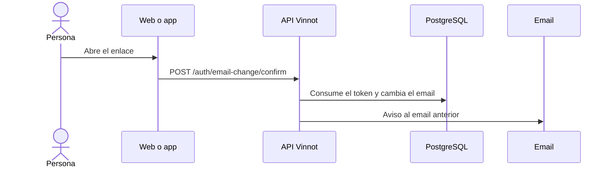

# UC-USR-11 · Confirmar el cambio de email desde el enlace

| Campo | Valor |
|---|---|
| ID | `UC-USR-11` |
| Módulo | [Usuarios y cuenta](../README.md) |
| Plataformas | Web |
| Actores | Usuario autenticado, Servicio de email |
| IDs en Lucidchart | [WEB UC-AUTH-11](https://lucid.app/lucidchart/9f11a16b-bb5a-42fc-a9e8-0852b17bd241/edit) |
| Requisitos | [`RF-WEB-USR-16`](../requirements.md) |
| Casos de prueba | [`CP-USR-32`](../testing.md), [`CP-USR-33`](../testing.md) |

## Precondiciones

- Se pidió un cambio de email (UC-USR-17).

## Postcondiciones

- El email nuevo reemplaza al anterior como identidad verificada; se avisa al email anterior.

## Flujo principal

1. La persona abre el enlace que llegó al email nuevo.
2. La web envía el token a la API.
3. La API valida el token de un solo uso, vuelve a comprobar que el email esté libre y cambia el email.
4. La API revoca las sesiones anteriores y encola el aviso al email anterior.

## Flujos alternativos

- 3a. Token inválido, usado o vencido, o email ya tomado: el email no cambia.

## Reglas de negocio

- Solo la web tiene esta pantalla; los enlaces apuntan a la web aunque el pedido se haya hecho desde la app.
- El token de cambio de email dura 60 minutos.

## Diagrama

[Ver diagrama de «UC-USR-11 · Confirmar el cambio de email desde el enlace» completo](https://images.vinnot.com/docs/diagrams/v1/es/modules-users-use-cases-uc-usr-11-confirm-email-change-ecb0ff8b2abf.svg)

Diagrama de componentes en Lucidchart: [WEB UC-AUTH-11](https://lucid.app/lucidchart/9f11a16b-bb5a-42fc-a9e8-0852b17bd241/edit).

## Código

| Capa | Ubicación |
|---|---|
| Endpoints | `POST /auth/email-change/confirm` |
| Backend | [`AuthController.java`](../../../../../backend/src/main/java/com/vinnot/user/infrastructure/web/controller/AuthController.java), [`ConfirmEmailChangeCommandHandler.java`](../../../../../backend/src/main/java/com/vinnot/user/application/command/handler/ConfirmEmailChangeCommandHandler.java), [`AccountActionTokenService.java`](../../../../../backend/src/main/java/com/vinnot/user/application/service/AccountActionTokenService.java) |
| Web | [`ConfirmEmailChangePage.tsx`](../../../../../frontend-react/src/presentation/pages/public/ConfirmEmailChangePage.tsx), [`useAccountActionViewModels.ts`](../../../../../frontend-react/src/presentation/pages/public/useAccountActionViewModels.ts) |

## Tests automáticos

- Backend: [`EmailChangeCommandHandlersTest.java`](../../../../../backend/src/test/java/com/vinnot/user/application/command/handler/EmailChangeCommandHandlersTest.java), [`AccountEmailOutagePostgresIntegrationTest.java`](../../../../../backend/src/test/java/com/vinnot/user/application/AccountEmailOutagePostgresIntegrationTest.java)
- Web: Ninguno
- App: Ninguno
