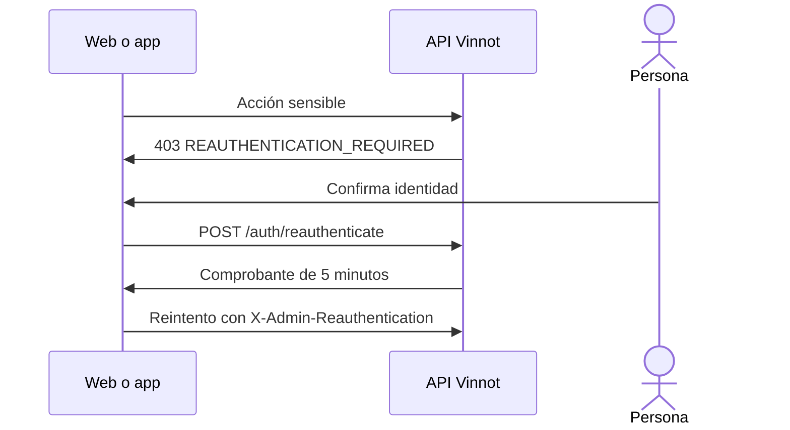

# UC-USR-12 · Confirmar la identidad para una acción sensible

| Campo | Valor |
|---|---|
| ID | `UC-USR-12` |
| Módulo | [Usuarios y cuenta](../README.md) |
| Plataformas | Web, APK |
| Actores | Usuario autenticado, Proveedor de identidad (Google o Apple) |
| IDs en Lucidchart | [WEB UC-AUTH-12](https://lucid.app/lucidchart/9f11a16b-bb5a-42fc-a9e8-0852b17bd241/edit) |
| Requisitos | Ninguno |
| Casos de prueba | [`CP-USR-34`](../testing.md), [`CP-USR-35`](../testing.md), [`CP-USR-36`](../testing.md) |

## Precondiciones

- La persona intenta una acción sensible: cambiar su email, borrar su cuenta o, siendo ADMIN, cambiar usuarios, roles o bloqueos, o eliminar recursos.

## Postcondiciones

- La acción pendiente se ejecuta una vez con un comprobante válido por cinco minutos.

## Flujo principal

1. La API responde `403 REAUTHENTICATION_REQUIRED`.
2. El cliente renueva el token de acceso y abre el diálogo de confirmación.
3. La persona confirma con su contraseña o, si tiene Google o Apple vinculado, con ese proveedor.
4. La API emite un comprobante firmado, ligado al usuario y al token de acceso actual.
5. El cliente reintenta la acción una vez con el header `X-Admin-Reauthentication`.

## Flujos alternativos

- 3a. Contraseña o credencial rechazada: el diálogo sigue abierto y ofrece recuperar la contraseña.
- 3b. Cancelar, salir o cambiar de cuenta: se descarta el comprobante y la acción no se ejecuta.

## Reglas de negocio

- El comprobante vive solo en memoria.
- Desactivar la cuenta no pide confirmación de identidad.

## Diagrama

[Ver diagrama de «UC-USR-12 · Confirmar la identidad para una acción sensible» completo](https://images.vinnot.com/docs/diagrams/v1/es/modules-users-use-cases-uc-usr-12-reauthenticate-badfc7b027e7.svg)

Diagrama de componentes en Lucidchart: [WEB UC-AUTH-12](https://lucid.app/lucidchart/9f11a16b-bb5a-42fc-a9e8-0852b17bd241/edit).

## Código

| Capa | Ubicación |
|---|---|
| Endpoints | `POST /auth/reauthenticate` |
| Backend | [`ReauthenticationController.java`](../../../../../backend/src/main/java/com/vinnot/user/infrastructure/web/controller/ReauthenticationController.java), [`ReauthenticateCommandHandler.java`](../../../../../backend/src/main/java/com/vinnot/user/application/command/handler/ReauthenticateCommandHandler.java), [`SignedReauthenticationProofAdapter.java`](../../../../../backend/src/main/java/com/vinnot/user/infrastructure/security/SignedReauthenticationProofAdapter.java), [`AdminSensitiveActionInterceptor.java`](../../../../../backend/src/main/java/com/vinnot/admin/infrastructure/web/AdminSensitiveActionInterceptor.java) |
| Web | [`ReauthenticationDialog.tsx`](../../../../../frontend-react/src/presentation/components/auth/ReauthenticationDialog.tsx), [`useReauthentication.ts`](../../../../../frontend-react/src/presentation/hooks/useReauthentication.ts), [`reauthentication.service.ts`](../../../../../frontend-react/src/application/services/reauthentication.service.ts) |
| App | [`ReauthenticationDialog.tsx`](../../../../../frontend-mobile/src/presentation/features/auth/ReauthenticationDialog.tsx), [`useReauthentication.ts`](../../../../../frontend-mobile/src/presentation/hooks/useReauthentication.ts), [`reauthentication.service.ts`](../../../../../frontend-mobile/src/application/services/reauthentication.service.ts) |

## Tests automáticos

- Backend: [`ReauthenticateCommandHandlerTest.java`](../../../../../backend/src/test/java/com/vinnot/user/application/command/handler/ReauthenticateCommandHandlerTest.java), [`ReauthenticationControllerTest.java`](../../../../../backend/src/test/java/com/vinnot/user/infrastructure/web/controller/ReauthenticationControllerTest.java), [`SignedReauthenticationProofAdapterTest.java`](../../../../../backend/src/test/java/com/vinnot/user/infrastructure/security/SignedReauthenticationProofAdapterTest.java), [`ProviderReauthenticationHttpPostgresIntegrationTest.java`](../../../../../backend/src/test/java/com/vinnot/user/infrastructure/web/ProviderReauthenticationHttpPostgresIntegrationTest.java), [`AdminSensitiveActionInterceptorTest.java`](../../../../../backend/src/test/java/com/vinnot/admin/infrastructure/web/AdminSensitiveActionInterceptorTest.java)
- Web: [`ReauthenticationDialog.test.tsx`](../../../../../frontend-react/src/presentation/components/auth/ReauthenticationDialog.test.tsx), [`useReauthentication.test.ts`](../../../../../frontend-react/src/presentation/hooks/useReauthentication.test.ts), [`reauthentication.service.test.ts`](../../../../../frontend-react/src/application/services/reauthentication.service.test.ts)
- App: [`ReauthenticationDialog.test.tsx`](../../../../../frontend-mobile/src/presentation/features/auth/ReauthenticationDialog.test.tsx), [`admin-role-reauthentication.test.tsx`](../../../../../frontend-mobile/src/test/integration/admin-role-reauthentication.test.tsx)
