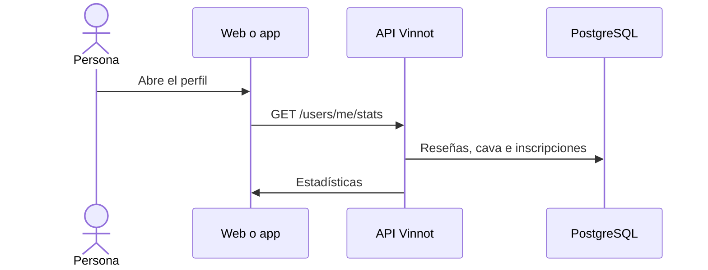

# UC-USR-13 · Ver el perfil, los roles y las estadísticas

| Campo | Valor |
|---|---|
| ID | `UC-USR-13` |
| Módulo | [Usuarios y cuenta](../README.md) |
| Plataformas | Web, APK |
| Actores | Usuario autenticado |
| IDs en Lucidchart | [WEB UC-ACC-01](https://lucid.app/lucidchart/9f11a16b-bb5a-42fc-a9e8-0852b17bd241/edit), [APK UC-ACC-01](https://lucid.app/lucidchart/e095dd25-e8ac-41ba-bf5b-396e1055f217/edit) |
| Requisitos | [`RF-WEB-USR-17`](../requirements.md), [`RF-WEB-USR-18`](../requirements.md), [`RF-APK-USR-18`](../requirements.md), [`RF-APK-USR-19`](../requirements.md), [`RF-APK-USR-20`](../requirements.md) |
| Casos de prueba | [`CP-USR-37`](../testing.md) |

## Precondiciones

- Hay una sesión iniciada.

## Postcondiciones

- Se muestran identidad, estado, roles y estadísticas, sin modificar nada.

## Flujo principal

1. La persona abre su perfil.
2. El cliente usa la identidad de `GET /auth/me` y pide `GET /users/me/stats`.
3. La API suma reseñas y promedio, vinos en la cava e inscripciones a eventos, a través de puertos de otros módulos.
4. El cliente muestra los datos.

## Flujos alternativos

No tiene.

## Reglas de negocio

- En la app, Eventos y Rutas aparecen solo para PARTNER o ADMIN; la tarjeta de la cava abre la cava aunque esté vacía.
- En la app, el menú del perfil incluye «Mis vinos enviados», que abre el seguimiento de las propuestas de vinos ([UC-WIN-09](../../wines/use-cases/uc-win-09-track-submissions.md)).
- `eventsAttended` cuenta inscripciones, no asistencia real.
- Los roles se exponen con prefijo `ROLE_`.
- El encabezado del perfil muestra el sello, los puntos, el nombre del nivel y una barra de progreso al siguiente (`GET /users/me/points`); tocar el sello abre «Tus puntos» con cómo sumar, los últimos movimientos y la escalera completa ([Puntos y sellos](../../gamification/README.md)).

## Diagrama

[Ver diagrama de «UC-USR-13 · Ver el perfil, los roles y las estadísticas» completo](https://images.vinnot.com/docs/diagrams/v1/es/modules-users-use-cases-uc-usr-13-view-profile-d0a9b988445a.svg)

Diagrama de componentes en Lucidchart: [WEB UC-ACC-01](https://lucid.app/lucidchart/9f11a16b-bb5a-42fc-a9e8-0852b17bd241/edit), [APK UC-ACC-01](https://lucid.app/lucidchart/e095dd25-e8ac-41ba-bf5b-396e1055f217/edit).

## Código

| Capa | Ubicación |
|---|---|
| Endpoints | `GET /auth/me`, `GET /users/me/stats` |
| Backend | [`AuthController.java`](../../../../../backend/src/main/java/com/vinnot/user/infrastructure/web/controller/AuthController.java), [`UserController.java`](../../../../../backend/src/main/java/com/vinnot/user/infrastructure/web/controller/UserController.java), [`GetUserStatsQueryHandler.java`](../../../../../backend/src/main/java/com/vinnot/user/application/query/handler/GetUserStatsQueryHandler.java) |
| Web | [`UserProfilePage.tsx`](../../../../../frontend-react/src/presentation/pages/user/UserProfilePage.tsx), [`UserProfileStatsTab.tsx`](../../../../../frontend-react/src/presentation/pages/user/UserProfileStatsTab.tsx), [`useUserStats.ts`](../../../../../frontend-react/src/presentation/hooks/queries/user/useUserStats.ts) |
| App | [`ProfileScreen.tsx`](../../../../../frontend-mobile/src/presentation/features/profile/ProfileScreen.tsx), [`ProfileHero.tsx`](../../../../../frontend-mobile/src/presentation/features/user/ProfileHero.tsx), [`StatsRow.tsx`](../../../../../frontend-mobile/src/presentation/features/user/StatsRow.tsx) |

## Tests automáticos

- Backend: [`UserCatalogQueryHandlersTest.java`](../../../../../backend/src/test/java/com/vinnot/user/application/query/handler/UserCatalogQueryHandlersTest.java)
- Web: [`users.service.test.ts`](../../../../../frontend-react/src/application/services/users.service.test.ts)
- App: [`StatsRow.test.tsx`](../../../../../frontend-mobile/src/presentation/features/user/StatsRow.test.tsx), [`profileRoute.test.tsx`](../../../../../frontend-mobile/src/presentation/features/profile/__tests__/profileRoute.test.tsx)
