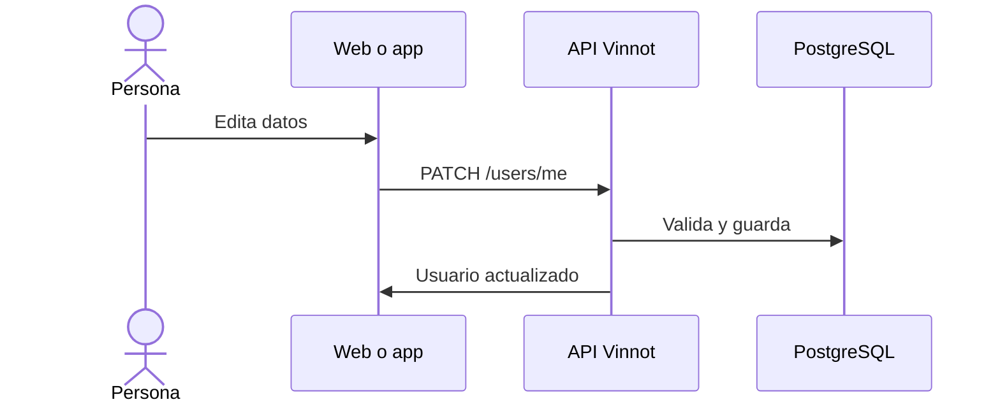

# UC-USR-14 · Editar los datos personales

| Campo | Valor |
|---|---|
| ID | `UC-USR-14` |
| Módulo | [Usuarios y cuenta](../README.md) |
| Plataformas | Web, APK |
| Actores | Usuario autenticado |
| IDs en Lucidchart | [WEB UC-ACC-02](https://lucid.app/lucidchart/9f11a16b-bb5a-42fc-a9e8-0852b17bd241/edit), [APK UC-ACC-02](https://lucid.app/lucidchart/e095dd25-e8ac-41ba-bf5b-396e1055f217/edit) |
| Requisitos | [`RF-WEB-USR-19`](../requirements.md), [`RF-APK-USR-21`](../requirements.md) |
| Casos de prueba | [`CP-USR-38`](../testing.md), [`CP-USR-39`](../testing.md), [`CP-USR-40`](../testing.md), [`CP-USR-41`](../testing.md) |

## Precondiciones

- Hay una sesión iniciada.

## Postcondiciones

- Usuario, nombres y teléfono quedan guardados.

## Flujo principal

1. La persona edita usuario, nombre, apellido o teléfono.
2. El cliente valida y envía `PATCH /users/me`.
3. La API normaliza el usuario y comprueba que esté libre si cambió, normaliza el teléfono a E.164 y guarda.
4. El cliente muestra el perfil actualizado.

## Flujos alternativos

- 3a. Usuario ocupado o inválido: no se guarda.
- 3b. Teléfono sin `+` y código de país, o inválido: no se guarda.
- 3c. Otra escritura guardó antes: `409 CONCURRENT_UPDATE`, sin pisar el cambio ajeno.

## Reglas de negocio

- Un campo ausente o `null` conserva su valor; un teléfono vacío lo borra.
- El email no se cambia acá (UC-USR-17).
- El teléfono es privado: no aparece en el perfil público.

## Diagrama

[Ver diagrama de «UC-USR-14 · Editar los datos personales» completo](https://images.vinnot.com/docs/diagrams/v1/es/modules-users-use-cases-uc-usr-14-edit-profile-67c9731dc141.svg)

Diagrama de componentes en Lucidchart: [WEB UC-ACC-02](https://lucid.app/lucidchart/9f11a16b-bb5a-42fc-a9e8-0852b17bd241/edit), [APK UC-ACC-02](https://lucid.app/lucidchart/e095dd25-e8ac-41ba-bf5b-396e1055f217/edit).

## Código

| Capa | Ubicación |
|---|---|
| Endpoints | `PATCH /users/me` |
| Backend | [`UserController.java`](../../../../../backend/src/main/java/com/vinnot/user/infrastructure/web/controller/UserController.java), [`UpdateUserProfileCommandHandler.java`](../../../../../backend/src/main/java/com/vinnot/user/application/command/handler/UpdateUserProfileCommandHandler.java) |
| Web | [`UserProfileProfileTab.tsx`](../../../../../frontend-react/src/presentation/pages/user/UserProfileProfileTab.tsx), [`useUserProfileViewModel.ts`](../../../../../frontend-react/src/presentation/pages/user/useUserProfileViewModel.ts), [`useUpdateProfile.ts`](../../../../../frontend-react/src/presentation/hooks/queries/user/useUpdateProfile.ts) |
| App | [`EditProfileSheet.tsx`](../../../../../frontend-mobile/src/presentation/features/user/EditProfileSheet.tsx) |

## Tests automáticos

- Backend: [`UpdateUserProfileCommandHandlerTest.java`](../../../../../backend/src/test/java/com/vinnot/user/application/command/handler/UpdateUserProfileCommandHandlerTest.java), [`UserTest.java`](../../../../../backend/src/test/java/com/vinnot/user/domain/model/UserTest.java), [`UserPersistenceMapperTest.java`](../../../../../backend/src/test/java/com/vinnot/user/infrastructure/persistence/mapper/UserPersistenceMapperTest.java)
- Web: [`contactPhone.test.ts`](../../../../../frontend-react/src/domain/user/contactPhone.test.ts), [`user.validators.test.ts`](../../../../../frontend-react/src/domain/user/user.validators.test.ts)
- App: [`contactPhone.test.ts`](../../../../../frontend-mobile/src/domain/user/contactPhone.test.ts)
