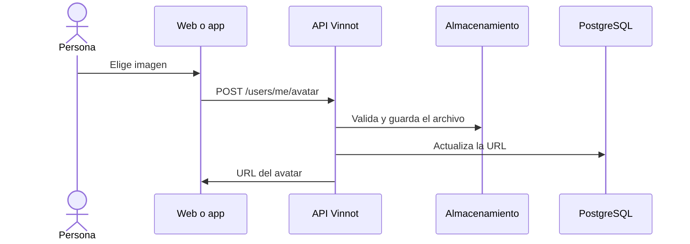

# UC-USR-15 · Cambiar el avatar

| Campo | Valor |
|---|---|
| ID | `UC-USR-15` |
| Módulo | [Usuarios y cuenta](../README.md) |
| Plataformas | Web, APK |
| Actores | Usuario autenticado |
| IDs en Lucidchart | [WEB UC-ACC-03](https://lucid.app/lucidchart/9f11a16b-bb5a-42fc-a9e8-0852b17bd241/edit), [APK UC-ACC-03](https://lucid.app/lucidchart/e095dd25-e8ac-41ba-bf5b-396e1055f217/edit) |
| Requisitos | [`RF-WEB-USR-20`](../requirements.md), [`RF-APK-USR-22`](../requirements.md) |
| Casos de prueba | [`CP-USR-42`](../testing.md), [`CP-USR-43`](../testing.md), [`CP-USR-44`](../testing.md), [`CP-USR-45`](../testing.md) |

## Precondiciones

- Hay una sesión iniciada.

## Postcondiciones

- El avatar nuevo queda guardado y el anterior se programa para borrar.

## Flujo principal

1. La persona elige una imagen: en la web un archivo (no se puede ingresar una URL), en la app la cámara o la galería.
2. La persona ajusta la foto en un marco cuadrado con máscara redonda (la arrastra y hace zoom) y confirma con **Usar foto**; el cliente recorta esa área en el dispositivo (#516).
3. El cliente sube la imagen recortada con `POST /users/me/avatar`.
4. La API valida tamaño, firma y formato, guarda el archivo y actualiza la URL del usuario.
5. Después de guardar, la API programa el borrado del avatar anterior.
6. El cliente muestra el avatar nuevo.

## Flujos alternativos

- 1a. En la app, la persona niega el permiso o cancela: se conserva el avatar actual.
- 2a. La persona cancela el ajuste: no se sube nada y se conserva el avatar actual.
- 4a. Archivo inválido: no se guarda nada.
- 4b. Falla la persistencia: se pide retirar el archivo nuevo y se informa el error.

## Reglas de negocio

- Las imágenes de usuario se guardan en R2 como WebP.
- Los borrados se encolan y el worker revalida referencias antes de borrar.

## Diagrama

[Ver diagrama de «UC-USR-15 · Cambiar el avatar» completo](https://images.vinnot.com/docs/diagrams/v1/es/modules-users-use-cases-uc-usr-15-change-avatar-834a792f4364.svg)

Diagrama de componentes en Lucidchart: [WEB UC-ACC-03](https://lucid.app/lucidchart/9f11a16b-bb5a-42fc-a9e8-0852b17bd241/edit), [APK UC-ACC-03](https://lucid.app/lucidchart/e095dd25-e8ac-41ba-bf5b-396e1055f217/edit).

## Código

| Capa | Ubicación |
|---|---|
| Endpoints | `POST /users/me/avatar` |
| Backend | [`UserController.java`](../../../../../backend/src/main/java/com/vinnot/user/infrastructure/web/controller/UserController.java), [`UploadUserAvatarCommandHandler.java`](../../../../../backend/src/main/java/com/vinnot/user/application/command/handler/UploadUserAvatarCommandHandler.java) |
| Web | [`useUserProfileViewModel.ts`](../../../../../frontend-react/src/presentation/pages/user/useUserProfileViewModel.ts), [`useUploadAvatar.ts`](../../../../../frontend-react/src/presentation/hooks/queries/user/useUploadAvatar.ts) |
| App | [`AvatarPickerSheet.tsx`](../../../../../frontend-mobile/src/presentation/features/user/AvatarPickerSheet.tsx), [`avatarSelection.service.ts`](../../../../../frontend-mobile/src/application/services/avatarSelection.service.ts), [`imagePicker.gateway.ts`](../../../../../frontend-mobile/src/infrastructure/device/imagePicker.gateway.ts) |

## Tests automáticos

- Backend: [`UploadUserAvatarCommandHandlerTest.java`](../../../../../backend/src/test/java/com/vinnot/user/application/command/handler/UploadUserAvatarCommandHandlerTest.java)
- Web: [`users.service.test.ts`](../../../../../frontend-react/src/application/services/users.service.test.ts)
- App: [`avatarSelection.service.test.ts`](../../../../../frontend-mobile/src/application/services/avatarSelection.service.test.ts), [`imagePicker.gateway.test.ts`](../../../../../frontend-mobile/src/infrastructure/device/imagePicker.gateway.test.ts)
