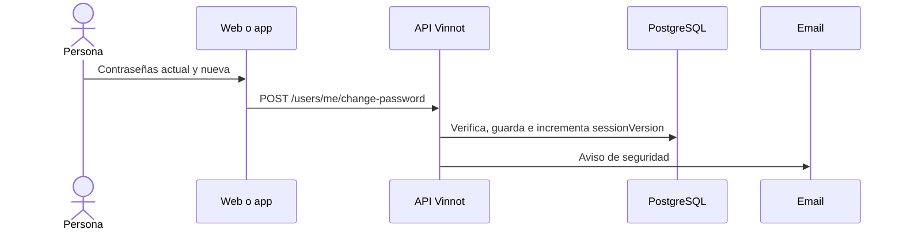

# UC-USR-16 · Cambiar o definir la contraseña

| Campo | Valor |
|---|---|
| ID | `UC-USR-16` |
| Módulo | [Usuarios y cuenta](../README.md) |
| Plataformas | Web, APK |
| Actores | Usuario autenticado, Servicio de email |
| IDs en Lucidchart | [WEB UC-ACC-04](https://lucid.app/lucidchart/9f11a16b-bb5a-42fc-a9e8-0852b17bd241/edit), [APK UC-ACC-04](https://lucid.app/lucidchart/e095dd25-e8ac-41ba-bf5b-396e1055f217/edit) |
| Requisitos | [`RF-WEB-USR-21`](../requirements.md), [`RF-APK-USR-23`](../requirements.md) |
| Casos de prueba | [`CP-USR-46`](../testing.md), [`CP-USR-47`](../testing.md), [`CP-USR-48`](../testing.md), [`CP-USR-68`](../testing.md) |

## Precondiciones

- Hay una sesión iniciada.

## Postcondiciones

- La contraseña cambia y las sesiones emitidas antes quedan revocadas; se avisa por email.

## Flujo principal

1. La persona ingresa la contraseña actual, la nueva y su confirmación.
2. La API compara la actual con la guardada, valida la nueva y guarda.
3. La API incrementa `sessionVersion` y encola el aviso de seguridad.

## Flujos alternativos

- 2a. Contraseña actual incorrecta: no cambia nada.
- 1a. La cuenta no tiene una contraseña propia (`hasPassword` falso, por ejemplo una cuenta creada con Google o Apple): en lugar del formulario se ofrece un enlace por email para definir la contraseña (usa `/auth/forgot-password`).
- 1b. La cuenta vinculó Google o Apple pero tiene una contraseña propia (`hasPassword` verdadero): se muestra el formulario de cambio, como en cualquier cuenta local.

## Reglas de negocio

- La contraseña nueva mide entre 8 y 100 caracteres y cumple la política de `Password`.

## Diagrama

[Ver diagrama de «UC-USR-16 · Cambiar o definir la contraseña» completo](https://images.vinnot.com/docs/diagrams/v1/es/modules-users-use-cases-uc-usr-16-change-password-c4ed052d20bc.svg)

Diagrama de componentes en Lucidchart: [WEB UC-ACC-04](https://lucid.app/lucidchart/9f11a16b-bb5a-42fc-a9e8-0852b17bd241/edit), [APK UC-ACC-04](https://lucid.app/lucidchart/e095dd25-e8ac-41ba-bf5b-396e1055f217/edit).

## Código

| Capa | Ubicación |
|---|---|
| Endpoints | `POST /users/me/change-password`, `POST /auth/forgot-password` |
| Backend | [`UserController.java`](../../../../../backend/src/main/java/com/vinnot/user/infrastructure/web/controller/UserController.java), [`ChangePasswordCommandHandler.java`](../../../../../backend/src/main/java/com/vinnot/user/application/command/handler/ChangePasswordCommandHandler.java), [`AccountSecurityNoticeService.java`](../../../../../backend/src/main/java/com/vinnot/user/application/service/AccountSecurityNoticeService.java) |
| Web | [`UserProfileSecurityTab.tsx`](../../../../../frontend-react/src/presentation/pages/user/UserProfileSecurityTab.tsx), [`useChangePassword.ts`](../../../../../frontend-react/src/presentation/hooks/queries/user/useChangePassword.ts), [`useRequestPasswordSetup.ts`](../../../../../frontend-react/src/presentation/hooks/queries/user/useRequestPasswordSetup.ts) |
| App | [`ProfileScreen.tsx`](../../../../../frontend-mobile/src/presentation/features/profile/ProfileScreen.tsx), [`ChangePasswordSheet.tsx`](../../../../../frontend-mobile/src/presentation/features/user/ChangePasswordSheet.tsx) |

## Tests automáticos

- Backend: [`ChangePasswordCommandHandlerTest.java`](../../../../../backend/src/test/java/com/vinnot/user/application/command/handler/ChangePasswordCommandHandlerTest.java), [`AccountSecurityNoticeServiceTest.java`](../../../../../backend/src/test/java/com/vinnot/user/application/service/AccountSecurityNoticeServiceTest.java), [`UserTest.java`](../../../../../backend/src/test/java/com/vinnot/user/domain/model/UserTest.java), [`UserPasswordSetMigrationPostgresIntegrationTest.java`](../../../../../backend/src/test/java/com/vinnot/user/infrastructure/persistence/UserPasswordSetMigrationPostgresIntegrationTest.java)
- Web: [`UserProfileTabs.test.tsx`](../../../../../frontend-react/src/presentation/pages/user/UserProfileTabs.test.tsx), [`user.mappers.test.ts`](../../../../../frontend-react/src/domain/user/user.mappers.test.ts)
- App: [`profileRoute.test.tsx`](../../../../../frontend-mobile/src/presentation/features/profile/__tests__/profileRoute.test.tsx)
