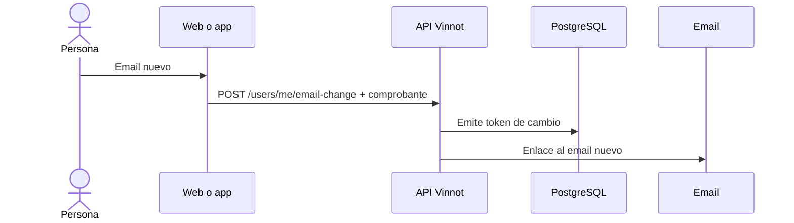

# UC-USR-17 · Solicitar el cambio de email

| Campo | Valor |
|---|---|
| ID | `UC-USR-17` |
| Módulo | [Usuarios y cuenta](../README.md) |
| Plataformas | Web, APK |
| Actores | Usuario autenticado, Servicio de email |
| IDs en Lucidchart | [WEB UC-ACC-05](https://lucid.app/lucidchart/9f11a16b-bb5a-42fc-a9e8-0852b17bd241/edit), [APK UC-ACC-05](https://lucid.app/lucidchart/e095dd25-e8ac-41ba-bf5b-396e1055f217/edit) |
| Requisitos | [`RF-WEB-USR-22`](../requirements.md), [`RF-APK-USR-24`](../requirements.md) |
| Casos de prueba | [`CP-USR-49`](../testing.md), [`CP-USR-50`](../testing.md) |

## Precondiciones

- Hay una sesión iniciada.

## Postcondiciones

- Se envía un enlace de confirmación al email nuevo; el email actual sigue vigente hasta confirmar.

## Flujo principal

1. La persona ingresa el email nuevo.
2. La API pide confirmar la identidad (UC-USR-12).
3. La API valida que el email sea válido, distinto y libre, emite el token y encola el email.
4. El cliente informa que hay que confirmar desde el email nuevo (UC-USR-11).

## Flujos alternativos

- 3a. Email inválido, igual al actual o ya registrado: no se envía nada.

## Reglas de negocio

- Actualizar el campo no verifica el email: la identidad cambia recién al confirmar.

## Diagrama

[Ver diagrama de «UC-USR-17 · Solicitar el cambio de email» completo](https://images.vinnot.com/docs/diagrams/v1/es/modules-users-use-cases-uc-usr-17-request-email-change-7642240068e2.svg)

Diagrama de componentes en Lucidchart: [WEB UC-ACC-05](https://lucid.app/lucidchart/9f11a16b-bb5a-42fc-a9e8-0852b17bd241/edit), [APK UC-ACC-05](https://lucid.app/lucidchart/e095dd25-e8ac-41ba-bf5b-396e1055f217/edit).

## Código

| Capa | Ubicación |
|---|---|
| Endpoints | `POST /users/me/email-change` |
| Backend | [`UserController.java`](../../../../../backend/src/main/java/com/vinnot/user/infrastructure/web/controller/UserController.java), [`RequestEmailChangeCommandHandler.java`](../../../../../backend/src/main/java/com/vinnot/user/application/command/handler/RequestEmailChangeCommandHandler.java) |
| Web | [`useUserProfileViewModel.ts`](../../../../../frontend-react/src/presentation/pages/user/useUserProfileViewModel.ts), [`useRequestEmailChange.ts`](../../../../../frontend-react/src/presentation/hooks/queries/user/useRequestEmailChange.ts), [`emailChangeErrorMessage.ts`](../../../../../frontend-react/src/presentation/feedback/emailChangeErrorMessage.ts) |
| App | [`ProfileScreen.tsx`](../../../../../frontend-mobile/src/presentation/features/profile/ProfileScreen.tsx), [`AccountSheet.tsx`](../../../../../frontend-mobile/src/presentation/features/user/AccountSheet.tsx) |

## Tests automáticos

- Backend: [`EmailChangeCommandHandlersTest.java`](../../../../../backend/src/test/java/com/vinnot/user/application/command/handler/EmailChangeCommandHandlersTest.java)
- Web: [`emailChangeErrorMessage.test.ts`](../../../../../frontend-react/src/presentation/feedback/emailChangeErrorMessage.test.ts), [`users.service.test.ts`](../../../../../frontend-react/src/application/services/users.service.test.ts)
- App: [`profileRoute.test.tsx`](../../../../../frontend-mobile/src/presentation/features/profile/__tests__/profileRoute.test.tsx)
