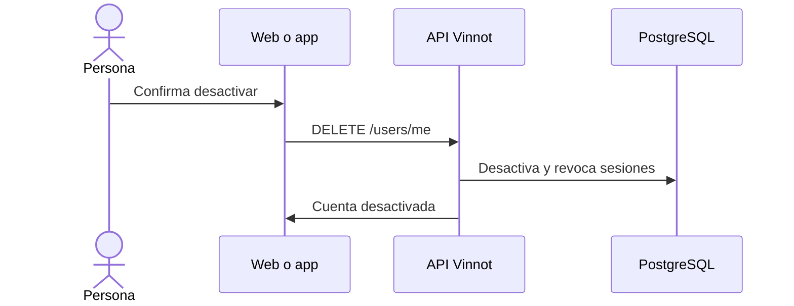

# UC-USR-18 · Desactivar la cuenta

| Campo | Valor |
|---|---|
| ID | `UC-USR-18` |
| Módulo | [Usuarios y cuenta](../README.md) |
| Plataformas | Web, APK |
| Actores | Usuario autenticado |
| IDs en Lucidchart | [WEB UC-ACC-06](https://lucid.app/lucidchart/9f11a16b-bb5a-42fc-a9e8-0852b17bd241/edit), [APK UC-ACC-06](https://lucid.app/lucidchart/e095dd25-e8ac-41ba-bf5b-396e1055f217/edit) |
| Requisitos | [`RF-WEB-USR-23`](../requirements.md), [`RF-APK-USR-25`](../requirements.md) |
| Casos de prueba | [`CP-USR-51`](../testing.md), [`CP-USR-52`](../testing.md), [`CP-USR-53`](../testing.md) |

## Precondiciones

- Hay una sesión iniciada.

## Postcondiciones

- La cuenta queda inactiva, sus sesiones y dispositivos push se borran y se envía un aviso.

## Flujo principal

1. La persona elige desactivar y confirma.
2. La API comprueba que no sea el último administrador activo.
3. La API desactiva la cuenta, borra los tokens de renovación y los dispositivos push.
4. El cliente cierra la sesión.

## Flujos alternativos

- 2a. Es el último administrador activo: `422 LAST_ADMIN`.
- R1. La persona vuelve a iniciar sesión: en la web o en la app puede reactivar la cuenta (UC-USR-03, 3c).

## Reglas de negocio

- Desactivar es reversible y no borra datos.

## Diagrama

[Ver diagrama de «UC-USR-18 · Desactivar la cuenta» completo](https://images.vinnot.com/docs/diagrams/v1/es/modules-users-use-cases-uc-usr-18-deactivate-account-c2f8a8889fea.svg)

Diagrama de componentes en Lucidchart: [WEB UC-ACC-06](https://lucid.app/lucidchart/9f11a16b-bb5a-42fc-a9e8-0852b17bd241/edit), [APK UC-ACC-06](https://lucid.app/lucidchart/e095dd25-e8ac-41ba-bf5b-396e1055f217/edit).

## Código

| Capa | Ubicación |
|---|---|
| Endpoints | `DELETE /users/me` |
| Backend | [`UserController.java`](../../../../../backend/src/main/java/com/vinnot/user/infrastructure/web/controller/UserController.java), [`DeactivateOwnAccountCommandHandler.java`](../../../../../backend/src/main/java/com/vinnot/user/application/command/handler/DeactivateOwnAccountCommandHandler.java), [`AdminUserSafety.java`](../../../../../backend/src/main/java/com/vinnot/user/application/service/AdminUserSafety.java) |
| Web | [`useUserProfileViewModel.ts`](../../../../../frontend-react/src/presentation/pages/user/useUserProfileViewModel.ts), [`useDeactivateAccount.ts`](../../../../../frontend-react/src/presentation/hooks/queries/user/useDeactivateAccount.ts) |
| App | [`ProfileScreen.tsx`](../../../../../frontend-mobile/src/presentation/features/profile/ProfileScreen.tsx) |

## Tests automáticos

- Backend: [`DeactivateOwnAccountCommandHandlerTest.java`](../../../../../backend/src/test/java/com/vinnot/user/application/command/handler/DeactivateOwnAccountCommandHandlerTest.java), [`AdminUserSafetyTest.java`](../../../../../backend/src/test/java/com/vinnot/user/application/service/AdminUserSafetyTest.java), [`AccountActionCommandHandlersTest.java`](../../../../../backend/src/test/java/com/vinnot/user/application/command/handler/AccountActionCommandHandlersTest.java)
- Web: [`useLoginViewModel.test.tsx`](../../../../../frontend-react/src/presentation/pages/public/useLoginViewModel.test.tsx)
- App: [`profileRoute.test.tsx`](../../../../../frontend-mobile/src/presentation/features/profile/__tests__/profileRoute.test.tsx), [`loginRoute.test.tsx`](../../../../../frontend-mobile/src/presentation/features/auth/__tests__/loginRoute.test.tsx)
