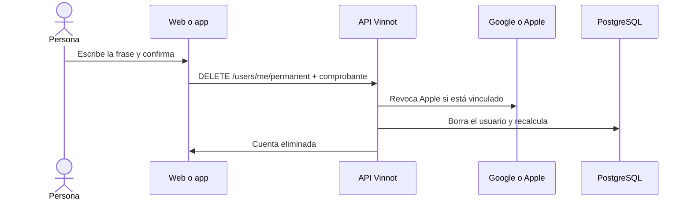

# UC-USR-19 · Eliminar la cuenta definitivamente

| Campo | Valor |
|---|---|
| ID | `UC-USR-19` |
| Módulo | [Usuarios y cuenta](../README.md) |
| Plataformas | Web, APK |
| Actores | Usuario autenticado, Proveedor de identidad (Google o Apple) |
| IDs en Lucidchart | [WEB UC-ACC-07](https://lucid.app/lucidchart/9f11a16b-bb5a-42fc-a9e8-0852b17bd241/edit), [APK UC-ACC-07](https://lucid.app/lucidchart/e095dd25-e8ac-41ba-bf5b-396e1055f217/edit) |
| Requisitos | [`RF-WEB-USR-24`](../requirements.md), [`RF-WEB-USR-25`](../requirements.md), [`RF-WEB-USR-26`](../requirements.md), [`RF-APK-USR-26`](../requirements.md), [`RF-APK-USR-27`](../requirements.md), [`RF-APK-USR-28`](../requirements.md) |
| Casos de prueba | [`CP-USR-54`](../testing.md), [`CP-USR-55`](../testing.md), [`CP-USR-56`](../testing.md), [`CP-USR-57`](../testing.md), [`CP-USR-69`](../testing.md) |

## Precondiciones

- Hay una sesión iniciada.

## Postcondiciones

- La cuenta y sus datos se borran; las relaciones se resuelven por las claves foráneas y se recalculan puntajes, likes y cupos.

## Flujo principal

1. La persona elige eliminar y escribe la frase exacta («acepto borrar cuenta» o «I agree to delete my account»).
2. Si tiene Apple vinculado, autoriza de nuevo con Apple.
3. La API pide confirmar la identidad (UC-USR-12).
4. En una sola transacción, la API rechaza al último administrador, revoca Apple cuando está vinculado y borra el usuario.
5. El cliente cierra la sesión y borra los datos locales.

## Flujos alternativos

- 1a. La frase no coincide (solo se ignoran espacios al inicio y al final): no se puede enviar.
- 4a. Falta la autorización de Apple o la revocación falla: `APPLE_REAUTH_REQUIRED` y la cuenta no se borra.
- 4b. Es el último administrador activo: `422 LAST_ADMIN`.
- 4c. Organiza un evento no cancelado ni terminado con inscripciones pagas o en pago: `422 ORGANIZER_HAS_UPCOMING_PAID_EVENTS`; web y app piden cancelar esos eventos primero y la cuenta no se borra.

## Reglas de negocio

- Cerrar el diálogo reinicia la frase.
- La limpieza de imágenes se encola y el worker verifica referencias antes de borrar.
- La evidencia privada de moderación se conserva 90 días desde el cierre.
- Los puntos de la cuenta se borran; los likes que dio no se descuentan a quienes los recibieron ([Puntos y sellos](../../gamification/README.md)).
- Borrar la cuenta no borra sus pagos: los intentos de pago, observaciones y devoluciones en los que la persona fue comprador u organizador se conservan como historial financiero de la operación, sin vínculo a la cuenta (V77); su cuenta de cobro de Mercado Pago sí se borra ([Pagos](../../payments/architecture.md)). Por eso un organizador no puede borrar la cuenta mientras tenga eventos próximos con entradas pagas o en pago: cancelar el evento dispara el reintegro de cada pago acreditado, y sin la cuenta de cobro ese reintegro ya no sería posible.

## Diagrama

[Ver diagrama de «UC-USR-19 · Eliminar la cuenta definitivamente» completo](https://images.vinnot.com/docs/diagrams/v1/es/modules-users-use-cases-uc-usr-19-delete-account-a13bff383a53.svg)

Diagrama de componentes en Lucidchart: [WEB UC-ACC-07](https://lucid.app/lucidchart/9f11a16b-bb5a-42fc-a9e8-0852b17bd241/edit), [APK UC-ACC-07](https://lucid.app/lucidchart/e095dd25-e8ac-41ba-bf5b-396e1055f217/edit).

## Código

| Capa | Ubicación |
|---|---|
| Endpoints | `DELETE /users/me/permanent` |
| Backend | [`UserController.java`](../../../../../backend/src/main/java/com/vinnot/user/infrastructure/web/controller/UserController.java), [`DeleteOwnAccountCommandHandler.java`](../../../../../backend/src/main/java/com/vinnot/user/application/command/handler/DeleteOwnAccountCommandHandler.java), [`AccountDeletionIntegrity.java`](../../../../../backend/src/main/java/com/vinnot/user/infrastructure/persistence/adapter/AccountDeletionIntegrity.java) |
| Web | [`useUserProfileViewModel.ts`](../../../../../frontend-react/src/presentation/pages/user/useUserProfileViewModel.ts), [`useDeleteAccount.ts`](../../../../../frontend-react/src/presentation/hooks/queries/user/useDeleteAccount.ts) |
| App | [`DeleteAccountDialog.tsx`](../../../../../frontend-mobile/src/presentation/features/user/DeleteAccountDialog.tsx), [`usePermanentAccountDeletion.ts`](../../../../../frontend-mobile/src/presentation/features/user/usePermanentAccountDeletion.ts) |

## Tests automáticos

- Backend: [`DeleteOwnAccountCommandHandlerTest.java`](../../../../../backend/src/test/java/com/vinnot/user/application/command/handler/DeleteOwnAccountCommandHandlerTest.java), [`AppleAuthorizationRevocationAdapterTest.java`](../../../../../backend/src/test/java/com/vinnot/user/infrastructure/identity/AppleAuthorizationRevocationAdapterTest.java)
- Web: [`socialAuth.service.test.ts`](../../../../../frontend-react/src/application/services/socialAuth.service.test.ts)
- App: [`DeleteAccountDialog.test.tsx`](../../../../../frontend-mobile/src/presentation/features/user/DeleteAccountDialog.test.tsx), [`usePermanentAccountDeletion.test.tsx`](../../../../../frontend-mobile/src/presentation/features/user/usePermanentAccountDeletion.test.tsx)
