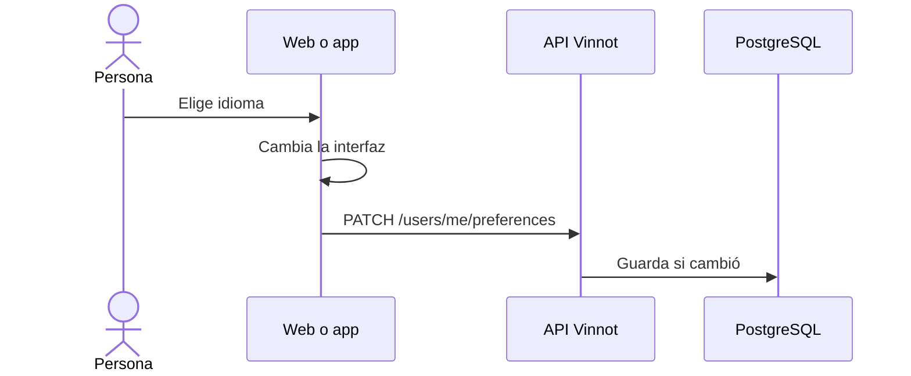

# UC-USR-20 · Cambiar el idioma

| Campo | Valor |
|---|---|
| ID | `UC-USR-20` |
| Módulo | [Usuarios y cuenta](../README.md) |
| Plataformas | Web, APK |
| Actores | Usuario autenticado |
| IDs en Lucidchart | [WEB UC-ACC-08](https://lucid.app/lucidchart/9f11a16b-bb5a-42fc-a9e8-0852b17bd241/edit), [APK UC-ACC-08](https://lucid.app/lucidchart/e095dd25-e8ac-41ba-bf5b-396e1055f217/edit) |
| Requisitos | [`RF-WEB-USR-27`](../requirements.md), [`RF-APK-USR-29`](../requirements.md) |
| Casos de prueba | [`CP-USR-58`](../testing.md), [`CP-USR-59`](../testing.md), [`CP-USR-60`](../testing.md) |

## Precondiciones

- Ninguna para cambiar el idioma de la interfaz; la sincronización con la cuenta requiere sesión.

## Postcondiciones

- La interfaz cambia de idioma y, con sesión, la cuenta guarda el idioma y la zona horaria del dispositivo.

## Flujo principal

1. La persona elige español o inglés.
2. El cliente cambia el idioma y lo guarda localmente.
3. Con sesión, el cliente envía `PATCH /users/me/preferences` con idioma y zona horaria.
4. La API valida y guarda solo si algo cambió.

## Flujos alternativos

- 3a. La sincronización falla: la interfaz igual cambia; nunca bloquea el uso.
- 4a. Idioma o zona inválidos: `400 INVALID_PREFERRED_LANGUAGE` o `INVALID_TIMEZONE`.

## Reglas de negocio

- Idiomas: `es` o `en`; zona horaria: identificador IANA. Sin elección guardada: `es` y `America/Argentina/Buenos_Aires`.
- El cliente también sincroniza después de cada login o restauración de sesión.
- Ese idioma y zona son los que usan las notificaciones de la cuenta.
- El texto libre del catálogo y de los usuarios no se traduce.

## Diagrama

[Ver diagrama de «UC-USR-20 · Cambiar el idioma» completo](https://images.vinnot.com/docs/diagrams/v1/es/modules-users-use-cases-uc-usr-20-change-language-6a2a504b14d0.svg)

Diagrama de componentes en Lucidchart: [WEB UC-ACC-08](https://lucid.app/lucidchart/9f11a16b-bb5a-42fc-a9e8-0852b17bd241/edit), [APK UC-ACC-08](https://lucid.app/lucidchart/e095dd25-e8ac-41ba-bf5b-396e1055f217/edit).

## Código

| Capa | Ubicación |
|---|---|
| Endpoints | `PATCH /users/me/preferences` |
| Backend | [`UserController.java`](../../../../../backend/src/main/java/com/vinnot/user/infrastructure/web/controller/UserController.java), [`UpdateUserPreferencesCommandHandler.java`](../../../../../backend/src/main/java/com/vinnot/user/application/command/handler/UpdateUserPreferencesCommandHandler.java) |
| Web | [`AppHeader.tsx`](../../../../../frontend-react/src/presentation/components/layout/AppHeader.tsx), [`AccountLocaleSync.tsx`](../../../../../frontend-react/src/app/providers/AccountLocaleSync.tsx), [`useAccountLocaleSync.ts`](../../../../../frontend-react/src/presentation/hooks/useAccountLocaleSync.ts) |
| App | [`LanguageSheet.tsx`](../../../../../frontend-mobile/src/presentation/features/user/LanguageSheet.tsx), [`LanguagePreferenceProvider.tsx`](../../../../../frontend-mobile/src/presentation/providers/LanguagePreferenceProvider.tsx), [`AccountLocaleSync.tsx`](../../../../../frontend-mobile/src/presentation/providers/AccountLocaleSync.tsx) |

## Tests automáticos

- Backend: [`UpdateUserPreferencesCommandHandlerTest.java`](../../../../../backend/src/test/java/com/vinnot/user/application/command/handler/UpdateUserPreferencesCommandHandlerTest.java), [`UserPreferencesHttpPostgresIntegrationTest.java`](../../../../../backend/src/test/java/com/vinnot/user/infrastructure/web/UserPreferencesHttpPostgresIntegrationTest.java), [`PreferredLanguageTest.java`](../../../../../backend/src/test/java/com/vinnot/user/domain/valueobject/PreferredLanguageTest.java), [`UserTimezoneTest.java`](../../../../../backend/src/test/java/com/vinnot/user/domain/valueobject/UserTimezoneTest.java)
- Web: [`useAccountLocaleSync.test.tsx`](../../../../../frontend-react/src/presentation/hooks/useAccountLocaleSync.test.tsx), [`i18n.test.ts`](../../../../../frontend-react/src/shared/i18n/i18n.test.ts)
- App: [`useAccountLocaleSync.test.tsx`](../../../../../frontend-mobile/src/presentation/hooks/useAccountLocaleSync.test.tsx), [`LanguagePreferenceProvider.test.tsx`](../../../../../frontend-mobile/src/presentation/providers/LanguagePreferenceProvider.test.tsx)
