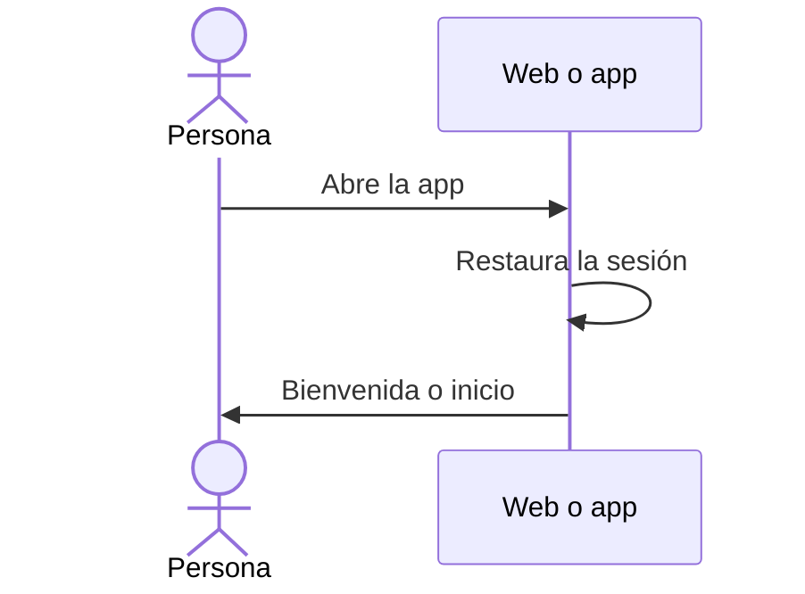

# UC-USR-21 · Abrir la app y ver la bienvenida

| Campo | Valor |
|---|---|
| ID | `UC-USR-21` |
| Módulo | [Usuarios y cuenta](../README.md) |
| Plataformas | APK |
| Actores | Visitante |
| IDs en Lucidchart | [APK UC-AUTH-01](https://lucid.app/lucidchart/e095dd25-e8ac-41ba-bf5b-396e1055f217/edit) |
| Requisitos | [`RF-APK-USR-30`](../requirements.md) |
| Casos de prueba | [`CP-USR-61`](../testing.md) |

## Precondiciones

- La app está instalada.

## Postcondiciones

- La persona ve la bienvenida o, si tiene sesión, el inicio.

## Flujo principal

1. La app muestra la pantalla de lanzamiento mientras restaura la sesión (UC-USR-06).
2. Sin sesión, abre la bienvenida con acceso a iniciar sesión y registrarse.
3. Con sesión, abre el inicio.

## Flujos alternativos

No tiene.

## Reglas de negocio

- La decisión espera a que termine la restauración; no redirige antes.

## Diagrama

[Ver diagrama de «UC-USR-21 · Abrir la app y ver la bienvenida» completo](https://images.vinnot.com/docs/diagrams/v1/es/modules-users-use-cases-uc-usr-21-welcome-b1dc8edfec1f.svg)

Diagrama de componentes en Lucidchart: [APK UC-AUTH-01](https://lucid.app/lucidchart/e095dd25-e8ac-41ba-bf5b-396e1055f217/edit).

## Código

| Capa | Ubicación |
|---|---|
| App | [`index.tsx`](../../../../../frontend-mobile/app/index.tsx), [`VinnotLaunchScreen.tsx`](../../../../../frontend-mobile/src/presentation/features/auth/VinnotLaunchScreen.tsx), `frontend-mobile/app/(onboarding)/welcome.tsx` |

## Tests automáticos

- Backend: Ninguno
- Web: Ninguno
- App: [`welcomeRoute.test.tsx`](../../../../../frontend-mobile/src/presentation/features/auth/__tests__/welcomeRoute.test.tsx), [`startupRoutes.test.tsx`](../../../../../frontend-mobile/src/presentation/features/auth/__tests__/startupRoutes.test.tsx)
