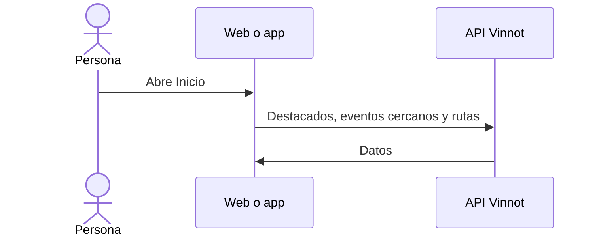

# UC-USR-22 · Ver el inicio

| Campo | Valor |
|---|---|
| ID | `UC-USR-22` |
| Módulo | [Usuarios y cuenta](../README.md) |
| Plataformas | Web, APK |
| Actores | Usuario autenticado |
| IDs en Lucidchart | [APK UC-HOME-01](https://lucid.app/lucidchart/e095dd25-e8ac-41ba-bf5b-396e1055f217/edit) |
| Requisitos | [`RF-WEB-USR-28`](../requirements.md), [`RF-APK-USR-31`](../requirements.md), [`RF-APK-USR-32`](../requirements.md), [`RF-APK-USR-33`](../requirements.md), [`RF-APK-USR-34`](../requirements.md) |
| Casos de prueba | [`CP-USR-62`](../testing.md), [`CP-USR-63`](../testing.md), [`CP-USR-64`](../testing.md) |

## Precondiciones

- Hay una sesión iniciada, con términos aceptados y onboarding completo.

## Postcondiciones

- Se muestra el inicio con accesos de descubrimiento.

## Flujo principal

1. La persona abre Inicio.
2. La app pide los vinos destacados (hasta cuatro), los eventos cercanos (hasta tres, con ubicación) y vistas previas de rutas (hasta tres).
3. La persona entra a un tipo, una cepa, el escáner, la cava, un evento o una ruta.

## Flujos alternativos

- 2a. Sin permiso de ubicación: no se muestran eventos cercanos.
- R1. Deslizar hacia abajo recarga las secciones.

## Reglas de negocio

- En la web, el inicio presenta Vinnot y ofrece explorar tipos, cepas, vinos, eventos y rutas; abrir una función protegida lleva al login.
- Los datos vienen de los módulos de vinos, eventos y rutas.
- En la app, las cepas populares se pintan con un degradé del color de su vino ([`grapeColors.ts`](../../../../../frontend-mobile/src/presentation/features/home/grapeColors.ts)), con texto blanco cuando la píldora es oscura; una cepa sin paleta usa la píldora neutra. Las cuatro tarjetas de «Todo lo que necesitás para descubrir vinos» abren Vinos, el escáner, Eventos y Rutas.

## Diagrama

[Ver diagrama de «UC-USR-22 · Ver el inicio» completo](https://images.vinnot.com/docs/diagrams/v1/es/modules-users-use-cases-uc-usr-22-home-cda51476f7fd.svg)

Diagrama de componentes en Lucidchart: [APK UC-HOME-01](https://lucid.app/lucidchart/e095dd25-e8ac-41ba-bf5b-396e1055f217/edit).

## Código

| Capa | Ubicación |
|---|---|
| Web | [`HomePage.tsx`](../../../../../frontend-react/src/presentation/pages/public/HomePage.tsx), [`useHomeViewModel.ts`](../../../../../frontend-react/src/presentation/pages/public/useHomeViewModel.ts) |
| App | `frontend-mobile/app/(app)/(tabs)/home.tsx`, [`HomeScreenView.tsx`](../../../../../frontend-mobile/src/presentation/features/home/HomeScreenView.tsx) |

## Tests automáticos

- Backend: Ninguno
- Web: Ninguno
- App: [`home-highlights.test.tsx`](../../../../../frontend-mobile/src/test/integration/home-highlights.test.tsx)
