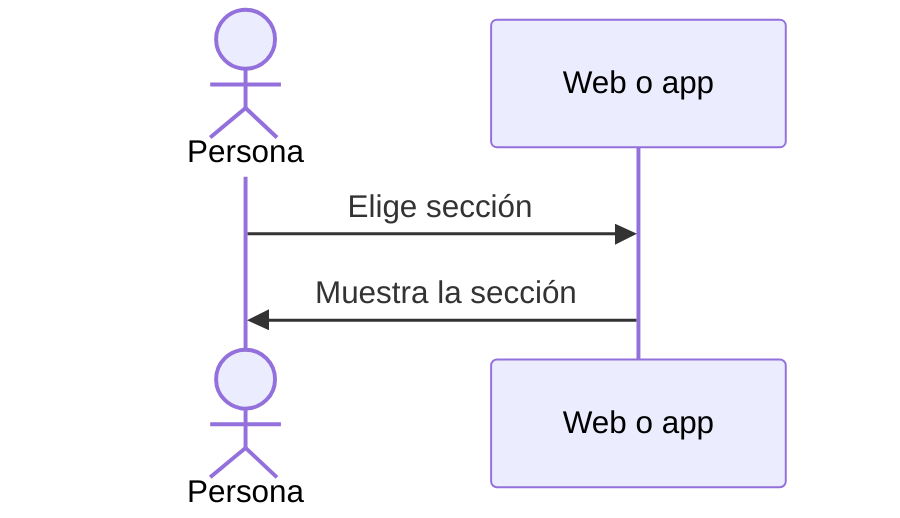

# UC-USR-23 · Navegar por la aplicación

| Campo | Valor |
|---|---|
| ID | `UC-USR-23` |
| Módulo | [Usuarios y cuenta](../README.md) |
| Plataformas | Web, APK |
| Actores | Usuario autenticado |
| IDs en Lucidchart | [APK UC-HOME-02](https://lucid.app/lucidchart/e095dd25-e8ac-41ba-bf5b-396e1055f217/edit) |
| Requisitos | [`RF-WEB-USR-29`](../requirements.md), [`RF-WEB-USR-30`](../requirements.md), [`RF-APK-USR-35`](../requirements.md) |
| Casos de prueba | [`CP-USR-65`](../testing.md), [`CP-USR-66`](../testing.md) |

## Precondiciones

- Hay una sesión iniciada.

## Postcondiciones

- La persona llega a la sección elegida.

## Flujo principal

1. En la app, la barra inferior ofrece Inicio, Vinos, Eventos, Rutas y Perfil.
2. En la web, la cabecera, el menú y el pie ofrecen las secciones del producto, el perfil, la cava, el idioma y las páginas públicas.
3. La persona elige una sección.

## Flujos alternativos

- 3a. Volver a tocar Vinos en la app vuelve al catálogo, sin dejar un detalle anterior abierto.

## Reglas de negocio

- Las acciones de administración y partner aparecen según el rol.
- En la web, cambiar de página vuelve el scroll arriba.

## Diagrama

[Ver diagrama de «UC-USR-23 · Navegar por la aplicación» completo](https://images.vinnot.com/docs/diagrams/v1/es/modules-users-use-cases-uc-usr-23-navigate-b6ace1a8cad1.svg)

Diagrama de componentes en Lucidchart: [APK UC-HOME-02](https://lucid.app/lucidchart/e095dd25-e8ac-41ba-bf5b-396e1055f217/edit).

## Código

| Capa | Ubicación |
|---|---|
| Web | [`AppHeader.tsx`](../../../../../frontend-react/src/presentation/components/layout/AppHeader.tsx), [`App.tsx`](../../../../../frontend-react/src/app/App.tsx) |
| App | `frontend-mobile/app/(app)/(tabs)/_layout.tsx`, [`tabNavigation.ts`](../../../../../frontend-mobile/src/presentation/navigation/tabNavigation.ts) |

## Tests automáticos

- Backend: Ninguno
- Web: Ninguno
- App: [`tabNavigation.test.tsx`](../../../../../frontend-mobile/src/presentation/navigation/tabNavigation.test.tsx), [`discoveryNavigation.test.ts`](../../../../../frontend-mobile/src/presentation/navigation/__tests__/discoveryNavigation.test.ts)
