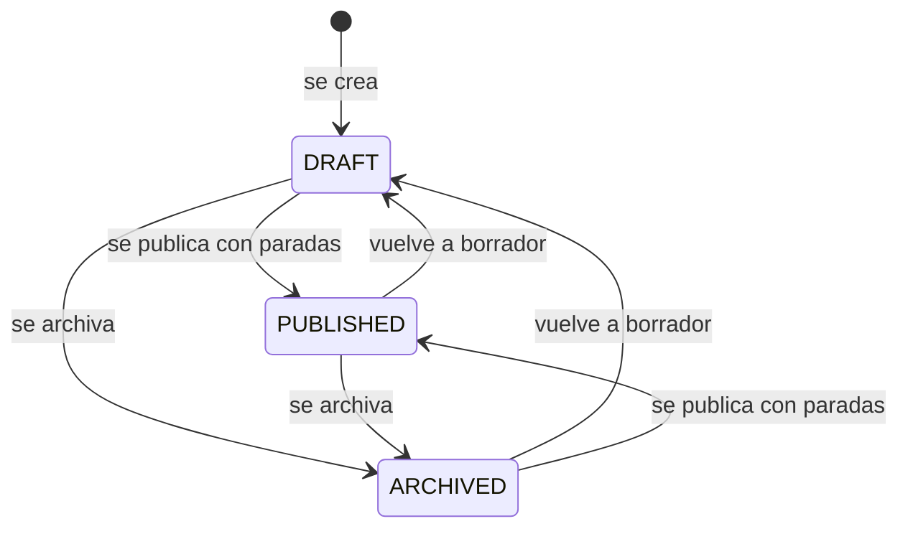
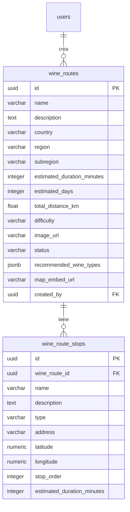

# Rutas del vino

Itinerarios turísticos curados: una ruta tiene región, largo, duración, distancia, tipos
de vino recomendados, portada y una lista ordenada de paradas. Quien tiene sesión
recorre el catálogo, abre una ruta, navega sus paradas en mapas y la comparte o
denuncia. Las rutas las cargan operadores de turismo y el equipo de Vinnot; su gestión
desde el panel está en [Administración](../admin/README.md).

- Código del módulo: `RTE`.
- Backend: paquete [`wineroute`](../../../../backend/src/main/java/com/vinnot/wineroute/).
- [Casos de uso](use-cases/README.md) · [Requisitos](requirements.md) ·
  [Arquitectura](architecture.md) · [Pruebas](testing.md)

## Actores

| Actor | Qué hace en este módulo |
|---|---|
| Usuario autenticado | Recorre y filtra rutas, abre el detalle, navega paradas, comparte y denuncia |
| Operador de turismo, moderador o administrador | Crea rutas y agrega paradas a las propias |
| Google Maps | Calcula distancia y duración entre paradas con coordenadas |

## Reglas de negocio

| Regla | Detalle | Dónde |
|---|---|---|
| Visibilidad | Toda lectura exige sesión; terceros solo ven rutas publicadas, y quien la creó y el equipo también ven borradores y archivadas | [`GetWineRouteByIdQueryHandler.java`](../../../../backend/src/main/java/com/vinnot/wineroute/application/query/handler/GetWineRouteByIdQueryHandler.java) |
| Alta | Nombre y creador obligatorios; toda ruta nace en `DRAFT` | [`WineRoute.java`](../../../../backend/src/main/java/com/vinnot/wineroute/domain/model/WineRoute.java) |
| Publicación | No se publica una ruta sin paradas (`CANNOT_PUBLISH`) | [`WineRoute.java`](../../../../backend/src/main/java/com/vinnot/wineroute/domain/model/WineRoute.java) |
| Orden de paradas | Al quitar una parada se renumeran desde 1 sin huecos | [`WineRoute.java`](../../../../backend/src/main/java/com/vinnot/wineroute/domain/model/WineRoute.java) |
| Largo | `SHORT`, `MEDIUM` o `LONG` | [`RouteDifficulty.java`](../../../../backend/src/main/java/com/vinnot/wineroute/domain/valueobject/RouteDifficulty.java) |
| Distancia | Con dos o más paradas con coordenadas se calcula con mapas; si falla, se conserva la informada | [`CreateWineRouteCommandHandler.java`](../../../../backend/src/main/java/com/vinnot/wineroute/application/command/handler/CreateWineRouteCommandHandler.java) |
| Propiedad | Agregar paradas a una ruta ajena exige el permiso global (`WINE_ROUTE_OWNERSHIP`) | [`AddRouteStopCommandHandler.java`](../../../../backend/src/main/java/com/vinnot/wineroute/application/command/handler/AddRouteStopCommandHandler.java) |
| Bodegas de las paradas | Las paradas de tipo bodega se vinculan por nombre exacto con bodegas activas; si no coincide, la ruta se muestra igual | [`WineryQueryAdapter.java`](../../../../backend/src/main/java/com/vinnot/wineroute/infrastructure/persistence/adapter/WineryQueryAdapter.java) |

## Estados de una ruta

[Ver diagrama de «Estados de una ruta» completo](https://images.vinnot.com/docs/diagrams/v1/es/modules-wine-routes-readme-13bc8abd49a4.svg)

## Dónde vive

| Parte | Ubicación |
|---|---|
| API | [`WineRouteController`](../../../../backend/src/main/java/com/vinnot/wineroute/infrastructure/web/controller/WineRouteController.java) bajo `/wine-routes` y `WineRouteAdminController` bajo `/admin/routes` |
| Web | [`pages/wine-routes`](../../../../frontend-react/src/presentation/pages/wine-routes/) en `/wine-routes` y `/wine-routes/:id` |
| App | Pestaña Rutas en `frontend-mobile/app/(app)/(tabs)/routes` y pantallas en [`features/wineRoute`](../../../../frontend-mobile/src/presentation/features/wineRoute/) |

## Datos

[Ver diagrama de «Rutas del vino · Datos» completo](https://images.vinnot.com/docs/diagrams/v1/es/modules-wine-routes-readme-eb13a64686a1.svg)

Las paradas se borran en cascada con su ruta, y las rutas con el usuario que las creó.
La columna `difficulty` guarda el largo de la ruta.
