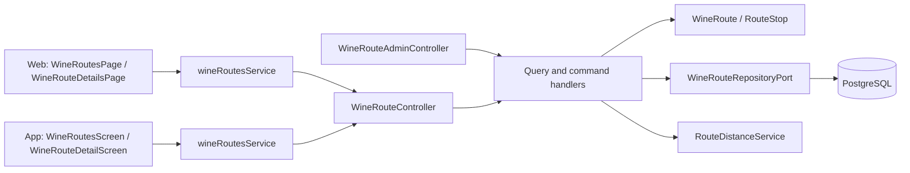
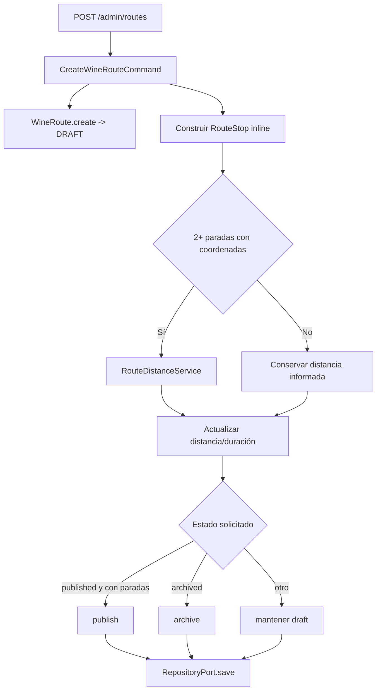
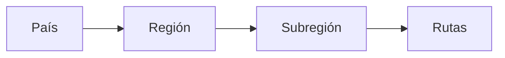

# Arquitectura

Cómo está construido el módulo en cada capa. El backend sigue el flujo hexagonal
`controller → puerto de entrada → handler → dominio → puerto de salida → adaptador`;
la web y la app siguen `pantalla → hook → servicio → cliente API → transporte HTTP`.
Las bodegas de cada parada vienen de [Bodegas](../wineries/README.md).

[Ver diagrama de «Arquitectura» completo](https://images.vinnot.com/docs/diagrams/v1/es/modules-wine-routes-architecture-fddd3d05ff40.svg)

## Backend

### Objetivo

Una ruta del vino es un itinerario turístico curado, no una simple lista de
bodegas. El agregado conserva identidad regional, largo, duración,
distancia, recomendaciones, mapa, estado y una secuencia ordenada de paradas.

### Dominio

`WineRoute` es aggregate root; `RouteStop` es entidad interna. Value objects:
`RouteStatus` (`DRAFT`, `PUBLISHED`, `ARCHIVED`) y `RouteDifficulty`.

Reglas principales:

- nombre y creador obligatorios;
- creación inicia en `DRAFT`;
- cada parada tiene ID, nombre, orden, tipo, dirección, coordenadas y duración;
- listas expuestas por dominio son inmutables;
- `removeStop` siempre ejecuta `reorderStops`, ordena por `stopOrder` y reasigna
  posiciones contiguas desde 1; `UpdateWineRouteCommandHandler` construye la
  lista de reemplazo conservando órdenes positivos explícitos y usando índice + 1 para valores no positivos; los editores reordenan sus borradores con posiciones contiguas;
- una ruta vacía no se publica;
- ownership se valida para mutaciones propias; admin puede operar globalmente;
- archivar y volver a draft son transiciones explícitas.

### Listados y actualización administrativa

Las queries pública y administrativa obtienen una página de rutas y una consulta
agrupada de paradas para los IDs de esa página. `getStopCounts` calcula
`stopCount` y `wineryCount` sin hidratar cada colección ni ejecutar una consulta
por ruta. El listado administrativo incluye borradores y archivadas.

El PATCH conserva campos omitidos. `clearFields` elimina campos opcionales;
`stops: []` y `recommendedWineTypes: []` vacían sus colecciones. Retirar todas
las paradas de una ruta publicada exige pasarla a borrador en la misma operación.
Dificultades válidas: `SHORT`, `MEDIUM`, `LONG`; los nombres de enum aceptan
minúsculas y se normalizan. Estados o dificultades desconocidos se rechazan.

### Creación

[Ver diagrama de «Creación» completo](https://images.vinnot.com/docs/diagrams/v1/es/modules-wine-routes-architecture-ef778f717102.svg)

`RouteDistanceService` es un puerto compartido. El adapter de Google Maps puede
fallar o no estar configurado; el handler conserva el valor manual cuando no hay
resultado calculado.

### Agregar una parada

`POST /wine-routes/{routeId}/stops`:

1. carga la ruta;
2. permite admin o creador;
3. crea `RouteStop` y valida coordenadas sólo si llegan ambas;
4. agrega al agregado;
5. persiste toda la ruta;
6. devuelve el ID de la parada.

El handler construye `Coordinates` solamente cuando recibe latitud y longitud.
Agrega la parada y guarda la ruta; el cálculo de distancia corresponde a
crear/actualizar la ruta, no al comando de agregar una parada.

### Búsqueda pública

`SearchWineRoutesQueryHandler` delega filtros de texto, país, región y largo
(`difficulty`), más paginación, a `WineRouteRepositoryPort`. Todos los filtros son
opcionales y se combinan: `GET /wine-routes?difficulty=` recibe un valor de
`RouteDifficulty` (`SHORT`, `MEDIUM` o `LONG`), un valor desconocido responde 400
`INVALID_REQUEST` y sin él los resultados son los mismos que antes. El adapter público devuelve rutas
publicadas; `SearchAllWineRoutesQueryHandler` existe para administración y no
aplica el mismo filtro de estado.

El detalle por UUID carga mediante `findById` y exige PUBLISHED para terceros;
el creador y ADMIN/MODERATOR conservan lectura privada. Mapea paradas ordenadas a `RouteStopResponse` dentro de una transacción
read-only, evitando lazy loading en serialización.

El enriquecimiento de bodegas reúne los nombres únicos de las paradas de tipo
`winery`, sin distinguir mayúsculas, y realiza una sola consulta de coincidencia
exacta sobre bodegas activas. El adapter carga país, región y contactos juntos;
no usa la búsqueda paginada del catálogo ni calcula totales por parada. El orden
de respuesta conserva el orden de las paradas, omite nombres sin coincidencia y
mantiene la ruta disponible si falla el enriquecimiento opcional. Los filtros
y la búsqueda de los listados mantienen su implementación independiente.

### Jerarquía de filtros

Los endpoints `/hierarchy`, `/countries`, `/countries/{country}/regions` y
`.../subregions` se derivan de las rutas publicadas, con coincidencia exacta de texto. La jerarquía permite filtros
en cascada sin descargar todo el catálogo.

[Ver diagrama de «Jerarquía de filtros» completo](https://images.vinnot.com/docs/diagrams/v1/es/modules-wine-routes-architecture-ca270d9be814.svg)

Los valores de path deben codificarse como segmentos URL y normalizarse en
persistencia; el frontend no concatena SQL ni asume que el texto es un ID.

### Administración

El controller `/admin/routes` permite listar todos los estados, crear, editar,
agregar paradas, publicar, archivar y eliminar. Reutiliza commands/queries del
módulo. `UpdateWineRouteCommandHandler` concentra cambios de campos, reemplazo de
paradas, recálculo de distancia/duración y transición de estado.

Publicar desde admin sigue invocando `WineRoute.publish`; no se saltea la regla
de al menos una parada.

### Seguridad y fallos

- Toda lectura exige sesión (`SecurityConfig` protege `GET /wine-routes/**`); terceros solo ven rutas publicadas.
- Crear: permiso `WINE_ROUTE_CREATE` (ADMIN y MODERATOR). La creación pública ignora paradas y estado y deja la ruta en `DRAFT`.
- Agregar paradas a una ruta propia: `WINE_ROUTE_UPDATE_OWN` con validación de creador; si no es suya, `422` `WINE_ROUTE_OWNERSHIP`.
- Edición global: `WINE_ROUTE_UPDATE` o el controller `/admin/routes` (ADMIN y MODERATOR).
- Eliminar desde administración: solo ADMIN y con reautenticación reciente.
- Ruta, parada o bodega inexistente: `404`. Publicar sin paradas: `400` `CANNOT_PUBLISH`.
- Sin Google Maps se conserva la distancia informada, sin corromper la ruta.

### Pruebas

- `WineRouteTest` y `RouteStopTest`: estados, publicación vacía, orden y colecciones inmutables.
- `WineRouteMutationHandlersTest` y `WineRouteOwnershipTest`: creación, edición, paradas, propiedad y distancia.
- `GetWineRouteByIdQueryHandlerTest` y `WineRouteQueryHandlersTest`: lectura privada, listados y jerarquía.
- `AdminRoleAccessTest`, `SecurityConfigAccessTest` y `SessionAccessHttpPostgresIntegrationTest`: permisos y sesión.

### Referencias

- `backend/src/main/java/com/vinnot/wineroute`
- `shared/application/port/RouteDistanceService.java`
- [Bodegas y regiones](../wineries/architecture.md)

## Web

### Listado y detalle

`/wine-routes` y `/wine-routes/:id` exigen sesión. `WineRoutesPage` →
`useWineRoutesViewModel` pide páginas de 20 con `useWineRoutes` y manda a la API el
texto (con espera de 350 ms), el largo (`difficulty`), el país y la región; los filtros
y la página viven en la URL, así que recargar y volver los conservan. Países y regiones
salen de los catálogos de referencia. `WineRouteDetailsPage` → `useWineRouteDetailsViewModel`
muestra portada, datos de la ruta (`RouteInfoSidebar`), las paradas en
`RouteStopTimeline` y el mapa embebido. El servicio `wineRoutesService` mapea los DTO
de `wineRoutesClient` al dominio (`domain/route`). El mapper deja la duración en minutos
(`estimatedDuration`) separada de los días (`estimatedDays`) y deja el largo en `null` cuando
falta o es desconocido; `routeLengthLabel` muestra los minutos, o «N días», o «—», y la
etiqueta de largo se oculta sin dato.

### Mapas, compartir y denunciar

El view model arma la URL de recorrido de Google Maps con las paradas en orden y abre
cada parada en mapas. «Compartir» aparece solo en rutas publicadas (`isPublicRoute`) y usa `useShareLink` con el tipo `wine-routes`, y
`CommunityActions` ofrece la denuncia de la ruta sin opción de bloqueo.

## App

### Listado y detalle

La pestaña Rutas usa `app/(app)/(tabs)/routes/index.tsx` → `WineRoutesScreen` y
`routes/[id].tsx` → `WineRouteDetailScreen`. `useWineRoutesListViewModel` carga páginas
de 20, las acumula por ID con «Cargar más» y filtra en el dispositivo las rutas cargadas
por texto (con espera de 300 ms), largo, país y región. `/wine-routes` redirige a la
pestaña y `app/(app)/wine-routes/[id].tsx` abre el detalle desde Inicio y enlaces anteriores.
El encabezado del listado es el `BrowseScreenHeader` compartido con Vinos y Eventos
(VINNOT, título, el subtítulo descriptivo «Explorá recorridos curados por bodegas,
paisajes y experiencias.» y el buscador, plano sobre el fondo de la pantalla). La
cantidad de rutas aparece debajo, junto a «Explorar rutas».

### Mapa y navegación

`RouteMap` muestra un marcador por parada. `useRouteNavigation` →
`routeNavigationService` → `externalLinkGateway` abre una parada o el recorrido
completo; las URLs se arman en `domain/route/route.navigation.ts`, que conserva el orden
de las paradas y suma sus duraciones en minutos. «Compartir» aparece solo en rutas publicadas (`canShareRoute`) y usa `useShareLink` y
`CommunityActions` ofrece la denuncia de la ruta.

### Presentación de rutas y portadas

La tab Rutas usa `app/(app)/(tabs)/routes/index.tsx` → `WineRoutesScreen` y
`routes/[id].tsx` → `WineRouteDetailScreen`. El listado y detalle conservan la
barra y el estado seleccionado. `/wine-routes` redirige a esa tab; el shell
`app/(app)/wine-routes/[id].tsx` mantiene el detalle desde Inicio y enlaces
anteriores. El back usa el historial de origen o Rutas si no hay historial.
Su ViewModel obtiene la consulta, deriva la duración en minutos y coordina
compartir/navegar. La tarjeta compartida por Inicio y listado y el detalle usan
la misma portada, sin oscurecerla ni superponer etiquetas sobre la fotografía.
Largo, número de paradas, distancia y duración se presentan sobre superficies
claras (`formatRouteLength` muestra los minutos o «N días»; sin largo ni duración, ese dato
no aparece); la parada expandida usa una superficie de marca suave con texto oscuro
y contactos legibles. El encabezado expandible y la acción Maps tienen objetivos
táctiles separados, roles accesibles y estado de expansión.

`RouteCoverImage` usa `expo-image` a través de `ImageWithFallback`, con caché
`memory-disk`, reducción al tamaño de la vista, redimensionado temprano en iOS
y la ilustración local como placeholder y fallback. La portada remota se
muestra sin un fundido que retrase la aparición de una imagen ya cacheada. Inicio, listado y detalle
conservan la misma URL para reutilizar la caché; no se descarga ni recomprime
la imagen en JavaScript. Una URL nueva reinicia la vista reciclada; un error
activa el recurso local. El cliente HTTP resuelve rutas relativas de uploads
contra el origen API antes de mapear los DTOs, sin alterar la paginación.
La primera descarga de una URL externa depende del servidor de origen y de la
red: la caché y el redimensionado no reducen los bytes transferidos en frío.

Las acciones de navegación pasan por `useRouteNavigation` →
`routeNavigationService` → `externalLinkGateway`. Las URLs de Maps se construyen
en dominio, conservando el orden de paradas y codificando coordenadas/direcciones;
coordenadas cero son válidas. Una ruta sin paradas deshabilita navegación; un
fallo del handler de plataforma muestra feedback localizado. La duración del
backend y de cada parada se expresa en minutos; el detalle usa la suma de paradas
cuando es positiva y la estimación de la ruta en otro caso.
