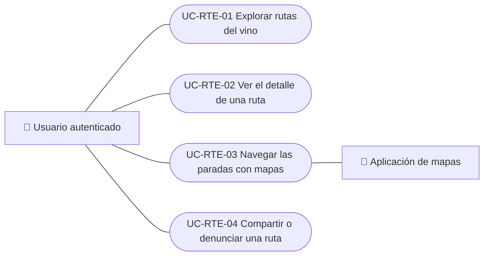

# Casos de uso

Casos de uso de rutas del vino: explorar rutas publicadas, abrir su detalle con las paradas, navegar las paradas con mapas y compartir o denunciar una ruta. La creación y edición de rutas está en Administración. Cada caso vale para las plataformas indicadas.

| ID | Caso de uso | Plataformas | Actores |
|---|---|---|---|
| `UC-RTE-01` | [Explorar rutas del vino](uc-rte-01-browse-routes.md) | Web, APK | Usuario autenticado |
| `UC-RTE-02` | [Ver el detalle de una ruta](uc-rte-02-view-route.md) | Web, APK | Usuario autenticado |
| `UC-RTE-03` | [Navegar las paradas con mapas](uc-rte-03-navigate-stops.md) | Web, APK | Usuario autenticado, Aplicación de mapas |
| `UC-RTE-04` | [Compartir o denunciar una ruta](uc-rte-04-share-or-report-route.md) | Web, APK | Usuario autenticado |

## Diagrama de casos de uso

[Ver diagrama de «Casos de uso · Diagrama de casos de uso» completo](https://images.vinnot.com/docs/diagrams/v1/es/modules-wine-routes-use-cases-readme-c45bcbfd7ef1.svg)

## Equivalencia con Lucidchart

| ID | IDs en Lucidchart |
|---|---|
| `UC-RTE-01` | [WEB UC-RTE-01](https://lucid.app/lucidchart/9f11a16b-bb5a-42fc-a9e8-0852b17bd241/edit), [APK UC-RTE-01](https://lucid.app/lucidchart/e095dd25-e8ac-41ba-bf5b-396e1055f217/edit) |
| `UC-RTE-02` | [WEB UC-RTE-02](https://lucid.app/lucidchart/9f11a16b-bb5a-42fc-a9e8-0852b17bd241/edit), [APK UC-RTE-02](https://lucid.app/lucidchart/e095dd25-e8ac-41ba-bf5b-396e1055f217/edit) |
| `UC-RTE-03` | [APK UC-RTE-03](https://lucid.app/lucidchart/e095dd25-e8ac-41ba-bf5b-396e1055f217/edit) |
| `UC-RTE-04` | [APK UC-RTE-04](https://lucid.app/lucidchart/e095dd25-e8ac-41ba-bf5b-396e1055f217/edit) |
