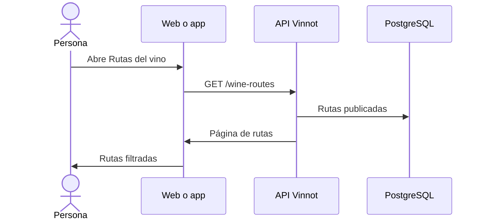

# UC-RTE-01 · Explorar rutas del vino

| Campo | Valor |
|---|---|
| ID | `UC-RTE-01` |
| Módulo | [Rutas del vino](../README.md) |
| Plataformas | Web, APK |
| Actores | Usuario autenticado |
| IDs en Lucidchart | [WEB UC-RTE-01](https://lucid.app/lucidchart/9f11a16b-bb5a-42fc-a9e8-0852b17bd241/edit), [APK UC-RTE-01](https://lucid.app/lucidchart/e095dd25-e8ac-41ba-bf5b-396e1055f217/edit) |
| Requisitos | [`RF-WEB-RTE-01`](../requirements.md), [`RF-WEB-RTE-02`](../requirements.md), [`RF-APK-RTE-01`](../requirements.md), [`RF-APK-RTE-02`](../requirements.md) |
| Casos de prueba | [`CP-RTE-01`](../testing.md), [`CP-RTE-02`](../testing.md), [`CP-RTE-03`](../testing.md), [`CP-RTE-04`](../testing.md) |

## Precondiciones

- La persona tiene sesión iniciada.

## Postcondiciones

- La persona ve las rutas publicadas y puede filtrarlas.

## Flujo principal

1. La persona abre Rutas del vino.
2. El cliente pide `GET /wine-routes`, de a 20 rutas.
3. La API devuelve solo rutas publicadas.
4. El cliente muestra cada ruta con portada, país, región, largo, cantidad de paradas, distancia y duración.
5. La persona filtra por texto, largo, país o región.

## Flujos alternativos

- 5a. Los filtros se aplican sobre las rutas ya cargadas: en la web, sobre la página actual; en la app, sobre las páginas acumuladas con «Cargar más».
- 3a. No hay rutas: se muestra el estado vacío.
- 2a. Más de 100 por página o un texto de más de 512 caracteres: la API responde 422.

## Reglas de negocio

- Las rutas en borrador o archivadas no aparecen en el listado.
- El largo es una categoría (corta, media o larga), no una dificultad física; una ruta sin largo cargado no muestra la etiqueta.
- La duración se muestra en horas y minutos; si la ruta solo tiene una estimación en días, se muestra «N días».
- La API filtra por texto, largo (`difficulty`) y país y región exactos; la web manda esos filtros a la API, mientras que la app todavía filtra la página cargada en el dispositivo.

## Diagrama

[Ver diagrama de «UC-RTE-01 · Explorar rutas del vino» completo](https://images.vinnot.com/docs/diagrams/v1/es/modules-wine-routes-use-cases-uc-rte-01-browse-routes-f0da0b8f2c95.svg)

Diagrama de componentes en Lucidchart: [WEB UC-RTE-01](https://lucid.app/lucidchart/9f11a16b-bb5a-42fc-a9e8-0852b17bd241/edit), [APK UC-RTE-01](https://lucid.app/lucidchart/e095dd25-e8ac-41ba-bf5b-396e1055f217/edit).

## Código

| Capa | Ubicación |
|---|---|
| Endpoints | `GET /wine-routes` |
| Backend | [`WineRouteController.java`](../../../../../backend/src/main/java/com/vinnot/wineroute/infrastructure/web/controller/WineRouteController.java), [`SearchWineRoutesQueryHandler.java`](../../../../../backend/src/main/java/com/vinnot/wineroute/application/query/handler/SearchWineRoutesQueryHandler.java), [`WineRoutePersistenceAdapter.java`](../../../../../backend/src/main/java/com/vinnot/wineroute/infrastructure/persistence/adapter/WineRoutePersistenceAdapter.java) |
| Web | [`WineRoutesPage.tsx`](../../../../../frontend-react/src/presentation/pages/wine-routes/WineRoutesPage.tsx), [`useWineRoutesViewModel.ts`](../../../../../frontend-react/src/presentation/pages/wine-routes/useWineRoutesViewModel.ts), [`WineRouteCard.tsx`](../../../../../frontend-react/src/presentation/components/features/wineRoute/WineRouteCard.tsx), [`useWineRoutes.ts`](../../../../../frontend-react/src/presentation/hooks/queries/wineRoute/useWineRoutes.ts), [`wineRoutes.service.ts`](../../../../../frontend-react/src/application/services/wineRoutes.service.ts), [`wineRoutes.client.ts`](../../../../../frontend-react/src/infrastructure/api/clients/wineRoutes.client.ts) |
| App | [`WineRoutesScreen.tsx`](../../../../../frontend-mobile/src/presentation/features/wineRoute/WineRoutesScreen.tsx), [`useWineRoutesListViewModel.ts`](../../../../../frontend-mobile/src/presentation/features/wineRoute/useWineRoutesListViewModel.ts), [`WineRouteCard.tsx`](../../../../../frontend-mobile/src/presentation/features/wineRoute/WineRouteCard.tsx), [`wineRoutes.service.ts`](../../../../../frontend-mobile/src/application/services/wineRoutes.service.ts), [`wineRoutes.client.ts`](../../../../../frontend-mobile/src/infrastructure/api/clients/wineRoutes.client.ts) |

## Tests automáticos

- Backend: [`WineRouteQueryHandlersTest.java`](../../../../../backend/src/test/java/com/vinnot/wineroute/application/query/handler/WineRouteQueryHandlersTest.java)
- Web: [`wineRoutes.service.test.ts`](../../../../../frontend-react/src/application/services/wineRoutes.service.test.ts), [`route.mappers.test.ts`](../../../../../frontend-react/src/domain/route/route.mappers.test.ts)
- App: [`useWineRoutesListViewModel.test.ts`](../../../../../frontend-mobile/src/presentation/features/wineRoute/useWineRoutesListViewModel.test.ts), [`wineRoutes.service.test.ts`](../../../../../frontend-mobile/src/application/services/wineRoutes.service.test.ts), [`wineRoutes.client.test.ts`](../../../../../frontend-mobile/src/infrastructure/api/clients/wineRoutes.client.test.ts)
