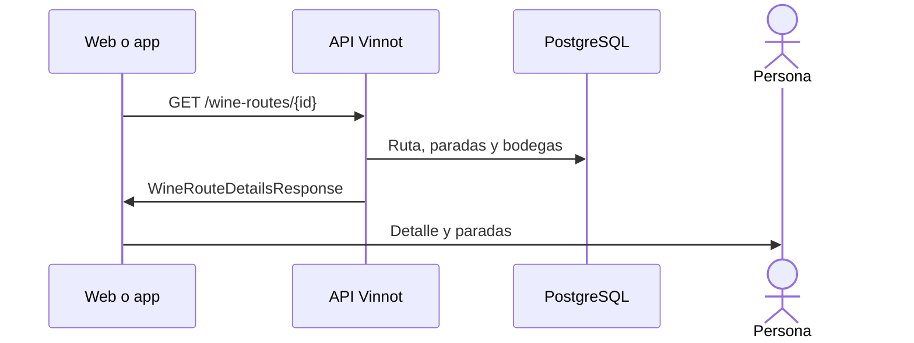

# UC-RTE-02 · Ver el detalle de una ruta

| Campo | Valor |
|---|---|
| ID | `UC-RTE-02` |
| Módulo | [Rutas del vino](../README.md) |
| Plataformas | Web, APK |
| Actores | Usuario autenticado |
| IDs en Lucidchart | [WEB UC-RTE-02](https://lucid.app/lucidchart/9f11a16b-bb5a-42fc-a9e8-0852b17bd241/edit), [APK UC-RTE-02](https://lucid.app/lucidchart/e095dd25-e8ac-41ba-bf5b-396e1055f217/edit) |
| Requisitos | [`RF-WEB-RTE-03`](../requirements.md), [`RF-WEB-RTE-04`](../requirements.md), [`RF-APK-RTE-03`](../requirements.md), [`RF-APK-RTE-04`](../requirements.md) |
| Casos de prueba | [`CP-RTE-05`](../testing.md), [`CP-RTE-06`](../testing.md), [`CP-RTE-07`](../testing.md), [`CP-RTE-13`](../testing.md), [`CP-RTE-14`](../testing.md) |

## Precondiciones

- La persona tiene sesión iniciada y abre una ruta desde el listado, Inicio o un enlace.

## Postcondiciones

- La persona ve la ruta con sus paradas en orden.

## Flujo principal

1. El cliente pide `GET /wine-routes/{id}`.
2. La API devuelve la ruta con sus paradas ordenadas y, para las paradas de tipo bodega, los datos de la bodega con el mismo nombre.
3. El cliente muestra portada, descripción, largo, distancia, duración y tipos de vino recomendados.
4. Muestra las paradas en una línea de tiempo; cada parada se expande con su descripción, dirección y contactos.

## Flujos alternativos

- 2a. La ruta no está publicada y quien consulta no la creó ni es moderador o administrador: la API responde 404.
- 3a. Las paradas tienen duración: la duración total es la suma de las paradas; si no, se usa la estimación de la ruta en minutos.
- 3b. Ni las paradas ni la ruta tienen duración en minutos: se muestra la estimación en días («N días»); sin ninguna, la web muestra «—» y la app no muestra la duración.
- 3c. La ruta no tiene largo cargado: no se muestra la etiqueta de largo.

## Reglas de negocio

- Las duraciones se expresan en minutos, aparte de la estimación en días, y la distancia en kilómetros.
- La distancia la calcula el servidor con Google Directions al guardar la ruta, o se carga a mano ([Administración](../../admin/README.md)).
- La relación con la bodega es por nombre y solo informativa.

## Diagrama

[Ver diagrama de «UC-RTE-02 · Ver el detalle de una ruta» completo](https://images.vinnot.com/docs/diagrams/v1/es/modules-wine-routes-use-cases-uc-rte-02-view-route-259589148e4d.svg)

Diagrama de componentes en Lucidchart: [WEB UC-RTE-02](https://lucid.app/lucidchart/9f11a16b-bb5a-42fc-a9e8-0852b17bd241/edit), [APK UC-RTE-02](https://lucid.app/lucidchart/e095dd25-e8ac-41ba-bf5b-396e1055f217/edit).

## Código

| Capa | Ubicación |
|---|---|
| Endpoints | `GET /wine-routes/{id}` |
| Backend | [`WineRouteController.java`](../../../../../backend/src/main/java/com/vinnot/wineroute/infrastructure/web/controller/WineRouteController.java), [`GetWineRouteByIdQueryHandler.java`](../../../../../backend/src/main/java/com/vinnot/wineroute/application/query/handler/GetWineRouteByIdQueryHandler.java), [`WineryQueryAdapter.java`](../../../../../backend/src/main/java/com/vinnot/wineroute/infrastructure/persistence/adapter/WineryQueryAdapter.java), [`WineRoute.java`](../../../../../backend/src/main/java/com/vinnot/wineroute/domain/model/WineRoute.java) |
| Web | [`WineRouteDetailsPage.tsx`](../../../../../frontend-react/src/presentation/pages/wine-routes/WineRouteDetailsPage.tsx), [`useWineRouteDetailsViewModel.ts`](../../../../../frontend-react/src/presentation/pages/wine-routes/useWineRouteDetailsViewModel.ts), [`RouteStopTimeline.tsx`](../../../../../frontend-react/src/presentation/components/features/wineRoute/RouteStopTimeline.tsx), [`RouteInfoSidebar.tsx`](../../../../../frontend-react/src/presentation/components/features/wineRoute/RouteInfoSidebar.tsx), [`useWineRoute.ts`](../../../../../frontend-react/src/presentation/hooks/queries/wineRoute/useWineRoute.ts), [`wineRoutes.service.ts`](../../../../../frontend-react/src/application/services/wineRoutes.service.ts), [`wineRoutes.client.ts`](../../../../../frontend-react/src/infrastructure/api/clients/wineRoutes.client.ts) |
| App | [`WineRouteDetailScreen.tsx`](../../../../../frontend-mobile/src/presentation/features/wineRoute/WineRouteDetailScreen.tsx), [`useWineRouteDetailViewModel.ts`](../../../../../frontend-mobile/src/presentation/features/wineRoute/useWineRouteDetailViewModel.ts), [`RouteStopTimeline.tsx`](../../../../../frontend-mobile/src/presentation/features/wineRoute/RouteStopTimeline.tsx), [`RouteCoverImage.tsx`](../../../../../frontend-mobile/src/presentation/features/wineRoute/RouteCoverImage.tsx), [`wineRoutes.service.ts`](../../../../../frontend-mobile/src/application/services/wineRoutes.service.ts), [`wineRoutes.client.ts`](../../../../../frontend-mobile/src/infrastructure/api/clients/wineRoutes.client.ts) |

## Tests automáticos

- Backend: [`GetWineRouteByIdQueryHandlerTest.java`](../../../../../backend/src/test/java/com/vinnot/wineroute/application/query/handler/GetWineRouteByIdQueryHandlerTest.java), [`WineRouteTest.java`](../../../../../backend/src/test/java/com/vinnot/wineroute/domain/model/WineRouteTest.java), [`RouteStopTest.java`](../../../../../backend/src/test/java/com/vinnot/wineroute/domain/model/RouteStopTest.java)
- Web: [`route.mappers.test.ts`](../../../../../frontend-react/src/domain/route/route.mappers.test.ts), [`useWineRouteDetailsViewModel.test.tsx`](../../../../../frontend-react/src/presentation/pages/wine-routes/useWineRouteDetailsViewModel.test.tsx)
- App: [`routeStops.test.tsx`](../../../../../frontend-mobile/src/presentation/features/wineRoute/__tests__/routeStops.test.tsx), [`route.mappers.test.ts`](../../../../../frontend-mobile/src/domain/route/route.mappers.test.ts)
