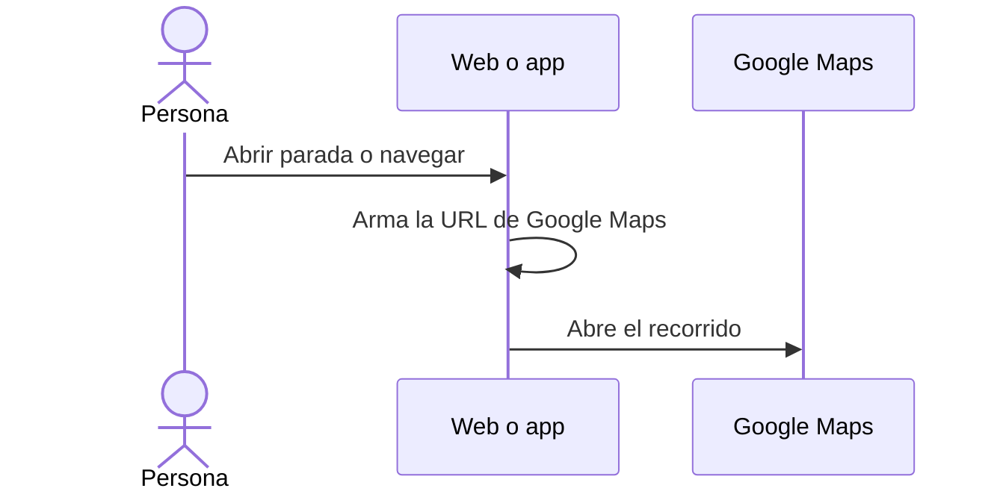

# UC-RTE-03 · Navegar las paradas con mapas

| Campo | Valor |
|---|---|
| ID | `UC-RTE-03` |
| Módulo | [Rutas del vino](../README.md) |
| Plataformas | Web, APK |
| Actores | Usuario autenticado, Aplicación de mapas |
| IDs en Lucidchart | [APK UC-RTE-03](https://lucid.app/lucidchart/e095dd25-e8ac-41ba-bf5b-396e1055f217/edit) |
| Requisitos | [`RF-WEB-RTE-05`](../requirements.md), [`RF-WEB-RTE-06`](../requirements.md), [`RF-APK-RTE-05`](../requirements.md), [`RF-APK-RTE-06`](../requirements.md) |
| Casos de prueba | [`CP-RTE-08`](../testing.md), [`CP-RTE-09`](../testing.md), [`CP-RTE-10`](../testing.md) |

## Precondiciones

- La persona está en el detalle de una ruta con paradas.

## Postcondiciones

- La aplicación de mapas abre la parada o el recorrido completo.

## Flujo principal

1. La persona ve las paradas en un mapa: en la web, el mapa embebido de la ruta; en la app, un mapa con un marcador por parada.
2. Elige abrir una parada en mapas: el cliente arma la dirección de Google Maps con sus coordenadas o su dirección.
3. O elige navegar la ruta completa: el cliente arma un recorrido de Google Maps en auto con origen, destino y paradas intermedias en orden.
4. El sistema abre la aplicación o la página de mapas.

## Flujos alternativos

- 3a. La ruta no tiene paradas: la navegación queda deshabilitada.
- 4a. El sistema no puede abrir el enlace: la app muestra un aviso.

## Reglas de negocio

- Vinnot no sigue la ubicación ni registra el recorrido de la persona.
- Las coordenadas cero son válidas.

## Diagrama

[Ver diagrama de «UC-RTE-03 · Navegar las paradas con mapas» completo](https://images.vinnot.com/docs/diagrams/v1/es/modules-wine-routes-use-cases-uc-rte-03-navigate-stops-3e69c5d96921.svg)

Diagrama de componentes en Lucidchart: [APK UC-RTE-03](https://lucid.app/lucidchart/e095dd25-e8ac-41ba-bf5b-396e1055f217/edit).

## Código

| Capa | Ubicación |
|---|---|
| Web | [`WineRouteDetailsPage.tsx`](../../../../../frontend-react/src/presentation/pages/wine-routes/WineRouteDetailsPage.tsx), [`useWineRouteDetailsViewModel.ts`](../../../../../frontend-react/src/presentation/pages/wine-routes/useWineRouteDetailsViewModel.ts), [`RouteStopTimeline.tsx`](../../../../../frontend-react/src/presentation/components/features/wineRoute/RouteStopTimeline.tsx) |
| App | [`WineRouteDetailScreen.tsx`](../../../../../frontend-mobile/src/presentation/features/wineRoute/WineRouteDetailScreen.tsx), [`useWineRouteDetailViewModel.ts`](../../../../../frontend-mobile/src/presentation/features/wineRoute/useWineRouteDetailViewModel.ts), [`RouteMap.tsx`](../../../../../frontend-mobile/src/presentation/features/wineRoute/RouteMap.tsx), [`useRouteNavigation.ts`](../../../../../frontend-mobile/src/presentation/features/wineRoute/useRouteNavigation.ts), [`routeNavigation.service.ts`](../../../../../frontend-mobile/src/application/services/routeNavigation.service.ts), [`route.navigation.ts`](../../../../../frontend-mobile/src/domain/route/route.navigation.ts) |

## Tests automáticos

- Backend: Ninguno
- Web: Ninguno
- App: [`route.navigation.test.ts`](../../../../../frontend-mobile/src/domain/route/route.navigation.test.ts), [`routeNavigation.service.test.ts`](../../../../../frontend-mobile/src/application/services/routeNavigation.service.test.ts), [`routeStops.test.tsx`](../../../../../frontend-mobile/src/presentation/features/wineRoute/__tests__/routeStops.test.tsx)
