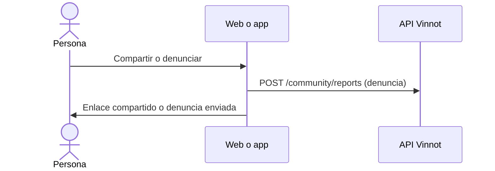

# UC-RTE-04 · Compartir o denunciar una ruta

| Campo | Valor |
|---|---|
| ID | `UC-RTE-04` |
| Módulo | [Rutas del vino](../README.md) |
| Plataformas | Web, APK |
| Actores | Usuario autenticado |
| IDs en Lucidchart | [APK UC-RTE-04](https://lucid.app/lucidchart/e095dd25-e8ac-41ba-bf5b-396e1055f217/edit) |
| Requisitos | [`RF-WEB-RTE-07`](../requirements.md), [`RF-APK-RTE-07`](../requirements.md) |
| Casos de prueba | [`CP-RTE-11`](../testing.md), [`CP-RTE-15`](../testing.md), [`CP-RTE-12`](../testing.md) |

## Precondiciones

- La persona está en el detalle de una ruta publicada.

## Postcondiciones

- La ruta se compartió o quedó denunciada.

## Flujo principal

1. La persona elige «Compartir».
2. El cliente genera el enlace público de la ruta y abre la hoja de compartir del sistema o copia el enlace ([Compartir](../../sharing/README.md)).
3. O la persona elige «Denunciar» y sigue el flujo de denuncia ([Comunidad](../../community/README.md)).

## Flujos alternativos

- 1a. La ruta no está publicada (borrador o archivada, visible solo para quien la creó y el equipo): no se ofrece «Compartir».
- 3a. La persona cancela la denuncia: no se envía nada.

## Reglas de negocio

- El enlace público solo abre rutas publicadas, por eso «Compartir» solo aparece en ellas.
- En las rutas no se ofrece bloquear cuentas.

## Diagrama

[Ver diagrama de «UC-RTE-04 · Compartir o denunciar una ruta» completo](https://images.vinnot.com/docs/diagrams/v1/es/modules-wine-routes-use-cases-uc-rte-04-share-or-report-route-f6a6a8f1e153.svg)

Diagrama de componentes en Lucidchart: [APK UC-RTE-04](https://lucid.app/lucidchart/e095dd25-e8ac-41ba-bf5b-396e1055f217/edit).

## Código

| Capa | Ubicación |
|---|---|
| Endpoints | `POST /community/reports` |
| Web | [`WineRouteDetailsPage.tsx`](../../../../../frontend-react/src/presentation/pages/wine-routes/WineRouteDetailsPage.tsx), [`useWineRouteDetailsViewModel.ts`](../../../../../frontend-react/src/presentation/pages/wine-routes/useWineRouteDetailsViewModel.ts), [`CommunityActions.tsx`](../../../../../frontend-react/src/presentation/components/features/community/CommunityActions.tsx) |
| App | [`WineRouteDetailScreen.tsx`](../../../../../frontend-mobile/src/presentation/features/wineRoute/WineRouteDetailScreen.tsx), [`useWineRouteDetailViewModel.ts`](../../../../../frontend-mobile/src/presentation/features/wineRoute/useWineRouteDetailViewModel.ts), [`CommunityActions.tsx`](../../../../../frontend-mobile/src/presentation/features/community/CommunityActions.tsx) |

## Tests automáticos

- Backend: Ninguno
- Web: [`CommunityActions.test.tsx`](../../../../../frontend-react/src/presentation/components/features/community/CommunityActions.test.tsx), [`useWineRouteDetailsViewModel.test.tsx`](../../../../../frontend-react/src/presentation/pages/wine-routes/useWineRouteDetailsViewModel.test.tsx), [`publicContent.test.ts`](../../../../../frontend-react/src/domain/sharing/publicContent.test.ts)
- App: [`CommunityActions.test.tsx`](../../../../../frontend-mobile/src/presentation/features/community/CommunityActions.test.tsx), [`useWineRouteDetailViewModel.test.ts`](../../../../../frontend-mobile/src/presentation/features/wineRoute/useWineRouteDetailViewModel.test.ts), [`shareability.test.ts`](../../../../../frontend-mobile/src/domain/sharing/shareability.test.ts)
