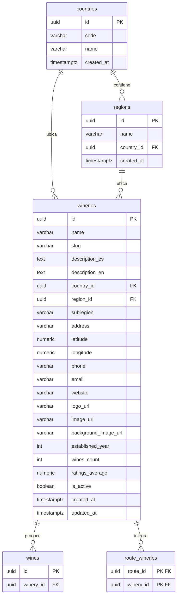

# Bodegas y regiones

Las bodegas que producen los vinos del catálogo y los países y regiones que los
ubican. Cada bodega tiene una ficha con descripción, mapa, contacto y vinos; los
países y regiones alimentan los filtros del catálogo y las relaciones entre
bodegas, vinos, eventos y rutas. El alta, la edición y la baja de bodegas están
en [Administración](../admin/README.md); los vinos de cada bodega se leen desde
[Vinos](../wines/README.md).

- Código del módulo: `WRY`.
- Backend: paquetes [`winery`](../../../../backend/src/main/java/com/vinnot/winery/) y [`region`](../../../../backend/src/main/java/com/vinnot/region/).
- [Casos de uso](use-cases/README.md) · [Requisitos](requirements.md) ·
  [Arquitectura](architecture.md) · [Pruebas](testing.md)

## Actores

| Actor | Qué hace en este módulo |
|---|---|
| Usuario autenticado | Abre la ficha de una bodega, busca bodegas en la app y consulta países y regiones |
| Servicio de geocodificación (Google) | Ubica en el mapa una bodega que no tiene coordenadas |

## Reglas de negocio

| Regla | Detalle | Dónde |
|---|---|---|
| Acceso | Bodegas, países y regiones requieren sesión | [`SecurityConfig.java`](../../../../backend/src/main/java/com/vinnot/shared/infrastructure/config/SecurityConfig.java) |
| Búsqueda | Por nombre sin distinguir mayúsculas, con filtro de país (nombre o código ISO) y de región (nombre), ambos sin distinguir mayúsculas; solo bodegas activas | [`SearchWineriesQueryHandler.java`](../../../../backend/src/main/java/com/vinnot/winery/application/query/handler/SearchWineriesQueryHandler.java) |
| Paginación | Páginas de 20 por defecto y de hasta 100 | [`SearchWineriesQueryHandler.java`](../../../../backend/src/main/java/com/vinnot/winery/application/query/handler/SearchWineriesQueryHandler.java) |
| Coordenadas | Latitud entre -90 y 90 y longitud entre -180 y 180; una bodega puede tener dirección sin coordenadas | [`winery/domain`](../../../../backend/src/main/java/com/vinnot/winery/domain/) |
| Geocodificación | Si faltan coordenadas, la ficha las busca y la API solo las guarda con el permiso `WINERY_UPDATE` | [`WineryController.java`](../../../../backend/src/main/java/com/vinnot/winery/infrastructure/web/controller/WineryController.java) |
| Países y regiones | Listas completas, sin paginar, ordenadas por nombre | [`RegionController.java`](../../../../backend/src/main/java/com/vinnot/region/infrastructure/web/controller/RegionController.java) |
| Límites de uso | 180 lecturas de bodegas por minuto y 300 por minuto para el resto | [`RateLimitPolicyResolver.java`](../../../../backend/src/main/java/com/vinnot/shared/infrastructure/security/RateLimitPolicyResolver.java) |

## Dónde vive

| Parte | Ubicación |
|---|---|
| API | [`WineryController`](../../../../backend/src/main/java/com/vinnot/winery/infrastructure/web/controller/WineryController.java) y [`RegionController`](../../../../backend/src/main/java/com/vinnot/region/infrastructure/web/controller/RegionController.java) |
| Web | Ficha en [`pages/wineries`](../../../../frontend-react/src/presentation/pages/wineries/) y componentes en [`features/winery`](../../../../frontend-react/src/presentation/components/features/winery/) |
| App | Pantallas en `frontend-mobile/app/(app)/wineries` y lógica en [`features/winery`](../../../../frontend-mobile/src/presentation/features/winery/) |

## Datos

Tablas creadas en `V1__baseline_schema.sql`.

[Ver diagrama de «Bodegas y regiones · Datos» completo](https://images.vinnot.com/docs/diagrams/v1/es/modules-wineries-readme-4d28e41d9dd6.svg)

`route_wineries` une bodegas con [Rutas del vino](../wine-routes/README.md).
