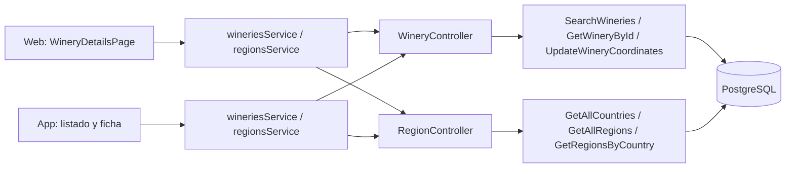
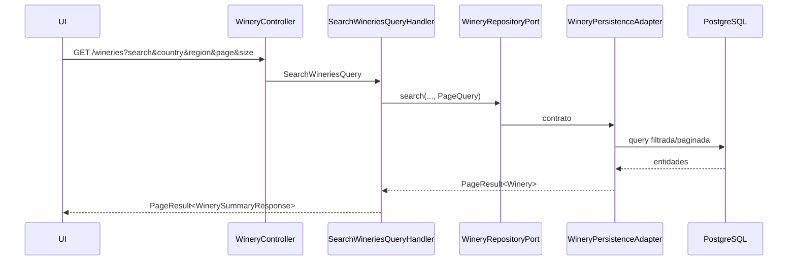
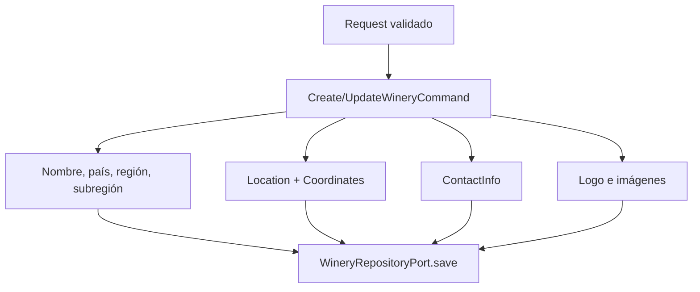

# Arquitectura

Cómo está construido el módulo en cada capa. El backend sigue el flujo hexagonal
`controller → puerto de entrada → handler → dominio → puerto de salida → adaptador`;
la web y la app siguen `pantalla → hook → servicio → cliente API → transporte HTTP`.



[Ver diagrama de «Arquitectura» completo](https://images.vinnot.com/docs/diagrams/v1/es/modules-wineries-architecture-a84b6d9137c0.svg)

## Backend

### Alcance

El catálogo de bodegas representa al productor separado de sus vinos. El módulo
`winery` administra identidad pública, descripciones bilingües, ubicación,
contacto, imágenes y métricas importadas; `region` provee países y regiones
normalizados para filtros y relaciones.

### Modelo de dominio

`Winery` es un agregado con:

- nombre y `slug` derivado;
- `descriptionEs` y `descriptionEn`;
- país, región y subregión;
- `Location` con dirección y `Coordinates` opcionales;
- `ContactInfo` con email, teléfono y web;
- logo, imagen y fondo;
- año de fundación;
- datos de catálogo externo: nombre SEO/legal, claim, estado y contadores;
- `active`, `createdAt` y `updatedAt`.

`Country` y `Region` son modelos propietarios de `region`. Una bodega referencia
sus UUID; los nombres/códigos de lectura son proyecciones, no sustitutos de la
referencia.

### Invariantes

- Nombre y `countryId` son obligatorios al crear.
- El slug se genera desde el nombre y se regenera al cambiarlo.
- Las coordenadas deben cumplir latitud `[-90, 90]` y longitud `[-180, 180]`.
- Una ubicación puede tener dirección sin coordenadas.
- Descripciones ES/EN se actualizan explícitamente y no se mezclan según locale.
- La búsqueda pública trabaja sobre bodegas activas.
- Los filtros país/región se aplican en persistencia antes de paginar.

### Búsqueda y detalle



[Ver diagrama de «Búsqueda y detalle» completo](https://images.vinnot.com/docs/diagrams/v1/es/modules-wineries-architecture-0905f02e88cd.svg)

El detalle usa `GetWineryByIdQueryHandler` y devuelve ubicación, contacto,
descripciones, imágenes, métricas y timestamps. Los vinos de una bodega se
obtienen por el catálogo de vinos con filtro `wineryId`; no se cargan mediante
una colección JPA abierta en el controller.

## Archivos fuente de referencia

### Creación y actualización

`CreateWineryCommandHandler` construye el agregado y aplica value objects sólo
cuando hay datos válidos. `UpdateWineryCommandHandler` conserva la misma
separación: información básica, textos localizados, ubicación, contacto,
imágenes y año se actualizan mediante métodos de dominio.



[Ver diagrama de «Creación y actualización» completo](https://images.vinnot.com/docs/diagrams/v1/es/modules-wineries-architecture-61d60f4af5ce.svg)

La ruta pública de actualización usa `PUT`; la administrativa usa `PATCH` con
su DTO de back-office. Ambas delegan en el mismo módulo y no implementan una
segunda entidad.

#### Contrato de escritura y lectura por ID

Los handlers create/update sólo inyectan `WineryRepositoryPort`. Construyen
`Coordinates` cuando ambos valores están presentes, `Location` para dirección
y coordenadas, y `ContactInfo` para email/teléfono/web. Las referencias geográficas
se resuelven en persistencia; la base impone las FKs.

Create retorna UUID y update retorna void; el controller construye la respuesta
de su ruta. El update reconstruye ubicación/contacto con los valores del command:
no equivale a conservar automáticamente cada campo omitido. Descripciones pasan
por `updateDescriptions`, imágenes por `updateImages` y año por
`setEstablishedYear`.

`GetWineryByIdQueryHandler` usa `findById`; no ejecuta nuevamente el filtro activo
de la búsqueda pública. El agregado se proyecta mediante DTO, sin serializar
entidades JPA.

### Geocodificación incremental

`PATCH /wineries/{id}/coordinates` está pensado para completar una bodega sin
coordenadas. El handler:

1. carga el agregado;
2. retorna sin escribir si ya tiene coordenadas;
3. valida el par latitud/longitud con `Coordinates`;
4. conserva la dirección existente si el request no aporta otra;
5. guarda la nueva `Location`.

Así se evita que una navegación o geocodificación tardía sobrescriba datos
curados. El frontend puede mostrar un mapa con datos resueltos sin convertir la
pantalla en propietaria de la regla.

### Datos regionales

| Endpoint | Caso de uso |
|---|---|
| `GET /regions/countries` | `GetAllCountriesQueryHandler` |
| `GET /regions` | `GetAllRegionsQueryHandler` |
| `GET /regions/country/{countryId}` | `GetRegionsByCountryQueryHandler` |

Los catálogos son de sólo lectura y requieren sesión autenticada (`SecurityConfig` protege `GET /regions/**`). Las escrituras se realizan por
migraciones/importación o herramientas administrativas autorizadas, no por un
endpoint genérico expuesto.

### Integraciones

- Wines guarda `wineryId` y usa `WineryQueryPort` para nombres/ubicación.
- Wine routes resuelve bodegas de paradas mediante su propio puerto.
- Google Maps/geocodificación vive en infraestructura de frontend o servicio
  externo; el dominio sólo conoce coordenadas.
- Import scripts mapean países/regiones antes de insertar grandes catálogos.

### Errores y seguridad

- búsqueda/detalle: autenticados (`GET /wineries/**` exige sesión); las reglas de publicación/propiedad siguen aplicándose;
- crear/actualizar/coordenadas/eliminar: autoridades `WINERY_*`;
- back-office (`/admin/wineries`): rol `ADMIN` o `MODERATOR`; `DELETE` exige `ADMIN`;
- ID inexistente: `404`;
- coordenadas inválidas: `400`;
- slug/relación conflictiva: `409` cuando la base protege la condición.

### Pruebas

- dominio: nombre, slug, textos, ubicación/contacto y activación;
- handlers: creación, update parcial y no sobrescribir coordenadas;
- consultas: búsqueda, detalle y listas de países y regiones;
- integración: nombres exactos y conteo de vinos activos con PostgreSQL;
- frontend: servicios y mappers de bodegas y regiones, y el encabezado de la app por idioma.

### Referencias

- `backend/src/main/java/com/vinnot/winery`
- `backend/src/main/java/com/vinnot/region`
- `frontend-react/src/application/services/wineries.service.ts`
- `frontend-mobile/src/application/services/wineries.service.ts`
- [Modelo de datos](../../backend/data/database-model.md)

## Web

```text
WineryDetailsPage → useWineryDetailsViewModel → wineriesService → wineriesClient → http
```

La web solo tiene la ficha `/wineries/:id`, dentro del layout protegido de
[`App.tsx`](../../../../frontend-react/src/app/App.tsx); no hay listado de bodegas. Se
llega desde el detalle de un vino, el recorrido de una ruta del vino y la
administración.

| Pieza | Qué hace |
|---|---|
| [`WineryDetailsPage.tsx`](../../../../frontend-react/src/presentation/pages/wineries/WineryDetailsPage.tsx) | Logo con imagen por defecto, datos, contacto con `mailto:` y `tel:`, mapa embebido y grilla de vinos |
| [`useWineryDetailsViewModel.ts`](../../../../frontend-react/src/presentation/pages/wineries/useWineryDetailsViewModel.ts) | Carga la bodega y sus primeros 20 vinos; muestra la descripción del idioma activo y, si falta, la otra (`localizedWineryDescription`); si faltan coordenadas, geocodifica y pide guardarlas |
| [`wineries.service.ts`](../../../../frontend-react/src/application/services/wineries.service.ts) | Mapea los DTO; los vinos de la bodega salen de `GET /wines?wineryId=` |
| [`regions.service.ts`](../../../../frontend-react/src/application/services/regions.service.ts) | Países y regiones para los filtros de vinos, eventos y rutas |

## App

Las pantallas son `frontend-mobile/app/(app)/wineries/index.tsx` (listado) y
`frontend-mobile/app/(app)/wineries/[id].tsx` (ficha). El listado se abre desde
una notificación con destino `/wineries`; la ficha, desde el listado y desde
otros módulos.

| Pieza | Qué hace |
|---|---|
| [`useWineriesListViewModel.ts`](../../../../frontend-mobile/src/presentation/features/winery/useWineriesListViewModel.ts) | Búsqueda con espera de 350 ms, páginas de 20 que se suman al llegar al final mientras `hasNext` sea verdadero, y recarga al tirar hacia abajo |
| [`useWineryDetailViewModel.ts`](../../../../frontend-mobile/src/presentation/features/winery/useWineryDetailViewModel.ts) | Carga la bodega y sus primeros 20 vinos; si faltan coordenadas, geocodifica y pide guardarlas |
| [`WineryHero.tsx`](../../../../frontend-mobile/src/presentation/features/winery/WineryHero.tsx) | Encabezado con la descripción en el idioma de la interfaz y la otra como respaldo |
| [`WineryWineGrid.tsx`](../../../../frontend-mobile/src/presentation/features/winery/WineryWineGrid.tsx) | Grilla de vinos de la bodega |
| [`wineries.service.ts`](../../../../frontend-mobile/src/application/services/wineries.service.ts) | Mapea los DTO del listado (`items`, `pageNumber`, `pageSize`, `totalItems` y `hasNext` de `PageResponseWrapper`) y la ficha; los vinos de la bodega salen de `GET /wines?wineryId=`, como en la web |

El buscador de bodegas también se usa para sugerir la bodega al proponer un vino
([Vinos propuestos](../wines/submissions.md)).
