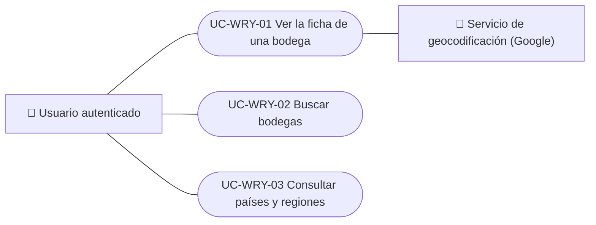

# Casos de uso

Casos de uso del módulo de bodegas y regiones: ver la ficha de una bodega, buscar bodegas en la app y consultar países y regiones. Cada caso vale para las plataformas indicadas.

| ID | Caso de uso | Plataformas | Actores |
|---|---|---|---|
| `UC-WRY-01` | [Ver la ficha de una bodega](uc-wry-01-view-winery.md) | Web, APK | Usuario autenticado, Servicio de geocodificación (Google) |
| `UC-WRY-02` | [Buscar bodegas](uc-wry-02-search-wineries.md) | APK | Usuario autenticado |
| `UC-WRY-03` | [Consultar países y regiones](uc-wry-03-countries-and-regions.md) | Web, APK | Usuario autenticado |

## Diagrama de casos de uso

[Ver diagrama de «Casos de uso · Diagrama de casos de uso» completo](https://images.vinnot.com/docs/diagrams/v1/es/modules-wineries-use-cases-readme-6a6a91465975.svg)

## Equivalencia con Lucidchart

| ID | IDs en Lucidchart |
|---|---|
| `UC-WRY-01` | [WEB UC-WRY-01](https://lucid.app/lucidchart/9f11a16b-bb5a-42fc-a9e8-0852b17bd241/edit), [APK UC-WINERY-02](https://lucid.app/lucidchart/e095dd25-e8ac-41ba-bf5b-396e1055f217/edit) |
| `UC-WRY-02` | [APK UC-WINERY-01](https://lucid.app/lucidchart/e095dd25-e8ac-41ba-bf5b-396e1055f217/edit) |
| `UC-WRY-03` | Ninguno |
