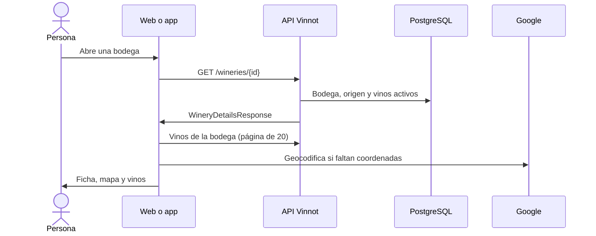

# UC-WRY-01 · Ver la ficha de una bodega

| Campo | Valor |
|---|---|
| ID | `UC-WRY-01` |
| Módulo | [Bodegas y regiones](../README.md) |
| Plataformas | Web, APK |
| Actores | Usuario autenticado, Servicio de geocodificación (Google) |
| IDs en Lucidchart | [WEB UC-WRY-01](https://lucid.app/lucidchart/9f11a16b-bb5a-42fc-a9e8-0852b17bd241/edit), [APK UC-WINERY-02](https://lucid.app/lucidchart/e095dd25-e8ac-41ba-bf5b-396e1055f217/edit) |
| Requisitos | [`RF-WEB-WRY-01`](../requirements.md), [`RF-WEB-WRY-02`](../requirements.md), [`RF-WEB-WRY-03`](../requirements.md), [`RF-WEB-WRY-04`](../requirements.md), [`RF-APK-WRY-01`](../requirements.md), [`RF-APK-WRY-02`](../requirements.md), [`RF-APK-WRY-03`](../requirements.md), [`RF-APK-WRY-04`](../requirements.md) |
| Casos de prueba | [`CP-WRY-01`](../testing.md), [`CP-WRY-02`](../testing.md), [`CP-WRY-03`](../testing.md), [`CP-WRY-04`](../testing.md), [`CP-WRY-05`](../testing.md) |

## Precondiciones

- La persona tiene sesión iniciada.

## Postcondiciones

- Se muestra la ficha de la bodega con sus vinos, su ubicación y sus datos de contacto.

## Flujo principal

1. La persona abre una bodega desde un vino, una ruta del vino o el listado de la app.
2. El cliente pide `GET /wineries/{id}`.
3. La API devuelve la bodega con su origen, contacto, coordenadas y cantidad de vinos activos.
4. El cliente muestra logo, nombre, ubicación, año de fundación, descripción (en el idioma de la interfaz o, si falta, en el otro), web, email y teléfono.
5. El cliente muestra un mapa con las coordenadas o, si faltan, con la dirección o el nombre.
6. Pide aparte la primera página de 20 vinos de la bodega y los muestra en una grilla que lleva a cada vino.

## Flujos alternativos

- 3a. La bodega no existe: la API responde 404 y el cliente muestra que no se encontró.
- 5a. La bodega no tiene coordenadas: el cliente las busca por geocodificación con nombre, región y país, y pide guardarlas con `PATCH /wineries/{id}/coordinates`; la API solo las guarda si quien mira tiene permiso `WINERY_UPDATE` y la bodega sigue sin coordenadas.
- 6a. La bodega no tiene vinos publicados: se muestra el estado vacío.
- 4a. Falta la imagen: se muestra una imagen por defecto; falta otro dato: no se muestra ese bloque.

## Reglas de negocio

- La ficha y sus vinos son lecturas separadas: un error en los vinos no oculta la bodega.
- Solo se cuentan y se listan vinos activos.
- Las coordenadas guardadas nunca se sobrescriben desde una ficha: el PATCH no escribe si ya existen.
- Latitud entre -90 y 90, longitud entre -180 y 180 y dirección de hasta 500 caracteres.

## Diagrama

[Ver diagrama de «UC-WRY-01 · Ver la ficha de una bodega» completo](https://images.vinnot.com/docs/diagrams/v1/es/modules-wineries-use-cases-uc-wry-01-view-winery-cd0309bffcdd.svg)

Diagrama de componentes en Lucidchart: [WEB UC-WRY-01](https://lucid.app/lucidchart/9f11a16b-bb5a-42fc-a9e8-0852b17bd241/edit), [APK UC-WINERY-02](https://lucid.app/lucidchart/e095dd25-e8ac-41ba-bf5b-396e1055f217/edit).

## Código

| Capa | Ubicación |
|---|---|
| Endpoints | `GET /wineries/{id}`, `GET /wines?wineryId=`, `PATCH /wineries/{id}/coordinates` |
| Backend | [`WineryController.java`](../../../../../backend/src/main/java/com/vinnot/winery/infrastructure/web/controller/WineryController.java), [`GetWineryByIdQueryHandler.java`](../../../../../backend/src/main/java/com/vinnot/winery/application/query/handler/GetWineryByIdQueryHandler.java), [`UpdateWineryCoordinatesCommandHandler.java`](../../../../../backend/src/main/java/com/vinnot/winery/application/command/handler/UpdateWineryCoordinatesCommandHandler.java) |
| Web | [`WineryDetailsPage.tsx`](../../../../../frontend-react/src/presentation/pages/wineries/WineryDetailsPage.tsx), [`useWineryDetailsViewModel.ts`](../../../../../frontend-react/src/presentation/pages/wineries/useWineryDetailsViewModel.ts), [`WineryWineCard.tsx`](../../../../../frontend-react/src/presentation/components/features/winery/WineryWineCard.tsx), [`wineries.service.ts`](../../../../../frontend-react/src/application/services/wineries.service.ts), [`wineries.client.ts`](../../../../../frontend-react/src/infrastructure/api/clients/wineries.client.ts) |
| App | `frontend-mobile/app/(app)/wineries/[id].tsx`, [`useWineryDetailViewModel.ts`](../../../../../frontend-mobile/src/presentation/features/winery/useWineryDetailViewModel.ts), [`WineryHero.tsx`](../../../../../frontend-mobile/src/presentation/features/winery/WineryHero.tsx), [`WineryWineGrid.tsx`](../../../../../frontend-mobile/src/presentation/features/winery/WineryWineGrid.tsx), [`wineries.service.ts`](../../../../../frontend-mobile/src/application/services/wineries.service.ts) |

## Tests automáticos

- Backend: [`GetWineryByIdQueryHandlerTest.java`](../../../../../backend/src/test/java/com/vinnot/winery/application/query/handler/GetWineryByIdQueryHandlerTest.java), [`WineryTest.java`](../../../../../backend/src/test/java/com/vinnot/winery/domain/model/WineryTest.java), [`WineryExactNamesPostgresIntegrationTest.java`](../../../../../backend/src/test/java/com/vinnot/winery/infrastructure/persistence/WineryExactNamesPostgresIntegrationTest.java)
- Web: [`wineries.service.test.ts`](../../../../../frontend-react/src/application/services/wineries.service.test.ts), [`winery.mappers.test.ts`](../../../../../frontend-react/src/domain/winery/winery.mappers.test.ts), [`useWineryDetailsViewModel.test.tsx`](../../../../../frontend-react/src/presentation/pages/wineries/useWineryDetailsViewModel.test.tsx)
- App: [`WineryHero.test.tsx`](../../../../../frontend-mobile/src/presentation/features/winery/WineryHero.test.tsx), [`wineries.service.test.ts`](../../../../../frontend-mobile/src/application/services/wineries.service.test.ts), [`winery.mappers.test.ts`](../../../../../frontend-mobile/src/domain/winery/winery.mappers.test.ts), [`wineDetailRoute.test.tsx`](../../../../../frontend-mobile/src/presentation/features/wine/__tests__/wineDetailRoute.test.tsx)
