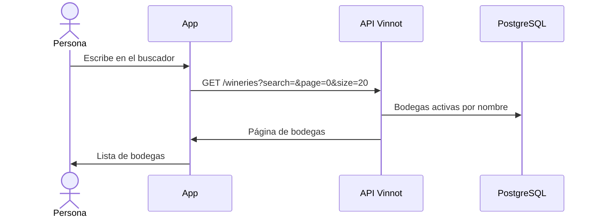

# UC-WRY-02 · Buscar bodegas

| Campo | Valor |
|---|---|
| ID | `UC-WRY-02` |
| Módulo | [Bodegas y regiones](../README.md) |
| Plataformas | APK |
| Actores | Usuario autenticado |
| IDs en Lucidchart | [APK UC-WINERY-01](https://lucid.app/lucidchart/e095dd25-e8ac-41ba-bf5b-396e1055f217/edit) |
| Requisitos | [`RF-APK-WRY-05`](../requirements.md) |
| Casos de prueba | [`CP-WRY-06`](../testing.md), [`CP-WRY-07`](../testing.md), [`CP-WRY-13`](../testing.md), [`CP-WRY-08`](../testing.md), [`CP-WRY-09`](../testing.md) |

## Precondiciones

- La persona tiene sesión iniciada en la app y abrió el listado de bodegas desde una notificación con ese destino.

## Postcondiciones

- Se muestran las bodegas activas que coinciden con la búsqueda.

## Flujo principal

1. La app muestra las bodegas activas ordenadas por nombre.
2. La persona escribe en el buscador.
3. La app espera 350 ms sin cambios y pide `GET /wineries` con el texto y páginas de 20.
4. La API busca el texto dentro del nombre, el nombre legal o el nombre SEO de cada bodega.
5. La persona elige una bodega y la app abre su ficha ([UC-WRY-01](uc-wry-01-view-winery.md)).

## Flujos alternativos

- 2a. La persona tira hacia abajo: la lista se recarga.
- 2b. La persona llega al final de la lista: la app pide la página siguiente y la suma, mientras la API indique que hay más (`hasNext`).
- 4a. No hay resultados: se muestra el estado vacío.
- 3a. Un texto de más de 512 caracteres responde 422 `INVALID_SEARCH`.

## Reglas de negocio

- La búsqueda no distingue mayúsculas; también acepta filtro de país, por nombre (`Argentina`, como lo envían la web y la app del equipo) o por código ISO (`ar`), y filtro por nombre de región; ambos filtros ignoran mayúsculas.
- El tamaño de página va de 1 a 100; fuera de ese rango responde 422 `INVALID_PAGINATION`.
- La web no tiene listado de bodegas: se llega a cada ficha desde vinos y rutas.

## Diagrama

[Ver diagrama de «UC-WRY-02 · Buscar bodegas» completo](https://images.vinnot.com/docs/diagrams/v1/es/modules-wineries-use-cases-uc-wry-02-search-wineries-2b2c2ddf2a95.svg)

Diagrama de componentes en Lucidchart: [APK UC-WINERY-01](https://lucid.app/lucidchart/e095dd25-e8ac-41ba-bf5b-396e1055f217/edit).

## Código

| Capa | Ubicación |
|---|---|
| Endpoints | `GET /wineries?search=&page=&size=20` |
| Backend | [`WineryController.java`](../../../../../backend/src/main/java/com/vinnot/winery/infrastructure/web/controller/WineryController.java), [`SearchWineriesQueryHandler.java`](../../../../../backend/src/main/java/com/vinnot/winery/application/query/handler/SearchWineriesQueryHandler.java), [`WineryJpaRepository.java`](../../../../../backend/src/main/java/com/vinnot/winery/infrastructure/persistence/jpa/WineryJpaRepository.java) |
| App | `frontend-mobile/app/(app)/wineries/index.tsx`, [`useWineriesListViewModel.ts`](../../../../../frontend-mobile/src/presentation/features/winery/useWineriesListViewModel.ts), [`WineryCard.tsx`](../../../../../frontend-mobile/src/presentation/features/winery/WineryCard.tsx) |

## Tests automáticos

- Backend: [`SearchWineriesQueryHandlerTest.java`](../../../../../backend/src/test/java/com/vinnot/winery/application/query/handler/SearchWineriesQueryHandlerTest.java), [`SearchInputLimitsTest.java`](../../../../../backend/src/test/java/com/vinnot/shared/application/util/SearchInputLimitsTest.java), [`WinerySearchPostgresIntegrationTest.java`](../../../../../backend/src/test/java/com/vinnot/winery/infrastructure/persistence/WinerySearchPostgresIntegrationTest.java)
- Web: Ninguno
- App: [`wineries.service.test.ts`](../../../../../frontend-mobile/src/application/services/wineries.service.test.ts)
