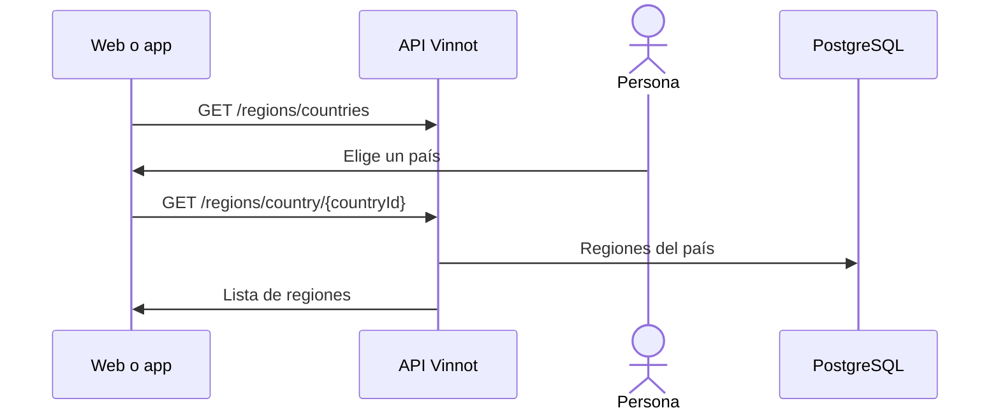

# UC-WRY-03 · Consultar países y regiones

| Campo | Valor |
|---|---|
| ID | `UC-WRY-03` |
| Módulo | [Bodegas y regiones](../README.md) |
| Plataformas | Web, APK |
| Actores | Usuario autenticado |
| IDs en Lucidchart | Ninguno |
| Requisitos | Ninguno |
| Casos de prueba | [`CP-WRY-10`](../testing.md), [`CP-WRY-11`](../testing.md), [`CP-WRY-12`](../testing.md) |

## Precondiciones

- La persona tiene sesión iniciada y abre una pantalla con filtro o selector de país y región.

## Postcondiciones

- El selector ofrece los países y las regiones del país elegido.

## Flujo principal

1. El cliente pide la lista de países.
2. La persona elige un país.
3. El cliente pide las regiones de ese país.
4. La persona elige una región.

## Flujos alternativos

- 2a. La persona cambia el país: se borra la región elegida y se cargan las del país nuevo.
- 3a. El país no tiene regiones o no existe: la API devuelve una lista vacía.

## Reglas de negocio

- Las listas no se paginan y vienen ordenadas por nombre sin distinguir mayúsculas.
- Países y regiones se cargan con las migraciones de referencia y no se editan desde la aplicación.
- La web guarda estas listas en caché 30 minutos.
- Las usan los filtros de [vinos](../../wines/README.md), [eventos](../../events/README.md) y [rutas del vino](../../wine-routes/README.md).

## Diagrama

[Ver diagrama de «UC-WRY-03 · Consultar países y regiones» completo](https://images.vinnot.com/docs/diagrams/v1/es/modules-wineries-use-cases-uc-wry-03-countries-and-regions-0bf2f8370132.svg)

## Código

| Capa | Ubicación |
|---|---|
| Endpoints | `GET /regions/countries`, `GET /regions`, `GET /regions/country/{countryId}` |
| Backend | [`RegionController.java`](../../../../../backend/src/main/java/com/vinnot/region/infrastructure/web/controller/RegionController.java), [`GetAllCountriesQueryHandler.java`](../../../../../backend/src/main/java/com/vinnot/region/application/query/GetAllCountriesQueryHandler.java), [`GetAllRegionsQueryHandler.java`](../../../../../backend/src/main/java/com/vinnot/region/application/query/GetAllRegionsQueryHandler.java), [`GetRegionsByCountryQueryHandler.java`](../../../../../backend/src/main/java/com/vinnot/region/application/query/GetRegionsByCountryQueryHandler.java) |
| Web | [`useCountries.ts`](../../../../../frontend-react/src/presentation/hooks/queries/wine/useCountries.ts), [`useRegions.ts`](../../../../../frontend-react/src/presentation/hooks/queries/wine/useRegions.ts), [`regions.service.ts`](../../../../../frontend-react/src/application/services/regions.service.ts), [`regions.client.ts`](../../../../../frontend-react/src/infrastructure/api/clients/regions.client.ts) |
| App | [`regions.client.ts`](../../../../../frontend-mobile/src/infrastructure/api/clients/regions.client.ts) |

## Tests automáticos

- Backend: [`GetAllCountriesQueryHandlerTest.java`](../../../../../backend/src/test/java/com/vinnot/region/application/query/GetAllCountriesQueryHandlerTest.java), [`GetAllRegionsQueryHandlerTest.java`](../../../../../backend/src/test/java/com/vinnot/region/application/query/GetAllRegionsQueryHandlerTest.java), [`GetRegionsByCountryQueryHandlerTest.java`](../../../../../backend/src/test/java/com/vinnot/region/application/query/GetRegionsByCountryQueryHandlerTest.java)
- Web: [`regions.service.test.ts`](../../../../../frontend-react/src/application/services/regions.service.test.ts)
- App: [`regions.service.test.ts`](../../../../../frontend-mobile/src/application/services/regions.service.test.ts)
