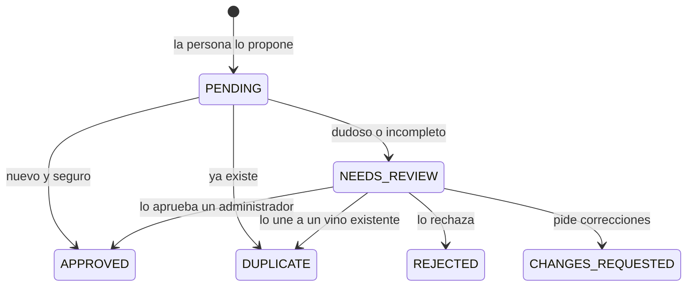
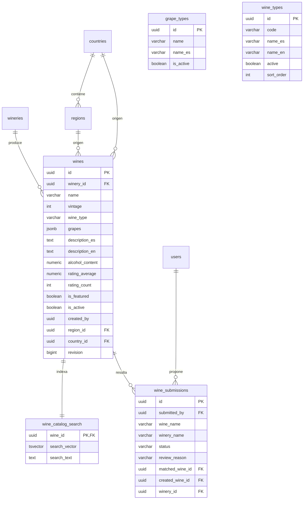

# Vinos

El catálogo de vinos de Vinnot: buscarlo y filtrarlo, recorrer sus páginas y ver
la ficha de cada vino. En la app suma el escáner de etiquetas, que reconoce un
vino con la cámara, y el circuito para proponer los vinos que todavía no están
en el catálogo. El alta y la edición de vinos por el equipo están en
[Administración](../admin/README.md); el perfil con IA y las comparaciones, en
[Perfiles y comparaciones IA](../ai/README.md); las reseñas, en
[Reseñas](../reviews/README.md).

- Código del módulo: `WIN`.
- Backend: paquete [`wine`](../../../../backend/src/main/java/com/vinnot/wine/).
- [Casos de uso](use-cases/README.md) · [Requisitos](requirements.md) ·
  [Arquitectura](architecture.md) · [Vinos propuestos](submissions.md) ·
  [Pruebas](testing.md)

## Actores

| Actor | Qué hace en este módulo |
|---|---|
| Usuario autenticado | Busca, filtra y abre vinos; en la app escanea etiquetas y propone vinos |
| Servicio de ubicación | Sugiere el país del dispositivo como filtro inicial |
| Proveedor de reconocimiento | OpenAI lee la etiqueta cuando el texto del dispositivo no alcanza |
| Servicio de email | Avisa a quien propuso un vino cada cambio de estado |

## Reglas de negocio

| Regla | Detalle | Dónde |
|---|---|---|
| Acceso | El catálogo, el detalle, las uvas y los tipos de referencia requieren sesión | [`SecurityConfig.java`](../../../../backend/src/main/java/com/vinnot/shared/infrastructure/config/SecurityConfig.java) |
| Vinos visibles | El catálogo muestra solo vinos activos; el detalle de un vino inactivo solo lo ven el equipo de catálogo y quien lo creó | [`ResourceReader.java`](../../../../backend/src/main/java/com/vinnot/shared/domain/valueobject/ResourceReader.java) |
| Paginación | Páginas de hasta 20 y solo los primeros 500 resultados | [`PublicWineCatalogAccessPolicy.java`](../../../../backend/src/main/java/com/vinnot/wine/infrastructure/web/policy/PublicWineCatalogAccessPolicy.java) |
| Texto de búsqueda | Hasta 512 caracteres; prefijo y contenido, y similitud si no hay resultados | [`WineSearchNativeRepository.java`](../../../../backend/src/main/java/com/vinnot/wine/infrastructure/persistence/search/WineSearchNativeRepository.java) |
| Tipos de vino | `RED`, `WHITE`, `ROSE`, `SPARKLING`, `DESSERT`, `FORTIFIED` y `ORANGE` | [`WineType.java`](../../../../backend/src/main/java/com/vinnot/wine/domain/valueobject/WineType.java) |
| Foto de etiqueta | JPEG o PNG, hasta 8 MiB y 24 Mpx, con lados mínimos de 320 y 720 px y luz y foco suficientes | [`WineLabelUploadValidator.java`](../../../../backend/src/main/java/com/vinnot/wine/infrastructure/web/WineLabelUploadValidator.java) |
| Escaneo | Respuesta en 18 segundos como máximo; no guarda la foto | [`ScanWineLabelCommandHandler.java`](../../../../backend/src/main/java/com/vinnot/wine/application/command/handler/ScanWineLabelCommandHandler.java) |
| Límites de uso | Por usuario: 60 consultas por minuto al catálogo, 30 escaneos por hora y 10 propuestas o fotos por día | [`RateLimitPolicyResolver.java`](../../../../backend/src/main/java/com/vinnot/shared/infrastructure/security/RateLimitPolicyResolver.java) |
| Propuestas | Solo se publican sin revisión cuando reconocimiento, deduplicación y moderación son seguros | [Vinos propuestos](submissions.md) |

## Estados de un vino propuesto

[Ver diagrama de «Estados de un vino propuesto» completo](https://images.vinnot.com/docs/diagrams/v1/es/modules-wines-readme-f99b0a7f84c9.svg)

## Dónde vive

| Parte | Ubicación |
|---|---|
| API | [`WineReadController`](../../../../backend/src/main/java/com/vinnot/wine/infrastructure/web/controller/WineReadController.java), [`WineLabelScanController`](../../../../backend/src/main/java/com/vinnot/wine/infrastructure/web/controller/WineLabelScanController.java), [`WineSubmissionController`](../../../../backend/src/main/java/com/vinnot/wine/infrastructure/web/controller/WineSubmissionController.java) y [`GrapeTypeController`](../../../../backend/src/main/java/com/vinnot/wine/infrastructure/web/controller/GrapeTypeController.java) |
| Web | Páginas en [`pages/wines`](../../../../frontend-react/src/presentation/pages/wines/) |
| App | Pantallas en `frontend-mobile/app/(app)/(tabs)/wines`, lógica en [`features/wine`](../../../../frontend-mobile/src/presentation/features/wine/) y cámara en [`device/camera`](../../../../frontend-mobile/src/infrastructure/device/camera/) |

## Datos

Tablas creadas en `V1__baseline_schema.sql` y ampliadas por los índices de
búsqueda (`V3`, `V4`, `V14`, `V15`, `V16`, `V61`, `V85`, `V86`), la versión del catálogo
(`V19`) y las propuestas (`V10`, `V41`).

[Ver diagrama de «Vinos · Datos» completo](https://images.vinnot.com/docs/diagrams/v1/es/modules-wines-readme-9ec83ebea7f5.svg)

`grape_types` y `wine_types` son catálogos de referencia sin relación directa:
`wines.grapes` guarda los nombres de las uvas y `wines.wine_type` el código del
tipo.
