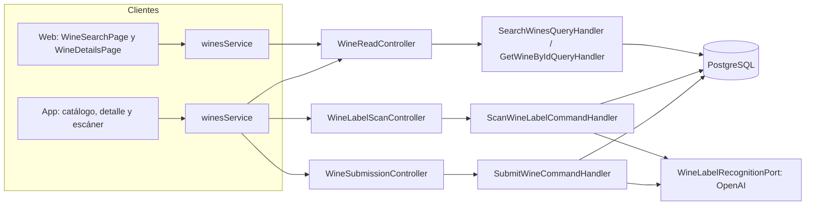
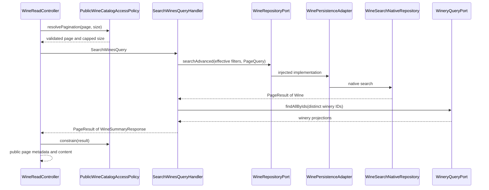
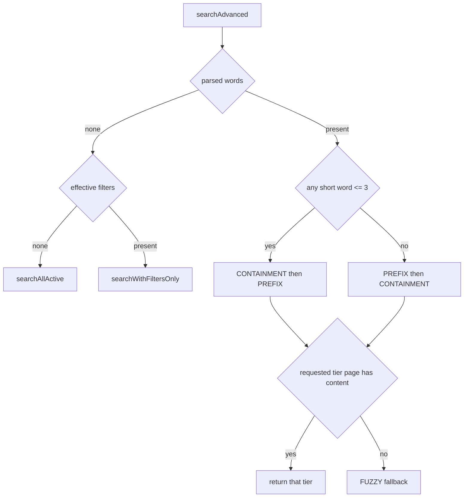
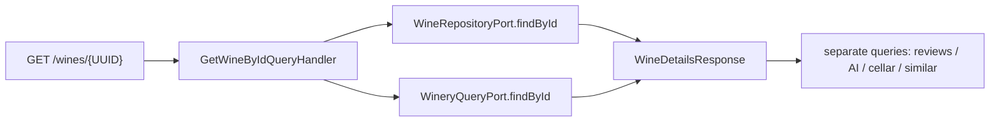
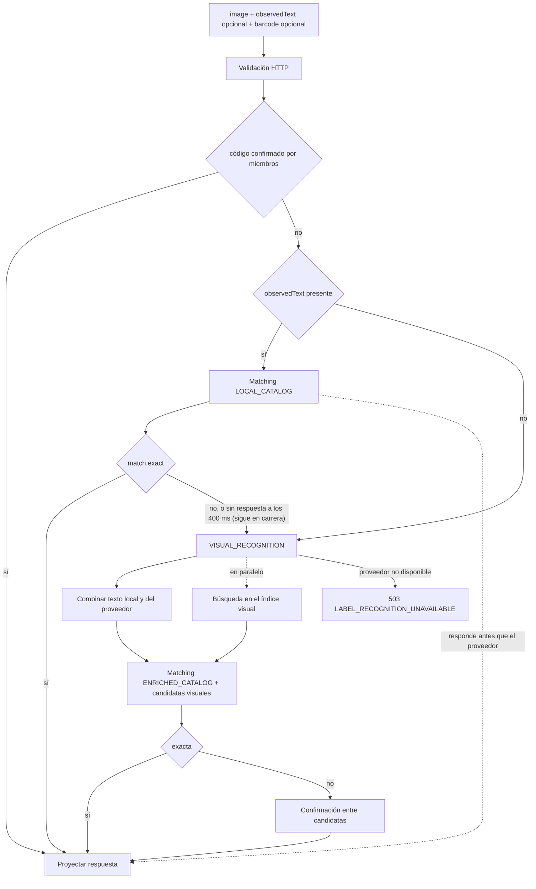
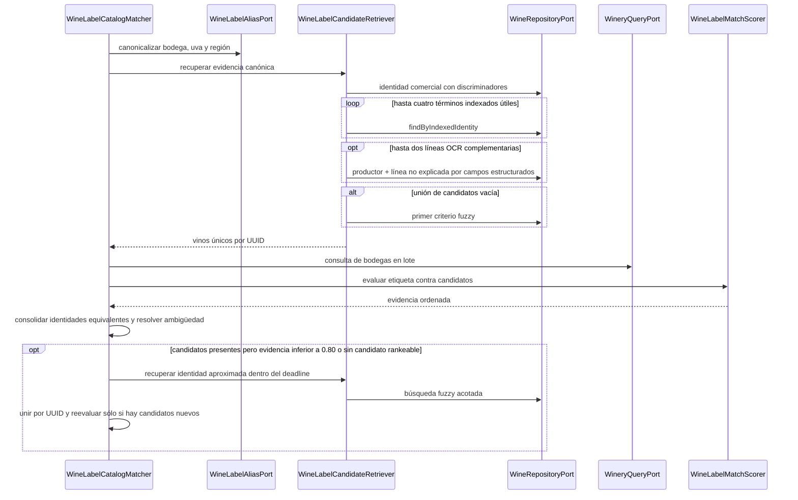
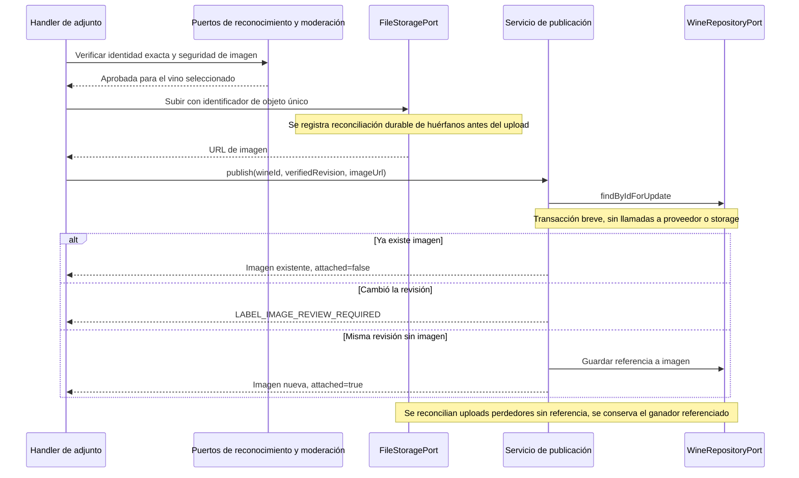
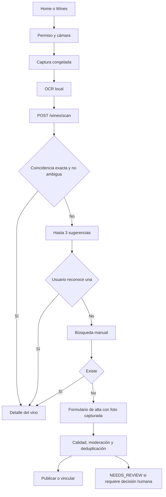
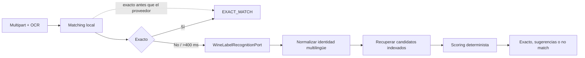

# Arquitectura

Cómo está construido el módulo en cada capa. El backend sigue el flujo hexagonal
`controller → puerto de entrada → handler → dominio → puerto de salida → adaptador`;
la web y la app siguen `pantalla → hook → servicio → cliente API → transporte HTTP`.
El circuito de vinos propuestos está en [Vinos propuestos](submissions.md).

[Ver diagrama de «Arquitectura» completo](https://images.vinnot.com/docs/diagrams/v1/es/modules-wines-architecture-ebeb6450e2ea.svg)

## Backend

### Búsqueda y detalle

#### Alcance funcional

Web y mobile consultan el mismo catálogo mediante GET /wines y su alias /wines/search. Buscar texto no ejecuta reconocimiento de imágenes: el escaneo pertenece al circuito mobile y usa otro caso de uso. La búsqueda pública trabaja sobre vinos activos; el detalle es una lectura por UUID.

#### Flujo de búsqueda

[Ver diagrama de «Flujo de búsqueda» completo](https://images.vinnot.com/docs/diagrams/v1/es/modules-wines-architecture-97bb8a271eeb.svg)

El handler es read-only y agrupa las bodegas en una consulta de puerto, evitando una consulta por vino para esa proyección. No devuelve entidades JPA. La policy vive en infraestructura web: los puertos internos y consultas administrativas no heredan automáticamente el límite público.

#### Filtros efectivos y límites

| Criterio del puerto | Aplicación |
|---|---|
| searchTerm | palabras sobre identidad vino/bodega |
| wineType | tipo persistido del vino |
| wineryId | UUID de bodega |
| country / region | predicados geográficos del adapter |
| grapeVariety | predicado sobre uvas del vino |
| page / size | página cero-based y tamaño efectivo |

Esta tabla enumera los argumentos que SearchWinesQueryHandler transmite a searchAdvanced. Los rankings destacados, mejor puntuados, recientes, populares y similares tienen endpoints/casos de uso específicos; no son un orden arbitrario de esa consulta.

La policy rechaza page < 0 (INVALID_PAGE), size <= 0 (INVALID_PAGE_SIZE) y offset >= 500 (PUBLIC_CATALOG_WINDOW_EXCEEDED); limita size a 20, recorta contenido y totalElements a la ventana pública de 500. Similares admite hasta 10 elementos y rechaza límite no positivo. No se impone en el handler una longitud mínima de tres caracteres; el debounce y mínimo de UI pertenecen al cliente.

#### Destacados acotados de Inicio

`GET /wines/highlights?limit=4` requiere sesión y devuelve una lista de
`WineSummaryResponse`, sin `PageResult` ni conteo total. El controller delega a
`GetWineHighlightsUseCase` → `GetWineHighlightsQueryHandler` →
`WineRepositoryPort.findHighlights` → adapter JPA. El handler rechaza límites
no positivos (`INVALID_RESULT_LIMIT`) y aplica un máximo de diez.

La consulta elige vinos activos con `ratingCount > 0` y `ratingAverage > 0`,
ordenados por promedio descendente, cantidad descendente y UUID ascendente.
Usa los agregados públicos persistidos del vino; no recalcula ni cambia reglas
de moderación. El límite se aplica en la consulta después de ordenar. País y
región se leen con fetch joins de relaciones singulares, en una sola sentencia,
sin `COUNT` ni N+1. No modifica el buscador, sus filtros, tiers, índices ni los
contratos paginados de `/featured`, `/top-rated`, `/popular` o `/recommended`.

La prueba PostgreSQL verifica orden, desempate, límite, vinos sin valoraciones,
inactivos y una sola sentencia SQL; las pruebas del handler verifican validación
y mapeo. Una lista vacía es válida y distinta de un error HTTP.

#### Selección del plan de búsqueda

[Ver diagrama de «Selección del plan de búsqueda» completo](https://images.vinnot.com/docs/diagrams/v1/es/modules-wines-architecture-140405bd75c2.svg)

PREFIX consulta search_vector con to_tsquery simple y prefijos; CONTAINMENT exige LIKE '%palabra%' para cada palabra en search_text. Sin filtros, ambos usan wine_catalog_search, que combina nombre de vino y bodega. FUZZY usa pg_trgm en ramas de vino y bodega y agrupa por ID. Con filtro de tipo, bodega, país, región o uva, todos los niveles toman candidatos de wine_catalog_filter_search (V86), cuyo GIN multicolumna cruza texto y filtros dentro del índice; un filtro de uva sin texto pagina por nombre con wine_grape_search. El ranking, el orden de los niveles y el contrato de respuesta son los mismos con y sin filtros. Los detalles y las mediciones están en [Rendimiento de consultas](../../backend/data/query-performance.md). Tests PostgreSQL fijan el nivel fuzzy combinado con filtro de bodega, los planes de búsquedas filtradas sobre un catálogo con la forma de producción y la sincronización por triggers de ambos read models. Los parámetros se enlazan, no se concatenan como valores SQL.

Los tiers son alternativas: se devuelve el primero cuya página solicitada tiene contenido, no la unión de todas las coincidencias de prefijo, substring y fuzzy. El orden final del tier textual es relevance DESC, name ASC, id ASC sobre los candidatos seleccionados. Browse ordena por nombre. Estos órdenes no representan un snapshot inmutable entre requests.

#### Contrato de paginación

La consulta sin texto/filtros usa reltuples de PostgreSQL como estimación de total y COUNT si esa estimación no está disponible. Consultas filtradas/textuales leen size+1 y construyen un total mínimo para navegación incremental. La policy pública lo recorta. totalElements no debe interpretarse como conteo exacto de todo el catálogo en estas rutas; hasNext/totalPages derivan del PageResult devuelto.

#### Composición de detalle

[Ver diagrama de «Composición de detalle» completo](https://images.vinnot.com/docs/diagrams/v1/es/modules-wines-architecture-596ebb1e231d.svg)

Un vino ausente, o inactivo cuando quien consulta no es del equipo de catálogo ni quien lo creó (`ResourceReader.mayRead`), produce EntityNotFoundException (404). El handler no resuelve un slug. Si hay wineryId, incorpora WineryInfo y nombres de origen; si la bodega no se resuelve, esos campos quedan sin enriquecimiento. Reviews, IA y cava no se cargan como colecciones JPA durante esta serialización.

#### Errores, pruebas y observabilidad

Los errores de policy son DomainException y se mapean a 400; los de texto u opciones de búsqueda (`INVALID_SEARCH`, `INVALID_SEARCH_OPTION`) son reglas de negocio y responden 422. Errores de consulta propagados se resuelven por el mapper global; no se atribuye a esta búsqueda el fallback específico del recuperador de candidatos de scan. Correlación/duración HTTP provienen de HttpRequestLoggingFilter. Un resultado vacío y una respuesta HTTP fallida son contratos distintos.

Casos de prueba: texto vacío, fragmentos cortos y largos, nombre de bodega, criterios combinados, límites 20/500, size+1, datos de bodega agrupados y detalle ausente. SQL se verifica con PostgreSQL y EXPLAIN sobre cada tier; los umbrales de precisión de scan no sustituyen tests de búsqueda manual.

#### Fuentes y navegación

Bajo `backend/src/main/java/com/vinnot/wine/`: `infrastructure/web/controller/WineReadController.java`, `infrastructure/web/policy/PublicWineCatalogAccessPolicy.java`, `application/query/handler/SearchWinesQueryHandler.java`, `GetWineByIdQueryHandler.java`, `infrastructure/persistence/search/WineSearchNativeRepository.java`.

[API](../../backend/architecture/api.md) · [SQL](../../backend/data/query-performance.md) · [Escaneo](architecture.md).

#### Proyección de perfil en el detalle

`GetWineByIdQueryHandler` consulta `WineProfileOverviewPort` para añadir
`profileOverview` al detalle. El adapter del módulo IA sólo lee perfiles
persistidos por ID/idioma; no genera ni guarda contenido. Cada entrada ES/EN
contiene resumen, acidez, taninos, cuerpo, dulzor y lista de maridajes. Los
scores inválidos se omiten como null, no se transforman en mediciones válidas.
Los campos originales del catálogo permanecen intactos y los listados de vinos
no ejecutan estas lecturas adicionales. El frontend aplica la proyección sólo
al renderizar la información rápida, nunca al editar el catálogo.

### Reconocimiento de etiquetas

#### Alcance y responsabilidades

El escaneo es una funcionalidad de mobile. Web presenta una invitación a descargar la aplicación; no necesita un segundo reconocedor. El backend expone un caso de uso autenticado que recibe imagen y evidencia OCR opcional, extrae identidad y consulta el catálogo. No crea un vino ni almacena la imagen por ejecutar /scan.

| Capa | Responsabilidad y componente |
|---|---|
| HTTP | WineLabelScanController, WineLabelUploadValidator, WineLabelObservedTextValidator |
| Aplicación | ScanWineLabelCommandHandler, WineLabelScanPolicy, WineLabelCatalogMatcher, WineLabelCandidateRetriever, WineLabelCandidateVerifier, WineVisualIndexService, WineLabelScanRecorder |
| Dominio | ExtractedWineLabel, WineLabelMatchScorer, WineLabelIdentityNormalizer, RankedWineLabelCandidate, WineLabelPickEvidence |
| Puertos | WineLabelRecognitionPort, WineRepositoryPort, WineryQueryPort, WineLabelAliasPort, WineLabelMetricsPort, WineLabelCandidateVerificationPort, WineVisualIndexPort, WineBarcodeConfirmationPort, CatalogQualitySignalPort |
| Adapters | OpenAiWineLabelRecognitionAdapter, WineSearchNativeRepository, ConfiguredWineLabelAliasAdapter, MicrometerWineLabelMetricsAdapter, OpenAiWineLabelCandidateVerificationAdapter, GeminiImageEmbeddingAdapter, InMemoryWineVisualIndex |

#### Contrato multipart y validación

`POST /api/wines/scan`: Bearer JWT, `multipart/form-data`, `image` obligatorio,
`observedText` opcional como lista de líneas y `barcode` opcional.

| Control | Contrato de entrada |
|---|---|
| Contenido | JPEG / PNG; MIME y firma concordantes |
| Tamaño | 8 MiB máximo; archivo no vacío |
| Dimensiones | lado corto >= 320 y largo >= 720 píxeles; máximo 24 millones de píxeles, comprobados en cabecera antes de decodificar |
| Calidad | luminancia media 12..248; energía de bordes >= 1,5 |
| observedText | hasta 24 líneas, 120 caracteres/línea, 2000 caracteres normalizados totales |
| barcode | 8, 12, 13 o 14 dígitos ASCII con dígito verificador GS1 módulo 10 válido (EAN-8, UPC-A, EAN-13, GTIN-14); si no, 400 `INVALID_LABEL_BARCODE`; se valida antes que la imagen |

OCR normaliza espacios, omite null/vacíos y deduplica sin distinguir mayúsculas. Es evidencia no confiable, no una orden para seleccionar un ID. La validación de scan devuelve los bytes originales; validateAndSanitizeForPersistence, usada por submission/label-image, genera JPEG RGB nuevo de hasta 1600 píxeles de lado largo sin reutilizar metadata del archivo. Son dos operaciones distintas.

La lectura usa `ImageReader`: primero obtiene dimensiones, luego decodifica una sola vez con subsampling para limitar el buffer a 1600 píxeles de lado largo. La validación de calidad reutiliza ese buffer; readers, streams e imágenes se liberan al finalizar. El límite de bytes se comprueba tanto en multipart como en los bytes leídos. MIME ausente, contenido corrupto o dimensiones excesivas son errores de entrada, no resultados de reconocimiento.

#### Orquestación

[Ver diagrama de «Orquestación» completo](https://images.vinnot.com/docs/diagrams/v1/es/modules-wines-architecture-fa41d25b2d3f.svg)

El paso local construye ExtractedWineLabel con observedText y la añada sólo cuando existe una única línea de año plausible. El scorer puede corroborar productor y producto del candidato únicamente cuando todos sus tokens significativos están literalmente presentes en OCR y no queda texto significativo sin explicar por identidad, uvas observadas u origen del candidato. Esta corroboración es evidencia de matching, no enriquecimiento del catálogo. Texto parcial, otra línea comercial o una cepa incompatible impiden esa promoción. La salida anticipada sigue requiriendo match.exact, con los mismos umbrales y control de ambigüedad. La fiabilidad estructurada es 1,0 con dos términos distintos, 0,75 con uno y 0,55 sin términos. Si falta evidencia se utiliza reconocimiento visual y se combinan las líneas locales/remotas sin perder orden ni duplicar texto.

#### Extracción visual

La etapa de catálogo basada sólo en OCR tiene un subpresupuesto de 3 s dentro del
deadline global. Su agotamiento permite continuar con reconocimiento visual si
queda tiempo global; no extiende el deadline ni oculta errores ajenos al timeout.

La búsqueda local corre en el executor `wineLabelScanExecutor` (`WINE_LABEL_SCAN_THREADS`, 8 por defecto, sin cola). Si en 400 ms no respondió el escaneo, el reconocimiento visual y la búsqueda en el índice visual arrancan en paralelo en vez de esperar a que termine: la búsqueda local sigue en carrera y, si después puede responder sola, su resultado contesta el escaneo y se descartan los del proveedor. Una búsqueda local que responde dentro de los 400 ms evita la llamada al proveedor. Si el proveedor falla enseguida (por ejemplo, llamadas pagas pausadas o presupuesto agotado), el escaneo espera a la búsqueda local y la usa si puede responder; si no, devuelve el error del proveedor. Con el executor lleno, el trabajo corre en el hilo de la request, una etapa tras otra. El trabajo descartado del proveedor no se aborta: termina, se cobra y registra su etapa; ese escaneo reporta `visual_fallback=false`.

Si la etapa opcional de catálogo basada sólo en OCR agota el presupuesto de sus consultas, puede continuar la extracción visual dentro del deadline compartido. La búsqueda enriquecida debe completarse; agotar el deadline total u otro fallo técnico no se convierte en un resultado de negocio vacío.

El adapter solicita JSON estructurado con isWineLabel, productor, producto, cepa, añada, tipo, país/región, alcohol, confidence, searchKeywords, visualDescription, observedText e identitySymbols. El prompt exige texto visible, conserva escritura original y símbolos comerciales y separa marca pública de denominación del producto. Confidence del proveedor mide extracción; no se usa como probabilidad de pertenencia al catálogo.

El schema solicita primero observedText e identitySymbols y luego los campos interpretados. La transcripción incluye números de producto, cuvées y marcas pequeñas junto a la bodega; la cepa se copia cuando es legible, sin inferirla a partir de una denominación geográfica. visualDescription es opcional y breve: no reemplaza evidencia de identidad.

Defaults de application.yml: WINE_LABEL_RECOGNITION_TIMEOUT=12s, DETAIL=HIGH y MAX_TOKENS=500; el request usa temperatura 0. El adapter limita la llamada al menor entre timeout configurado y presupuesto restante, con un solo intento para no multiplicar latencia/costo mediante reintentos ocultos. Un resultado vacío del proveedor se convierte en ExternalServiceUnavailableException, no en NO_MATCH.

#### Recuperación del catálogo y alias

[Ver diagrama de «Recuperación del catálogo y alias» completo](https://images.vinnot.com/docs/diagrams/v1/es/modules-wines-architecture-2da37654083c.svg)

Cada búsqueda comercial/indexada usa pool 60; se unen resultados por UUID, por lo que el conjunto combinado puede superar 60. Los términos provienen de producto, keywords, productor y OCR útil. La rama comercial/indexada precede a fuzzy. Los timeouts específicos capturados permiten continuar con otras vistas de identidad. La consulta fuzzy también puede recurrir a pistas de tipo/uva/añada si no hay términos legibles.

Las líneas de producto numeradas tienen prioridad sobre términos amplios. Se excluyen líneas compuestas únicamente por origen/tipo y años plausibles aislados. Hasta dos líneas OCR adicionales no representadas por los campos estructurados se buscan combinadas con el productor: una palabra comercial separada no debe perderse por el límite de candidatos de una búsqueda global.

Los alias son mapas de configuración app.wine-label.aliases para WINERY, GRAPE y REGION. ConfiguredWineLabelAliasAdapter compara claves normalizadas y conserva el original si no existe entrada. No traduce la etiqueta a español ni asume un país de origen.

Un resultado indexado irrelevante no suprime la búsqueda aproximada: si los candidatos no alcanzan evidencia 0,80 y no hay exacto, el matcher solicita un complemento fuzzy acotado y vuelve a rankear la unión. La búsqueda full-text separa puntos internos como `13.Cabernet` antes de construir tsquery, conservando escritura y acentos. Los términos siguen parametrizados; no se interpolan en SQL.

Si sólo el complemento opcional agota su timeout, se conservan las sugerencias indexadas utilizables. Si no había ninguna sugerencia válida, el fallo se informa como indisponibilidad del catálogo. Un deadline global agotado nunca se oculta como recuperación exitosa.

#### Ranking, exactitud y ambigüedad

El suplemento aproximado utiliza el productor observado cuando existe, evitando consultar una cepa genérica sobre todo el catálogo. Las líneas OCR numeradas de producto también aportan discriminadores comerciales al ranking.

El score renormaliza las señales disponibles: nombre 0,40; bodega 0,30; añada 0,10; uva 0,08; tipo 0,05; país 0,04; región 0,03. Los discriminadores comerciales tienen peso propio 0,35 cuando se incorpora esa señal. Con evidencia estructurada, combina base (0,70) y cobertura de identidad (0,30), multiplica por fiabilidad y redondea a cuatro decimales. No suma señales ausentes como coincidencias.

rank conserva score >= 0,42 y ordena por score descendente/UUID. isExact exige señal de nombre >= 0,72, productor/producto representados, cobertura de etiqueta >= 0,80 y catálogo >= 0,90, compatibilidad de añada/uva y discriminadores. Admite score >= 0,90 o >= 0,80 con identidad completa. Matcher consolida identidades equivalentes y, si otro candidato también cumple exact, exige una ventaja >= 0,06. Un número alto por sí solo no decide el resultado.

Una cepa observada incompatible con las cepas conocidas del candidato limita su score a 0,41, fuera de sugerencias. La ausencia de cepas no se interpreta como contradicción. La evidencia OCR complementaria excluye términos ya explicados por el producto estructurado y sólo activa su señal si está respaldada por un candidato del productor observado, cuando éste se conoce. Un texto secundario coincidente con el nombre de un vino de otra bodega no debe penalizar al candidato correcto. Las cepas de catálogo no leídas sólo se omiten del cotejo de nombre cuando existe otra denominación comercial explícita; un nombre únicamente varietal no autoriza convertir un vino monovarietal en un blend exacto.

Una denominación OCR complementaria respaldada por el catálogo (por ejemplo, una línea de calidad separada) aporta evidencia de identidad aunque la extracción estructurada la omita. La geografía conocida del catálogo se excluye de la evidencia de producto para no convertir una denominación de origen en una cuvée competidora. Si ninguna denominación complementaria tiene respaldo en el catálogo, un producto estructurado respaldado aporta esa señal en su lugar. Coincidir con una cepa repetida en el nombre de una bodega no constituye evidencia independiente del productor ni autoriza invertir roles de productor/producto. Un nombre parcial de productor no puede borrar el resto de una marca explícita; una marca pública distinta en el campo producto puede seguir representando la identidad completa de catálogo.

Los símbolos extraídos únicamente de líneas de medidas (altitud, alcohol o volumen) no son marcas comerciales. A la inversa, si un vino hermano del catálogo difiere por un símbolo comercial no observado, se devuelven la variante genérica y la marcada como alternativas, sin certificar la etiqueta genérica.

La consolidación de filas equivalentes exige discriminadores comerciales idénticos. Un nombre largo compartido no puede ocultar un número o marca de producto diferente mediante umbrales de solapamiento de tokens.

#### Respuesta y acciones posteriores

| outcome | Contenido |
|---|---|
| EXACT_MATCH | `wine` presente, suggestions vacío, candidates contiene el elegido |
| POSSIBLE_MATCHES | `wine=null`; hasta tres sugerencias y sus candidates |
| NO_MATCH | `wine=null`; listas vacías, confidence=0 |

Toda respuesta trae además `scanId`, el id del escaneo registrado sobre el que el miembro puede enviar su veredicto, o `null` si no se registró.

extractedData acompaña la respuesta. Las sugerencias exponen confidence como máximo 0,89 aunque el score de ranking sea mayor; no son porcentajes estadísticos calibrados de certeza. La decisión exacta se toma en backend, no mediante un umbral inventado por la UI.

La imagen temporal durante búsqueda manual pertenece al cliente. Para crear vino se envía otra vez con los datos a /wines/submissions. Para completar una imagen ausente se usa /wines/{id}/label-image: exige match.exact y que el ID seleccionado sea el primer candidato, además de moderación aprobada. Una sugerencia o selección manual no autoriza publicar la foto automáticamente. Reconocimiento/moderación/upload ocurren fuera de la transacción de publicación. Cada upload recibe un identificador de objeto único; `WineLabelImagePublicationService` bloquea la fila brevemente, conserva cualquier imagen concurrente y verifica que la revisión del vino siga siendo la evaluada antes de guardar. Los objetos perdedores quedan cubiertos por reconciliación durable de almacenamiento, sin borrar el objeto ganador.

##### Publicación segura de una imagen faltante

[Ver diagrama de «Publicación segura de una imagen faltante» completo](https://images.vinnot.com/docs/diagrams/v1/es/modules-wines-architecture-8941b3681f33.svg)

#### Tiempo, errores y observación

La expansión aproximada opcional tiene un subpresupuesto de 2 s y sólo comienza
si quedan más de 3 s globales. Si agota ese subpresupuesto, se conservan candidatos
indexados utilizables; sin candidatos válidos se devuelve error técnico. El
deadline global se comprueba también antes de devolver la respuesta.

Para comparar identidad, los descriptores visibles `orgánico`, `orgânica` y
`organique` se canonicalizan como `organic`, sin añadir el descriptor cuando falta.
Si dos candidatos tienen el mismo puntaje, se prioriza la coincidencia del nombre
normalizado de la bodega con el nombre leído antes de desempatar por ID. Esto
preserva la variante visible cuando los alias del productor comparten identidad
canónica; no aumenta el puntaje ni modifica el umbral de aceptación.
La similitud de bodega tolera espacios OCR en nombres completos de al menos ocho
caracteres, sin aceptar prefijos. Los núcleos de tokens se ordenan antes de
compararlos para no depender del orden de iteración de conjuntos. Las comprobaciones
de identidad requeridas para declarar un exacto permanecen separadas de esa similitud.
Las líneas de medida, incluida altitud en `m`/`mts`, no aportan números comerciales.
La búsqueda indexada separa guiones y puntos internos entre letras/números antes de
construir `plainto_tsquery`: conserva los tokens y evita exigir un lexema compuesto
ausente del catálogo. La evidencia original y los umbrales de exactitud no cambian.
Cada rama indexada ordena antes de aplicar su límite: relevancia de texto con
normalización por longitud o similitud de bodega, seguida del ID para estabilidad.
Se conserva la mejor evidencia por candidato, sin sumar dos veces una coincidencia
recuperada por texto y por bodega. Esta relevancia selecciona el conjunto a evaluar;
no es el porcentaje de confianza del escaneo. El timeout indexado sigue en 750 ms.

`WineLabelScanDeadline` comparte un presupuesto monotónico de 18 s entre OCR/catálogo y reconocimiento visual. Se comprueba antes y después de etapas y entre consultas; la llamada visual recibe sólo el tiempo restante. No es una espera artificial ni el objetivo de latencia: el objetivo interactivo se mide por separado. Catálogo mantiene hints por query (indexada 750 ms; fuzzy/comercial/visual 1500 ms); una consulta ya enviada conserva su timeout propio. Upload, validación y transporte quedan fuera de ese reloj de aplicación; mobile conserva 22 s HTTP. Cancelar no implica rollback ni cancelación distribuida del trabajo remoto ya iniciado.

Errores de imagen: INVALID_LABEL_IMAGE, LABEL_IMAGE_RESOLUTION_TOO_LOW, LABEL_IMAGE_TOO_DARK, LABEL_IMAGE_TOO_BRIGHT y LABEL_IMAGE_OUT_OF_FOCUS; OCR inválido: INVALID_LABEL_TEXT. Fallo visual: 503 LABEL_RECOGNITION_UNAVAILABLE; catálogo agotado sin recuperación: LABEL_CATALOG_UNAVAILABLE; deadline: LABEL_SCAN_TIMEOUT. Un timeout seguido de recuperación válida permite continuar, pero un fallo técnico sin recuperación no se convierte en NO_MATCH. El log de proveedor registra el código HTTP y, para OpenAI, el código de error del proveedor (por ejemplo `HTTP 429 insufficient_quota`); nunca clave ni cuerpo de respuesta.

Las etapas LOCAL_CATALOG, VISUAL_RECOGNITION, VISUAL_WAIT, ENRICHED_CATALOG y CANDIDATE_VERIFICATION registran duración SUCCESS/FAILURE. Scan total/duration se registran al construir una respuesta de negocio; errores lanzados antes no recorren ese punto. Además, cada escaneo escribe una sola línea INFO `Label scan finished: outcome=<resultado> totalMs=<ms> <ETAPA>=<ms> ...` con solo las etapas que habían terminado cuando respondió el escaneo; un escaneo fallido usa `outcome=FAILED_<código>` (o el tipo de excepción). CANDIDATE_VERIFICATION se registra en todo escaneo que llega al reconocimiento, con unos 0 ms cuando se omite la confirmación. No se almacenan imágenes en métricas ni en logs.

#### Pruebas y fuentes

Verificar validación multipart, normalización para persistencia, extracción con fixture, combinación OCR, alias, ranking y ambigüedad con el scorer real, shape de outcomes y fallos del proveedor. PostgreSQL valida recuperación; el benchmark mide precisión/recall/estabilidad/latencia por separado. Tests fake del proveedor no constituyen evidencia de ejecución OpenAI.

Fuentes bajo `backend/src/main/java/com/vinnot/wine/`: `application/command/handler/ScanWineLabelCommandHandler.java`, `AttachWineLabelImageCommandHandler.java`; `application/service/WineLabelCatalogMatcher.java`, `WineLabelCandidateRetriever.java`, `WineLabelScanPolicy.java`; `domain/service/WineLabelMatchScorer.java`, `WineLabelIdentityNormalizer.java`; `infrastructure/config/WineLabelScanConfig.java`; `infrastructure/web/WineLabelUploadValidator.java`; `infrastructure/ai/OpenAiWineLabelRecognitionAdapter.java`.

[Submissions](submissions.md) · [SQL](../../backend/data/query-performance.md) · [Flujo mobile](architecture.md) · [Observabilidad](../../backend/architecture/observability.md).

#### Precisión del escaneo de etiquetas

El escaneo combina cuatro señales independientes; cada una vuelve al comportamiento anterior cuando no está disponible.

| Señal | Cómo funciona | Componentes |
|---|---|---|
| Texto sin tildes | `V90` agrega `catalog_search_unaccent`, un envoltorio `IMMUTABLE` de `unaccent` con diccionario fijo, y hace que las funciones que construyen los dos modelos de lectura de búsqueda guarden el texto sin tildes y en minúsculas. Las consultas se normalizan igual, así que «SEPTIMA» encuentra «Séptima» en el escaneo, el catálogo público y la administración. Las filas escritas antes de `V90` se reescriben después del arranque en lotes confirmados (5000 filas, pausa de 200 ms) en `catalogMaintenanceTaskScheduler`; mientras tanto, la búsqueda encuentra ambas formas. Cuando una pasada completa no encuentra nada pendiente se detiene; cada reinicio vuelve a revisar (en producción, unos 3 minutos de lotes livianos). | `WineSearchNativeRepository`, `CatalogSearchAccentNormalizer` |
| Recuperación por productor | El productor leído en la etiqueta también trae los vinos de esa bodega; una línea genérica sola («Reserva», «Malbec», «Estate») nunca se usa como identidad del vino. | `WineLabelCandidateRetriever`, `WineLabelLanguageVocabulary`, `WineLabelIdentityNormalizer` |
| Búsqueda visual | Cada vino del catálogo cuya imagen de etiqueta aloja Vinnot tiene un embedding de Google Gemini (`gemini-embedding-2`, 768 dimensiones) guardado como int8 en `wine_image_embeddings` (`V91`). El backend carga en un índice en memoria todos los vectores del modelo activo y compara la foto escaneada por similitud coseno (al menos 0,6), en paralelo con el reconocimiento de OpenAI y en un pool acotado (2 hilos, cola de 4); el escaneo la espera como máximo 1,5 s. Hasta 10 coincidencias visuales se suman a las candidatas y, si el texto no encuentra nada, pasan a ser sugerencias. Un planificador carga el índice 30 s después del arranque y genera embeddings de hasta 200 imágenes pendientes cada 60 s. Si Gemini rechaza por cuota o límite de uso (HTTP 402 o 429), el backfill se pausa 5 minutos, duplicando la pausa hasta 6 horas, y el log indica el código; una corrida exitosa termina la pausa. Sin `GEMINI_API_KEY` la señal queda apagada. | `WineVisualIndexService`, `GeminiImageEmbeddingAdapter`, `InMemoryWineVisualIndex`, `JdbcWineImageEmbeddingRepository`, `CatalogImageSourceAdapter`, `WineVisualIndexScheduler` |
| Confirmación entre candidatas | Sin coincidencia exacta y con al menos 3 s disponibles, el modelo de visión recibe la foto con las 5 mejores candidatas de texto y hasta 3 visuales, lee el productor y el producto impresos y elige una o ninguna (como máximo 8 s). La elección pasa a ser exacta solo con confianza de al menos 0,85 y si `WineLabelPickEvidence` encuentra cada palabra del producto leído en la candidata, cada palabra del nombre de la candidata en el texto de la etiqueta y un productor que coincide. | `WineLabelCandidateVerifier`, `WineLabelPickEvidence`, `OpenAiWineLabelCandidateVerificationAdapter` |

**Capacidad de IA.** `ai.admission.maximum-concurrent` (3 por defecto) acota las llamadas al proveedor. Con tres o más cupos, el último queda reservado para pedidos interactivos: un escaneo de etiqueta prueba primero el cupo reservado y después espera hasta `ai.admission.interactive-wait` (4 s) cualquier cupo antes de responder 503 `AI_CAPACITY_EXCEEDED`, mientras los perfiles y las comparaciones usan los demás cupos y fallan enseguida. La decodificación de imágenes espera hasta 2 s un cupo de procesamiento antes de responder 503 `IMAGE_PROCESSING_BUSY`. `services.openai.vision-reasoning-effort` (vacío por defecto) permite que el pedido de visión use un modelo de razonamiento con la forma `max_completion_tokens`.

**Códigos de barras y veredictos.** `POST /wines/scan` acepta un `barcode` opcional (8, 12, 13 o 14 dígitos con dígito verificador GS1 módulo 10 válido; si no, 400 `INVALID_LABEL_BARCODE`) y devuelve el `scanId` del escaneo registrado (`null` si no se registró). Antes de cualquier llamada a IA, un código confirmado para un vino activo por al menos dos miembros, y por más miembros que cualquier otro vino, responde `EXACT_MATCH` con confianza 1,0; ese escaneo no suma punto de escaneo ni guarda el código. `POST /wines/scans/{scanId}/feedback` guarda el último veredicto del miembro (`CONFIRMED`, `CORRECTED` o `NOT_IN_CATALOG`) sobre su propio escaneo y responde 204. `CONFIRMED` solo vale para la coincidencia exacta del escaneo y es el único que confirma el código que leyó el escaneo (una confirmación por miembro y código en `wine_barcode_confirmations`, `V92`): una corrección es solo la palabra del miembro. Un `CORRECTED` sobre una coincidencia exacta llama a `CatalogQualitySignalPort`, que el módulo de comunidad convierte en una denuncia de calidad de catálogo; una señal fallida nunca hace fallar el veredicto y las filas del catálogo nunca se editan automáticamente.

| Capa | Componentes |
|---|---|
| HTTP | `WineLabelScanController`, `WineLabelBarcodeValidator`, `WineLabelScanFeedbackRequest`, `WineLabelScanExceptionHandler` (404 para `SCAN_NOT_FOUND` y `WINE_NOT_FOUND`) |
| Aplicación | `SubmitWineLabelScanFeedbackCommandHandler`, `WineLabelScanRecorder` |
| Dominio | `WineLabelScanVerdict` |
| Puertos | `WineLabelScanHistoryPort`, `WineBarcodeConfirmationPort`, `CatalogQualitySignalPort`, `WineImageEmbeddingPort`, `WineImageEmbeddingRepositoryPort`, `WineVisualIndexPort`, `CatalogImageSourcePort`, `WineLabelCandidateVerificationPort` |
| Adaptadores | `JdbcWineLabelScanHistory`, `JdbcWineBarcodeConfirmations`, `CommunityCatalogQualitySignalAdapter` |

| Propiedad | Valor por defecto | Efecto |
|---|---|---|
| `app.wine-label.visual-index.enabled` | `true` | Enciende el planificador del índice visual; sin clave de Gemini no hace nada |
| `app.wine-label.visual-index.min-similarity` | `0.6` | Similitud coseno que necesita una etiqueta del catálogo para contar como candidata visual |
| `app.wine-label.visual-index.backfill-batch` / `backfill-delay-ms` / `initial-delay-ms` | `200` / `60000` / `30000` | Tamaño y frecuencia del relleno |
| `app.wine-label.visual-index.image-timeout` | `10s` | Tiempo máximo de descarga de cada imagen del catálogo |
| `app.wine-label.scan-threads` (`WINE_LABEL_SCAN_THREADS`) | `8` | Hilos de `wineLabelScanExecutor` que permiten superponer la búsqueda local y el reconocimiento; sin cola, con el pool lleno corre en el hilo de la request |
| `app.wine-label.visual-index.search-threads` / `search-queue` | `2` / `4` | Pool que genera los embeddings de las fotos escaneadas |
| `app.wine-label.verification.enabled` / `min-confidence` | `true` / `0.85` | Confirmación entre candidatas con el modelo de visión |
| `app.wine-label.search-normalization.enabled` / `batch-size` / `pause` | `true` / `5000` / `200ms` | Reescritura de las filas de búsqueda anteriores a `V90` |
| `services.google.gemini.api-key` | vacío (`GEMINI_API_KEY`) | Habilita los embeddings de Google |
| `services.google.gemini.embedding-model` / `embedding-dimensions` | `gemini-embedding-2` / `768` | Modelo de embeddings; un cambio vuelve a procesar las imágenes |
| `services.google.gemini.connect-timeout` / `timeout` | `3s` / `8s` | Tiempos máximos HTTP de Gemini |
| `ai.admission.interactive-wait` | `4s` | Espera máxima de un escaneo por un cupo de IA |
| `services.openai.vision-reasoning-effort` (`OPENAI_VISION_REASONING_EFFORT`) | vacío | Esfuerzo de razonamiento del modelo de visión; solo para un modelo de visión con razonamiento |

## Web

### Alcance y actores

El catálogo permite descubrir vinos y abrir detalles sin generar datos IA.
La lectura del catálogo y las acciones personales requieren sesión. Cava,
reseñas y operaciones privadas conservan sus permisos y controles de propiedad.
El ranking y la coincidencia textual se resuelven en backend; el frontend
no realiza una búsqueda aproximada sobre todas las botellas descargadas.

### Entrada y parámetros

| Entrada de UI | Construcción de consulta |
|---|---|
| Texto | Trim después de debounce de 400 ms; desde dos caracteres se envía search |
| Texto vacío o de un carácter | Search omitido; se conserva modo catálogo/filtros |
| Tipo | Uno de los tipos activos de `GET /reference/wine-types` (incluido `ORANGE`), con su nombre traducido |
| Uva | Nombre normalizado mediante catálogo de uvas |
| País | País seleccionado, resuelto contra referencias |
| Región | Opciones del país; cambiar país limpia región |
| Página | Índice desde cero, tamaño veinte |

El soporte de parámetros adicionales en un DTO no significa que la pantalla
publique controles para todos ellos. La tabla describe el browse actual.
Buscar tres letras sigue enviando el texto a `GET /wines`; las reglas de
substring, normalización y ranking pertenecen al contrato del backend.

El país inicial se sugiere desde la ubicación autorizada del navegador y una
geocodificación inversa mediante el SDK Maps existente. Se compara el código ISO
o nombre con países del backend. URL explícita (incluido `country=`), cambio manual
y limpieza prevalecen sobre respuestas tardías. Sin permiso, proveedor o coincidencia
se habilita la exploración global y manual; no se infiere país por IP. La espera de
ubicación y del SDK se limita a diez segundos cada una, sin reintentos automáticos.
La consulta de vinos espera esa resolución para evitar presentar el catálogo global
como localizado. El comportamiento mobile se documenta por separado en
[catálogo mobile](architecture.md).

### Estado de presentación y URL

El ViewModel lee `q` o `search`, `type`, `grape`, `country`, `region` y `page`
para estado inicial. `updateUrl` serializa `q`, `page`, `country` y `region`
mediante replace. Cambiar país limpia región y página; quitarlo deja `country=`
para no volver a imponer la sugerencia. Tipo/uva y cambios de región conservan
parte de su estado local: no se afirma restauración completa de todos los filtros.

Cambiar página solicita veinte resultados y lleva el scroll al inicio.
Los handlers de filtro reinician página cero. `keepPreviousData` conserva
respuesta previa durante transiciones de clave.

Una clave de consulta representa sus argumentos. El dato previo, carga inicial
y refetch son estados diferentes; la visualización y los tests deben distinguirlos
sin inferir un resultado vacío de una respuesta todavía no recibida.

### Flujo técnico

1. La screen/page recoge input y llama al ViewModel/hook.
2. El hook construye query key y función de consulta.
3. `winesService` traduce filtros/paginación a parámetros del cliente.
4. El cliente solicita `GET /wines`.
5. El servicio mapea contenido y metadata de página.
6. Presentación renderiza tarjetas, total y controles de continuación.

El detalle obtiene ID de ruta y consulta el vino. Reseñas, perfil/disponibilidad
IA, comparación y cava son consultas/acciones separadas. La tarjeta no necesita
transportar un DTO completo en navegación para que el detalle pueda leerse.

### Navegación y acciones

El detalle tiene ruta `/wines/:id`. Comparación representa A en su ruta y B en
`compareWith`. El retorno puede usar historial u origen explícito según flujo;
no se asegura conservar un formulario de filtros que sólo vivía en memoria.

El escaneo es exclusivamente mobile. La ruta `/wines/scan` es una invitación a descargar la
app, sin captura, multipart ni reconocimiento.

### Errores, contratos y pruebas

La validación del servidor decide parámetros inválidos y permisos. Mappers
normalizan tipos, URLs y paginación; UI no reinterpreta scores como probabilidad.
El contrato de búsqueda está en
[búsqueda backend](architecture.md).
El circuito visual está en [procesos](../../frontend-web/diagrams/product-processes.md).

Los casos relevantes incluyen búsqueda corta, referencia de uva, país/región,
página siguiente, refresh, error y acceso directo a detalle por ID.
La [estrategia de pruebas](../../frontend-web/testing/strategy.md) diferencia unidad de mapper,
servicio, hooks y recorrido de UI.

### Evidencia

- [ViewModel](../../../../frontend-react/src/presentation/pages/wines/useWineSearchViewModel.ts)
- [Servicio / Service](../../../../frontend-react/src/application/services/wines.service.ts)
- [Modelos / Models](../../../../frontend-react/src/domain/wine/wine.types.ts)

### Resumen sensorial en detalle

`profileOverview` conserva el resumen, los scores y los maridajes de perfiles
persistidos en ambos idiomas, separados de los campos del catálogo.
`useWineDetailsViewModel` aplica `wineQuickInfo` como proyección de lectura:
selecciona el idioma y completa sólo valores ausentes, preservando descripción
manual y scores conocidos, incluso cero. El mapper y los formularios de edición
conservan los campos originales; la proyección de pantalla no se utiliza para
escribir el catálogo. Leer detalle no genera perfiles ni consume IA.

El tipo de vino nunca se muestra como código del enum: `wineTypeLabel` lo traduce
(«Tinto», «Naranja») en el detalle, las tarjetas de bodega y de cava y las tablas de
administración; si el código no tiene traducción usa el nombre del catálogo de
referencia. Las opciones del filtro de tipo y del formulario de administración salen de
`GET /reference/wine-types` mediante `useWineTypes` → `referenceDataService` →
`referenceDataClient`, así que un tipo nuevo del catálogo aparece sin cambiar el cliente.

Resumen y perfil completo comparten `sensoryBarWidth`, con escala 0–100 y un
marcador visual mínimo del 3% para scores 0–3. El marcador no modifica el score
almacenado ni el valor de accesibilidad; no completa datos ausentes.

### Imágenes del catálogo

Los adaptadores HTTP resuelven `imageUrl` y `bottleImageUrl` del backend contra
el origen de la API configurada. Por ejemplo, `/api/uploads/wine-labels/label.jpg`
se carga desde `https://api.vinnot.com/api/uploads/wine-labels/label.jpg` en
producción. Las URLs absolutas se conservan; no se reescriben imágenes en la DB.
La normalización conserva parámetros de búsqueda, filtros y metadata de páginas,
y cubre catálogo, detalle, recomendaciones y proyecciones de cava/admin.

El perfil del vino muestra contenido sensorial y recomendaciones. La procedencia
de caché y fecha de generación siguen en el modelo para uso interno, pero no
se muestran al usuario.

## App

### Catálogo y detalle

#### Alcance y actores

El catálogo permite descubrir vinos y abrir detalles sin generar datos IA.
La lectura del catálogo y las acciones personales requieren sesión. Cava,
reseñas y operaciones privadas conservan sus permisos y controles de propiedad.
El ranking y la coincidencia textual se resuelven en backend; el frontend
no realiza una búsqueda aproximada sobre todas las botellas descargadas.

#### Destacados de Inicio

Inicio usa `useWineHighlights(4)` → operación `wine.highlights` →
`winesService.getHighlights` → `winesClient.getHighlights` →
`GET /wines/highlights?limit=4`. La respuesta es una lista de resúmenes, sin
metadata de paginación. El backend selecciona vinos activos con valoraciones
públicas: promedio descendente, cantidad de reseñas descendente y UUID ascendente
para desempatar. Se limita después de ordenar en base de datos. El frontend
conserva ese orden y los defaults de imagen; no reordena una página del catálogo.

La clave de caché se separa de `wine.list`, comparte suscripción para el mismo
límite y se invalida con `Wines/LIST`, incluidas mutaciones de reseñas y su
moderación. Volver entre tabs no fuerza otra consulta. Si no hay candidatos se
muestra un vacío localizado; un fallo ofrece reintento. No se sustituye un error
o un vacío por los primeros vinos del catálogo. Buscar/filtrar y «Ver todos»
conservan el flujo de catálogo existente.

#### Entrada y parámetros

| Entrada de UI | Construcción de consulta |
|---|---|
| Texto | Trim después de debounce de 400 ms; desde dos caracteres se envía search |
| Texto vacío o de un carácter | Search omitido; se conserva modo catálogo/filtros |
| Tipo | Uno de los tipos activos de `GET /reference/wine-types` (incluido `ORANGE`), con su nombre traducido |
| Uva | Nombre normalizado mediante catálogo de uvas |
| País | País seleccionado, resuelto contra referencias |
| Región | Opciones del país; cambiar país limpia región |
| Página | Índice desde cero, tamaño veinte |

El soporte de parámetros adicionales en un DTO no significa que la pantalla
publique controles para todos ellos. La tabla describe el browse actual.
Buscar tres letras sigue enviando el texto a `GET /wines`; las reglas de
substring, normalización y ranking pertenecen al contrato del backend.

#### Estado de presentación y URL

El ViewModel mantiene texto, filtros, página y lista acumulada. Parámetros
`type`/`grape` de Expo Router inicializan selección. La ubicación puede resolver
un país de referencia antes de una elección manual; `clearFilters` marca esa
elección para no volver a aplicar automáticamente geolocalización.

La primera consulta del catálogo espera a que termine la resolución inicial
del país. Así no se solicita primero el catálogo global y después el mismo
arranque con el país detectado. Permiso denegado, referencias vacías/fallidas o
un país no reconocido permiten consultar el catálogo global una sola vez.
La espera inicial tiene un límite de diez segundos. En Android, al agotarse se
habilita el catálogo global sin descartar la ubicación pendiente: si luego se
resuelve un país válido, se aplica una sola vez y se consulta su primera página.
Elegir país o limpiar filtros cancela la espera y prevalece sobre esa respuesta
tardía. iOS conserva el comportamiento anterior: después del límite no aplica
un país tardío. Durante la espera inicial se conserva el estado de carga.

En Android, el adaptador consulta primero el permiso vigente; sólo solicita el
permiso si falta y el sistema permite volver a preguntar. Con permiso, utiliza
la última posición del sistema si tiene como máximo cinco minutos y un radio de
incertidumbre de hasta un kilómetro; si falta o falla, pide una posición nueva.
No se persisten coordenadas ni se solicita ubicación en segundo plano. iOS
conserva su solicitud y obtención de posición existentes. Las pruebas cubren
permiso previamente concedido, posición reciente/ausente/fallida, resolución
tardía, prioridad manual y preservación del flujo de iOS. No sustituyen una
verificación en el Android que reportó el problema.

`useWineCatalogPagination` coordina las páginas en presentación. La identidad
incluye los filtros existentes, la cuenta, la habilitación de sesión y el tamaño
de página. Una identidad nueva comienza en cero antes de suscribirse; no cambia
los valores de filtros, su mapeo, debounce ni la estrategia de búsqueda backend.
Sólo incorpora `currentData` de la página solicitada, con una colección por
página. Una respuesta repetida/foco reemplaza esa página; la proyección conserva
el orden del servidor y una tarjeta por ID, usando el dato más reciente si un
vino aparece en varias páginas. La caché RTK de cada consulta se conserva.

`loadMore` requiere `hasNext`, una página recibida sin error y no estar fetching
ni refrescando. Dos eventos de fin de lista en el mismo render avanzan una sola
página. Una página siguiente fallida conserva los resultados anteriores y
«Reintentar» solicita esa misma página.

Pull-to-refresh consulta la página cero mediante `useRefreshWines`, sin vaciar
la lista ni cambiar la página suscrita durante la petición. Al tener éxito
reemplaza el acumulado y vuelve a cero, incluso si la respuesta es idéntica a
la almacenada. Ante fallo conserva la lista y ofrece reintentar el refresh.
Su suscripción temporal se libera sin eliminar la caché; una respuesta tardía
después de cambiar consulta, cerrar sesión o desmontar no modifica la lista.
El catálogo y la consulta auxiliar de cava se omiten sin sesión; los badges de
cava y páginas acumuladas se limpian al cerrar sesión. El flujo de autenticación
existente restablece además la caché privada al cambiar de cuenta.

Una clave de consulta representa sus argumentos. El dato previo, carga inicial
y refetch son estados diferentes; la visualización y los tests deben distinguirlos
sin inferir un resultado vacío de una respuesta todavía no recibida.

#### Flujo técnico

1. La screen/page recoge input y llama al ViewModel/hook.
2. El hook construye operación `wine.list` y params.
3. `winesService` traduce filtros/paginación a parámetros del cliente.
4. El cliente solicita `GET /wines`.
5. El servicio mapea contenido y metadata de página.
6. Presentación renderiza tarjetas, total y controles de continuación.

El detalle obtiene ID de ruta y consulta el vino. Reseñas, perfil/disponibilidad
IA, comparación y cava son consultas/acciones separadas. La tarjeta no necesita
transportar un DTO completo en navegación para que el detalle pueda leerse.

#### Navegación y acciones

Tocar la tab Vinos usa `openTabRoot` para abrir la raíz de catálogo.
El detalle abierto desde scan conserva un retorno contextual; la navegación
de scanner distingue origen home/wines. Comparación permite volver al vino
inicial o al catálogo cuando no hay historial.

El escaneo es exclusivamente mobile. El browse ofrece acceso al scanner; los
envíos propios («Mis vinos enviados») se abren desde Perfil
(`app/(app)/my-submissions.tsx`). Un catálogo vacío ofrece «Agregá tu vino»:
`createAddWineRoute` abre el scanner con `intent=add` y el texto buscado como
`wineName`. En ese modo un scan sin `EXACT_MATCH` pasa directo al formulario de
propuesta, y el nombre buscado completa el campo solo si la etiqueta no trajo
uno. En ese modo la cámara ofrece además «Cargar sin foto», que abre el
formulario sin foto ([propuesta sin foto](submissions.md#propuesta-sin-foto)).
«Limpiar» queda como acción secundaria cuando hay filtros.

El encabezado es el `BrowseScreenHeader` compartido con Eventos y Rutas. Su
subtítulo sale de
[`catalogCountLabel.ts`](../../../../frontend-mobile/src/presentation/features/wine/catalogCountLabel.ts):
la API pública no informa más de 500 resultados (`PUBLIC_RESULT_WINDOW`, igual a
`PublicWineCatalogAccessPolicy.MAX_RESULT_WINDOW`), así que un total en ese tope
se lee «Miles de vinos para descubrir» sin filtros, «Más de 500 vinos de {país}»
con solo país o «Más de 500 vinos coinciden con tu búsqueda»; debajo del tope se
muestra el número exacto. Mientras carga la primera página dice «Buscando vinos…»,
nunca «0 vinos».

#### Errores, contratos y pruebas

La validación del servidor decide parámetros inválidos y permisos. Mappers
normalizan tipos, URLs y paginación; UI no reinterpreta scores como probabilidad.
El contrato de búsqueda está en
[búsqueda backend](architecture.md).
El circuito visual está en [procesos](../../frontend-mobile/diagrams/product-processes.md).

Los casos relevantes incluyen búsqueda corta, referencia de uva, país/región,
página siguiente, refresh, error y acceso directo a detalle por ID.
`winesBrowsePagination.test.tsx` usa el ViewModel, los hooks de consulta y el store
RTK reales, con respuestas diferidas en el límite de operación de aplicación.
Cubre scroll repetido, foco, solapamiento por ID, error/retry, refresh idéntico o
fallido, respuestas fuera de orden, retorno a caché y visitante/login/logout.
Comprueba además los parámetros combinados y el debounce original de 400 ms.
Estas pruebas locales no sustituyen aceptación del scroll en el iPhone instalado.
La [estrategia de pruebas](../../frontend-mobile/testing/strategy.md) diferencia unidad de mapper,
servicio, hooks y recorrido de UI.

#### Evidencia

- [ViewModel](../../../../frontend-mobile/src/presentation/features/wine/useWinesBrowseViewModel.ts)
- [Coordinación de páginas](../../../../frontend-mobile/src/presentation/features/wine/useWineCatalogPagination.ts)
- [Servicio / Service](../../../../frontend-mobile/src/application/services/wines.service.ts)
- [Modelos / Models](../../../../frontend-mobile/src/domain/wine/wine.types.ts)

#### Información rápida del perfil guardado

El detalle incluye `profileOverview` con resúmenes, scores y maridajes ES/EN.
El mapper conserva ese mapa separado del catálogo. `wineQuickInfo` produce una
proyección de sólo lectura para la pestaña Info, elige el idioma actual y completa
campos ausentes sin mutar el vino original. Las descripciones y scores manuales,
incluido cero, prevalecen. La ficha muestra resumen, barras y maridajes; los scores
se interpretan siempre en escala 0–100 (5 representa 5%, no 100%).
Resumen y perfil completo comparten `sensoryBarWidth`: un mínimo visual del 3%
representa el origen de la escala para scores 0–3, sin modificar el valor real ni
el valor anunciado por accesibilidad. Un dato ausente no se transforma en cero.
No hay generación incidental ni otra petición al proveedor. Generar/editar el
perfil invalida el detalle del vino para actualizar esta proyección. El mapa
opcional permite leer respuestas anteriores sin requerir migraciones de datos.

#### Imágenes del catálogo

Los adaptadores HTTP resuelven `imageUrl` y `bottleImageUrl` del backend contra
el origen de la API configurada. Por ejemplo, `/api/uploads/wine-labels/label.jpg`
se carga desde `https://api.vinnot.com/api/uploads/wine-labels/label.jpg` en
producción. Las URLs absolutas se conservan; no se reescriben imágenes en la DB.
La normalización conserva parámetros de búsqueda, filtros y metadata de páginas,
y cubre catálogo, detalle, recomendaciones y proyecciones de cava/admin.

`WineImage` usa la foto real si existe y la botella local predeterminada si
falta o falla. Comparte con web `winebottle.webp` para tintos/otros y
`winebottle2.webp` para blancos/espumosos. Este fallback de presentación no genera
una URL de catálogo ni reemplaza fotos al guardar. También se aplica en
comparación y selección de vinos para la cava.

En Android, `WineImage` resuelve el recurso local y entrega sólo su URI al
fallback. Conserva el mismo archivo y diseño, pero omite dimensiones de origen:
`expo-image` 3.0.11 las usa en `SourceMap.createGlideOptions` para sobrescribir
el tamaño de decodificación de Glide. La botella oscura mide 3840×5760 y la clara
2333×3500; pasar el recurso numérico directamente fuerza dimensiones innecesarias
para las tarjetas. Sin ese override, el target se determina por los límites de
la vista y `contentFit="contain"` permite downsampling. La fuente resuelta se
memoiza para mantener la identidad del fallback fallido y evitar reintentos
involuntarios. iOS conserva el recurso numérico; las fotos remotas conservan su
URI y recuperación tras error. No cambia filtros, paginación ni animaciones.

Las pruebas comprueban selección por tipo, omisión de dimensiones Android,
fallback fallido estable y recuperación de fotos reales. No miden memoria/FPS
en un dispositivo. Un reporte de scroll degradado después del build Android
0.1.0 (3) requiere comparar ambos candidatos en el mismo teléfono y entorno
antes de declarar resuelta la regresión.

El perfil del vino muestra contenido sensorial y recomendaciones. La procedencia
de caché y fecha de generación siguen en el modelo para uso interno, pero no
se muestran al usuario.

### Escaneo de etiquetas

#### Objetivo

Identificar un vino existente desde una etiqueta, ofrecer sugerencias seguras o
permitir buscar/agregar uno desconocido. La funcionalidad es exclusiva de mobile;
el backend concentra reconocimiento, matching, deduplicación y publicación.

#### Flujo funcional

[Ver diagrama de «Flujo funcional» completo](https://images.vinnot.com/docs/diagrams/v1/es/modules-wines-architecture-8586421dbe5f.svg)

La imagen capturada permanece en estado temporal durante escaneo, sugerencias,
búsqueda manual y formulario. Un escaneo normal sí envía la imagen al backend mediante multipart para
analizarla, sin convertirla en imagen persistente del catálogo. Submission y
adjuntar etiqueta son operaciones independientes que también transmiten la foto.

#### Diagrama de actividad: escaneo de etiquetas

Muestra en notación de actividad UML el recorrido desde la captura hasta el detalle del vino o una propuesta nueva, con carriles por actor.

```mermaid
flowchart TD
    subgraph U["Usuario"]
        start((" ")) --> u1("Abrir el escáner desde Inicio o Vinos")
        d2{" "}
        d3{" "}
    end
    subgraph A["App"]
        a1("Pedir permiso, capturar y congelar la foto")
        a2("OCR local del texto visible")
        a3("Abrir el detalle del vino")
        a4("Mostrar hasta 3 sugerencias")
        a5("Búsqueda manual en el catálogo")
        a6("Formulario de alta con la foto capturada")
    end
    subgraph B["Backend"]
        b1("POST /wines/scan: extraer, recuperar y rankear")
        d1{" "}
        b2("POST /wines/submissions: moderar, deduplicar, publicar o NEEDS_REVIEW")
        b3("POST /wines/{id}/label-image si el vino no tiene imagen")
    end
    u1 --> a1 --> a2 --> b1 --> d1
    d1 -->|"[EXACT_MATCH]"| a3
    d1 -->|"[POSSIBLE_MATCHES]"| a4
    d1 -->|"[NO_MATCH]"| a5
    a4 --> d2
    d2 -->|"[reconoce una]"| a3
    d2 -->|"[ninguna]"| a5
    a5 --> d3
    d3 -->|"[existe]"| a3
    d3 -->|"[no existe]"| a6 --> b2
    a3 -->|"[exacto y sin imagen]"| b3
    a3 -->|"[otro caso]"| stop
    b2 & b3 --> stop(((" ")))
    classDef bar fill:#30262c,stroke:#30262c,color:#30262c
    style start fill:#30262c,stroke:#30262c
    style stop fill:#30262c,stroke:#30262c
```

[Ver diagrama de «Diagrama de actividad: escaneo de etiquetas» completo](https://images.vinnot.com/docs/diagrams/v1/es/modules-wines-architecture-6872759d2d0c.svg)

#### Captura y OCR local

`WineLabelCamera` encapsula Expo Camera, procesamiento y ML Kit. La UI congela la
foto al capturar para comunicar qué se analiza. Antes de enviar se valida
resolución, exposición y foco; el OCR aporta líneas `observedText`.

La evidencia OCR normaliza espacios y duplicados y respeta el contrato HTTP:
24 líneas, 120 caracteres por línea y 2.000 caracteres totales. Se omiten las
líneas que excederían el presupuesto total sin fragmentarlas; una línea posterior
más corta puede aprovechar el espacio restante. El OCR es una ayuda opcional y
no debe impedir el reconocimiento visual por exceder los límites del request.

Si el OCR local permite una coincidencia de catálogo exacta y no ambigua en
400 ms, el backend termina por fast path. Si no, el puerto visual arranca mientras
la búsqueda local sigue (ver [Orquestación](#orquestación)). El provider
extrae evidencia estructurada y texto observado; si la búsqueda en el catálogo no
es exacta, el modelo de visión puede elegir entre las candidatas preseleccionadas,
y el backend acepta esa elección solo si las palabras leídas en la etiqueta la
respaldan (ver [Precisión del escaneo de etiquetas](#precisión-del-escaneo-de-etiquetas)).

#### Pipeline backend

[Ver diagrama de «Pipeline backend» completo](https://images.vinnot.com/docs/diagrams/v1/es/modules-wines-architecture-d02f14b60a7c.svg)

`ScanWineLabelCommandHandler` orquesta etapas. `WineLabelCatalogMatcher` recupera,
rankea y consolida identidades equivalentes. `WineLabelMatchScorer` es dominio
puro: pondera nombre, bodega, vintage, uva, tipo, país, región y discriminadores.
La confianza del proveedor visual no reemplaza el score comparable catálogo-
etiqueta.

El scoring compara cada línea de la etiqueta con cada candidato, y un escaneo
rankea cientos de candidatos hasta tres veces. Por eso `WineLabelIdentityNormalizer`
conserva el texto normalizado y los tokens significativos de hasta 8.192 valores
distintos (la memoria se vacía al llenarse) y usa patrones precompilados. En un
volcado de hilos de producción el ranking pasaba 4-6 s de la etapa ampliada
normalizando las mismas líneas; un benchmark local de 400 candidatos bajó de
670 ms a 36-43 ms con el mismo ranking.

#### Exactitud y sugerencias

- Umbral base exacto: `0.90`.
- Una identidad completa puede calificar desde `0.80` sólo si cumple cobertura
  de producto/productor y compatibilidad de discriminadores.
- Umbral interno de sugerencia: `0.42`.
- Una sugerencia nunca se presenta con 100% si no fue aceptada como exacta.
- Un score alto no basta: el top debe ser no ambiguo respecto de duplicados o
  variantes incompatibles.
- Se devuelven como máximo tres sugerencias con orden determinista.

La normalización no depende de una lista española en UI. Vocabulario, símbolos y
aliases multilingües viven en dominio/configuración backend; bodegas, uvas y
regiones pueden ampliarse sin modificar la pantalla.

#### Contrato

`POST /api/wines/scan` usa `multipart/form-data`:

- `image`: JPEG transitorio;
- `observedText`: parámetro repetible opcional;
- `barcode`: código EAN o UPC opcional leído por la cámara.

Outcomes:

- `EXACT_MATCH`: `wine` y evidencia rankeada en `candidates`.
- `POSSIBLE_MATCHES`: candidatos y scores presentables.
- `NO_MATCH`: sin candidato seguro.

Cada respuesta trae `scanId`; el veredicto va a `POST /api/wines/scans/{scanId}/feedback`.

La configuración por defecto permite 12 s para reconocimiento visual, un intento
y hasta 500 tokens, limitado también por el presupuesto restante del pipeline de
18 s. Mobile mantiene 22 s de timeout HTTP para incluir upload, catálogo y red.
Estos límites no son tiempos mínimos de espera ni acreditan el objetivo de rapidez.

#### Veredicto, contraetiqueta, código de barras y añada

- **Código de barras.** `WineLabelCamera` habilita el lector de códigos de
  `CameraView` para EAN-13, EAN-8, UPC-A y UPC-E mientras se encuadra.
  `normalizeLabelBarcode` conserva el último código de 8, 12, 13 o 14 dígitos con
  dígito verificador GS1 válido; la pantalla muestra «Leímos el código de barras»
  y el escaneo lo envía como `barcode`.
- **Veredicto.** `useWineLabelScanViewModel` envía como máximo un veredicto por
  `scanId` mediante la operación `wine.scanFeedback`, sin esperar el resultado:
  `CONFIRMED` cuando la persona abre o agrega la coincidencia exacta, `CORRECTED`
  cuando abre otra sugerencia, un resultado de la búsqueda manual o un duplicado
  encontrado por una propuesta, y `NOT_IN_CATALOG` cuando propone el vino. Los
  errores nunca llegan a la persona.
- **Contraetiqueta.** Sin coincidencia exacta, el resultado ofrece una vez
  «Escanear la contraetiqueta». La captura siguiente se lee como contraetiqueta:
  `mergeObservedLabelText` combina ambas lecturas para que cada lado conserve al
  menos la mitad de las 24 líneas, la foto de atrás se libera y se vuelve a enviar
  la foto del frente con el texto combinado.
- **Añada.** `plausibleScannedVintage` conserva una añada leída en la etiqueta
  entre 1900 y el año actual; `createScannedWineDetailRoute` la pasa como
  `scannedVintage` y el detalle del vino se la da a `CellarAddSheet` como añada
  inicial de una entrada nueva, nunca de una editada.

Estos cambios son solo JavaScript y se publican por OTA.

#### Búsqueda manual y submission

La búsqueda usa el mismo catálogo indexado que Wines. Sólo se habilita en modo
manual con al menos dos caracteres normalizados y debounce de 300 ms. Se muestra
`currentData` de la consulta vigente, nunca los resultados del texto anterior;
reintentar no dispara una consulta deshabilitada. Si no hay resultado, el
formulario solicita como mínimo nombre y bodega y permite uva, tipo, país, región,
vintage y otros datos. Antes de crear:

1. se repite deduplicación con datos e imagen;
2. se valida contenido, archivo y metadatos;
3. contenido válido se publica o vincula sin espera innecesaria;
4. contenido dudoso pasa a `NEEDS_REVIEW` con motivo;
5. el usuario consulta el estado en sus submissions.

Si el vino existente no tiene imagen y es el `EXACT_MATCH` seleccionado,
el flujo puede adjuntar la foto mediante el caso de uso específico. Una sugerencia
o búsqueda manual permite abrir el vino, pero no publica automáticamente la captura.
El backend vuelve a verificar identidad exacta, moderación y concurrencia.

#### Seguridad, privacidad y costos

- Escaneo: 30 tokens por usuario/hora por defecto.
- Submission: 10 por usuario/día por defecto.
- Validación de MIME, tamaño, calidad y contenido.
- Eliminación de EXIF antes de persistir.
- Escaneos normales no guardan imágenes.
- Rechazados se retienen 30 días y solicitudes de corrección 90 días por defecto.
- Métricas agregadas registran outcome y latencias, no la foto.

#### Errores y cancelación

El estado de error conserva la foto y separa el mensaje de sus tres acciones:
reintentar la misma imagen, buscar manualmente o escanear otro vino. Las acciones
ocupan el mismo ancho disponible; título y mensaje se centran. Un timeout informa
demora de procesamiento y no atribuye el fallo a la calidad de la etiqueta.

Mobile distingue offline, timeout, sesión expirada, foto oscura, muy iluminada,
desenfocada o de baja resolución, catálogo no disponible y proveedor no
disponible; cualquier otro error muestra el mensaje general de escaneo. Cancelar incrementa la generación de request
y propaga el `AbortSignal` de RTK por operación, servicio y cliente hasta Axios.
Las comprobaciones de generación después de captura, OCR y HTTP descartan trabajo
tardío, incluso al desmontar. Esto no garantiza cancelar trabajo/costos ya iniciados
en servidor. Un error conserva la captura y ofrece reintento o nueva toma.

Los archivos generados por la cámara se registran como recursos propios dentro
de la caché. Originales y muestras de calidad se liberan tras usarlos; la captura
preparada se conserva durante resultados, búsqueda y alta. OCR nativo y uploads
retienen una referencia hasta finalizar: reset/desmontaje no elimina un archivo
todavía utilizado por esas operaciones. Sólo se borran URIs registradas, nunca
archivos arbitrarios ni la caché completa. Véase [ciclo de vida](../../frontend-mobile/diagrams/scan-lifecycle.md).

El OCR nativo admite una sola operación en curso: un timeout de UI no implica que el trabajo nativo haya terminado. Mientras continúa activo, las capturas posteriores omiten OCR local y utilizan reconocimiento visual, sin acumular trabajos nativos ni archivos retenidos. La referencia y la exclusión se liberan cuando la promesa nativa realmente finaliza.

#### Pruebas y aceptación

- Dominio: normalización, aliases, símbolos, scoring, exactitud y ambigüedad.
- Aplicación: fast path, fallback, timeouts, métricas y outcomes.
- Infraestructura: PostgreSQL real, multipart y contract test del proveedor.
- Mobile: permiso, captura, freeze, cancelación, errores, navegación y submission.
- Benchmark: cohortes argentina/global, negativos y repeticiones con gates de
  precisión, top-3, falsos exactos, estabilidad, latencia y costo.
- Matriz física: iOS/Android, luz, reflejo, inclinación, tipografía y red adversa.

La documentación define procedimiento y gates. Los resultados fechados se guardan
como artefactos reproducibles fuera del árbol canónico y no se presentan como una
propiedad permanente del sistema.

#### Acceso y disparador

Inicio y Vinos destacan su acceso existente al escáner; se conservan las cinco tabs.
En Inicio, Escanear es la única acción destacada; Explorar vinos y Mi bodega usan
el estilo translúcido secundario. La tarjeta adapta su altura al espacio
disponible: imagen de cámara sin oscurecimiento arriba y franja blanca de
controles debajo. El disparador circular y «Tomar foto» quedan centrados; el flash
está al lateral, fuera del marco. La región normalizada compartida
`WINE_LABEL_CAPTURE_REGION` mantiene coordinados marco y recorte dentro del área
real de cámara, sin incluir la franja de controles. La captura mantiene exclusión por ref además del
estado visual `isCapturing`, evitando duplicar fotos o análisis con dos taps.
No cambia OCR, proveedor, ranking, cancelación ni publicación de la etiqueta.
