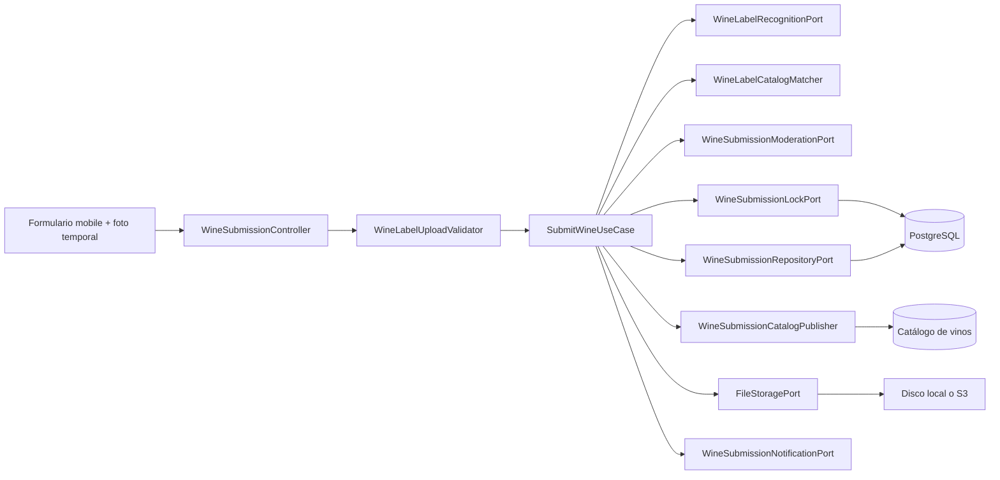
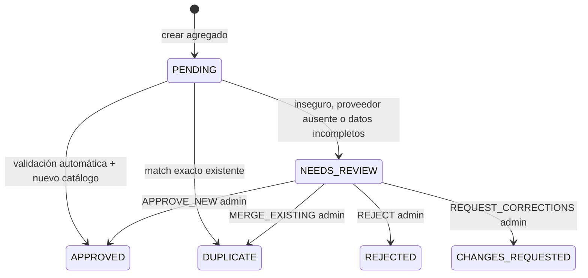
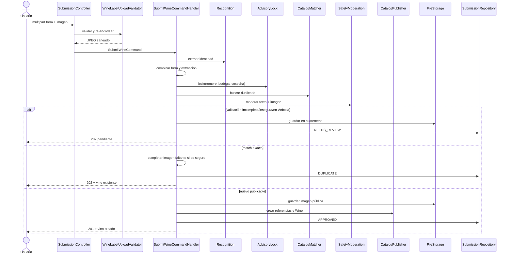
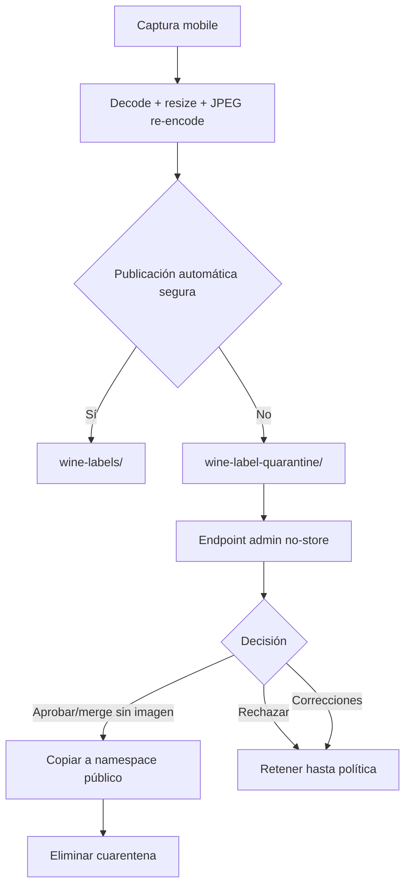

# Vinos propuestos: envío, moderación y publicación

El listado y el detalle de moderación incluyen `submittedByUsername`, resuelto mediante `WineSubmissionAuthorQueryPort`. El listado consulta los remitentes distintos en un solo lote; el detalle valida el acceso antes de resolver el nombre. No se expone el correo y las cuentas ausentes devuelven `null`. Las consultas del propietario conservan el contrato privado sin resolver nombres de otros usuarios.

## Objetivo

El circuito permite que un usuario incorpore un vino que no encontró por
escaneo ni búsqueda manual sin convertir entrada no confiable directamente en
catálogo. La foto capturada se reutiliza, el formulario aporta identidad básica,
el backend combina reconocimiento, deduplicación y moderación, y sólo publica de
forma automática cuando todas las evidencias necesarias son seguras.

`WineSubmission` es un agregado auditable separado de `Wine`. Esta separación es
la barrera principal entre propuesta y catálogo canónico.

## Arquitectura

[Ver diagrama de «Vinos propuestos: envío, moderación y publicación · Arquitectura» completo](https://images.vinnot.com/docs/diagrams/v1/es/modules-wines-submissions-10bf38938c7c.svg)

El controller valida el multipart y construye un comando. La parte `image` es
opcional: omitirla significa que la persona no tiene la botella a mano; una parte
`image` vacía sigue respondiendo 400. El handler decide el
flujo; el dominio controla transiciones; los adapters resuelven IA, persistencia,
locks, email y storage.

## Datos de la propuesta

Campos obligatorios:

- nombre del vino, hasta 255 caracteres;
- nombre de bodega, hasta 255 caracteres.

Campos opcionales:

- imagen JPEG o PNG válida (si se envía la parte `image`, tiene que serlo);

- tipo de vino, hasta 50 caracteres;
- cosecha entre 1800 y el máximo soportado por `Year`;
- hasta 10 uvas, 100 caracteres cada una;
- país y región, hasta 100 caracteres;
- alcohol entre 0 y 100;
- notas, hasta 1000 caracteres.

El agregado recorta strings y exige `submittedBy`, `wineName` y `wineryName`.
Datos ausentes pueden completarse con reconocimiento; el valor ingresado por el
usuario tiene precedencia.

## Referencias de catálogo

El formulario puede enviar además `wineryId`, `countryId` y `regionId` para los
valores elegidos del catálogo. Las versiones anteriores de la app envían solo
texto; se aceptan ambas formas. `WineSubmissionCatalogResolver` vincula los
valores antes de crear la submission:

- un ID elegido debe existir; si no, la solicitud falla con
  `INVALID_SUBMISSION_CATALOG_REFERENCE` (400). El nombre del catálogo
  reemplaza el texto enviado;
- una región elegida implica su país y debe pertenecer al país elegido;
- el texto sin ID, de apps anteriores o del reconocimiento de etiqueta, se
  vincula solo si exactamente una entrada del catálogo tiene ese nombre, sin
  distinguir mayúsculas, acentos ni puntuación (`CatalogNameNormalizer`);
- las uvas que coinciden con una variedad activa (nombre en inglés o español)
  toman el nombre del catálogo; el resto se guarda en `proposed_grapes`, un
  subconjunto de `grapes`.

Un texto con referencia NULL es una propuesta que un administrador aprueba o
fusiona. El detalle agrega `wineryId`, `countryId`, `regionId` y
`proposedGrapes`.

## Estados y transiciones

[Ver diagrama de «Estados y transiciones» completo](https://images.vinnot.com/docs/diagrams/v1/es/modules-wines-submissions-1f80a6767705.svg)

Toda decisión terminal conserva status, motivo, confidence, wine relacionado,
revisor y timestamps según corresponda. Sólo `PENDING` admite decisión
automática y sólo `NEEDS_REVIEW` admite decisión administrativa. Repetir una
decisión falla con `INVALID_SUBMISSION_TRANSITION`.

`APPROVED` referencia `createdWineId`; `DUPLICATE` referencia `matchedWineId`.
Una decisión automática no inventa `reviewedBy`; una decisión humana exige
revisor y motivo no vacío.

El diagrama representa el flujo invocado por los handlers. El dominio también
expone `reject(reason, confidence)` para `PENDING`, pero el ingreso HTTP utiliza
`requireReview` cuando no se permite publicación automática.

## Ingreso end-to-end

[Ver diagrama de «Ingreso end-to-end» completo](https://images.vinnot.com/docs/diagrams/v1/es/modules-wines-submissions-51ef5fe32d43.svg)

### Diagrama de actividad: de la propuesta a la publicación

Muestra en notación de actividad UML cómo una propuesta llega a cada estado, por decisión automática o administrativa.

```mermaid
flowchart TD
    start((" ")) --> a1("Enviar el formulario con la foto de la etiqueta")
    a1 --> a2("Validar y re-encodear la imagen")
    a2 --> a3("Reconocer la identidad y combinarla con el formulario")
    a3 --> a4("Tomar el lock de nombre, bodega y cosecha")
    a4 --> a5("Buscar duplicado y moderar texto e imagen")
    a5 --> d1{" "}
    d1 -->|"[match exacto]"| a6("DUPLICATE: vincular al vino existente")
    d1 -->|"[nuevo, seguro y con etiqueta de vino]"| a7("Publicar Wine e imagen: APPROVED")
    d1 -->|"[inseguro, incompleto o sin proveedor]"| a8("Imagen en cuarentena: NEEDS_REVIEW")
    a8 --> a9("Revisión de admin o moderador")
    a9 --> d2{" "}
    d2 -->|"[APPROVE_NEW]"| a7
    d2 -->|"[MERGE_EXISTING]"| a6
    d2 -->|"[REJECT]"| a10("REJECTED")
    d2 -->|"[REQUEST_CORRECTIONS]"| a11("CHANGES_REQUESTED")
    a6 & a7 & a10 & a11 --> m1{" "}
    m1 --> a12("Encolar el email del nuevo estado")
    a12 --> a13("El usuario consulta el estado en sus propuestas")
    a13 --> stop(((" ")))
    classDef bar fill:#30262c,stroke:#30262c,color:#30262c
    style start fill:#30262c,stroke:#30262c
    style stop fill:#30262c,stroke:#30262c
```

[Ver diagrama de «Diagrama de actividad: de la propuesta a la publicación» completo](https://images.vinnot.com/docs/diagrams/v1/es/modules-wines-submissions-62ee51cd3a61.svg)

## Formulario de la app

La foto se conserva como URI durante scan, búsqueda y formulario. En modo alta
(«Agregá tu vino»), la cámara ofrece «¿No tenés el vino a mano?» y «Cargar sin
foto», que abre el formulario sin foto con el aviso «Sin foto, un administrador
revisa el vino antes de publicarlo.»; el cliente omite entonces la parte `image`.
`WineSubmissionForm` inicializa campos desde datos extraídos. Nombre y bodega
son obligatorios; tipo, añada, uvas, país, región, alcohol y notas son opcionales.
Bodega, país, región y uvas son selectores del catálogo con búsqueda
(`CatalogSelectField`, `GrapesSelectField`); las regiones se limitan al país
elegido. "No está en la lista" conserva el texto como valor nuevo propuesto,
marcado para revisión. El prefill de la etiqueta y el texto que coinciden con
una sola entrada del catálogo, sin distinguir mayúsculas ni acentos, se vinculan
a ella. Los IDs elegidos se envían junto a sus nombres y los números se
transforman antes del multipart. El alcohol acepta coma o punto decimal (`13,6` / `13.6`) y se envía
como `13.6`, sin truncar; mantiene el rango 0–100 y rechaza separadores
múltiples o texto no numérico. El resultado de validación/deduplicación es del servidor.

`REJECTED` se presenta como error del resultado; otros estados usan el mensaje
retornado. La lista de envíos («Mis vinos enviados», en Perfil) consulta estado y
datos de la submission.

Desde un catálogo sin resultados, «Agregá tu vino» abre el scanner en modo
alta (`intent=add`): un scan sin `EXACT_MATCH` va directo a este formulario y el
texto buscado completa el nombre solo cuando la etiqueta no trae uno; el dato de
la etiqueta siempre gana.

Adjuntar una foto a un vino sin imagen usa un endpoint distinto de crear
submission. Una selección existente no es una instrucción para reemplazar una
imagen ya publicada.

## Reconocimiento y precedencia de datos

El reconocimiento extrae tipo, cosecha, uva, país, región, alcohol, texto
observado y señal `wineLabel`. El handler construye la propuesta de esta forma:

- texto del form si no está vacío; de otro modo texto extraído;
- valor del form si no es null; de otro modo valor extraído;
- lista de uvas del form si contiene elementos; si no, la uva extraída.

Una caída del proveedor de reconocimiento no hace fallar ni publica a ciegas:
se representa como extracción no disponible y empuja la propuesta a revisión.

La deduplicación reutiliza el mismo matcher determinista del escaneo. La
identidad se evalúa después de tomar un advisory lock para serializar propuestas
equivalentes durante la transacción.

## Moderación y política de fail-closed

`OpenAiWineSubmissionModerationAdapter` envía al endpoint de moderación:

- texto normalizado del formulario;
- imagen como data URI;
- modelo de moderación configurable.

La moderación responde sólo seguridad de contenido. La relevancia vinícola
proviene del puerto de reconocimiento, respetando responsabilidades separadas.

`WineSubmissionReview.permitsAutomaticPublication()` exige simultáneamente:

1. revisión completa;
2. contenido seguro;
3. evidencia de etiqueta de vino.

Si el proveedor está sin configurar, responde vacío, vence o falla, el flujo es
fail-closed: guarda la imagen en cuarentena y crea `NEEDS_REVIEW`. No rechaza al
usuario definitivamente ni publica material no certificado.

### Propuesta sin foto

Sin parte `image` (`SubmitWineCommand.hasLabelPhoto()` es falso), el handler no
reconoce la etiqueta, no modera y no guarda imagen. Solo corre el matcher con los
datos del formulario: una coincidencia exacta pasa a `DUPLICATE` vinculada a ese
vino, sin agregarle imagen; cualquier otro caso pasa a `NEEDS_REVIEW` con el
motivo `LABEL_PHOTO_MISSING` (texto guardado "No label photo was attached").
Nunca se publica automáticamente.

## Deduplicación y concurrencia

La clave de lock concatena nombre, bodega y cosecha normalizados:

- Unicode NFD y eliminación de diacríticos;
- minúsculas con `Locale.ROOT`;
- separadores no alfanuméricos convertidos a espacio;
- whitespace colapsado;
- cosecha ausente representada como `0`.

`PostgresWineSubmissionLockAdapter` usa
`pg_advisory_xact_lock(hashtextextended(key, 0))`. El lock dura la transacción y
serializa intentos equivalentes sin crear una fila de coordinación permanente.

Antes de publicar automáticamente se ejecuta el matcher. En revisión admin,
`APPROVE_NEW` vuelve a tomar el lock y crea el vino: respeta la decisión de quien
modera y nunca lo une a otro. Unir la propuesta a un vino existente se hace solo
con `MERGE_EXISTING`.

## Publicación automática

`WineSubmissionCatalogPublisher` acepta un DTO de aplicación y:

1. resuelve `WineType` de forma segura;
2. resuelve o crea referencias de país, región y bodega por
   `WineCatalogReferencePort`, usando primero los IDs de catálogo de la
   submission (un ID que ya no existe, o una región de otro país, vuelve al
   nombre), así una bodega elegida se reutiliza en lugar de duplicarse;
3. crea el agregado `Wine` con el submitter como `createdBy`;
4. aplica cosecha, uvas, alcohol y origen;
5. obtiene la imagen desde un supplier;
6. persiste y proyecta un resumen.

Una corrección escrita por el administrador reemplaza la elección: un nombre
nuevo de bodega o región descarta ese ID, y un país nuevo descarta los IDs de
país y región.

La publicación retorna vacío si falta un tipo reconocido o un país resoluble.
El handler elimina la copia pública temporal y deriva a revisión; no crea un
vino parcial.

## Vino duplicado e imagen faltante

Si el matcher encuentra el vino:

- la submission pasa a `DUPLICATE`;
- se devuelve el resumen del vino canónico;
- si el vino no tiene imagen y la revisión automática es segura, la captura se
  guarda como imagen administrada y completa `imageUrl`;
- si el vino ya tiene imagen, no se reemplaza.

La misma regla se aplica en merge administrativo: una imagen curada existente
tiene precedencia; una ausencia puede completarse promoviendo la captura
moderada.

`AttachWineLabelImageCommandHandler` expone además una operación específica para
un vino conocido sin imagen. Requiere que reconocimiento/matcher ubiquen ese
vino como primer candidato del ranking y que la moderación de seguridad se complete. Si el
vino ya tiene URL, responde idempotentemente sin almacenar otra copia.

## Cuarentena y ciclo de la imagen

[Ver diagrama de «Cuarentena y ciclo de la imagen» completo](https://images.vinnot.com/docs/diagrams/v1/es/modules-wines-submissions-61254df3ddc0.svg)

La URL de cuarentena apunta a `/api/admin/wine-submissions/{id}/image`; no se
expone a usuarios comunes. El response del propietario indica
`imageAvailable=true`, pero oculta la URL si `imageQuarantined=true`.

El endpoint admin devuelve `Cache-Control: no-store` y carga por submission ID.
En S3, los objetos se almacenan con cifrado server-side AES-256. La promoción
copia el objeto a `wine-labels/`; luego se elimina la copia privada.

Una propuesta sin foto también se puede aprobar como vino nuevo: el vino se
publica sin imagen. Si la propuesta tiene una etiqueta guardada que no está en
cuarentena, la aprobación sigue fallando con `SUBMISSION_IMAGE_REQUIRED`. La
regla de datos de catálogo no cambia: hace falta un tipo y un país conocido.

Con `provider=r2`, las etiquetas persistidas se convierten a WebP y el objeto
público se entrega por Worker; la cuarentena sigue privada vía API. Promover
una cuarentena histórica S3 también escribe la copia pública en R2. La limpieza
se encola/revalida mediante outbox después de la decisión, no depende de borrar
sincrónicamente durante el request. [Storage y límites](../../backend/use-cases/uploads-and-reference-data.md).

## Decisiones administrativas

| Decisión | Datos específicos | Resultado |
|---|---|---|
| `APPROVE_NEW` | catálogo corregido opcional | siempre crea el vino |
| `MERGE_EXISTING` | `targetWineId` | vincula a vino existente |
| `REJECT` | motivo | rechazo terminal |
| `REQUEST_CORRECTIONS` | motivo | queda esperando corrección del usuario |

Todas exigen reason. `APPROVE_NEW` permite sobreescribir los datos propuestos
con `WineSubmissionCatalogData`; los valores no nulos/no vacíos del admin tienen
precedencia. `MERGE_EXISTING` exige un target existente.

La superficie `/admin/wine-submissions/**` admite `ROLE_ADMIN` o `ROLE_MODERATOR` en la
frontera HTTP. La imagen no se obtiene por una URL pública de storage.

## Consulta del usuario y notificaciones

El usuario puede:

- listar sólo sus submissions, ordenadas por creación descendente;
- consultar detalle por ID sólo si `submittedBy` coincide con el principal;
- observar status, motivo, confidence y referencia de vino resultante;
- conocer que existe una imagen sin acceder a la cuarentena.

`GetWineSubmissionQueryHandler` valida ownership aunque el endpoint ya esté
autenticado, evitando IDOR.

Cada cambio de estado llama `WineSubmissionNotificationPort`. El adapter actual
encola en external_effects el snapshot de la decisión dentro de la transacción. El worker resuelve el destinatario y envía el email sólo después del commit, con reintentos durables. Un rollback no emite notificación; la entrega es al menos una vez.

El email se redacta en el `preferred_language` actual de quien envió la
propuesta, leído al momento de la entrega; el español es sólo el valor por
defecto. El estado se muestra como texto legible y localizado (por ejemplo
"Necesita revisión" / "Needs review"), nunca como el nombre del enum. Los
motivos siguen dos reglas:

- el motivo de un administrador se muestra tal como fue escrito;
- un motivo registrado por la revisión automática (sin `reviewedBy`) se envía
  como código `WineSubmissionSystemReason` y se muestra como texto localizado.
  El texto guardado en `review_reason` no cambia, por lo que los moderadores lo
  siguen viendo en la cola. Cualquier texto que no sea uno de los motivos
  automáticos conocidos, como la explicación propia de un proveedor de
  moderación, se asigna al código genérico `CONTENT_REVIEW` y nunca se muestra
  a quien envió la propuesta.

Las respuestas con el detalle de una propuesta (la lista de quien la envió y la
cola de moderación) traen el mismo código en `reasonCode`, para que la web y la
app muestren el motivo en el idioma de cada persona; vale `null` cuando el motivo
lo escribió un administrador. Si no hay un proveedor de moderación configurado o
no responde, el motivo registrado es `MODERATION_UNAVAILABLE`. Una propuesta sin
foto registra `LABEL_PHOTO_MISSING`, que se muestra como «Se envió sin foto de la
etiqueta, así que un administrador la revisará antes de publicarla.» / "It was sent
without a label photo, so an administrator will review it before publishing it."
(app y `submission_{es,en}.properties`).

## Retención y eliminación

El scheduler ejecuta por default a las 03:25 y purga en batches:

| Estado | Retención base |
|---|---:|
| `REJECTED` | 30 días |
| `CHANGES_REQUESTED` sin corregir | 90 días |

Por cada elemento elimina imagen pública y cuarentena antes de borrar la fila.
Los períodos, cron y batch size son configurables. `APPROVED`, `DUPLICATE` y
`NEEDS_REVIEW` no se incluyen en esas dos políticas.

## Métricas y costo

`SubmitWineCommandHandler` registra el estado final y la duración agregada al
construir su respuesta mediante `WineLabelMetricsPort`. La métrica no guarda
imágenes ni prueba por sí sola el commit posterior de la transacción.

El límite predeterminado de `wine-submission` es 10 solicitudes/día. Es un
límite de solicitudes del backend, distinto de la facturación del proveedor.
Los instrumentos implementados y sus tags se describen en
[observabilidad](../../backend/architecture/observability.md).

## Contratos HTTP

- una publicación automática nueva devuelve `201`;
- duplicate o review devuelve `202`;
- listar y detalle requieren autenticación;
- el admin puede filtrar por status y texto;
- las páginas usan el contrato común `PageResult`;
- errores de transición, acceso, imagen o datos incompletos usan códigos de
  dominio normalizados.

Ver rutas y payloads en [Catálogo de API](../../backend/architecture/api.md).

## Pruebas

### Dominio

- creación y limpieza de campos;
- clamp de confidence a 0–1;
- cada transición válida;
- prohibición de doble review;
- revisor/motivo obligatorios;
- referencias `createdWineId` versus `matchedWineId`.

### Aplicación

- precedencia form/extracción;
- reconocimiento o moderación no disponible deriva a review;
- contenido unsafe no se publica;
- exacto se marca duplicate;
- sin foto no reconoce ni modera: exacto es duplicate sin imagen y el resto
  `NEEDS_REVIEW` con `LABEL_PHOTO_MISSING`;
- aprobación admin de una propuesta sin foto publica el vino sin imagen;
- vino existente sin imagen se completa una vez;
- datos incompletos limpian imagen pública y crean cuarentena;
- aprobación admin como nuevo crea el vino aunque el catálogo tenga uno parecido;
- promoción/eliminación según decisión;
- ownership de detalle;
- notificación por cambio de estado;
- retención por cutoff y batch.

### Integración

- multipart real con JPEG/PNG válido e inválido, sin parte `image` y con una
  parte `image` vacía (400);
- re-encode elimina EXIF;
- advisory lock con transacciones PostgreSQL concurrentes;
- unicidad y foreign keys reales;
- local storage, S3 y R2 contract tests;
- endpoint de cuarentena admin con `no-store`;
- moderación/recognition simulados y proveedor real en suite opt-in.

## Referencias de código

- `backend/src/main/java/com/vinnot/wine/domain/model/WineSubmission.java`
- `backend/src/main/java/com/vinnot/wine/application/command/handler/SubmitWineCommandHandler.java`
- `backend/src/main/java/com/vinnot/wine/application/command/handler/ReviewWineSubmissionCommandHandler.java`
- `backend/src/main/java/com/vinnot/wine/application/service/WineSubmissionCatalogPublisher.java`
- `backend/src/main/java/com/vinnot/wine/infrastructure/web/controller/WineSubmissionController.java`
- `backend/src/main/java/com/vinnot/wine/infrastructure/web/controller/WineSubmissionAdminController.java`
- [Escaneo mobile](architecture.md)

La decisión administrativa bloquea la submission y exige NEEDS_REVIEW; una segunda decisión concurrente responde 409 INVALID_SUBMISSION_TRANSITION. Los [efectos externos](../../backend/architecture/session-and-data-integrity.md) no alteran esa atomicidad.
