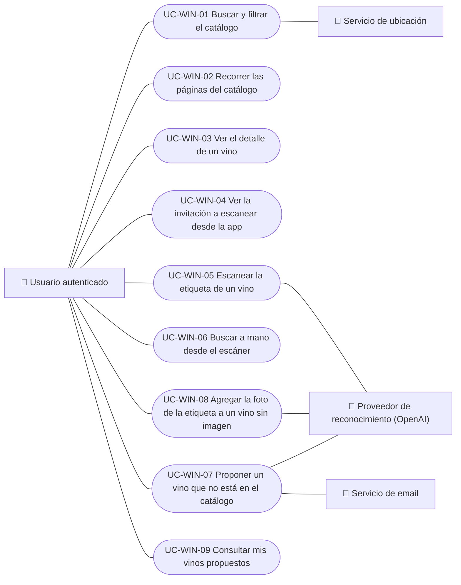

# Casos de uso

Casos de uso del módulo de vinos: buscar y recorrer el catálogo, ver el detalle, escanear etiquetas y proponer vinos nuevos. Cada caso vale para las plataformas indicadas.

| ID | Caso de uso | Plataformas | Actores |
|---|---|---|---|
| `UC-WIN-01` | [Buscar y filtrar el catálogo](uc-win-01-search-catalog.md) | Web, APK | Usuario autenticado, Servicio de ubicación |
| `UC-WIN-02` | [Recorrer las páginas del catálogo](uc-win-02-page-catalog.md) | Web, APK | Usuario autenticado |
| `UC-WIN-03` | [Ver el detalle de un vino](uc-win-03-view-wine-detail.md) | Web, APK | Usuario autenticado |
| `UC-WIN-04` | [Ver la invitación a escanear desde la app](uc-win-04-scan-invitation.md) | Web | Usuario autenticado |
| `UC-WIN-05` | [Escanear la etiqueta de un vino](uc-win-05-scan-label.md) | APK | Usuario autenticado, Proveedor de reconocimiento (OpenAI), Proveedor de embeddings de imagen (Google Gemini) |
| `UC-WIN-06` | [Buscar a mano desde el escáner](uc-win-06-manual-search-from-scan.md) | APK | Usuario autenticado |
| `UC-WIN-07` | [Proponer un vino que no está en el catálogo](uc-win-07-submit-wine.md) | APK | Usuario autenticado, Proveedor de reconocimiento (OpenAI), Servicio de email |
| `UC-WIN-08` | [Agregar la foto de la etiqueta a un vino sin imagen](uc-win-08-attach-label-photo.md) | APK | Usuario autenticado, Proveedor de reconocimiento (OpenAI) |
| `UC-WIN-09` | [Consultar mis vinos propuestos](uc-win-09-track-submissions.md) | APK | Usuario autenticado |

## Diagrama de casos de uso

[Ver diagrama de «Casos de uso · Diagrama de casos de uso» completo](https://images.vinnot.com/docs/diagrams/v1/es/modules-wines-use-cases-readme-f8dcc9a1cf46.svg)

## Equivalencia con Lucidchart

| ID | IDs en Lucidchart |
|---|---|
| `UC-WIN-01` | [WEB UC-WINE-01](https://lucid.app/lucidchart/9f11a16b-bb5a-42fc-a9e8-0852b17bd241/edit), [APK UC-WINE-01](https://lucid.app/lucidchart/e095dd25-e8ac-41ba-bf5b-396e1055f217/edit) |
| `UC-WIN-02` | [WEB UC-WINE-01](https://lucid.app/lucidchart/9f11a16b-bb5a-42fc-a9e8-0852b17bd241/edit), [APK UC-WINE-01](https://lucid.app/lucidchart/e095dd25-e8ac-41ba-bf5b-396e1055f217/edit) |
| `UC-WIN-03` | [WEB UC-WINE-02](https://lucid.app/lucidchart/9f11a16b-bb5a-42fc-a9e8-0852b17bd241/edit), [APK UC-WINE-02](https://lucid.app/lucidchart/e095dd25-e8ac-41ba-bf5b-396e1055f217/edit) |
| `UC-WIN-04` | [WEB UC-WINE-03](https://lucid.app/lucidchart/9f11a16b-bb5a-42fc-a9e8-0852b17bd241/edit) |
| `UC-WIN-05` | [APK UC-SCAN-01](https://lucid.app/lucidchart/e095dd25-e8ac-41ba-bf5b-396e1055f217/edit) |
| `UC-WIN-06` | [APK UC-SCAN-02](https://lucid.app/lucidchart/e095dd25-e8ac-41ba-bf5b-396e1055f217/edit) |
| `UC-WIN-07` | [APK UC-SCAN-03](https://lucid.app/lucidchart/e095dd25-e8ac-41ba-bf5b-396e1055f217/edit) |
| `UC-WIN-08` | [APK UC-SCAN-04](https://lucid.app/lucidchart/e095dd25-e8ac-41ba-bf5b-396e1055f217/edit) |
| `UC-WIN-09` | [APK UC-SCAN-05](https://lucid.app/lucidchart/e095dd25-e8ac-41ba-bf5b-396e1055f217/edit) |
