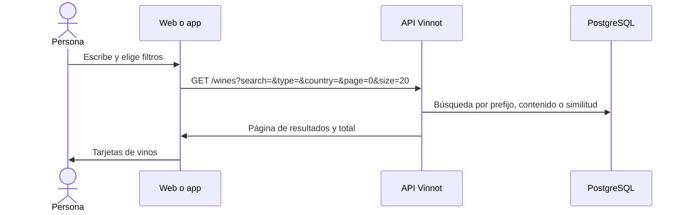

# UC-WIN-01 · Buscar y filtrar el catálogo

| Campo | Valor |
|---|---|
| ID | `UC-WIN-01` |
| Módulo | [Vinos](../README.md) |
| Plataformas | Web, APK |
| Actores | Usuario autenticado, Servicio de ubicación |
| IDs en Lucidchart | [WEB UC-WINE-01](https://lucid.app/lucidchart/9f11a16b-bb5a-42fc-a9e8-0852b17bd241/edit), [APK UC-WINE-01](https://lucid.app/lucidchart/e095dd25-e8ac-41ba-bf5b-396e1055f217/edit) |
| Requisitos | [`RF-WEB-WIN-01`](../requirements.md), [`RF-WEB-WIN-02`](../requirements.md), [`RF-WEB-WIN-03`](../requirements.md), [`RF-WEB-WIN-04`](../requirements.md), [`RF-WEB-WIN-05`](../requirements.md), [`RF-APK-WIN-01`](../requirements.md), [`RF-APK-WIN-02`](../requirements.md), [`RF-APK-WIN-03`](../requirements.md), [`RF-APK-WIN-04`](../requirements.md), [`RF-APK-WIN-05`](../requirements.md) |
| Casos de prueba | [`CP-WIN-01`](../testing.md), [`CP-WIN-02`](../testing.md), [`CP-WIN-03`](../testing.md), [`CP-WIN-04`](../testing.md), [`CP-WIN-05`](../testing.md), [`CP-WIN-06`](../testing.md), [`CP-WIN-07`](../testing.md), [`CP-WIN-08`](../testing.md) |

## Precondiciones

- La persona tiene sesión iniciada: el catálogo no es público.

## Postcondiciones

- Se muestran los vinos activos que cumplen el texto y los filtros, con el total.

## Flujo principal

1. La persona abre «Vinos».
2. En el primer ingreso el cliente propone el país de la ubicación del dispositivo, esperando hasta 10 segundos.
3. La persona escribe un texto y elige tipo, uva, país o región.
4. El cliente espera 400 ms sin cambios y pide `GET /wines` con el texto, los filtros y páginas de 20.
5. La API valida la consulta y busca entre los vinos activos.
6. El cliente muestra tarjetas con nombre, bodega, tipo, imagen y valoración, y el total.

## Flujos alternativos

- 3a. El texto tiene menos de 2 caracteres: no se envía y se mantiene el catálogo.
- 2a. No hay permiso de ubicación o no responde: se muestra el catálogo global.
- 3b. La persona cambia el país: se borra la región elegida.
- 3c. La persona limpia los filtros: vuelve el catálogo sin filtros y no se vuelve a proponer el país rechazado.
- 5a. Un texto de más de 512 caracteres responde 422 `INVALID_SEARCH`.
- 6a. No hay resultados: se muestra el estado vacío. En la app ofrece «Agregá tu vino», que abre el escáner para proponer el vino con el texto buscado como nombre ([UC-WIN-07](uc-win-07-submit-wine.md)), y «Limpiar» si hay filtros.
- 6b. La consulta falla: se muestra el estado de error.

## Reglas de negocio

- El texto busca por palabras sobre el nombre del vino y de la bodega: primero por prefijo y contenido y, si no hay resultados, por similitud (pg_trgm).
- El tipo se compara exacto; país y región, exactos sin distinguir mayúsculas; la uva, por contenido.
- Los vinos inactivos no aparecen nunca en el catálogo.
- Sin texto ni filtros el total es una estimación de PostgreSQL.
- En la app, un total menor a 500 se muestra exacto; desde 500, el tope de la ventana pública, se muestra como «Miles de vinos para descubrir» sin filtros, «Más de 500 vinos de {país}» con solo país o «Más de 500 vinos coinciden con tu búsqueda».
- Cada usuario puede hacer hasta 60 consultas por minuto a `GET /wines/**`.

## Diagrama

[Ver diagrama de «UC-WIN-01 · Buscar y filtrar el catálogo» completo](https://images.vinnot.com/docs/diagrams/v1/es/modules-wines-use-cases-uc-win-01-search-catalog-94c12fcba32b.svg)

Diagrama de componentes en Lucidchart: [WEB UC-WINE-01](https://lucid.app/lucidchart/9f11a16b-bb5a-42fc-a9e8-0852b17bd241/edit), [APK UC-WINE-01](https://lucid.app/lucidchart/e095dd25-e8ac-41ba-bf5b-396e1055f217/edit).

## Código

| Capa | Ubicación |
|---|---|
| Endpoints | `GET /wines`, `GET /grape-types` |
| Backend | [`WineReadController.java`](../../../../../backend/src/main/java/com/vinnot/wine/infrastructure/web/controller/WineReadController.java), [`SearchWinesQueryHandler.java`](../../../../../backend/src/main/java/com/vinnot/wine/application/query/handler/SearchWinesQueryHandler.java), [`PublicWineCatalogAccessPolicy.java`](../../../../../backend/src/main/java/com/vinnot/wine/infrastructure/web/policy/PublicWineCatalogAccessPolicy.java), [`WineSearchNativeRepository.java`](../../../../../backend/src/main/java/com/vinnot/wine/infrastructure/persistence/search/WineSearchNativeRepository.java), [`GrapeTypeController.java`](../../../../../backend/src/main/java/com/vinnot/wine/infrastructure/web/controller/GrapeTypeController.java) |
| Web | [`WineSearchPage.tsx`](../../../../../frontend-react/src/presentation/pages/wines/WineSearchPage.tsx), [`useWineSearchViewModel.ts`](../../../../../frontend-react/src/presentation/pages/wines/useWineSearchViewModel.ts), [`useWineSearch.ts`](../../../../../frontend-react/src/presentation/hooks/queries/wine/useWineSearch.ts), [`wines.service.ts`](../../../../../frontend-react/src/application/services/wines.service.ts), [`wines.service.helpers.ts`](../../../../../frontend-react/src/application/services/wines.service.helpers.ts), [`wines.core.client.ts`](../../../../../frontend-react/src/infrastructure/api/clients/wines.core.client.ts) |
| App | `frontend-mobile/app/(app)/(tabs)/wines/index.tsx`, [`useWinesBrowseViewModel.ts`](../../../../../frontend-mobile/src/presentation/features/wine/useWinesBrowseViewModel.ts), [`useWineCatalogPagination.ts`](../../../../../frontend-mobile/src/presentation/features/wine/useWineCatalogPagination.ts), [`useWines.ts`](../../../../../frontend-mobile/src/presentation/hooks/queries/wine/useWines.ts), [`wines.service.ts`](../../../../../frontend-mobile/src/application/services/wines.service.ts), [`wines.client.ts`](../../../../../frontend-mobile/src/infrastructure/api/clients/wines.client.ts) |

## Tests automáticos

- Backend: [`SearchWinesQueryHandlerTest.java`](../../../../../backend/src/test/java/com/vinnot/wine/application/query/handler/SearchWinesQueryHandlerTest.java), [`PublicWineCatalogAccessPolicyTest.java`](../../../../../backend/src/test/java/com/vinnot/wine/infrastructure/web/policy/PublicWineCatalogAccessPolicyTest.java), [`WineSearchNativeRepositoryTest.java`](../../../../../backend/src/test/java/com/vinnot/wine/infrastructure/persistence/search/WineSearchNativeRepositoryTest.java), [`SearchInputLimitsTest.java`](../../../../../backend/src/test/java/com/vinnot/shared/application/util/SearchInputLimitsTest.java), [`SecurityConfigAccessTest.java`](../../../../../backend/src/test/java/com/vinnot/shared/infrastructure/config/SecurityConfigAccessTest.java)
- Web: [`useWineSearchViewModel.test.tsx`](../../../../../frontend-react/src/presentation/pages/wines/useWineSearchViewModel.test.tsx), [`wines.service.test.ts`](../../../../../frontend-react/src/application/services/wines.service.test.ts), [`wines.core.client.test.ts`](../../../../../frontend-react/src/infrastructure/api/clients/wines.core.client.test.ts), [`wine-search-flow.spec.tsx`](../../../../../frontend-react/tests/unit/integration/wine-search-flow.spec.tsx), [`wines.spec.ts`](../../../../../frontend-react/tests/e2e/wines.spec.ts)
- App: [`winesBrowsePagination.test.tsx`](../../../../../frontend-mobile/src/presentation/features/wine/__tests__/winesBrowsePagination.test.tsx), [`wines.service.test.ts`](../../../../../frontend-mobile/src/application/services/wines.service.test.ts), [`wines.client.test.ts`](../../../../../frontend-mobile/src/infrastructure/api/clients/wines.client.test.ts)
