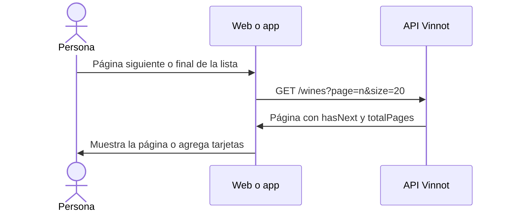

# UC-WIN-02 · Recorrer las páginas del catálogo

| Campo | Valor |
|---|---|
| ID | `UC-WIN-02` |
| Módulo | [Vinos](../README.md) |
| Plataformas | Web, APK |
| Actores | Usuario autenticado |
| IDs en Lucidchart | [WEB UC-WINE-01](https://lucid.app/lucidchart/9f11a16b-bb5a-42fc-a9e8-0852b17bd241/edit), [APK UC-WINE-01](https://lucid.app/lucidchart/e095dd25-e8ac-41ba-bf5b-396e1055f217/edit) |
| Requisitos | [`RF-WEB-WIN-06`](../requirements.md), [`RF-WEB-WIN-07`](../requirements.md), [`RF-WEB-WIN-08`](../requirements.md), [`RF-APK-WIN-06`](../requirements.md), [`RF-APK-WIN-07`](../requirements.md), [`RF-APK-WIN-08`](../requirements.md) |
| Casos de prueba | [`CP-WIN-09`](../testing.md), [`CP-WIN-10`](../testing.md), [`CP-WIN-11`](../testing.md), [`CP-WIN-12`](../testing.md), [`CP-WIN-13`](../testing.md), [`CP-WIN-14`](../testing.md) |

## Precondiciones

- Hay una búsqueda del catálogo en pantalla ([UC-WIN-01](uc-win-01-search-catalog.md)).

## Postcondiciones

- Se muestra la página pedida con los mismos criterios.

## Flujo principal

1. En la web, la persona pasa a la página siguiente o anterior; en la app, llega al final de la lista.
2. El cliente pide la página siguiente de 20 con los mismos criterios.
3. La API devuelve la página con `hasNext`, `hasPrevious` y `totalPages`.
4. En la web se reemplaza la página y la URL guarda `page`; en la app se agregan las tarjetas sin repetir vinos.

## Flujos alternativos

- 1a. En la web, mientras llega la página nueva se sigue mostrando la anterior.
- 1b. En la app no se pide otra página si hay una en curso, si no hay siguiente o después de un error.
- 1c. En la app, al tirar hacia abajo se recarga la primera página y la lista se reemplaza solo si la carga sale bien.
- 1d. Cambian los criterios o la cuenta: se vuelve a la página 0.
- 3a. La página pedida supera los primeros 500 resultados: la API responde 400 `PUBLIC_CATALOG_WINDOW_EXCEEDED`.

## Reglas de negocio

- El tamaño máximo de página es 20 y solo se pueden recorrer los primeros 500 resultados; el total informado tampoco pasa de 500.
- Una página negativa responde 400 `INVALID_PAGE` y un tamaño no positivo, 400 `INVALID_PAGE_SIZE`.
- La web lee de la URL `q` o `search`, `type`, `grape`, `country`, `region` y `page`.

## Diagrama

[Ver diagrama de «UC-WIN-02 · Recorrer las páginas del catálogo» completo](https://images.vinnot.com/docs/diagrams/v1/es/modules-wines-use-cases-uc-win-02-page-catalog-b315453a8a13.svg)

Diagrama de componentes en Lucidchart: [WEB UC-WINE-01](https://lucid.app/lucidchart/9f11a16b-bb5a-42fc-a9e8-0852b17bd241/edit), [APK UC-WINE-01](https://lucid.app/lucidchart/e095dd25-e8ac-41ba-bf5b-396e1055f217/edit).

## Código

| Capa | Ubicación |
|---|---|
| Endpoints | `GET /wines?page=&size=20` |
| Backend | [`WineReadController.java`](../../../../../backend/src/main/java/com/vinnot/wine/infrastructure/web/controller/WineReadController.java), [`PublicWineCatalogAccessPolicy.java`](../../../../../backend/src/main/java/com/vinnot/wine/infrastructure/web/policy/PublicWineCatalogAccessPolicy.java), [`WineSearchNativeRepository.java`](../../../../../backend/src/main/java/com/vinnot/wine/infrastructure/persistence/search/WineSearchNativeRepository.java) |
| Web | [`WineSearchPage.tsx`](../../../../../frontend-react/src/presentation/pages/wines/WineSearchPage.tsx), [`useWineSearchViewModel.ts`](../../../../../frontend-react/src/presentation/pages/wines/useWineSearchViewModel.ts), [`useWineSearch.ts`](../../../../../frontend-react/src/presentation/hooks/queries/wine/useWineSearch.ts) |
| App | [`useWinesBrowseViewModel.ts`](../../../../../frontend-mobile/src/presentation/features/wine/useWinesBrowseViewModel.ts), [`useWineCatalogPagination.ts`](../../../../../frontend-mobile/src/presentation/features/wine/useWineCatalogPagination.ts) |

## Tests automáticos

- Backend: [`PublicWineCatalogAccessPolicyTest.java`](../../../../../backend/src/test/java/com/vinnot/wine/infrastructure/web/policy/PublicWineCatalogAccessPolicyTest.java), [`WineSearchNativeRepositoryTest.java`](../../../../../backend/src/test/java/com/vinnot/wine/infrastructure/persistence/search/WineSearchNativeRepositoryTest.java)
- Web: [`useWineSearchViewModel.test.tsx`](../../../../../frontend-react/src/presentation/pages/wines/useWineSearchViewModel.test.tsx), [`useWineQueries.spec.tsx`](../../../../../frontend-react/tests/unit/hooks/useWineQueries.spec.tsx)
- App: [`winesBrowsePagination.test.tsx`](../../../../../frontend-mobile/src/presentation/features/wine/__tests__/winesBrowsePagination.test.tsx)
