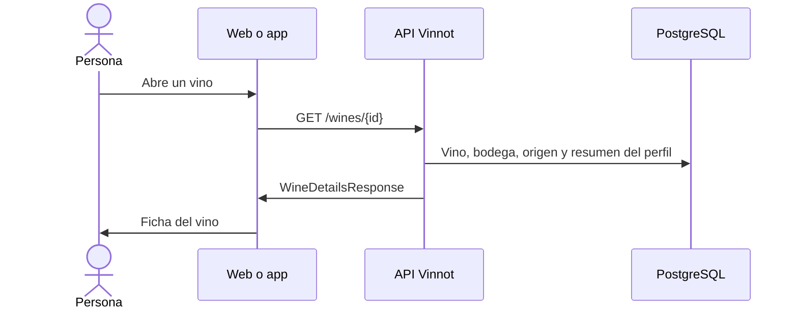

# UC-WIN-03 · Ver el detalle de un vino

| Campo | Valor |
|---|---|
| ID | `UC-WIN-03` |
| Módulo | [Vinos](../README.md) |
| Plataformas | Web, APK |
| Actores | Usuario autenticado |
| IDs en Lucidchart | [WEB UC-WINE-02](https://lucid.app/lucidchart/9f11a16b-bb5a-42fc-a9e8-0852b17bd241/edit), [APK UC-WINE-02](https://lucid.app/lucidchart/e095dd25-e8ac-41ba-bf5b-396e1055f217/edit) |
| Requisitos | [`RF-WEB-WIN-09`](../requirements.md), [`RF-WEB-WIN-10`](../requirements.md), [`RF-WEB-WIN-11`](../requirements.md), [`RF-APK-WIN-09`](../requirements.md), [`RF-APK-WIN-10`](../requirements.md), [`RF-APK-WIN-11`](../requirements.md) |
| Casos de prueba | [`CP-WIN-15`](../testing.md), [`CP-WIN-16`](../testing.md), [`CP-WIN-17`](../testing.md) |

## Precondiciones

- La persona tiene sesión iniciada y eligió un vino.

## Postcondiciones

- Se muestra la ficha del vino; leerla no genera un perfil con IA.

## Flujo principal

1. La persona abre un vino desde el catálogo, el inicio u otro módulo.
2. El cliente pide `GET /wines/{id}`.
3. La API carga el vino, su bodega con el origen y el resumen del perfil guardado.
4. El cliente muestra los datos del vino (descripción en el idioma de la interfaz, bodega y origen, uvas, alcohol y valoración) y el resumen sensorial, separados de las reseñas y del perfil con IA.
5. Ofrece ir a la bodega, comparar, compartir y agregar a la cava.

## Flujos alternativos

- 3a. El vino no existe, o está inactivo y quien consulta no es del equipo de catálogo ni quien lo creó: la API responde 404 y el cliente muestra que no se encontró.
- 4a. Falta un dato: no se muestra ese bloque y no se inventa un valor.

## Reglas de negocio

- El resumen sensorial usa los valores del vino y completa los que faltan con el perfil guardado; respeta los valores cargados a mano y los ceros.
- Las reseñas, el perfil con IA y la cava se piden aparte; el detalle no los incluye.
- Si la imagen falta o no carga, se muestra una imagen por defecto.

## Diagrama

[Ver diagrama de «UC-WIN-03 · Ver el detalle de un vino» completo](https://images.vinnot.com/docs/diagrams/v1/es/modules-wines-use-cases-uc-win-03-view-wine-detail-6d866d79e9dd.svg)

Diagrama de componentes en Lucidchart: [WEB UC-WINE-02](https://lucid.app/lucidchart/9f11a16b-bb5a-42fc-a9e8-0852b17bd241/edit), [APK UC-WINE-02](https://lucid.app/lucidchart/e095dd25-e8ac-41ba-bf5b-396e1055f217/edit).

## Código

| Capa | Ubicación |
|---|---|
| Endpoints | `GET /wines/{id}` |
| Backend | [`WineReadController.java`](../../../../../backend/src/main/java/com/vinnot/wine/infrastructure/web/controller/WineReadController.java), [`GetWineByIdQueryHandler.java`](../../../../../backend/src/main/java/com/vinnot/wine/application/query/handler/GetWineByIdQueryHandler.java) |
| Web | [`WineDetailsPage.tsx`](../../../../../frontend-react/src/presentation/pages/wines/WineDetailsPage.tsx), [`useWineDetailsViewModel.ts`](../../../../../frontend-react/src/presentation/pages/wines/useWineDetailsViewModel.ts), [`wine.mappers.details.ts`](../../../../../frontend-react/src/domain/wine/wine.mappers.details.ts) |
| App | `frontend-mobile/app/(app)/(tabs)/wines/[id].tsx`, [`useWines.ts`](../../../../../frontend-mobile/src/presentation/hooks/queries/wine/useWines.ts), [`wine.quick-info.ts`](../../../../../frontend-mobile/src/domain/wine/wine.quick-info.ts) |

## Tests automáticos

- Backend: [`GetWineByIdQueryHandlerTest.java`](../../../../../backend/src/test/java/com/vinnot/wine/application/query/handler/GetWineByIdQueryHandlerTest.java), [`CheckWineReadAccessQueryHandlerTest.java`](../../../../../backend/src/test/java/com/vinnot/wine/application/query/handler/CheckWineReadAccessQueryHandlerTest.java), [`WineResourceAccessInterceptorTest.java`](../../../../../backend/src/test/java/com/vinnot/wine/infrastructure/web/WineResourceAccessInterceptorTest.java)
- Web: [`wine.mappers.test.ts`](../../../../../frontend-react/src/domain/wine/wine.mappers.test.ts), [`WineTasteProfile.test.tsx`](../../../../../frontend-react/src/presentation/components/features/wine/WineTasteProfile.test.tsx), [`wine.quick-info.test.ts`](../../../../../frontend-react/src/domain/wine/wine.quick-info.test.ts)
- App: [`wine.mappers.test.ts`](../../../../../frontend-mobile/src/domain/wine/wine.mappers.test.ts), [`wine.quick-info.test.ts`](../../../../../frontend-mobile/src/domain/wine/wine.quick-info.test.ts), [`WineImage.test.tsx`](../../../../../frontend-mobile/src/presentation/features/wine/WineImage.test.tsx)
