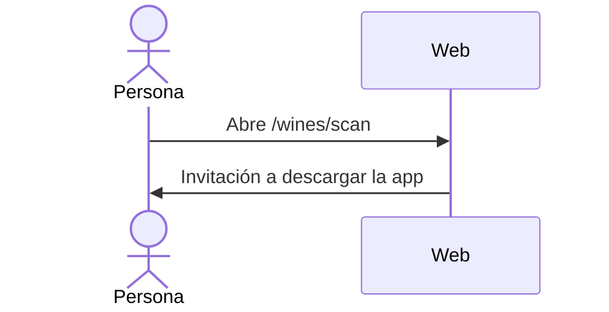

# UC-WIN-04 · Ver la invitación a escanear desde la app

| Campo | Valor |
|---|---|
| ID | `UC-WIN-04` |
| Módulo | [Vinos](../README.md) |
| Plataformas | Web |
| Actores | Usuario autenticado |
| IDs en Lucidchart | [WEB UC-WINE-03](https://lucid.app/lucidchart/9f11a16b-bb5a-42fc-a9e8-0852b17bd241/edit) |
| Requisitos | [`RF-WEB-WIN-12`](../requirements.md) |
| Casos de prueba | [`CP-WIN-18`](../testing.md) |

## Precondiciones

- La persona tiene sesión iniciada en la web.

## Postcondiciones

- La persona sabe que el escaneo está en la app y cómo descargarla.

## Flujo principal

1. La persona abre `/wines/scan`.
2. La web muestra la invitación a descargar la app para escanear etiquetas.

## Flujos alternativos

No tiene.

## Reglas de negocio

- La web no usa la cámara, no procesa archivos y no llama al reconocimiento.

## Diagrama

[Ver diagrama de «UC-WIN-04 · Ver la invitación a escanear desde la app» completo](https://images.vinnot.com/docs/diagrams/v1/es/modules-wines-use-cases-uc-win-04-scan-invitation-108649e7a91c.svg)

Diagrama de componentes en Lucidchart: [WEB UC-WINE-03](https://lucid.app/lucidchart/9f11a16b-bb5a-42fc-a9e8-0852b17bd241/edit).

## Código

| Capa | Ubicación |
|---|---|
| Web | [`WineScanPage.tsx`](../../../../../frontend-react/src/presentation/pages/wines/WineScanPage.tsx) |

## Tests automáticos

- Backend: Ninguno
- Web: [`wines.spec.ts`](../../../../../frontend-react/tests/e2e/wines.spec.ts)
- App: Ninguno
