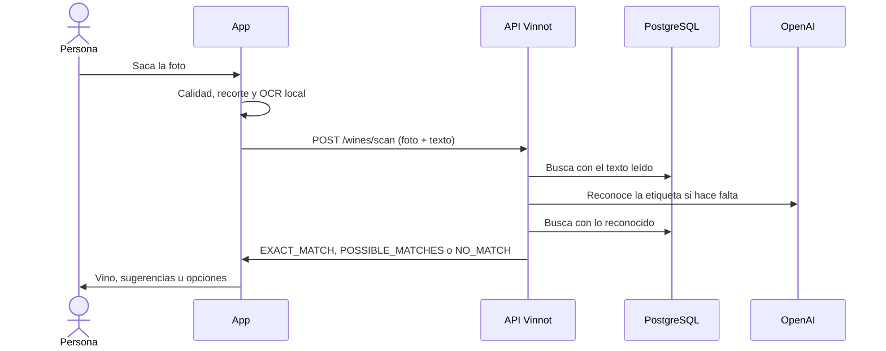

# UC-WIN-05 · Escanear la etiqueta de un vino

| Campo | Valor |
|---|---|
| ID | `UC-WIN-05` |
| Módulo | [Vinos](../README.md) |
| Plataformas | APK |
| Actores | Usuario autenticado, Proveedor de reconocimiento (OpenAI) |
| IDs en Lucidchart | [APK UC-SCAN-01](https://lucid.app/lucidchart/e095dd25-e8ac-41ba-bf5b-396e1055f217/edit) |
| Requisitos | [`RF-APK-WIN-12`](../requirements.md), [`RF-APK-WIN-13`](../requirements.md), [`RF-APK-WIN-14`](../requirements.md), [`RF-APK-WIN-15`](../requirements.md), [`RF-APK-WIN-16`](../requirements.md), [`RF-APK-WIN-17`](../requirements.md), [`RF-APK-WIN-18`](../requirements.md) |
| Casos de prueba | [`CP-WIN-19`](../testing.md), [`CP-WIN-20`](../testing.md), [`CP-WIN-21`](../testing.md), [`CP-WIN-22`](../testing.md), [`CP-WIN-23`](../testing.md), [`CP-WIN-24`](../testing.md), [`CP-WIN-25`](../testing.md), [`CP-WIN-42`](../testing.md) |

## Precondiciones

- La persona tiene sesión iniciada en la app.

## Postcondiciones

- La persona ve el vino reconocido, hasta tres sugerencias o la opción de buscar o proponer el vino.
- Escanear no guarda la foto en el catálogo.

## Flujo principal

1. La persona abre el escáner desde el inicio o desde «Vinos».
2. La app pide permiso de cámara.
3. La persona encuadra la etiqueta y saca la foto; la imagen queda congelada.
4. La app revisa resolución, luz y foco, recorta y guarda la foto en JPEG de hasta 1600 px.
5. La app lee el texto de la etiqueta en el dispositivo (hasta 24 líneas de 120 caracteres y 2000 en total).
6. La app envía `POST /wines/scan` con la foto y el texto leído.
7. La API valida la foto, busca primero en el catálogo con el texto leído y, si no hay coincidencia exacta, reconoce la etiqueta con OpenAI y vuelve a buscar.
8. La API responde `EXACT_MATCH`, `POSSIBLE_MATCHES` (hasta 3) o `NO_MATCH`.
9. Con coincidencia exacta, la app muestra el vino con «Ver detalles»; con sugerencias, la persona elige una; sin coincidencias, ofrece buscar a mano o proponer el vino.

## Flujos alternativos

- 2a. La persona no da permiso de cámara: la app explica que hace falta para escanear.
- 4a. La foto está oscura, muy iluminada, desenfocada o tiene poca resolución: la app lo indica y pide otra toma.
- 7a. Se superan los 18 segundos: la API responde 503 `LABEL_SCAN_TIMEOUT` y la app informa la demora, conserva la foto y ofrece reintentar, buscar a mano o sacar otra.
- 7b. El reconocimiento no está disponible o no está configurado: la app lo informa y conserva la foto.
- 6a. La persona superó 30 escaneos en la hora: la API responde 429 y la app explica que llegó al límite de escaneos y sugiere esperar unos minutos o buscar el vino por su nombre, conservando la foto.
- 7c. La API rechaza la foto (`INVALID_LABEL_IMAGE`), el texto leído (`INVALID_LABEL_TEXT`) o está procesando demasiadas imágenes (503 `IMAGE_PROCESSING_BUSY`): la app muestra un mensaje propio para cada caso (formato o tamaño de la foto, demasiado texto, esperar unos segundos) y conserva la foto.
- 1a. La persona cancela o sale: la app descarta las respuestas que lleguen tarde y borra solo los archivos temporales que creó.

## Reglas de negocio

- La foto debe ser JPEG o PNG, de hasta 8 MiB y 24 Mpx, con lado corto de al menos 320 px y lado largo de al menos 720 px.
- Una coincidencia es exacta con puntaje 0,90, o 0,80 con identidad completa, y una ventaja de 0,06 sobre otra candidata; las sugerencias empiezan en 0,42 y nunca se muestran por encima de 0,89.
- Si el servidor está procesando otras imágenes al límite, responde 503 `IMAGE_PROCESSING_BUSY`.

## Diagrama

[Ver diagrama de «UC-WIN-05 · Escanear la etiqueta de un vino» completo](https://images.vinnot.com/docs/diagrams/v1/es/modules-wines-use-cases-uc-win-05-scan-label-e2a2fb89b381.svg)

Diagrama de componentes en Lucidchart: [APK UC-SCAN-01](https://lucid.app/lucidchart/e095dd25-e8ac-41ba-bf5b-396e1055f217/edit).

## Código

| Capa | Ubicación |
|---|---|
| Endpoints | `POST /wines/scan` |
| Backend | [`WineLabelScanController.java`](../../../../../backend/src/main/java/com/vinnot/wine/infrastructure/web/controller/WineLabelScanController.java), [`ScanWineLabelCommandHandler.java`](../../../../../backend/src/main/java/com/vinnot/wine/application/command/handler/ScanWineLabelCommandHandler.java), [`WineLabelUploadValidator.java`](../../../../../backend/src/main/java/com/vinnot/wine/infrastructure/web/WineLabelUploadValidator.java), [`WineLabelCatalogMatcher.java`](../../../../../backend/src/main/java/com/vinnot/wine/application/service/WineLabelCatalogMatcher.java), [`OpenAiWineLabelRecognitionAdapter.java`](../../../../../backend/src/main/java/com/vinnot/wine/infrastructure/ai/OpenAiWineLabelRecognitionAdapter.java) |
| App | `frontend-mobile/app/(app)/(tabs)/wines/scan.tsx`, [`WineLabelScanScreen.tsx`](../../../../../frontend-mobile/src/presentation/features/wine/scan/WineLabelScanScreen.tsx), [`useWineLabelScanViewModel.ts`](../../../../../frontend-mobile/src/presentation/features/wine/scan/useWineLabelScanViewModel.ts), [`WineLabelCamera.tsx`](../../../../../frontend-mobile/src/infrastructure/device/camera/WineLabelCamera.tsx), [`wineLabelTextRecognizer.ts`](../../../../../frontend-mobile/src/infrastructure/device/camera/wineLabelTextRecognizer.ts), [`wineLabelImageProcessor.ts`](../../../../../frontend-mobile/src/infrastructure/device/camera/wineLabelImageProcessor.ts), [`wineLabelTemporaryImages.ts`](../../../../../frontend-mobile/src/infrastructure/device/camera/wineLabelTemporaryImages.ts) |

## Tests automáticos

- Backend: [`ScanWineLabelCommandHandlerTest.java`](../../../../../backend/src/test/java/com/vinnot/wine/application/command/handler/ScanWineLabelCommandHandlerTest.java), [`WineLabelCatalogMatcherTest.java`](../../../../../backend/src/test/java/com/vinnot/wine/application/service/WineLabelCatalogMatcherTest.java), [`WineLabelMatchScorerTest.java`](../../../../../backend/src/test/java/com/vinnot/wine/domain/service/WineLabelMatchScorerTest.java), [`WineLabelUploadValidatorTest.java`](../../../../../backend/src/test/java/com/vinnot/wine/infrastructure/web/WineLabelUploadValidatorTest.java), [`WineLabelObservedTextValidatorTest.java`](../../../../../backend/src/test/java/com/vinnot/wine/infrastructure/web/WineLabelObservedTextValidatorTest.java), [`OpenAiWineLabelRecognitionAdapterTest.java`](../../../../../backend/src/test/java/com/vinnot/wine/infrastructure/ai/OpenAiWineLabelRecognitionAdapterTest.java), [`WineLabelScanDeadlineTest.java`](../../../../../backend/src/test/java/com/vinnot/wine/application/service/WineLabelScanDeadlineTest.java), [`WineLabelScanPolicyTest.java`](../../../../../backend/src/test/java/com/vinnot/wine/application/service/WineLabelScanPolicyTest.java)
- Web: Ninguno
- App: [`useWineLabelScanViewModel.test.ts`](../../../../../frontend-mobile/src/presentation/features/wine/scan/useWineLabelScanViewModel.test.ts), [`WineLabelScanScreen.test.tsx`](../../../../../frontend-mobile/src/presentation/features/wine/scan/WineLabelScanScreen.test.tsx), [`WineLabelCamera.test.tsx`](../../../../../frontend-mobile/src/infrastructure/device/camera/WineLabelCamera.test.tsx), [`wineLabelTextRecognizer.test.ts`](../../../../../frontend-mobile/src/infrastructure/device/camera/wineLabelTextRecognizer.test.ts), [`wineLabelImageProcessor.test.ts`](../../../../../frontend-mobile/src/infrastructure/device/camera/wineLabelImageProcessor.test.ts), [`wineLabelTemporaryImages.test.ts`](../../../../../frontend-mobile/src/infrastructure/device/camera/wineLabelTemporaryImages.test.ts), [`wineLabelImageQuality.test.ts`](../../../../../frontend-mobile/src/shared/image/wineLabelImageQuality.test.ts)
