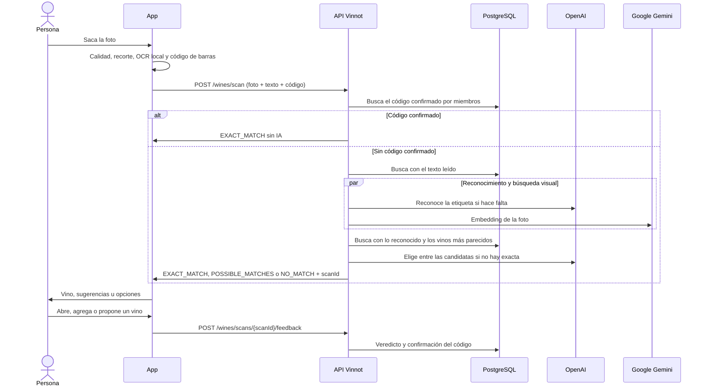

# UC-WIN-05 · Escanear la etiqueta de un vino

| Campo | Valor |
|---|---|
| ID | `UC-WIN-05` |
| Módulo | [Vinos](../README.md) |
| Plataformas | APK |
| Actores | Usuario autenticado, Proveedor de reconocimiento (OpenAI), Proveedor de embeddings de imagen (Google Gemini) |
| IDs en Lucidchart | [APK UC-SCAN-01](https://lucid.app/lucidchart/e095dd25-e8ac-41ba-bf5b-396e1055f217/edit) |
| Requisitos | [`RF-APK-WIN-12`](../requirements.md), [`RF-APK-WIN-13`](../requirements.md), [`RF-APK-WIN-14`](../requirements.md), [`RF-APK-WIN-15`](../requirements.md), [`RF-APK-WIN-16`](../requirements.md), [`RF-APK-WIN-17`](../requirements.md), [`RF-APK-WIN-18`](../requirements.md), [`RF-APK-WIN-24`](../requirements.md), [`RF-APK-WIN-25`](../requirements.md), [`RF-APK-WIN-26`](../requirements.md), [`RF-APK-WIN-27`](../requirements.md) |
| Casos de prueba | [`CP-WIN-19`](../testing.md), [`CP-WIN-20`](../testing.md), [`CP-WIN-21`](../testing.md), [`CP-WIN-22`](../testing.md), [`CP-WIN-23`](../testing.md), [`CP-WIN-24`](../testing.md), [`CP-WIN-25`](../testing.md), [`CP-WIN-42`](../testing.md), [`CP-WIN-44`](../testing.md), [`CP-WIN-45`](../testing.md), [`CP-WIN-46`](../testing.md), [`CP-WIN-47`](../testing.md), [`CP-WIN-48`](../testing.md), [`CP-WIN-49`](../testing.md), [`CP-WIN-50`](../testing.md), [`CP-WIN-51`](../testing.md), [`CP-WIN-52`](../testing.md), [`CP-WIN-53`](../testing.md) |

## Precondiciones

- La persona tiene sesión iniciada en la app.

## Postcondiciones

- La persona ve el vino reconocido, hasta tres sugerencias o la opción de buscar o proponer el vino.
- Escanear no guarda la foto en el catálogo.
- El escaneo queda registrado con su resultado, el código de barras leído y, cuando la persona actúa sobre el resultado, su veredicto.

## Flujo principal

1. La persona abre el escáner desde el inicio o desde «Vinos».
2. La app pide permiso de cámara.
3. La persona encuadra la etiqueta y saca la foto; la imagen queda congelada. Mientras encuadra, la cámara también lee el código de barras EAN o UPC de la botella si está a la vista.
4. La app revisa resolución, luz y foco, recorta y guarda la foto en JPEG de hasta 1600 px.
5. La app lee el texto de la etiqueta en el dispositivo (hasta 24 líneas de 120 caracteres y 2000 en total).
6. La app envía `POST /wines/scan` con la foto, el texto leído y, si leyó uno, el `barcode`.
7. La API valida la foto, busca primero en el catálogo con el texto leído y, si no hay coincidencia exacta, reconoce la etiqueta con OpenAI y vuelve a buscar. Mientras OpenAI lee la etiqueta, la API compara la foto con las etiquetas del catálogo que aloja Vinnot (búsqueda visual) y suma los vinos más parecidos a las candidatas.
8. Si la búsqueda no alcanza para una coincidencia exacta, OpenAI mira la foto junto con las mejores candidatas de texto y de imagen, lee el productor y el producto impresos y elige una o ninguna. La elección cuenta como exacta solo si las palabras leídas en la etiqueta la respaldan.
9. La API registra el escaneo y responde `EXACT_MATCH`, `POSSIBLE_MATCHES` (hasta 3) o `NO_MATCH`, con el `scanId` del escaneo registrado.
10. Con coincidencia exacta, la app muestra el vino con «Ver detalles»; con sugerencias, la persona elige una; sin coincidencias, ofrece buscar a mano o proponer el vino.
11. Cuando la persona abre o agrega un vino desde el resultado, o propone el vino, la app envía una sola vez por escaneo `POST /wines/scans/{scanId}/feedback`, sin esperar la respuesta: `CONFIRMED` con el vino coincidente, `CORRECTED` con otra sugerencia o resultado de búsqueda, o `NOT_IN_CATALOG` al proponer el vino. La API guarda el veredicto en el escaneo y responde 204; si el veredicto es `CONFIRMED` y el escaneo trajo un código de barras, registra además la confirmación de la persona de que ese código corresponde a ese vino.

## Flujos alternativos

- 1a. La persona cancela o sale: la app descarta las respuestas que lleguen tarde y borra solo los archivos temporales que creó.
- 2a. La persona no da permiso de cámara: la app explica que hace falta para escanear.
- 3a. La cámara lee un código de barras de 8, 12, 13 o 14 dígitos con dígito verificador válido: la app muestra «Leímos el código de barras» y lo envía con el escaneo; los demás códigos se ignoran.
- 4a. La foto está oscura, muy iluminada, desenfocada o tiene poca resolución: la app lo indica y pide otra toma.
- 6a. La persona superó 30 escaneos en la hora: la API responde 429 y la app explica que llegó al límite de escaneos y sugiere esperar unos minutos o buscar el vino por su nombre, conservando la foto.
- 6b. La parte `barcode` no tiene 8, 12, 13 o 14 dígitos o su dígito verificador GS1 es incorrecto: la API responde 400 `INVALID_LABEL_BARCODE`.
- 7a. Se superan los 18 segundos: la API responde 503 `LABEL_SCAN_TIMEOUT` y la app informa la demora, conserva la foto y ofrece reintentar, buscar a mano o sacar otra.
- 7b. El reconocimiento no está disponible o no está configurado: la app lo informa y conserva la foto.
- 7c. La API rechaza la foto (`INVALID_LABEL_IMAGE`), el texto leído (`INVALID_LABEL_TEXT`) o está procesando demasiadas imágenes (503 `IMAGE_PROCESSING_BUSY`): la app muestra un mensaje propio para cada caso (formato o tamaño de la foto, demasiado texto, esperar unos segundos) y conserva la foto.
- 7d. La búsqueda visual o la elección entre candidatas no están disponibles, tardan o no eligen con seguridad: el escaneo sigue con el resultado del catálogo, sin error.
- 7e. La IA está ocupada con otras tareas: el escaneo usa el cupo reservado para escaneos o espera hasta 4 segundos un cupo libre antes de responder 503 `AI_CAPACITY_EXCEEDED`.
- 7f. El código de barras fue confirmado para un vino activo por al menos dos miembros, y por más miembros que cualquier otro vino: la API responde `EXACT_MATCH` con ese vino y confianza 1,0, sin llamar a OpenAI ni buscar en el catálogo. Ese escaneo no suma punto de escaneo ni guarda el código, así que un veredicto sobre él nunca refuerza el código que lo respondió.
- 10a. No hay coincidencia exacta: la app ofrece una vez «Escanear la contraetiqueta». La persona fotografía la contraetiqueta; la app lee su texto, lo combina con la lectura del frente, conserva la foto del frente y vuelve a enviar el escaneo.
- 10b. La etiqueta muestra una añada entre 1900 y el año actual: la app la pasa al vino que abre y, al agregar ese vino a la cava, «Añada» viene precargada en una entrada nueva; una entrada existente conserva su propia añada.
- 11a. La persona corrige una coincidencia exacta con otro vino: además de guardar el veredicto, Vinnot abre una denuncia de calidad de catálogo sobre ambos vinos para el equipo de moderación ([UC-ADM-07](../../admin/use-cases/uc-adm-07-moderate-reports.md)); el catálogo nunca se edita automáticamente.
- 11b. El escaneo no existe o es de otra persona (404 `SCAN_NOT_FOUND`), el vino no existe o está inactivo (404 `WINE_NOT_FOUND`), el veredicto y el vino no son coherentes, o `CONFIRMED` nombra un vino distinto de la coincidencia exacta del escaneo (400 `INVALID_SCAN_FEEDBACK`): la API no guarda nada.
- 11c. Falla el envío del veredicto o el escaneo no tiene `scanId`: la app no muestra nada y la persona sigue.

## Reglas de negocio

- La foto debe ser JPEG o PNG, de hasta 8 MiB y 24 Mpx, con lado corto de al menos 320 px y lado largo de al menos 720 px.
- Una coincidencia es exacta con puntaje 0,90, o 0,80 con identidad completa, y una ventaja de 0,06 sobre otra candidata; las sugerencias empiezan en 0,42 y nunca se muestran por encima de 0,89.
- Si el servidor está procesando otras imágenes al límite, espera hasta 2 segundos y después responde 503 `IMAGE_PROCESSING_BUSY`.
- La búsqueda en el catálogo ignora tildes y mayúsculas: «SEPTIMA» encuentra «Séptima». También busca por productor: «Norton» trae los vinos de Bodega Norton.
- Una línea genérica sola («Reserva», «Malbec», «Estate») no se usa como identidad del vino.
- La búsqueda visual solo considera etiquetas con similitud de al menos 0,6 y nunca reemplaza al texto: sus vinos se suman a las candidatas y, si el texto no encuentra nada, se muestran como sugerencias.
- La elección de OpenAI entre candidatas necesita confianza de 0,85, que cada palabra del producto leído esté en la candidata, que cada palabra del nombre de la candidata se haya leído en la etiqueta y que el productor coincida.
- La foto del escaneo no se guarda: solo se usa para leerla y compararla en el momento.
- Un código de barras solo se aprende de veredictos `CONFIRMED`, en los que la etiqueta reconocida en la foto y el miembro coinciden en el vino; `CORRECTED` y `NOT_IN_CATALOG` nunca confirman un código. Cada miembro cuenta una vez por código (vale su última confirmación) y un empate en el primer puesto no responde nada. Si la consulta falla, el escaneo sigue como siempre.
- `CONFIRMED` y `CORRECTED` requieren `wineId`; `NOT_IN_CATALOG` no debe traerlo. `CONFIRMED` solo vale en un escaneo `EXACT_MATCH` y con su vino coincidente. Enviar otro veredicto reemplaza al anterior.
- `scanId` es `null` cuando no se pudo registrar el escaneo; en ese caso la app no envía veredicto.
- Al combinar dos lecturas, cada lado conserva al menos la mitad de las 24 líneas, dentro de los mismos límites que una lectura sola.

## Diagrama

[Ver diagrama de «UC-WIN-05 · Escanear la etiqueta de un vino» completo](https://images.vinnot.com/docs/diagrams/v1/es/modules-wines-use-cases-uc-win-05-scan-label-7669a32854ba.svg)

Diagrama de componentes en Lucidchart: [APK UC-SCAN-01](https://lucid.app/lucidchart/e095dd25-e8ac-41ba-bf5b-396e1055f217/edit).

## Código

| Capa | Ubicación |
|---|---|
| Endpoints | `POST /wines/scan`, `POST /wines/scans/{scanId}/feedback` |
| Backend | [`WineLabelScanController.java`](../../../../../backend/src/main/java/com/vinnot/wine/infrastructure/web/controller/WineLabelScanController.java), [`ScanWineLabelCommandHandler.java`](../../../../../backend/src/main/java/com/vinnot/wine/application/command/handler/ScanWineLabelCommandHandler.java), [`WineLabelUploadValidator.java`](../../../../../backend/src/main/java/com/vinnot/wine/infrastructure/web/WineLabelUploadValidator.java), [`WineLabelCatalogMatcher.java`](../../../../../backend/src/main/java/com/vinnot/wine/application/service/WineLabelCatalogMatcher.java), [`OpenAiWineLabelRecognitionAdapter.java`](../../../../../backend/src/main/java/com/vinnot/wine/infrastructure/ai/OpenAiWineLabelRecognitionAdapter.java), [`WineLabelCandidateVerifier.java`](../../../../../backend/src/main/java/com/vinnot/wine/application/service/WineLabelCandidateVerifier.java), [`OpenAiWineLabelCandidateVerificationAdapter.java`](../../../../../backend/src/main/java/com/vinnot/wine/infrastructure/ai/OpenAiWineLabelCandidateVerificationAdapter.java), [`WineLabelPickEvidence.java`](../../../../../backend/src/main/java/com/vinnot/wine/domain/service/WineLabelPickEvidence.java), [`WineVisualIndexService.java`](../../../../../backend/src/main/java/com/vinnot/wine/application/service/WineVisualIndexService.java), [`GeminiImageEmbeddingAdapter.java`](../../../../../backend/src/main/java/com/vinnot/wine/infrastructure/visual/GeminiImageEmbeddingAdapter.java), [`InMemoryWineVisualIndex.java`](../../../../../backend/src/main/java/com/vinnot/wine/infrastructure/visual/InMemoryWineVisualIndex.java), [`SubmitWineLabelScanFeedbackCommandHandler.java`](../../../../../backend/src/main/java/com/vinnot/wine/application/command/handler/SubmitWineLabelScanFeedbackCommandHandler.java), [`WineLabelScanRecorder.java`](../../../../../backend/src/main/java/com/vinnot/wine/application/service/WineLabelScanRecorder.java), [`WineLabelBarcodeValidator.java`](../../../../../backend/src/main/java/com/vinnot/wine/infrastructure/web/WineLabelBarcodeValidator.java), [`JdbcWineBarcodeConfirmations.java`](../../../../../backend/src/main/java/com/vinnot/wine/infrastructure/persistence/adapter/JdbcWineBarcodeConfirmations.java), [`CommunityCatalogQualitySignalAdapter.java`](../../../../../backend/src/main/java/com/vinnot/wine/infrastructure/community/CommunityCatalogQualitySignalAdapter.java) |
| App | `frontend-mobile/app/(app)/(tabs)/wines/scan.tsx`, [`WineLabelScanScreen.tsx`](../../../../../frontend-mobile/src/presentation/features/wine/scan/WineLabelScanScreen.tsx), [`useWineLabelScanViewModel.ts`](../../../../../frontend-mobile/src/presentation/features/wine/scan/useWineLabelScanViewModel.ts), [`WineLabelCamera.tsx`](../../../../../frontend-mobile/src/infrastructure/device/camera/WineLabelCamera.tsx), [`wineLabelTextRecognizer.ts`](../../../../../frontend-mobile/src/infrastructure/device/camera/wineLabelTextRecognizer.ts), [`wineLabelImageProcessor.ts`](../../../../../frontend-mobile/src/infrastructure/device/camera/wineLabelImageProcessor.ts), [`wineLabelTemporaryImages.ts`](../../../../../frontend-mobile/src/infrastructure/device/camera/wineLabelTemporaryImages.ts), [`labelScan.ts`](../../../../../frontend-mobile/src/domain/wine/labelScan.ts), [`wineLabelText.ts`](../../../../../frontend-mobile/src/shared/image/wineLabelText.ts), [`CellarAddSheet.tsx`](../../../../../frontend-mobile/src/presentation/features/cellar/CellarAddSheet.tsx), [`wineNavigation.ts`](../../../../../frontend-mobile/src/presentation/navigation/wineNavigation.ts) |

## Tests automáticos

- Backend: [`ScanWineLabelCommandHandlerTest.java`](../../../../../backend/src/test/java/com/vinnot/wine/application/command/handler/ScanWineLabelCommandHandlerTest.java), [`WineLabelCatalogMatcherTest.java`](../../../../../backend/src/test/java/com/vinnot/wine/application/service/WineLabelCatalogMatcherTest.java), [`WineLabelMatchScorerTest.java`](../../../../../backend/src/test/java/com/vinnot/wine/domain/service/WineLabelMatchScorerTest.java), [`WineLabelUploadValidatorTest.java`](../../../../../backend/src/test/java/com/vinnot/wine/infrastructure/web/WineLabelUploadValidatorTest.java), [`WineLabelObservedTextValidatorTest.java`](../../../../../backend/src/test/java/com/vinnot/wine/infrastructure/web/WineLabelObservedTextValidatorTest.java), [`OpenAiWineLabelRecognitionAdapterTest.java`](../../../../../backend/src/test/java/com/vinnot/wine/infrastructure/ai/OpenAiWineLabelRecognitionAdapterTest.java), [`WineLabelScanDeadlineTest.java`](../../../../../backend/src/test/java/com/vinnot/wine/application/service/WineLabelScanDeadlineTest.java), [`WineLabelScanPolicyTest.java`](../../../../../backend/src/test/java/com/vinnot/wine/application/service/WineLabelScanPolicyTest.java), [`WineLabelCandidateVerifierTest.java`](../../../../../backend/src/test/java/com/vinnot/wine/application/service/WineLabelCandidateVerifierTest.java), [`WineLabelPickEvidenceTest.java`](../../../../../backend/src/test/java/com/vinnot/wine/domain/service/WineLabelPickEvidenceTest.java), [`WineVisualIndexServiceTest.java`](../../../../../backend/src/test/java/com/vinnot/wine/application/service/WineVisualIndexServiceTest.java), [`OpenAiWineLabelCandidateVerificationAdapterTest.java`](../../../../../backend/src/test/java/com/vinnot/wine/infrastructure/ai/OpenAiWineLabelCandidateVerificationAdapterTest.java), [`JdbcWineImageEmbeddingRepositoryPostgresIntegrationTest.java`](../../../../../backend/src/test/java/com/vinnot/wine/infrastructure/persistence/adapter/JdbcWineImageEmbeddingRepositoryPostgresIntegrationTest.java), [`SubmitWineLabelScanFeedbackCommandHandlerTest.java`](../../../../../backend/src/test/java/com/vinnot/wine/application/command/handler/SubmitWineLabelScanFeedbackCommandHandlerTest.java), [`WineLabelScanRecorderTest.java`](../../../../../backend/src/test/java/com/vinnot/wine/application/service/WineLabelScanRecorderTest.java), [`WineLabelScanControllerTest.java`](../../../../../backend/src/test/java/com/vinnot/wine/infrastructure/web/controller/WineLabelScanControllerTest.java), [`WineLabelScanFeedbackPostgresIntegrationTest.java`](../../../../../backend/src/test/java/com/vinnot/wine/infrastructure/persistence/adapter/WineLabelScanFeedbackPostgresIntegrationTest.java), [`WineLabelCandidateRetrieverTest.java`](../../../../../backend/src/test/java/com/vinnot/wine/application/service/WineLabelCandidateRetrieverTest.java), [`CatalogSearchAccentNormalizerTest.java`](../../../../../backend/src/test/java/com/vinnot/wine/infrastructure/persistence/search/CatalogSearchAccentNormalizerTest.java), [`GeminiImageEmbeddingAdapterTest.java`](../../../../../backend/src/test/java/com/vinnot/wine/infrastructure/visual/GeminiImageEmbeddingAdapterTest.java), [`InMemoryWineVisualIndexTest.java`](../../../../../backend/src/test/java/com/vinnot/wine/infrastructure/visual/InMemoryWineVisualIndexTest.java), [`AiProviderAdmissionServiceTest.java`](../../../../../backend/src/test/java/com/vinnot/ai/application/service/AiProviderAdmissionServiceTest.java)
- Web: Ninguno
- App: [`useWineLabelScanViewModel.test.ts`](../../../../../frontend-mobile/src/presentation/features/wine/scan/useWineLabelScanViewModel.test.ts), [`WineLabelScanScreen.test.tsx`](../../../../../frontend-mobile/src/presentation/features/wine/scan/WineLabelScanScreen.test.tsx), [`WineLabelCamera.test.tsx`](../../../../../frontend-mobile/src/infrastructure/device/camera/WineLabelCamera.test.tsx), [`wineLabelTextRecognizer.test.ts`](../../../../../frontend-mobile/src/infrastructure/device/camera/wineLabelTextRecognizer.test.ts), [`wineLabelImageProcessor.test.ts`](../../../../../frontend-mobile/src/infrastructure/device/camera/wineLabelImageProcessor.test.ts), [`wineLabelTemporaryImages.test.ts`](../../../../../frontend-mobile/src/infrastructure/device/camera/wineLabelTemporaryImages.test.ts), [`wineLabelImageQuality.test.ts`](../../../../../frontend-mobile/src/shared/image/wineLabelImageQuality.test.ts), [`labelScan.test.ts`](../../../../../frontend-mobile/src/domain/wine/labelScan.test.ts), [`wineLabelText.test.ts`](../../../../../frontend-mobile/src/shared/image/wineLabelText.test.ts), [`CellarAddSheet.test.tsx`](../../../../../frontend-mobile/src/presentation/features/cellar/CellarAddSheet.test.tsx), [`wineNavigation.test.ts`](../../../../../frontend-mobile/src/presentation/navigation/__tests__/wineNavigation.test.ts), [`wines.service.test.ts`](../../../../../frontend-mobile/src/application/services/wines.service.test.ts)
