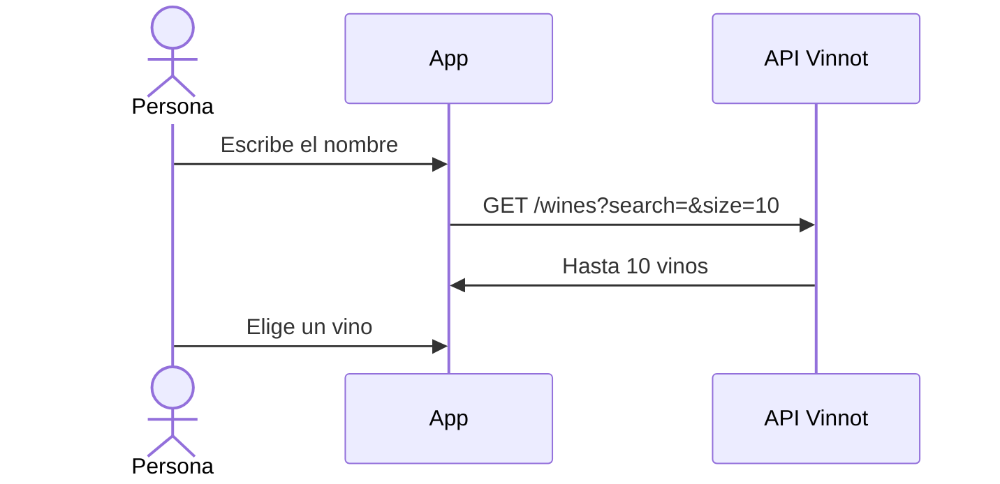

# UC-WIN-06 · Buscar a mano desde el escáner

| Campo | Valor |
|---|---|
| ID | `UC-WIN-06` |
| Módulo | [Vinos](../README.md) |
| Plataformas | APK |
| Actores | Usuario autenticado |
| IDs en Lucidchart | [APK UC-SCAN-02](https://lucid.app/lucidchart/e095dd25-e8ac-41ba-bf5b-396e1055f217/edit) |
| Requisitos | [`RF-APK-WIN-19`](../requirements.md) |
| Casos de prueba | [`CP-WIN-26`](../testing.md), [`CP-WIN-27`](../testing.md), [`CP-WIN-28`](../testing.md) |

## Precondiciones

- El escáner muestra un error, sugerencias o ninguna coincidencia.

## Postcondiciones

- La persona abre el vino que buscó, o sigue con la foto que sacó.

## Flujo principal

1. La persona elige «Buscar a mano».
2. Escribe al menos 2 caracteres.
3. La app espera 300 ms sin cambios y busca en el catálogo hasta 10 vinos.
4. La persona elige un vino y la app abre su detalle.

## Flujos alternativos

- 3a. La persona cambia el texto: los resultados anteriores se descartan.
- 3b. No hay resultados: la app ofrece proponer el vino ([UC-WIN-07](uc-win-07-submit-wine.md)).

## Reglas de negocio

- La foto sacada se conserva mientras dura la búsqueda.

## Diagrama

[Ver diagrama de «UC-WIN-06 · Buscar a mano desde el escáner» completo](https://images.vinnot.com/docs/diagrams/v1/es/modules-wines-use-cases-uc-win-06-manual-search-from-scan-1050b8ee8140.svg)

Diagrama de componentes en Lucidchart: [APK UC-SCAN-02](https://lucid.app/lucidchart/e095dd25-e8ac-41ba-bf5b-396e1055f217/edit).

## Código

| Capa | Ubicación |
|---|---|
| Endpoints | `GET /wines?search=` |
| Backend | [`WineReadController.java`](../../../../../backend/src/main/java/com/vinnot/wine/infrastructure/web/controller/WineReadController.java), [`SearchWinesQueryHandler.java`](../../../../../backend/src/main/java/com/vinnot/wine/application/query/handler/SearchWinesQueryHandler.java) |
| App | [`WineLabelScanScreen.tsx`](../../../../../frontend-mobile/src/presentation/features/wine/scan/WineLabelScanScreen.tsx), [`useWineLabelScanViewModel.ts`](../../../../../frontend-mobile/src/presentation/features/wine/scan/useWineLabelScanViewModel.ts) |

## Tests automáticos

- Backend: [`SearchWinesQueryHandlerTest.java`](../../../../../backend/src/test/java/com/vinnot/wine/application/query/handler/SearchWinesQueryHandlerTest.java)
- Web: Ninguno
- App: [`useWineLabelScanViewModel.test.ts`](../../../../../frontend-mobile/src/presentation/features/wine/scan/useWineLabelScanViewModel.test.ts)
