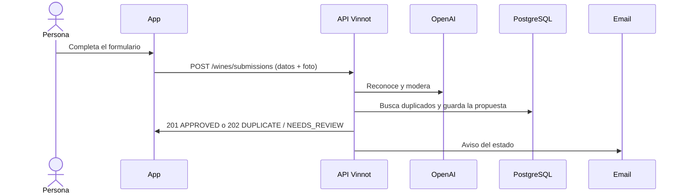

# UC-WIN-07 · Proponer un vino que no está en el catálogo

| Campo | Valor |
|---|---|
| ID | `UC-WIN-07` |
| Módulo | [Vinos](../README.md) |
| Plataformas | APK |
| Actores | Usuario autenticado, Proveedor de reconocimiento (OpenAI), Servicio de email |
| IDs en Lucidchart | [APK UC-SCAN-03](https://lucid.app/lucidchart/e095dd25-e8ac-41ba-bf5b-396e1055f217/edit) |
| Requisitos | [`RF-APK-WIN-20`](../requirements.md), [`RF-APK-WIN-21`](../requirements.md) |
| Casos de prueba | [`CP-WIN-29`](../testing.md), [`CP-WIN-30`](../testing.md), [`CP-WIN-31`](../testing.md), [`CP-WIN-32`](../testing.md), [`CP-WIN-33`](../testing.md), [`CP-WIN-43`](../testing.md) |

## Precondiciones

- El escáner no encontró el vino y hay una foto de la etiqueta, o la persona llegó desde «Agregá tu vino» y eligió «Cargar sin foto».

## Postcondiciones

- Queda una propuesta guardada con estado `APPROVED`, `DUPLICATE` o `NEEDS_REVIEW`.
- Con `APPROVED` el vino ya está en el catálogo; con `DUPLICATE` la propuesta apunta al vino existente.

## Flujo principal

1. La persona elige proponer el vino y la app abre el formulario con la foto.
2. Completa nombre del vino y bodega, y puede sumar tipo, añada, uvas, país, región, alcohol y notas.
3. La app valida y envía `POST /wines/submissions` con los datos y la foto.
4. La API valida la foto, reconoce la etiqueta, combina lo reconocido con el formulario, bloquea nombre, bodega y añada, busca duplicados y modera texto e imagen.
5. Si todo es seguro y el vino es nuevo, lo publica en el catálogo y responde 201 `APPROVED`.
6. La app muestra el resultado.

## Flujos alternativos

- 5a. Ya existe el mismo vino: responde 202 `DUPLICATE` con el vino existente y, si le faltaba imagen y es seguro, usa la foto.
- 5b. La validación es incompleta o insegura, o el proveedor no está disponible: guarda la foto en cuarentena y responde 202 `NEEDS_REVIEW`; decide la moderación ([Administración](../../admin/README.md)).
- 3a. Falta nombre o bodega, o un dato está fuera de rango: el formulario no se envía.
- 3b. La persona superó 10 propuestas en el día: la API responde 429.
- 1a. Desde «Agregá tu vino» la persona no tiene el vino a mano y toca «Cargar sin foto»: el formulario se abre sin foto y avisa «Sin foto, un administrador revisa el vino antes de publicarlo.»; la app envía sin parte `image` y la API no reconoce, no modera ni guarda imagen: si el formulario coincide exacto con un vino responde 202 `DUPLICATE` sin agregarle imagen y, si no, 202 `NEEDS_REVIEW` con el motivo `LABEL_PHOTO_MISSING`.

## Reglas de negocio

- Nombre y bodega llevan hasta 255 caracteres; hasta 10 uvas de 100 caracteres; país y región hasta 100; notas hasta 1000.
- El alcohol acepta coma o punto (13,6 y 13.6 son lo mismo) entre 0 y 100; la añada va de 1800 al año siguiente al actual.
- Solo se publica sin revisión cuando todas las comprobaciones son seguras; ante la duda, la propuesta queda para moderación.
- Cada cambio de estado se avisa por email en el idioma de quien propuso.
- En la app también se llega desde «Agregá tu vino» en una búsqueda sin resultados ([UC-WIN-01](uc-win-01-search-catalog.md)): el escáner se titula «Agregá tu vino», muestra el vino si la etiqueta coincide exacto y, si no, abre directo el formulario. El texto buscado completa el nombre solo cuando la etiqueta no lo trae.

## Diagrama

[Ver diagrama de «UC-WIN-07 · Proponer un vino que no está en el catálogo» completo](https://images.vinnot.com/docs/diagrams/v1/es/modules-wines-use-cases-uc-win-07-submit-wine-cd20fcba7ec3.svg)

Diagrama de componentes en Lucidchart: [APK UC-SCAN-03](https://lucid.app/lucidchart/e095dd25-e8ac-41ba-bf5b-396e1055f217/edit).

## Código

| Capa | Ubicación |
|---|---|
| Endpoints | `POST /wines/submissions` |
| Backend | [`WineSubmissionController.java`](../../../../../backend/src/main/java/com/vinnot/wine/infrastructure/web/controller/WineSubmissionController.java), [`SubmitWineCommandHandler.java`](../../../../../backend/src/main/java/com/vinnot/wine/application/command/handler/SubmitWineCommandHandler.java), [`WineLabelUploadValidator.java`](../../../../../backend/src/main/java/com/vinnot/wine/infrastructure/web/WineLabelUploadValidator.java) |
| App | [`WineSubmissionForm.tsx`](../../../../../frontend-mobile/src/presentation/features/wine/scan/WineSubmissionForm.tsx), [`WineLabelScanScreen.tsx`](../../../../../frontend-mobile/src/presentation/features/wine/scan/WineLabelScanScreen.tsx), [`wineNavigation.ts`](../../../../../frontend-mobile/src/presentation/navigation/wineNavigation.ts), [`useWineSubmissionCatalog.ts`](../../../../../frontend-mobile/src/presentation/features/wine/scan/useWineSubmissionCatalog.ts), [`useWineLabelScanViewModel.ts`](../../../../../frontend-mobile/src/presentation/features/wine/scan/useWineLabelScanViewModel.ts) |

## Tests automáticos

- Backend: [`SubmitWineCommandHandlerTest.java`](../../../../../backend/src/test/java/com/vinnot/wine/application/command/handler/SubmitWineCommandHandlerTest.java), [`WineSubmissionTest.java`](../../../../../backend/src/test/java/com/vinnot/wine/domain/model/WineSubmissionTest.java), [`WineSubmissionMultipartContractTest.java`](../../../../../backend/src/test/java/com/vinnot/wine/infrastructure/web/controller/WineSubmissionMultipartContractTest.java), [`WineSubmissionPostgresIntegrationTest.java`](../../../../../backend/src/test/java/com/vinnot/wine/infrastructure/persistence/WineSubmissionPostgresIntegrationTest.java)
- Web: Ninguno
- App: [`WineSubmissionForm.test.tsx`](../../../../../frontend-mobile/src/presentation/features/wine/scan/WineSubmissionForm.test.tsx), [`useWineSubmissionCatalog.test.ts`](../../../../../frontend-mobile/src/presentation/features/wine/scan/useWineSubmissionCatalog.test.ts), [`useWineLabelScanViewModel.test.ts`](../../../../../frontend-mobile/src/presentation/features/wine/scan/useWineLabelScanViewModel.test.ts), [`WineLabelScanScreen.test.tsx`](../../../../../frontend-mobile/src/presentation/features/wine/scan/WineLabelScanScreen.test.tsx)
