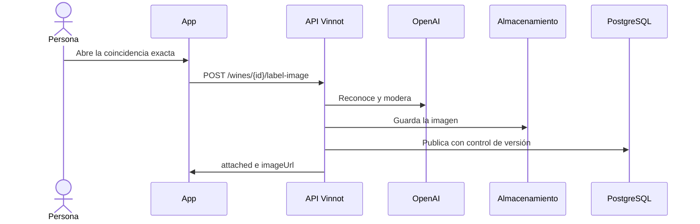

# UC-WIN-08 · Agregar la foto de la etiqueta a un vino sin imagen

| Campo | Valor |
|---|---|
| ID | `UC-WIN-08` |
| Módulo | [Vinos](../README.md) |
| Plataformas | APK |
| Actores | Usuario autenticado, Proveedor de reconocimiento (OpenAI) |
| IDs en Lucidchart | [APK UC-SCAN-04](https://lucid.app/lucidchart/e095dd25-e8ac-41ba-bf5b-396e1055f217/edit) |
| Requisitos | [`RF-APK-WIN-22`](../requirements.md) |
| Casos de prueba | [`CP-WIN-34`](../testing.md), [`CP-WIN-35`](../testing.md), [`CP-WIN-36`](../testing.md), [`CP-WIN-37`](../testing.md), [`CP-WIN-38`](../testing.md) |

## Precondiciones

- El escaneo dio una coincidencia exacta y ese vino no tiene imagen.

## Postcondiciones

- La foto queda publicada como imagen del vino.

## Flujo principal

1. La persona abre la coincidencia exacta con «Ver detalles» o tocando la tarjeta del vino.
2. Como el vino no tiene imagen, la app envía sola `POST /wines/{id}/label-image` con la foto, sin pedir confirmación.
3. La API vuelve a reconocer la etiqueta y exige que la coincidencia exacta sea ese mismo vino.
4. Modera la imagen, la guarda en JPEG de hasta 1600 px y la publica comprobando la versión del vino.
5. Responde `attached: true` con la URL y la app muestra la imagen.

## Flujos alternativos

- 3a. El vino ya tiene imagen: responde `attached: false` y no cambia nada.
- 3b. La etiqueta no corresponde a ese vino: responde `LABEL_IMAGE_WINE_MISMATCH`.
- 4a. La moderación no aprueba la imagen: responde `LABEL_IMAGE_REVIEW_REQUIRED`.
- 2a. La persona superó 10 envíos de foto en el día: la API responde 429.

## Reglas de negocio

- Solo ocurre con coincidencia exacta: elegir una sugerencia nunca cambia la foto de un vino.
- Nunca reemplaza una imagen existente.

## Diagrama

[Ver diagrama de «UC-WIN-08 · Agregar la foto de la etiqueta a un vino sin imagen» completo](https://images.vinnot.com/docs/diagrams/v1/es/modules-wines-use-cases-uc-win-08-attach-label-photo-049784fd7210.svg)

Diagrama de componentes en Lucidchart: [APK UC-SCAN-04](https://lucid.app/lucidchart/e095dd25-e8ac-41ba-bf5b-396e1055f217/edit).

## Código

| Capa | Ubicación |
|---|---|
| Endpoints | `POST /wines/{id}/label-image` |
| Backend | [`WineLabelScanController.java`](../../../../../backend/src/main/java/com/vinnot/wine/infrastructure/web/controller/WineLabelScanController.java), [`AttachWineLabelImageCommandHandler.java`](../../../../../backend/src/main/java/com/vinnot/wine/application/command/handler/AttachWineLabelImageCommandHandler.java) |
| App | [`useWineLabelScanViewModel.ts`](../../../../../frontend-mobile/src/presentation/features/wine/scan/useWineLabelScanViewModel.ts), [`WineLabelScanScreen.tsx`](../../../../../frontend-mobile/src/presentation/features/wine/scan/WineLabelScanScreen.tsx) |

## Tests automáticos

- Backend: [`AttachWineLabelImageCommandHandlerTest.java`](../../../../../backend/src/test/java/com/vinnot/wine/application/command/handler/AttachWineLabelImageCommandHandlerTest.java), [`WineLabelImagePublicationServiceTest.java`](../../../../../backend/src/test/java/com/vinnot/wine/application/service/WineLabelImagePublicationServiceTest.java)
- Web: Ninguno
- App: [`useWineLabelScanViewModel.test.ts`](../../../../../frontend-mobile/src/presentation/features/wine/scan/useWineLabelScanViewModel.test.ts)
