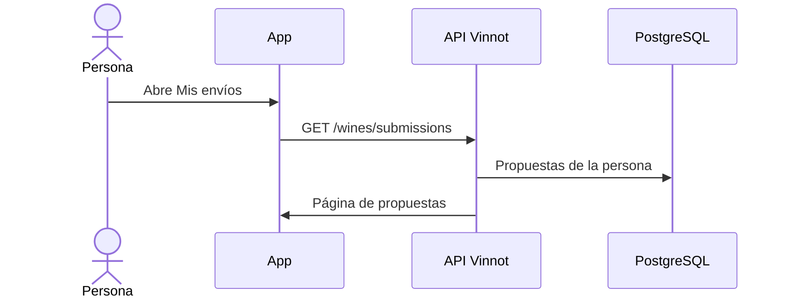

# UC-WIN-09 · Consultar mis vinos propuestos

| Campo | Valor |
|---|---|
| ID | `UC-WIN-09` |
| Módulo | [Vinos](../README.md) |
| Plataformas | APK |
| Actores | Usuario autenticado |
| IDs en Lucidchart | [APK UC-SCAN-05](https://lucid.app/lucidchart/e095dd25-e8ac-41ba-bf5b-396e1055f217/edit) |
| Requisitos | [`RF-APK-WIN-23`](../requirements.md) |
| Casos de prueba | [`CP-WIN-39`](../testing.md), [`CP-WIN-40`](../testing.md), [`CP-WIN-41`](../testing.md) |

## Precondiciones

- La persona propuso al menos un vino.

## Postcondiciones

- La persona ve el estado de cada propuesta, el motivo y el vino resultante.

## Flujo principal

1. La persona abre «Mis vinos enviados» desde Perfil.
2. La app pide `GET /wines/submissions` paginado.
3. La API devuelve solo las propuestas de esa persona, de la más nueva a la más vieja.
4. La app muestra estado (`PENDING`, `APPROVED`, `DUPLICATE`, `NEEDS_REVIEW`, `REJECTED` o `CHANGES_REQUESTED`), motivo y vino vinculado.

## Flujos alternativos

- 2a. Se pide una propuesta de otra persona por ID: la API la rechaza.
- 4a. La propuesta tiene un vino vinculado: la persona puede abrirlo.

## Reglas de negocio

- La persona sabe si la propuesta tiene imagen, pero no puede ver la foto en cuarentena.
- Los motivos automáticos se muestran como texto traducido; los de un administrador, tal como los escribió.

## Diagrama

[Ver diagrama de «UC-WIN-09 · Consultar mis vinos propuestos» completo](https://images.vinnot.com/docs/diagrams/v1/es/modules-wines-use-cases-uc-win-09-track-submissions-d35325fc24ba.svg)

Diagrama de componentes en Lucidchart: [APK UC-SCAN-05](https://lucid.app/lucidchart/e095dd25-e8ac-41ba-bf5b-396e1055f217/edit).

## Código

| Capa | Ubicación |
|---|---|
| Endpoints | `GET /wines/submissions`, `GET /wines/submissions/{id}` |
| Backend | [`WineSubmissionController.java`](../../../../../backend/src/main/java/com/vinnot/wine/infrastructure/web/controller/WineSubmissionController.java), [`GetMyWineSubmissionsQueryHandler.java`](../../../../../backend/src/main/java/com/vinnot/wine/application/query/handler/GetMyWineSubmissionsQueryHandler.java), [`GetWineSubmissionQueryHandler.java`](../../../../../backend/src/main/java/com/vinnot/wine/application/query/handler/GetWineSubmissionQueryHandler.java) |
| App | `frontend-mobile/app/(app)/my-submissions.tsx` (desde Perfil), `frontend-mobile/app/(app)/(tabs)/wines/submissions.tsx` (al terminar una propuesta), [`ProfileScreen.tsx`](../../../../../frontend-mobile/src/presentation/features/profile/ProfileScreen.tsx), [`WineSubmissionsScreen.tsx`](../../../../../frontend-mobile/src/presentation/features/wine/scan/WineSubmissionsScreen.tsx) |

## Tests automáticos

- Backend: [`GetWineSubmissionQueryHandlerTest.java`](../../../../../backend/src/test/java/com/vinnot/wine/application/query/handler/GetWineSubmissionQueryHandlerTest.java), [`WineSubmissionPostgresIntegrationTest.java`](../../../../../backend/src/test/java/com/vinnot/wine/infrastructure/persistence/WineSubmissionPostgresIntegrationTest.java), [`WineSubmissionStatusTemplateTest.java`](../../../../../backend/src/test/java/com/vinnot/notification/infrastructure/template/WineSubmissionStatusTemplateTest.java)
- Web: Ninguno
- App: Ninguno
