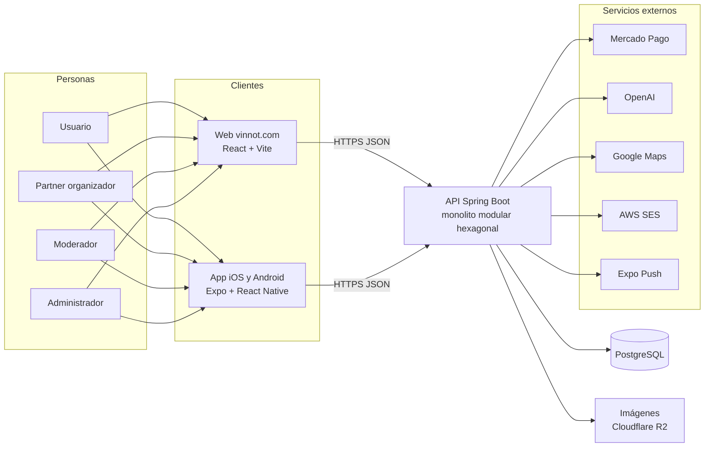

# Proyecto

Presentación de Vinnot en una página: qué es, qué problema resuelve, en qué estado
está y cómo recorrer el resto de la documentación. Las páginas de este capítulo son:

| Página | Qué contiene |
|---|---|
| [Plan del proyecto](project-plan.md) | Objetivos, público, alcance, supuestos, hitos, metodología, riesgos y criterios de éxito |
| [Índice de requisitos](requirements-index.md) | Requisitos funcionales por módulo y plataforma, con sus cantidades, y el enlace a los no funcionales |
| [Accesos al producto](deliverables-and-access.md) | Enlaces, instalación de la app, roles y permisos, cuentas de demostración y recorrido guiado por rol |
| [Organización del repositorio](repository-organization.md) | Carpetas, convenciones de arquitectura, ramas, acceso, ejecución local y CI |

## Qué es Vinnot

Vinnot es una plataforma para descubrir y gestionar vinos. Reúne el catálogo de
vinos, las bodegas, las rutas del vino y los eventos con entradas pagas, junto a una
comunidad que reseña y comparte. Funciona en la web, en [vinnot.com](https://vinnot.com),
y en una app para iOS y Android que además escanea la etiqueta de un vino para
encontrarlo en el catálogo.

## El problema

Quien toma vino o hace turismo del vino en Argentina reparte la información entre
varias fuentes: la etiqueta, la web de cada bodega, redes sociales para enterarse de
degustaciones y planillas o notas propias para recordar lo que probó. Las bodegas y
organizadores de eventos, a su vez, no tienen un canal propio para publicar
actividades, cobrar entradas y llegar a personas interesadas en el vino.

El análisis del mercado y de la competencia está en el capítulo
[Modelo de negocio](../business/README.md).

## La solución

| Necesidad | Qué ofrece Vinnot | Dónde se documenta |
|---|---|---|
| Identificar un vino | Búsqueda con filtros y escaneo de etiquetas desde la app | [Vinos](../modules/wines/README.md) |
| Recordar lo que probaste | Cava personal con notas y puntajes, y reseñas públicas | [Cava](../modules/cellar/README.md) y [Reseñas](../modules/reviews/README.md) |
| Conocer bodegas y recorrerlas | Fichas de bodegas y rutas del vino sobre el mapa | [Bodegas y regiones](../modules/wineries/README.md) y [Rutas del vino](../modules/wine-routes/README.md) |
| Ir a eventos | Descubrimiento, inscripción, pago con Mercado Pago y entrada en el teléfono | [Eventos y entradas](../modules/events/README.md) y [Pagos](../modules/payments/README.md) |
| Organizar eventos y cobrar | Panel partner con inscripciones, cobros y devoluciones | [Partners](../modules/partner/README.md) |
| Entender un vino | Perfiles y comparaciones generados con IA | [Perfiles y comparaciones IA](../modules/ai/README.md) |
| Cuidar el contenido | Panel de administración y moderación reactiva | [Administración y moderación](../modules/admin/README.md) |

## Vista general del sistema

[Ver diagrama de «Vista general del sistema» completo](https://images.vinnot.com/docs/diagrams/v1/es/project-readme-35901e700cd4.svg)

El detalle de cada pieza, de la red y de los contenedores está en
[Arquitectura del sistema](../architecture/README.md) y en
[Hospedaje y entorno de ejecución](../infra/architecture/hosting-and-runtime.md).

## Plataformas

| Plataforma | Tecnología | Código | Estado |
|---|---|---|---|
| Web | React 19, Vite y TypeScript | [`frontend-react/`](../../../frontend-react/package.json) | Implementada, en producción en [vinnot.com](https://vinnot.com) |
| iOS | Expo SDK 58 y React Native | [`frontend-mobile/`](../../../frontend-mobile/app.config.ts) | Implementada, versión 0.2.2 en el App Store |
| Android | Expo SDK 58 y React Native | [`frontend-mobile/`](../../../frontend-mobile/app.config.ts) | Implementada, versión 0.2.2 en Google Play |
| API | Spring Boot 4.1 y Java 25 | [`backend/`](../../../backend/pom.xml) | Implementada, en producción en `api.vinnot.com` |
| Documentación | Docusaurus | [`docs-site/`](../../../docs-site/docusaurus.config.ts) | Publicada con acceso restringido |

La versión de la app sale de `version` en
[`app.config.ts`](../../../frontend-mobile/app.config.ts). Las versiones de cada
dependencia están en el [catálogo de tecnologías](../architecture/technologies/README.md).

## Estado del proyecto

- **Producción.** El primer release a producción fue el 29 de septiembre de 2026. La
  web, la API y la app funcionan en producción
  ([Cronograma](../gantt/README.md)).
- **Alcance funcional.** 16 módulos con casos de uso y requisitos: 117 casos de uso,
  169 requisitos web, 193 requisitos de la app y 497 casos de prueba trazados
  ([Matriz de trazabilidad](../modules/traceability.md)). Otros dos módulos,
  [Actividad](../modules/activity/README.md) y
  [Puntos y sellos](../modules/gamification/README.md), se documentan sin casos de uso
  propios.
- **Cobro de entradas.** Implementado con Mercado Pago y una comisión de plataforma del
  3 % ([Pagos](../modules/payments/README.md) y
  [Monetización](../business/monetization.md)).
- **Planificado.** El aumento escalonado de la comisión y la suscripción para bodegas
  están en planificación, no implementados ([Monetización](../business/monetization.md)).

## Equipo y responsabilidades

El repositorio pertenece a la cuenta de GitHub `Bielaszczuk`, que aprueba los cambios y
publica los releases. Las responsabilidades del proyecto se reparten así:

| Responsabilidad | Qué incluye | Referencia |
|---|---|---|
| Producto y negocio | Prioridades, modelo de negocio, relación con bodegas y organizadores | [Modelo de negocio](../business/README.md) |
| Backend | API, dominio, persistencia, pagos e IA | [Backend](../backend/README.md) |
| Web | Sitio público, panel de administración y flujos de usuario | [Web](../frontend-web/README.md) |
| App móvil | App iOS y Android, escaneo y notificaciones | [App móvil](../frontend-mobile/README.md) |
| Infraestructura y releases | AWS, Cloudflare, CI/CD y publicación en tiendas | [Infraestructura](../infra/README.md) |
| Calidad y seguridad | Pruebas, gates de CI, riesgos y controles de seguridad | [Calidad](../quality/README.md) y [Seguridad](../security/README.md) |
| Documentación | Este sitio, en español e inglés | [Gobierno](../governance/README.md) |

Pendiente: la lista de integrantes del equipo con el rol de cada uno la completa el
propietario del repositorio.

## Cómo recorrer la documentación

El orden sugerido va de lo general a lo técnico, para cualquier persona que llegue al
proyecto: integrantes nuevos, partners o lectores interesados en el producto.

| Paso | Lee | Para entender |
|---|---|---|
| 1 | Esta página y el [Plan del proyecto](project-plan.md) | Qué es Vinnot, para quién es y hasta dónde llega |
| 2 | [Modelo de negocio](../business/README.md) | Propuesta de valor, monetización, costos y escala |
| 3 | [Accesos al producto](deliverables-and-access.md) | Cómo entrar a la web, instalar la app y probar cada rol |
| 4 | [Manuales](../manuals/README.md) y [Videos](../videos/README.md) | Cómo se usa cada función, por rol y plataforma |
| 5 | [Índice de requisitos](requirements-index.md) y [Módulos](../modules/README.md) | Casos de uso, requisitos y pruebas de cada módulo |
| 6 | [Arquitectura del sistema](../architecture/README.md) | Cómo se conectan web, app, API e infraestructura |
| 7 | [Modelo de dominio UML](../backend/diagrams/domain-class-model.md), [DER por contexto](../backend/diagrams/relational-model.md) y [Diagramas](../diagrams/README.md) | Clases, entidades, estados y el catálogo de diagramas |
| 8 | [Calidad](../quality/README.md) y [Seguridad](../security/README.md) | Cómo se prueba y cómo se protege la plataforma |
| 9 | [Organización del repositorio](repository-organization.md) y [Primeros pasos](../getting-started/README.md) | Dónde está cada cosa y cómo levantarla en local |
| 10 | [Infraestructura](../infra/README.md) y [Gobierno](../governance/README.md) | Despliegue, operación y forma de trabajo |
