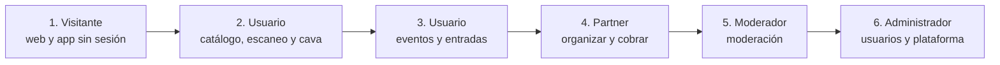

# Accesos al producto

Cómo entrar a cada parte de Vinnot: los enlaces de cada entorno, la instalación de la
app, qué puede hacer cada rol, cómo se manejan las cuentas de demostración y un
recorrido guiado por rol para mostrar el producto en vivo.

## Enlaces

### Producto

| Recurso | Producción | Desarrollo |
|---|---|---|
| Web | [vinnot.com](https://vinnot.com) | [dev.vinnot.com](https://dev.vinnot.com) |
| API | `https://api.vinnot.com/api` | `https://api-dev.vinnot.com/api` |
| Salud de la API | [api.vinnot.com/api/actuator/health](https://api.vinnot.com/api/actuator/health) | [api-dev.vinnot.com/api/actuator/health](https://api-dev.vinnot.com/api/actuator/health) |
| Imágenes | `https://images.vinnot.com` | `https://images.vinnot.com` |
| Enlace público para compartir | `https://vinnot.com/share/{tipo}/{id}` | `https://dev.vinnot.com/share/{tipo}/{id}` |

- La ruta `/actuator/health` es pública; el resto de `/actuator/**` exige el rol
  `ADMIN` ([`SecurityConfig.java`](../../../backend/src/main/java/com/vinnot/shared/infrastructure/config/SecurityConfig.java)).
- Desarrollo se apaga todos los días entre las 02:00 y las 09:00, hora de Argentina
  ([Desarrollo de bajo costo](../infra/operations/low-cost-dev.md)). En esa ventana,
  sus enlaces no responden.
- La documentación interactiva de la API (Swagger) se sirve en local, en
  `http://localhost:8080/api/swagger-ui.html`.

### App

| Tienda | Enlace | Identificador |
|---|---|---|
| App Store (iOS) | [Vinnot en la App Store](https://apps.apple.com/app/vinnot/id6817992780) | `com.vinnot.app` |
| Google Play (Android) | [Vinnot en Google Play](https://play.google.com/store/apps/details?id=com.vinnot.app) | `com.vinnot.app` |

Los identificadores salen del perfil de producción de
[`app.config.ts`](../../../frontend-mobile/app.config.ts) y el ID de App Store
Connect, de [`eas.json`](../../../frontend-mobile/eas.json).

### Proyecto

| Recurso | Enlace | Acceso |
|---|---|---|
| Repositorio (monorepo) | [github.com/Bielaszczuk/vinnot-demo](https://github.com/Bielaszczuk/vinnot-demo) | Público: copia de `main`. El repositorio de trabajo es privado; ver [Organización del repositorio](repository-organization.md#cómo-obtener-acceso) |
| Sitio de documentación | [vinnot-docs.pages.dev](https://vinnot-docs.pages.dev) | Privado: solo emails autorizados en Cloudflare Access ([Sitio de documentación](../governance/documentation-site.md)) |
| Videos de demostración | [Videos](../videos/README.md) | Dentro de esta documentación |
| Consolas de los servicios | [URLs importantes](../important-urls/README.md#consolas) | Cuentas del equipo |

## Instalar la app

### Desde las tiendas

1. Abre el [App Store](https://apps.apple.com/app/vinnot/id6817992780) en un iPhone o
   [Google Play](https://play.google.com/store/apps/details?id=com.vinnot.app) en un
   teléfono Android.
2. Instala Vinnot y ábrela.
3. Crea una cuenta con tu email o entra con Google (Android y iOS) o Apple (solo iOS).
4. Abre el email de verificación y toca el enlace. Después, inicia sesión.

El paso a paso con capturas está en el [Manual de usuario de la app](../manuals/app-user.md).

### Versiones de prueba

| Canal | Para qué | Cómo se accede |
|---|---|---|
| TestFlight (iOS) | Probar un build antes de enviarlo a revisión | El propietario agrega tu Apple ID como tester en App Store Connect; instala la app TestFlight y acepta la invitación |
| Prueba cerrada de Google Play (Android) | Probar un build antes de publicarlo en producción | El propietario agrega tu cuenta de Google a la lista de testers; abre el enlace de opt-in de Play Console e instala desde Google Play |
| Development build | Desarrollo en el simulador, con el identificador `com.vinnot.app.dev` | Solo para quien trabaja en el código ([Desarrollo de la app](../frontend-mobile/guides/development.md)) |

La publicación en cada tienda se explica en
[Distribución de la app](../frontend-mobile/guides/distribution.md).

### Actualizaciones

- Los cambios de JavaScript llegan solos, por actualización OTA de Expo en el canal
  `production`.
- Los cambios nativos necesitan una versión nueva en la tienda. Si la versión
  instalada es menor que la mínima que fija el equipo, la app muestra «Actualizá
  Vinnot para continuar» con un botón a la tienda
  ([Forzar la actualización](../frontend-mobile/guides/distribution.md#forzar-la-actualización)).

## Roles y permisos

### Qué puede hacer cada rol

Los roles operativos son los del enum
[`Role.java`](../../../backend/src/main/java/com/vinnot/user/domain/valueobject/Role.java):
`USER`, `PARTNER`, `MODERATOR` y `ADMIN`. Una cuenta nueva recibe `USER`; los demás
roles los asigna un administrador.

| Puede… | Visitante | Usuario | Partner | Moderador | Administrador |
|---|---|---|---|---|---|
| Crear una cuenta, iniciar sesión y recuperar la contraseña | Sí | — | — | — | — |
| Leer ayuda, contacto, términos y políticas; escribir a soporte; abrir la vista previa de un enlace compartido | Sí | Sí | Sí | Sí | Sí |
| Recorrer vinos, bodegas, rutas y eventos | No | Sí | Sí | Sí | Sí |
| Reseñar, comentar, dar likes, denunciar y bloquear | No | Sí | Sí | Sí | Sí |
| Escanear etiquetas y proponer vinos | No | Sí | Sí | Sí | Sí |
| Armar su cava | No | Sí | Sí | Solo si la cuenta también tiene `USER` | Sí |
| Inscribirse a eventos y pagar entradas | No | Sí | Sí | Sí | Sí |
| Crear eventos y editar los propios | No | No | Sí | Sí, y también los de terceros | Sí |
| Vincular Mercado Pago, ver los cobros de sus eventos y devolver pagos | No | No | Sí | No | Sí |
| Usar el panel y crear o editar vinos, bodegas, eventos y rutas | No | No | No | Sí | Sí |
| Revisar vinos propuestos, denuncias, publicaciones y reseñas; editar perfiles IA | No | No | No | Sí | Sí |
| Borrar vinos, bodegas y rutas, y cancelar eventos de terceros | No | No | No | No | Sí |
| Gestionar usuarios y roles, y suspender cuentas | No | No | No | No | Sí |
| Enviar anuncios, controlar los push y fijar la versión mínima de la app | No | No | No | No | Sí |

Fuentes: [Manual de administración](../manuals/admin.md#roles-y-acceso),
[Manual de partner](../manuals/partner.md#cómo-obtener-el-rol-de-partner) y las reglas
de rutas de [`SecurityConfig.java`](../../../backend/src/main/java/com/vinnot/shared/infrastructure/config/SecurityConfig.java).
Un visitante sin sesión no ve el catálogo: las lecturas de vinos, bodegas, eventos y
rutas exigen sesión.

### Reglas de acceso de la API

| Ruta | Acceso |
|---|---|
| `/auth/*` de ingreso, registro, renovación, recuperación y verificación | Público |
| `GET /share/**`, `POST /support/requests`, `GET /legal/terms/current`, `GET /app-versions/minimum` | Público |
| Webhooks y callback de Mercado Pago, `GET /payments/receipt` | Público, con validación propia de firma o token |
| `/health`, `/version`, `/actuator/health`, `/uploads/**` | Público |
| `GET /wines/**`, `/wineries/**`, `/events/**`, `/wine-routes/**`, `/grape-types/**`, `/regions/**`, `/reference/**` | Sesión iniciada |
| `/admin/users/**`, `/admin/notifications/**`, `/admin/app-versions/**`, `/actuator/**` | `ADMIN` |
| Resto de `/admin/**` | `ADMIN` o `MODERATOR` |
| Todo lo demás, incluidas las escrituras | Sesión iniciada, y el permiso o la propiedad que exige cada operación |

El detalle, con la comprobación de propiedad por operación, está en
[Seguridad, autorización y protección de abuso](../backend/architecture/security-and-authorization.md).

### Permisos por rol

Los permisos se siembran en
[`V2__seed_reference_data.sql`](../../../backend/src/main/resources/db/migration/V2__seed_reference_data.sql)
(tablas `roles`, `permissions` y `role_permissions`) y viajan en el token de acceso.
[`V76__remove_unused_roles_and_permissions.sql`](../../../backend/src/main/resources/db/migration/V76__remove_unused_roles_and_permissions.sql)
eliminó los roles y permisos sin uso. La tabla muestra los 31 permisos que quedan; la
matriz completa, con qué permisos comprueba cada controller con `@PreAuthorize`, está en
[Seguridad y autorización](../backend/architecture/security-and-authorization.md#permisos-de-cada-rol).

| Permiso | Usuario | Partner | Moderador | Administrador |
|---|---|---|---|---|
| `WINE_READ`, `WINERY_READ`, `EVENT_READ`, `WINE_ROUTE_READ` | Sí | Sí | Sí | Sí |
| `REVIEW_CREATE`, `REVIEW_UPDATE_OWN`, `REVIEW_DELETE_OWN` | Sí | Sí | Sí | Sí |
| `CELLAR_MANAGE_OWN` | Sí | Sí | No | Sí |
| `EVENT_CREATE` | No | Sí | Sí | Sí |
| `EVENT_UPDATE_OWN`, `EVENT_DELETE_OWN` | No | Sí | No | Sí |
| `EVENT_UPDATE` | No | No | Sí | Sí |
| `EVENT_DELETE` | No | No | No | Sí |
| `WINE_CREATE`, `WINE_UPDATE`, `WINERY_CREATE`, `WINERY_UPDATE` | No | No | Sí | Sí |
| `WINE_DELETE`, `WINERY_DELETE` | No | No | No | Sí |
| `WINE_ROUTE_CREATE`, `WINE_ROUTE_UPDATE` | No | No | Sí | Sí |
| `WINE_ROUTE_UPDATE_OWN`, `WINE_ROUTE_DELETE_OWN`, `WINE_ROUTE_DELETE` | No | No | No | Sí |
| `REVIEW_DELETE` | No | No | Sí | Sí |
| `USER_READ`, `ADMIN_DASHBOARD_READ` | No | No | Sí | Sí |
| `USER_UPDATE`, `USER_BAN`, `USER_DELETE`, `ROLE_ASSIGN` | No | No | No | Sí |

- La cava exige `CELLAR_MANAGE_OWN` en todo
  [`CellarController`](../../../backend/src/main/java/com/vinnot/cellar/infrastructure/web/controller/CellarController.java).
  Ese permiso no está sembrado para `MODERATOR`: un moderador usa la cava gracias a
  `USER`, que se conserva al asignar un rol desde Admin
  ([`User.replaceRole`](../../../backend/src/main/java/com/vinnot/user/domain/model/User.java)).
- La cuenta de Mercado Pago, los cobros por evento y las devoluciones exigen el rol
  `PARTNER` o `ADMIN` (`@PreAuthorize("hasAnyRole('PARTNER','ADMIN')")` en
  [`PaymentAccountController`](../../../backend/src/main/java/com/vinnot/payment/infrastructure/web/PaymentAccountController.java),
  `OrganizerPaymentsController` y `PaymentRefundController`).
- Los roles `ROLE_TOURISM_OPERATOR` y `ROLE_VERIFIED_EXPERT` y los permisos `ARTICLE_*`
  se sembraron en V2 sin funciones asociadas; V76 los eliminó. Los únicos roles son
  `USER`, `PARTNER`, `MODERATOR` y `ADMIN`.

## Cuentas de demostración

Las credenciales de las cuentas de demostración **nunca** se publican en esta
documentación ni en el repositorio. El propietario las comparte en privado con cada
persona que necesite probar el producto.

| Cuenta | Rol | Entorno sugerido | Para mostrar |
|---|---|---|---|
| Usuario de demostración | `USER` | Producción (app y web) | Catálogo, escaneo, cava, reseñas, eventos y perfiles IA |
| Partner de demostración | `PARTNER` | Producción para eventos gratuitos; desarrollo para cobros de prueba | Panel partner, eventos e inscripciones |
| Moderador de demostración | `MODERATOR` | Producción | Panel, vinos propuestos, denuncias y reseñas |
| Administrador de demostración | `ADMIN` | Desarrollo | Usuarios y roles, anuncios, push y versión mínima |
| Comprador de prueba de Mercado Pago | Cuenta de prueba de Mercado Pago | Desarrollo | Pagar una entrada sin dinero real |

- **Pendiente:** el repositorio no siembra usuarios (las migraciones solo cargan
  roles, permisos y datos de referencia), así que las cuentas de esta tabla las crea
  el propietario, que además asigna los roles desde el panel de administración.
- La app de las tiendas apunta a la API de producción, así que una demostración en la
  app usa cuentas de producción.
- Producción cobra con `EVENT_PAYMENTS_ENVIRONMENT=LIVE`, con dinero real
  ([Entornos y secretos](../infra/architecture/environments-and-secrets.md)). Para
  mostrar un pago, usa la web de desarrollo; antes de la demostración, confirma que
  desarrollo esté en `SANDBOX`.
- La cuenta demo que pide Apple para su revisión se guarda en App Store Connect, no en
  Git ([Distribución de la app](../frontend-mobile/guides/distribution.md#app-store-connect)).
- Los videos se grabaron en desarrollo con cuentas y datos de prueba
  ([Videos](../videos/README.md#cómo-grabar)).

## Recorrido guiado por rol

Recorrido de unos 20 minutos para mostrar el producto en vivo. Cada paso enlaza la
sección del manual que lo explica y el video que lo muestra. Antes de empezar,
comprueba la [salud de la API](https://api.vinnot.com/api/actuator/health), ten la app
instalada y abre la web en otra pestaña.

[Ver diagrama de «Recorrido guiado por rol» completo](https://images.vinnot.com/docs/diagrams/v1/es/project-deliverables-and-access-a90df558c448.svg)

### 1. Visitante

1. Abre [vinnot.com](https://vinnot.com) sin sesión: muestra la portada, la ayuda y los
   documentos legales ([Manual web](../manuals/web-user.md#primera-visita-qué-puedes-ver-sin-cuenta)).
2. Abre un enlace compartido `https://vinnot.com/share/...`: la vista previa funciona
   sin cuenta ([Compartir](../modules/sharing/README.md)).
3. En la app, muestra la bienvenida y el registro
   ([Manual de la app](../manuals/app-user.md#instalar-la-app-y-crear-una-cuenta)).

Video: [Presentación general](../videos/01-product-tour.md).

### 2. Usuario: catálogo, escaneo y cava

1. Inicia sesión en la app con la cuenta de usuario y acepta los términos si los pide.
2. Escanea la etiqueta de una botella y abre el vino encontrado
   ([Escanear la etiqueta de un vino](../manuals/app-user.md#escanear-la-etiqueta-de-un-vino)).
3. Muestra la ficha del vino y de su bodega, y su perfil IA
   ([Perfil IA y comparación](../manuals/app-user.md#perfil-ia-y-comparación)).
4. Agrega el vino a la cava con una nota y un puntaje ([Tu cava](../manuals/app-user.md#tu-cava)).
5. Escribe una reseña y muestra los puntos y el sello que gana
   ([Puntos y sellos](../manuals/points-and-seals.mdx)).
6. En la web, busca vinos con filtros ([Buscar vinos](../manuals/web-user.md#buscar-vinos)).

Videos: [Vinos](../videos/02-wines-on-the-web.md) y
[La app: escanear y tu bodega](../videos/03-app-scan-and-cellar.md).

### 3. Usuario: eventos, rutas y comunidad

1. Busca un evento e inscríbete
   ([Eventos](../manuals/app-user.md#eventos-inscribirte-pagar-y-ver-tus-entradas)).
2. Para un evento pago, muestra el checkout de Mercado Pago en desarrollo con el
   comprador de prueba, y la entrada en «Mis entradas».
3. Abre una ruta del vino sobre el mapa y compártela
   ([Rutas del vino y mapas](../manuals/app-user.md#rutas-del-vino-y-mapas)).
4. Muestra las preferencias de notificaciones y cómo denunciar o bloquear
   ([Denunciar o bloquear](../manuals/app-user.md#denunciar-o-bloquear)).

Videos: [Eventos y entradas](../videos/04-events-and-tickets.md),
[Rutas del vino y enlaces compartidos](../videos/05-routes-and-sharing.md) y
[Tu cuenta, comunidad y ayuda](../videos/06-account-and-community.md).

### 4. Partner

1. Inicia sesión con la cuenta partner y abre «Mis eventos» («Panel partner» en la app).
2. Muestra la cuenta de Mercado Pago vinculada
   ([Vincular tu cuenta de Mercado Pago](../manuals/partner.md#vincular-tu-cuenta-de-mercado-pago)).
3. Crea un evento, publícalo y revisa sus inscripciones
   ([Crear un evento](../manuals/partner.md#crear-un-evento) y
   [Revisar las inscripciones](../manuals/partner.md#revisar-las-inscripciones)).
4. Explica la comisión de plataforma del 3 % sobre cada entrada
   ([Pagos](../modules/payments/README.md) y [Monetización](../business/monetization.md)).

Video: [Organizar eventos](../videos/07-organize-events.md).

### 5. Moderador

1. Inicia sesión con la cuenta de moderador y abre «Administración».
2. Revisa un vino propuesto y apruébalo o recházalo
   ([Vinos propuestos](../manuals/admin.md#vinos-propuestos)).
3. Atiende una denuncia y una reseña
   ([Denuncias](../manuals/admin.md#denuncias) y [Reseñas](../manuals/admin.md#reseñas)).
4. Muestra que no ve la gestión de usuarios: esa sección es solo de administradores.

Video: [Moderación](../videos/08-moderation.md).

### 6. Administrador

1. Inicia sesión con la cuenta de administrador y confirma tu identidad cuando se pida
   ([Confirmar tu identidad](../manuals/admin.md#confirmar-tu-identidad)).
2. Abre el panel con sus métricas ([Panel](../manuals/admin.md#panel)).
3. Asigna el rol partner a una cuenta ([Usuarios y roles](../manuals/admin.md#usuarios-y-roles)).
4. Muestra los anuncios, el control de push y la versión mínima de la app
   ([Anuncios](../manuals/admin.md#anuncios),
   [Control de push](../manuals/admin.md#control-de-push) y
   [Versiones de la app](../manuals/admin.md#versiones-de-la-app)).

Videos: [Administración](../videos/09-administration.md) y [La web](../videos/10-web.md).

### Cierre técnico

Para mostrar cómo está hecho, sigue una búsqueda de vinos de punta a punta en
[Recorrido de una petición](../architecture/README.md#recorrido-de-una-petición) y el
[Mapa del sistema](../architecture/README.md#mapa-del-sistema).
