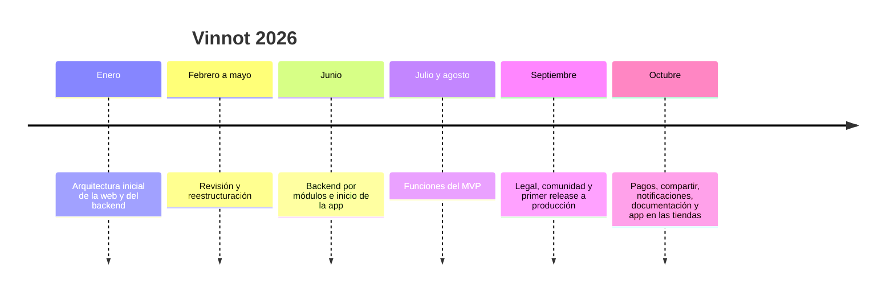
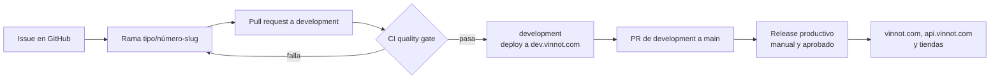

# Plan del proyecto

Objetivos, público, alcance, supuestos, hitos, metodología, riesgos y criterios de
éxito de Vinnot. Cada punto indica su estado: **implementado** (está en el código),
**verificado** (hay una prueba o una evidencia de producción), **planificado** (es un
plan, todavía no está en el código) o **fuera de alcance**.

## Objetivo general

Ofrecer una plataforma única, en la web y en una app para iOS y Android, donde las
personas descubran, registren y compartan vinos, recorran bodegas y rutas del vino y
asistan a eventos, y donde bodegas y organizadores publiquen sus actividades y cobren
sus entradas.

## Objetivos específicos

| # | Objetivo | Indicador | Estado | Evidencia |
|---|---|---|---|---|
| O1 | Publicar un catálogo de vinos con búsqueda y filtros en la web y en la app | Búsqueda por tipo, región, país, bodega, cepa y puntaje en ambas plataformas | Implementado | [Vinos](../modules/wines/README.md) |
| O2 | Identificar un vino desde la foto de su etiqueta | Escaneo con OCR en el dispositivo y búsqueda en el catálogo | Implementado en la app | [Escaneo de etiquetas](../modules/wines/README.md) |
| O3 | Cubrir el producto con requisitos trazables | 117 casos de uso, 169 requisitos web y 193 de la app, cada uno con casos de prueba | Verificado | [Matriz de trazabilidad](../modules/traceability.md) |
| O4 | Vender entradas a eventos | Checkout con Mercado Pago, entrada en el teléfono, devoluciones y comisión del 3 % | Implementado | [Pagos](../modules/payments/README.md) |
| O5 | Publicar la app en las dos tiendas | Versión 0.2.2 disponible en el App Store y en Google Play | Implementado | [Accesos al producto](deliverables-and-access.md) |
| O6 | Operar con un costo mensual bajo | Un host por entorno y desarrollo apagado de noche | Implementado | [Desarrollo de bajo costo](../infra/operations/low-cost-dev.md) y [Costos](../business/README.md) |
| O7 | Mantener cada cambio verificado antes de publicarlo | Gate de CI obligatorio para desplegar; release productivo manual y aprobado | Implementado | [CI/CD](../infra/guides/ci-cd.md) |
| O8 | Documentar todo en español e inglés | Cada página en `docs/es` tiene su espejo en `docs/en`, validado en CI | Verificado | [Estándares de documentación](../governance/documentation-standards.md) |
| O9 | Subir la comisión de entradas con la base de usuarios | Del 3 % actual al 8 % y, en un año, al 12 % | Planificado | [Monetización](../business/monetization.md) |
| O10 | Lanzar una suscripción para bodegas | Plan Free con perfil, vinos propios, eventos y métricas básicas, y plan Pro de USD 20 por mes con informes | Planificado | [Monetización](../business/monetization.md) |

## Público y segmentos

| Segmento | Quién es | Qué busca en Vinnot | Rol en la plataforma |
|---|---|---|---|
| Consumidores de vino | Personas que toman vino y quieren elegir, recordar y opinar | Catálogo, escaneo, cava, reseñas y perfiles IA | `USER` |
| Turistas del vino | Personas que visitan regiones y bodegas | Rutas del vino, bodegas y eventos | `USER` |
| Asistentes a eventos | Personas que van a degustaciones y ferias | Descubrir eventos, pagar y tener la entrada en el teléfono | `USER` |
| Organizadores y bodegas | Bodegas, sommeliers y espacios que organizan eventos | Publicar eventos, gestionar inscripciones y cobrar | `PARTNER` |
| Bodegas con catálogo propio | Bodegas que quieren datos de sus vinos | Informes de mercado sobre sus vinos (planificado) | `PARTNER` |
| Equipo de Vinnot | Moderadores y administradores | Cuidar el catálogo y la comunidad, gestionar usuarios | `MODERATOR` y `ADMIN` |

Vinnot es un producto global: la interfaz está en español y en inglés y el catálogo,
las reseñas y la IA no dependen del país. La primera etapa es Argentina, donde los
cobros son en pesos con Mercado Pago; las etapas siguientes suman países y monedas. El detalle del mercado está en
[Modelo de negocio](../business/README.md).

## Alcance

### Dentro del alcance

| Área | Estado | Referencia |
|---|---|---|
| Cuenta: registro, ingreso con email, Google y Apple, verificación, perfil, privacidad y baja | Implementado | [Usuarios y cuenta](../modules/users/README.md) |
| Términos versionados y su aceptación | Implementado | [Legal](../modules/legal/README.md) |
| Catálogo de vinos, búsqueda, propuestas de vinos y escaneo de etiquetas | Implementado | [Vinos](../modules/wines/README.md) |
| Bodegas y regiones | Implementado | [Bodegas y regiones](../modules/wineries/README.md) |
| Reseñas, comentarios, likes, denuncias y bloqueos | Implementado | [Reseñas](../modules/reviews/README.md) y [Comunidad](../modules/community/README.md) |
| Cava personal | Implementado | [Cava](../modules/cellar/README.md) |
| Eventos, inscripciones, entradas y cobros con Mercado Pago | Implementado | [Eventos y entradas](../modules/events/README.md) y [Pagos](../modules/payments/README.md) |
| Rutas del vino sobre el mapa | Implementado | [Rutas del vino](../modules/wine-routes/README.md) |
| Perfiles y comparaciones con IA | Implementado | [Perfiles y comparaciones IA](../modules/ai/README.md) |
| Notificaciones push y por email, y sugerencias personalizadas | Implementado | [Notificaciones](../modules/notifications/README.md) |
| Enlaces para compartir que abren la web o la app | Implementado | [Compartir](../modules/sharing/README.md) |
| Puntos y sellos por actividad | Implementado | [Puntos y sellos](../modules/gamification/README.md) |
| Panel partner, administración y moderación | Implementado | [Partners](../modules/partner/README.md) y [Administración y moderación](../modules/admin/README.md) |
| Soporte y páginas públicas | Implementado | [Soporte e información pública](../modules/support/README.md) |

### Fuera del alcance actual

| Tema | Situación |
|---|---|
| Venta de botellas | Fuera de alcance: Vinnot no vende vino |
| Suscripción paga para bodegas | Planificado, no implementado ([Monetización](../business/monetization.md)) |
| Roles de operador turístico y experto verificado | Fuera de alcance: [`V76__remove_unused_roles_and_permissions.sql`](../../../backend/src/main/resources/db/migration/V76__remove_unused_roles_and_permissions.sql) eliminó `ROLE_TOURISM_OPERATOR` y `ROLE_VERIFIED_EXPERT`, que no formaban parte del enum [`Role`](../../../backend/src/main/java/com/vinnot/user/domain/valueobject/Role.java) |
| Artículos de expertos | Fuera de alcance: no hay módulo de artículos y V76 eliminó los permisos `ARTICLE_*` |
| Escaneo de etiquetas en la web | Fuera de alcance: el escaneo es de la app ([Manual web](../manuals/web-user.md)) |
| Cobros en otras monedas | Próxima etapa: en la primera etapa los cobros son en pesos argentinos con Mercado Pago |

## Supuestos y restricciones

| Tipo | Descripción | Referencia |
|---|---|---|
| Supuesto | Las personas usuarias tienen un teléfono con cámara para escanear etiquetas | [Manual de la app](../manuals/app-user.md) |
| Supuesto | Los organizadores tienen una cuenta de Mercado Pago para recibir cobros | [Manual de partner](../manuals/partner.md) |
| Restricción | Presupuesto de infraestructura bajo: un host EC2 con Docker Compose por entorno, y desarrollo apagado entre las 02:00 y las 09:00 (hora de Argentina) | [Despliegue en AWS](../infra/architecture/aws-deployment.md) y [Desarrollo de bajo costo](../infra/operations/low-cost-dev.md) |
| Restricción | El consumo de IA tiene presupuesto y cupos | [Protección de recursos](../backend/architecture/resource-protection.md) |
| Restricción | Cada versión nativa de la app pasa por la revisión de Apple y de Google; Google exige una prueba cerrada antes del acceso a producción | [Distribución de la app](../frontend-mobile/guides/distribution.md) |
| Restricción | Los cobros dependen de las reglas y del entorno de Mercado Pago (`SANDBOX`, `LIVE_PILOT` o `LIVE`) | [Entornos y secretos](../infra/architecture/environments-and-secrets.md) |
| Restricción | Herramientas fijas: JDK 25 y Node 22 en local y en CI | [Desarrollo local](../getting-started/local-development.md) |

## Productos del proyecto

| Producto | Estado | Dónde está |
|---|---|---|
| Web en producción | Implementado | [vinnot.com](https://vinnot.com) |
| App para iOS y Android | Implementado, versión 0.2.2 | [Accesos al producto](deliverables-and-access.md) |
| API y base de datos | Implementado | [Backend](../backend/README.md) |
| Infraestructura como archivos versionados | Implementado | [`infra/`](../../../infra/docker-compose.yml) y [Infraestructura](../infra/README.md) |
| Código fuente en un monorepo | Implementado | [Organización del repositorio](repository-organization.md) |
| Documentación bilingüe con diagramas | Implementado | Este sitio y el [catálogo de diagramas](../diagrams/README.md) |
| Manuales por rol y videos de demostración | Implementado | [Manuales](../manuals/README.md) y [Videos](../videos/README.md) |
| Modelo de negocio, costos y proyecciones | Implementado como documento | [Modelo de negocio](../business/README.md) |

## Hitos

El [Cronograma](../gantt/README.md) reconstruye las etapas a partir del historial del
repositorio. En resumen:

[Ver diagrama de «Hitos» completo](https://images.vinnot.com/docs/diagrams/v1/es/project-project-plan-38063b6da911.svg)

| Hito | Fecha | Estado |
|---|---|---|
| Primer release a producción | 29 de septiembre de 2026 | Verificado |
| Sitio de documentación publicado | 21 de octubre de 2026 | Verificado |
| App 0.2.0 con Expo SDK 58 enviada a las tiendas | 25 de octubre de 2026 | Verificado |
| App 0.2.2 con los parches nativos de Expo SDK 58.0.21 | Versión fijada el 28 de octubre de 2026 | Implementado |
| Comisión de entradas al 8 % | Con más usuarios, sin fecha fija | Planificado |
| Comisión de entradas al 12 % | En un año, hacia octubre de 2027 | Planificado |
| Suscripción para bodegas | Lanzamiento objetivo el 01-03-2027, según la [hoja de ruta de negocio](../gantt/README.md) | Planificado |

## Metodología

El trabajo se organiza en issues de GitHub, cada uno con su rama, y se integra con pull
requests que pasan por CI antes de llegar a `development`. Producción se publica desde
`main` con un workflow manual que requiere aprobación. El proceso completo está en
[Proceso de desarrollo](../governance/development-process.md); las reglas de issues,
ramas y pull requests, en [Flujo de issues, ramas y pull requests](../governance/github-work-items.md).

[Ver diagrama de «Metodología» completo](https://images.vinnot.com/docs/diagrams/v1/es/project-project-plan-bfb1f89d3a04.svg)

## Riesgos principales

El análisis completo, con probabilidad, impacto y pruebas por riesgo, está en
[Pruebas basadas en riesgos](../quality/risk-based-testing.md). Resumen:

| Riesgo | Mitigación | Referencia |
|---|---|---|
| Un único host por entorno: una falla deja el servicio sin respuesta | Backups, restauración verificada y procedimientos de recuperación | [Backup y recuperación](../infra/operations/backup-and-disaster-recovery.md) |
| Error en un cobro o en una devolución | Conciliación con Mercado Pago, webhooks firmados y entornos de prueba | [Pagos](../modules/payments/README.md) |
| Gasto de IA fuera de control | Reservas de presupuesto y cupos diarios | [Protección de recursos](../backend/architecture/resource-protection.md) |
| Filtración de datos personales o acceso indebido | Autenticación con tokens, roles y permisos, rate limiting, bloqueo temporal tras contraseñas incorrectas, detección de robo de sesión, registro de eventos de seguridad y escaneo de dependencias; WAF de Cloudflare delante de la API, pendiente de que el responsable lo aplique (estado al 2026-10-30) | [Seguridad](../security/README.md) |
| Rechazo o demora en la revisión de las tiendas | Actualizaciones OTA para cambios de JavaScript y versión mínima forzada | [Distribución de la app](../frontend-mobile/guides/distribution.md) |
| Dependencia de proveedores externos | Puertos y adaptadores que aíslan cada proveedor | [Arquitectura del sistema](../architecture/README.md) |

## Criterios de éxito

| Criterio | Cómo se mide | Estado |
|---|---|---|
| El producto funciona en las tres plataformas | Web, App Store y Google Play con la versión vigente | Verificado |
| La API responde en producción | `GET https://api.vinnot.com/api/actuator/health` devuelve `UP`, y Caddy lo revisa cada 30 segundos | Implementado |
| Cada requisito tiene su prueba | La matriz de trazabilidad une casos de uso, requisitos y casos de prueba | Verificado |
| Ningún cambio llega a producción sin CI | El deploy depende del `CI quality gate` del mismo commit | Implementado |
| La documentación es completa y bilingüe | El validador de documentación pasa en CI | Verificado |
| El negocio es sostenible | Ingresos por comisión que cubren el costo mensual a cada escala | Planificado ([Modelo de negocio](../business/README.md)) |
