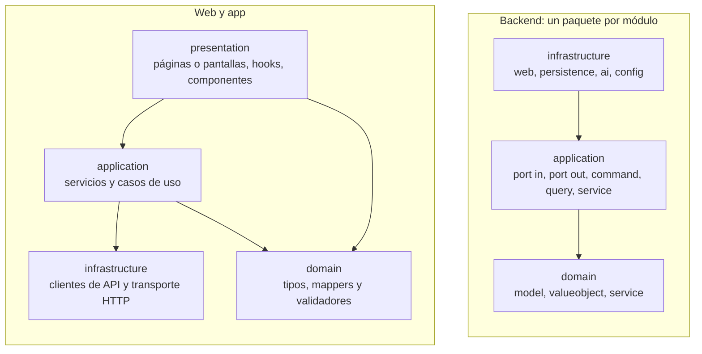

# Organización del repositorio

Cómo está organizado el código de Vinnot: las carpetas del monorepo, las convenciones de
arquitectura de cada aplicación, las ramas, cómo obtener acceso, cómo levantarlo en
local y qué controla la integración continua.

## Un monorepo

Todo el producto vive en un solo repositorio de GitHub,
[`Bielaszczuk/vinnot`](https://github.com/Bielaszczuk/vinnot): la API, la web, la app,
la infraestructura, los scripts y esta documentación. Un cambio que toca varias partes
se revisa y se publica junto.

| Carpeta | Contenido | Documentación |
|---|---|---|
| [`backend/`](../../../backend/pom.xml) | API en Spring Boot 4.1 y Java 25: monolito modular con arquitectura hexagonal y CQRS lógico; migraciones Flyway en `src/main/resources/db/migration` | [Backend](../backend/README.md) |
| [`frontend-react/`](../../../frontend-react/package.json) | Web en React 19, Vite 8, TypeScript y Tailwind, con el panel de administración | [Web](../frontend-web/README.md) |
| [`frontend-mobile/`](../../../frontend-mobile/package.json) | App para iOS y Android en Expo SDK 58 y React Native 0.88 | [App móvil](../frontend-mobile/README.md) |
| [`infra/`](../../../infra/docker-compose.yml) | Docker Compose, Caddy, scripts de despliegue y backup del host, el Worker de imágenes de Cloudflare y plantillas de entorno | [Infraestructura](../infra/README.md) |
| `docs/` | Esta documentación, en `docs/es` y su espejo `docs/en` | [Gobierno](../governance/README.md) |
| [`docs-site/`](../../../docs-site/docusaurus.config.ts) | Sitio Docusaurus que publica `docs/` como un libro navegable | [Sitio de documentación](../governance/documentation-site.md) |
| [`content/`](../../../content/public-pages.json) | Textos bilingües de las páginas públicas, sincronizados con `scripts/sync-public-content.mjs` | [Soporte e información pública](../modules/support/README.md) |
| [`scripts/`](../../../scripts/ci-preflight.mjs) | Preflight local, validadores de CI, releases, importación de datos y mantenimiento | [CI/CD](../infra/guides/ci-cd.md) |
| [`tools/`](../../../tools/docs-diagrams/generate.mjs) | Generación de las imágenes de los diagramas | [Sitio de documentación](../governance/documentation-site.md) |
| `.github/` | Workflows de CI/CD, formularios de issues, plantilla de pull request y Dependabot | [Flujo de issues, ramas y pull requests](../governance/github-work-items.md) |

Qué se versiona y qué queda fuera (credenciales, volcados de datos, archivos locales) se
explica en [Contenido versionado y archivos privados](../governance/repository-hygiene.md).

## Convenciones de arquitectura

Las tres aplicaciones separan el dominio de los frameworks y dejan los adaptadores en
los bordes. Las dependencias apuntan hacia adentro.

[Ver diagrama de «Convenciones de arquitectura» completo](https://images.vinnot.com/docs/diagrams/v1/es/project-repository-organization-3ed075ef4568.svg)

### Backend

Cada módulo es un paquete `com.vinnot.<módulo>` con tres capas. Por ejemplo, el módulo
de vinos:

| Capa | Paquetes | Qué contiene |
|---|---|---|
| `domain` | `model`, `valueobject`, `service` | Agregados, value objects e invariantes, sin Spring ni JPA |
| `application` | `port/in`, `port/out`, `command`, `query`, `service` | Puertos de entrada y salida, handlers de commands y queries |
| `infrastructure` | `web`, `persistence`, `ai`, `config` y otros | Controllers, requests HTTP, entidades JPA, SQL nativo y adaptadores externos |

Los módulos del backend son: `activity`, `admin`, `ai`, `cellar`, `community`,
`engagement`, `event`, `gamification`, `legal`, `notification`, `partner`, `payment`,
`region`, `review`, `sharing`, `support`, `user`, `wine`, `wineroute` y `winery`, más
`shared` para lo común
([`backend/src/main/java/com/vinnot`](../../../backend/src/main/java/com/vinnot/VinnotApplication.java)).
El flujo `Controller → puerto de entrada → handler → dominio → puerto de salida →
adaptador` se describe en [Arquitectura del backend](../backend/architecture/overview.md)
y las dependencias permitidas entre módulos, en
[Límites modulares](../backend/architecture/module-boundaries.md).

### Web

[`frontend-react/src`](../../../frontend-react/src/app/main.tsx) se divide en `app`
(arranque y rutas), `domain`, `application`, `infrastructure`, `presentation` (páginas,
hooks, componentes y stores) y `shared`. Las páginas no llaman a la API: usan hooks que
delegan en servicios de aplicación, y estos en clientes de infraestructura
([Arquitectura web](../frontend-web/architecture/overview.md)).

### App

[`frontend-mobile/app/`](../../../frontend-mobile/app/_layout.tsx) contiene solo las
rutas de Expo Router, con grupos como `(app)`, `(auth)` y `(onboarding)` que no
aparecen en la URL. La lógica vive en `frontend-mobile/src`, con las mismas capas que la
web: `domain`, `application`, `infrastructure`, `presentation` y `shared`
([Arquitectura de la app](../frontend-mobile/architecture/overview.md) y
[Convenciones](../frontend-mobile/architecture/conventions.md)).

## Ramas

| Rama | Para qué | Se publica en |
|---|---|---|
| `main` | Código publicado en producción | Producción, con el workflow manual `production-release.yml` |
| `development` | Integración de todo el trabajo terminado | Desarrollo, automáticamente después de CI |
| `feature/<issue>-<slug>` | Funcionalidad nueva, desde `development` | — |
| `bugfix/<issue>-<slug>` | Defecto sin urgencia, desde `development` | — |
| `task/<issue>-<slug>` | Infraestructura, documentación o mantenimiento, desde `development` | — |
| `hotfix/<issue>-<slug>` | Incidente urgente de producción, desde `main` | — |

- Cada issue y su rama se crean con el workflow **Create Work Branch**
  ([`create-work-branch.yml`](../../../.github/workflows/create-work-branch.yml)), no a
  mano. El número de la rama es el del issue, sin `#` ni ceros a la izquierda.
- CI valida el nombre de la rama en cada pull request.
- `development` pasa a `main` con un pull request y un merge commit.
- El proceso completo está en [Proceso de desarrollo](../governance/development-process.md)
  y en [Flujo de issues, ramas y pull requests](../governance/github-work-items.md).

## Cómo obtener acceso

| Recurso | Cómo se accede |
|---|---|
| Repositorio de GitHub | Es privado. Pide acceso al propietario, la cuenta de GitHub `Bielaszczuk`, indicando tu usuario de GitHub; te agrega como colaborador con el permiso que necesita tu tarea |
| Sitio de documentación | Es privado. El propietario autoriza tu email en Cloudflare Access ([Sitio de documentación](../governance/documentation-site.md#cloudflare-access)) |
| Consolas (AWS, Cloudflare, Expo, tiendas, Mercado Pago) | Solo para el equipo de operación ([URLs importantes](../important-urls/README.md#consolas)) |
| Secretos y variables de entorno | Nunca están en el repositorio ([Entornos y secretos](../infra/architecture/environments-and-secrets.md)) |
| Producto | Ver [Accesos al producto](deliverables-and-access.md) |

## Ejecutar en local

Necesitas Git, Docker, JDK 25, Maven y Node 22; Xcode o Android Studio solo para la app
nativa. El orden es:

1. Levanta PostgreSQL con Docker Compose.
2. Arranca el backend con Maven.
3. Arranca la web con `npm run dev` en `frontend-react/`.
4. Arranca la app con Expo en `frontend-mobile/`.

Los comandos, las variables y el diagnóstico están en
[Desarrollo local](../getting-started/local-development.md). Antes de subir cambios,
ejecuta `node scripts/ci-preflight.mjs`, que repite en local los controles de CI.

## Integración continua

| Workflow | Cuándo corre | Qué hace |
|---|---|---|
| [`ci.yml`](../../../.github/workflows/ci.yml) | Pull requests, push a `main` y `development`, manual | Calcula qué cambió y corre solo los controles afectados: backend, web, app, documentación y repositorio; publica desarrollo |
| [`security-checks.yml`](../../../.github/workflows/security-checks.yml) | Desde CI, manual y semanal | Escanea dependencias, imagen del backend e historial; bloquea el deploy ante vulnerabilidades críticas o altas |
| [`ios-native-validation.yml`](../../../.github/workflows/ios-native-validation.yml) | Manual o con la etiqueta `validate:ios-native` | Compila la app iOS en un runner macOS |
| [`deploy-backend-dev.yml`](../../../.github/workflows/deploy-backend-dev.yml) y [`deploy-frontend-dev.yml`](../../../.github/workflows/deploy-frontend-dev.yml) | Llamados desde CI aprobado | Despliegan la API y la web en desarrollo |
| [`production-release.yml`](../../../.github/workflows/production-release.yml) | Manual en `main` | Prepara, publica o revierte producción después de CI y de aprobar el commit |
| [`create-work-branch.yml`](../../../.github/workflows/create-work-branch.yml) | Manual | Crea el issue y su rama |

Ningún despliegue corre sin el `CI quality gate` aprobado del mismo commit. Los
controles por componente, los umbrales y la publicación están en
[CI/CD](../infra/guides/ci-cd.md); las pruebas, en [Calidad](../quality/README.md).
