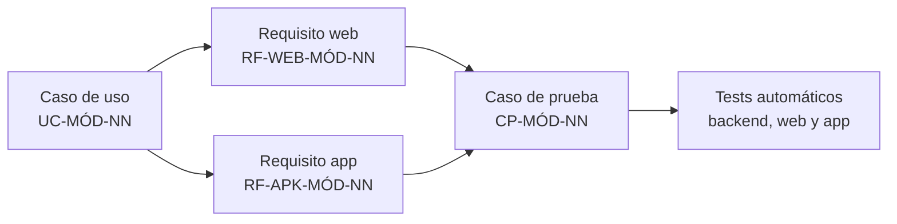

# Índice de requisitos

Punto de entrada a todos los requisitos de Vinnot. Los requisitos funcionales viven en
la página de cada módulo, junto a sus casos de uso y sus pruebas; esta página los
ordena, los cuenta y explica cómo leerlos. Los requisitos no funcionales están en
[Requisitos no funcionales](../quality/non-functional-requirements.md).

## Cómo se identifican

| Prefijo | Qué es | Ejemplo |
|---|---|---|
| `UC-<MÓDULO>-NN` | Caso de uso: actores, plataformas, precondiciones, postcondiciones, flujo principal y alternativos, reglas de negocio, diagrama, código y tests | [`UC-USR-01`](../modules/users/use-cases/uc-usr-01-sign-up.md) |
| `RF-WEB-<MÓDULO>-NN` | Requisito funcional de la web | `RF-WEB-USR-01` en [Usuarios y cuenta](../modules/users/requirements.md) |
| `RF-APK-<MÓDULO>-NN` | Requisito funcional de la app para iOS y Android | `RF-APK-USR-01` en [Usuarios y cuenta](../modules/users/requirements.md) |
| `CP-<MÓDULO>-NN` | Caso de prueba que verifica uno o más requisitos | `CP-USR-01` en [Pruebas de usuarios](../modules/users/testing.md) |

Cada requisito funcional es una fila con cinco columnas: el ID, el requisito, su
**criterio de aceptación**, el caso de uso que lo origina y el ID anterior que tenía en
la especificación por plataforma. El prefijo `RF-APK` conserva el nombre histórico,
pero cubre la app en las dos plataformas.

[Ver diagrama de «Cómo se identifican» completo](https://images.vinnot.com/docs/diagrams/v1/es/project-requirements-index-523d28efe8b1.svg)

## Requisitos funcionales por módulo

Cantidades contadas en cada página de requisitos y de pruebas. Coinciden con el
resumen de la [Matriz de trazabilidad](../modules/traceability.md).

| Módulo | Código | Casos de uso | RF-WEB | RF-APK | Total RF | Casos de prueba | Requisitos |
|---|---|---|---|---|---|---|---|
| [Usuarios y cuenta](../modules/users/README.md) | `USR` | [23](../modules/users/use-cases/README.md) | 30 | 35 | 65 | [69](../modules/users/testing.md) | [Requisitos](../modules/users/requirements.md) |
| [Legal](../modules/legal/README.md) | `LEG` | [8](../modules/legal/use-cases/README.md) | 7 | 7 | 14 | [27](../modules/legal/testing.md) | [Requisitos](../modules/legal/requirements.md) |
| [Vinos](../modules/wines/README.md) | `WIN` | [9](../modules/wines/use-cases/README.md) | 12 | 23 | 35 | [43](../modules/wines/testing.md) | [Requisitos](../modules/wines/requirements.md) |
| [Bodegas y regiones](../modules/wineries/README.md) | `WRY` | [3](../modules/wineries/use-cases/README.md) | 4 | 5 | 9 | [13](../modules/wineries/testing.md) | [Requisitos](../modules/wineries/requirements.md) |
| [Reseñas](../modules/reviews/README.md) | `REV` | [7](../modules/reviews/use-cases/README.md) | 10 | 10 | 20 | [33](../modules/reviews/testing.md) | [Requisitos](../modules/reviews/requirements.md) |
| [Cava](../modules/cellar/README.md) | `CEL` | [6](../modules/cellar/use-cases/README.md) | 7 | 8 | 15 | [26](../modules/cellar/testing.md) | [Requisitos](../modules/cellar/requirements.md) |
| [Comunidad](../modules/community/README.md) | `COM` | [4](../modules/community/use-cases/README.md) | 4 | 4 | 8 | [21](../modules/community/testing.md) | [Requisitos](../modules/community/requirements.md) |
| [Eventos y entradas](../modules/events/README.md) | `EVT` | [9](../modules/events/use-cases/README.md) | 16 | 15 | 31 | [46](../modules/events/testing.md) | [Requisitos](../modules/events/requirements.md) |
| [Pagos](../modules/payments/README.md) | `PAY` | [6](../modules/payments/use-cases/README.md) | 3 | 2 | 5 | [30](../modules/payments/testing.md) | [Requisitos](../modules/payments/requirements.md) |
| [Rutas del vino](../modules/wine-routes/README.md) | `RTE` | [4](../modules/wine-routes/use-cases/README.md) | 7 | 7 | 14 | [15](../modules/wine-routes/testing.md) | [Requisitos](../modules/wine-routes/requirements.md) |
| [Compartir](../modules/sharing/README.md) | `SHR` | [3](../modules/sharing/use-cases/README.md) | 7 | 8 | 15 | [15](../modules/sharing/testing.md) | [Requisitos](../modules/sharing/requirements.md) |
| [Notificaciones](../modules/notifications/README.md) | `NOT` | [7](../modules/notifications/use-cases/README.md) | 9 | 14 | 23 | [43](../modules/notifications/testing.md) | [Requisitos](../modules/notifications/requirements.md) |
| [Perfiles y comparaciones IA](../modules/ai/README.md) | `AI` | [4](../modules/ai/use-cases/README.md) | 8 | 10 | 18 | [20](../modules/ai/testing.md) | [Requisitos](../modules/ai/requirements.md) |
| [Soporte e información pública](../modules/support/README.md) | `SUP` | [3](../modules/support/use-cases/README.md) | 5 | 5 | 10 | [10](../modules/support/testing.md) | [Requisitos](../modules/support/requirements.md) |
| [Partners](../modules/partner/README.md) | `PAR` | [6](../modules/partner/use-cases/README.md) | 7 | 7 | 14 | [23](../modules/partner/testing.md) | [Requisitos](../modules/partner/requirements.md) |
| [Administración y moderación](../modules/admin/README.md) | `ADM` | [15](../modules/admin/use-cases/README.md) | 33 | 33 | 66 | [63](../modules/admin/testing.md) | [Requisitos](../modules/admin/requirements.md) |
| **Total** | | **117** | **169** | **193** | **362** | **497** | |

Los módulos [Actividad](../modules/activity/README.md) y
[Puntos y sellos](../modules/gamification/README.md) no tienen página de requisitos
propia: sus reglas se describen en la página de cada módulo y las usan los casos de uso
de otros módulos, como las sugerencias personalizadas de
[`UC-NOT-07`](../modules/notifications/use-cases/uc-not-07-receive-suggestions.md).

## Requisitos no funcionales

Rendimiento, disponibilidad, seguridad, usabilidad, mantenibilidad, portabilidad y
demás atributos de calidad se listan en
[Requisitos no funcionales](../quality/non-functional-requirements.md). Las reglas
técnicas que los implementan están en:

| Atributo | Dónde se implementa |
|---|---|
| Seguridad y autorización | [Seguridad](../security/README.md) y [Seguridad, autorización y protección de abuso](../backend/architecture/security-and-authorization.md) |
| Protección de recursos y costos | [Protección de recursos](../backend/architecture/resource-protection.md) |
| Rendimiento de consultas | [Rendimiento de consultas](../backend/data/query-performance.md) |
| Consistencia y errores | [Errores, transacciones y consistencia](../backend/architecture/errors-transactions-and-consistency.md) |
| Observabilidad | [Observabilidad e incidentes](../infra/operations/observability-and-incidents.md) |
| Recuperación ante fallas | [Backup y recuperación](../infra/operations/backup-and-disaster-recovery.md) |
| Calidad y pruebas | [Calidad](../quality/README.md) y [Estrategia de pruebas del backend](../backend/testing/strategy.md) |

## Cómo usar este índice

1. Elige el módulo en la tabla y abre su página de **Requisitos**.
2. Desde cada requisito, sigue el enlace a su caso de uso para ver el flujo completo.
3. Abre las **Pruebas** del módulo para ver qué casos de prueba y qué tests lo cubren.
4. Para una vista transversal, usa la [Matriz de trazabilidad](../modules/traceability.md).
