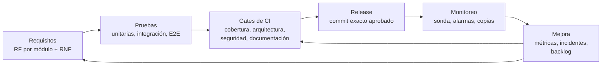

# Calidad de software

Este capítulo define cómo Vinnot especifica, mide y asegura la calidad de su web, su
app para iOS y Android y su API. Toma como marco la familia de normas ISO/IEC 25000
(SQuaRE) y la aplica al producto real: características priorizadas, requisitos no
funcionales con valores tomados del código, métricas con umbrales, análisis de riesgos,
plan de pruebas y backlog de mejoras.

No repite lo que ya documentan otras secciones. Las estrategias de prueba por capa, los
casos de prueba de cada módulo, la trazabilidad, los gates de CI/CD, la observabilidad y
las copias de seguridad tienen sus propias páginas, enlazadas en
[Dónde vive la calidad en el repositorio](#dónde-vive-la-calidad-en-el-repositorio).

## Propósito y alcance

- **Producto:** web (`vinnot.com`), app móvil para iOS y Android y API REST (`api.vinnot.com`).
- **Entornos:** desarrollo (`dev.vinnot.com`) y producción.
- **Fuente de verdad:** el código y la configuración. Cada valor numérico de este capítulo
  cita el archivo donde está definido. Si un valor cambia en el código, la página que lo
  cita se actualiza en el mismo cambio.
- **Estados:** cada control figura como *implementado*, *verificado*, *pendiente* o *fuera de
  alcance*. Los objetivos que todavía no tienen medición ni control figuran como
  **objetivo propuesto**, con estado pendiente.

## Normas de referencia

| Norma | Uso en Vinnot |
|---|---|
| ISO/IEC 25010:2011, con notas de la edición 2023 | Modelo de calidad del producto y de calidad en uso: base de [Modelo de calidad](quality-model.md) |
| ISO/IEC 25012:2008 | Calidad de datos del catálogo (exactitud, completitud, consistencia, actualidad) |
| ISO/IEC 25023:2016 y 25022:2016 | Medidas de calidad del producto y en uso: base de [Métricas](metrics.md) |
| ISO/IEC 25030 | Requisitos de calidad verificables: base de [Requisitos no funcionales](non-functional-requirements.md) |
| ISO/IEC 25040:2011 | Proceso de evaluación de la calidad en cinco actividades |
| ISO/IEC/IEEE 29119-3:2021 | Estructura de la documentación de pruebas: base de [Plan de pruebas](test-plan.md) |

## Marco en pocas palabras

La calidad de software es el grado en que el producto satisface las necesidades
declaradas e implícitas de quienes lo usan, en un contexto de uso concreto. No es un
valor absoluto: un catálogo de vinos y un cobro con Mercado Pago tienen exigencias
distintas dentro del mismo producto.

Las normas distinguen tres vistas encadenadas. La **calidad interna** se mide sin ejecutar
el software (arquitectura, código, cobertura). La **calidad externa** se mide al ejecutarlo
(fallas, tiempos, defectos). La **calidad en uso** es el efecto sobre la persona que lo usa
(si completa la tarea, en cuánto tiempo, si confía). La calidad del proceso influye en la
interna, esta en la externa y esta en la de uso. Por eso Vinnot trabaja la calidad desde el
proceso y el código, no solo con pruebas al final.

ISO/IEC 9126 introdujo la jerarquía característica → subcaracterística → atributo →
métrica. SQuaRE (ISO/IEC 25000) la reemplazó y la amplió: la seguridad y la compatibilidad
pasan a ser características propias, se agrega un modelo de calidad de datos (25012) y un
proceso formal de evaluación (25040). La edición 2023 de la 25010 suma la característica
*Protección* (safety), renombra *Usabilidad* como *Capacidad de interacción* y
*Portabilidad* como *Flexibilidad* (que incorpora la escalabilidad), reemplaza *madurez* por
*ausencia de fallas*, agrega *resistencia* dentro de Seguridad y separa la calidad en uso en
la ISO/IEC 25019:2023. Este capítulo usa la estructura de 2011 y marca la equivalencia con
2023 en el [Modelo de calidad](quality-model.md#equivalencias-con-la-edición-2023).

Las características no son independientes. Más seguridad suele restar usabilidad y
agregar latencia; la mantenibilidad favorece la fiabilidad; integrar servicios externos
mejora la compatibilidad pero amplía la superficie de ataque. Por eso la prioridad de cada
característica se decide según la criticidad del negocio.

## Criticidad por área de negocio

| Área | Tipo de negocio | Qué pasa si falla | Criticidad |
|---|---|---|---|
| Catálogo y descubrimiento | Contenido y marketplace | Datos incorrectos o incompletos dañan la confianza, sin pérdida económica directa | Media |
| Comunidad | Red social | Contenido abusivo, falta de moderación o filtración de datos personales | Media |
| Eventos con pago | Comercio electrónico | Cobro duplicado, venta por encima del cupo o pago acreditado sin confirmación real | Alta |

A estas áreas se suman datos personales (cuentas, correos, ubicación para eventos
cercanos) y servicios externos (Mercado Pago, OpenAI, Google Maps, notificaciones push),
que elevan la prioridad de la seguridad y de la tolerancia a fallos. La comisión de la
plataforma sobre las entradas está descrita en [Pagos](../modules/payments/README.md).

## Sistema de calidad

[Ver diagrama de «Sistema de calidad» completo](https://images.vinnot.com/docs/diagrams/v1/es/quality-readme-a494ec7905fa.svg)

Cada requisito tiene pruebas trazables; los gates de CI bloquean el cambio si una prueba,
un umbral de cobertura o un control de seguridad falla; producción solo se publica desde el
commit exacto que pasó esos gates; el monitoreo alimenta las métricas, y cada desvío o
falla se convierte en una mejora del producto o en una regla nueva del proceso.

## Mapa del capítulo

| Página | Contenido |
|---|---|
| [Modelo de calidad](quality-model.md) | Características y subcaracterísticas ISO/IEC 25010 aplicadas a Vinnot, calidad en uso, calidad de datos y ranking de prioridades |
| [Requisitos no funcionales](non-functional-requirements.md) | Tabla consolidada RNF-01 a RNF-26 con el valor actual, el archivo fuente y la verificación; índice de requisitos funcionales por módulo |
| [Métricas](metrics.md) | M-01 a M-25 con fórmula, interpretación y umbral; valores observados con su fecha |
| [Pruebas basadas en riesgos](risk-based-testing.md) | Riesgos R-01 a R-10, tipos de prueba priorizados y técnicas de diseño con ejemplos |
| [Plan de pruebas](test-plan.md) | PP-VINNOT-01 con estructura ISO/IEC/IEEE 29119-3: alcance, enfoque, criterios, severidades y ciclo por release |
| [Casos de prueba no funcionales](non-functional-test-cases.md) | CP-NF-01 a CP-NF-07 con pasos, resultado esperado y estado |
| [Backlog de mejoras de calidad](improvement-backlog.md) | Brechas detectadas con prioridad y estado |

El proceso de trabajo que sostiene este sistema (issues, ramas, pull requests, CI y
release) está en [Proceso de desarrollo](../governance/development-process.md).

## Dónde vive la calidad en el repositorio

| Tema | Documento |
|---|---|
| Estrategia de pruebas del backend y umbrales JaCoCo | [Backend: estrategia de pruebas](../backend/testing/strategy.md) |
| Estrategia de pruebas web (Vitest y Playwright) | [Web: estrategia de pruebas](../frontend-web/testing/strategy.md) |
| Estrategia de pruebas móvil (Jest) | [App: estrategia de pruebas](../frontend-mobile/testing/strategy.md) |
| Requisitos, casos de uso y casos de prueba por módulo | [Módulos](../modules/README.md) |
| Trazabilidad caso de uso → requisito → caso de prueba → test | [Matriz de trazabilidad](../modules/traceability.md) |
| Workflows, selección de controles y quality gate | [CI/CD](../infra/guides/ci-cd.md) y [pipeline de CI/CD](../infra/diagrams/ci-cd-pipeline.md) |
| Dependencias, imágenes y SBOM | [Seguridad de dependencias](../infra/guides/dependency-security.md) |
| Señales, umbrales y respuesta a incidentes | [Observabilidad e incidentes](../infra/operations/observability-and-incidents.md) |
| Copias, restauración, RPO y RTO | [Backup y recuperación ante desastres](../infra/operations/backup-and-disaster-recovery.md) |
| Rendimiento de consultas e índices | [Rendimiento de consultas](../backend/data/query-performance.md) |
| Accesibilidad y layout | [Layout y accesibilidad](../shared/design/layout-and-accessibility.md) |
| Release paso a paso | [Release paso a paso](../infra/guides/release-step-by-step.md) |
| Checklist previo al merge | [Flujo de issues, ramas y pull requests](../governance/github-work-items.md#checklist-previo-al-merge) |

## Glosario

| Término | Definición |
|---|---|
| Calidad en uso | Efecto del producto sobre la persona que lo usa: efectividad, eficiencia, satisfacción, ausencia de riesgo y cobertura de contexto |
| Característica / subcaracterística | Niveles del modelo ISO/IEC 25010; por ejemplo, Fiabilidad / Disponibilidad |
| Cobertura de código | Proporción de líneas, ramas o funciones que ejecutan las pruebas |
| Criterio de aceptación | Condición verificable que un módulo o un release debe cumplir para aprobarse |
| Gate de calidad | Control automático que bloquea un cambio si una verificación falla o se omite |
| HSTS | Cabecera que obliga al navegador a usar siempre HTTPS con un dominio |
| Límite de tasa | Cantidad máxima de peticiones en un período; al superarla la API responde HTTP 429 con `Retry-After` |
| p95 | Percentil 95: el 95 % de las mediciones es igual o menor a ese valor |
| Regresión | Defecto en algo que antes funcionaba |
| RPO / RTO | Pérdida máxima de datos tolerable / tiempo máximo tolerable para restaurar el servicio |
| Sandbox | Modo de prueba de un proveedor (por ejemplo, Mercado Pago) que no mueve dinero real |
| Severidad | Gravedad del impacto de un defecto: crítica, alta, media o baja |
| SQuaRE | Familia ISO/IEC 25000: requisitos y evaluación de la calidad de sistemas y software |
| SUS | System Usability Scale: cuestionario de 10 preguntas que da un puntaje de 0 a 100 |
| Webhook | Notificación que un servicio externo envía al backend cuando ocurre un evento, como un pago aprobado |

## Referencias

- ISO/IEC 9126-1:2001. Software engineering — Product quality — Part 1: Quality model.
- ISO/IEC 25000:2014. Systems and software engineering — SQuaRE — Guide to SQuaRE.
- ISO/IEC 25010:2011. Systems and software engineering — SQuaRE — System and software quality models.
- ISO/IEC 25010:2023. Systems and software engineering — SQuaRE — Product quality model.
- ISO/IEC 25012:2008. Software engineering — SQuaRE — Data quality model.
- ISO/IEC 25019:2023. Systems and software engineering — SQuaRE — Quality-in-use model.
- ISO/IEC 25022:2016 y 25023:2016. Measurement of quality in use / Measurement of system and software product quality.
- ISO/IEC 25040:2011. Systems and software engineering — SQuaRE — Evaluation process.
- ISO/IEC/IEEE 29119-3:2021. Software and systems engineering — Software testing — Part 3: Test documentation.
- Portal ISO 25000: <https://iso25000.com>
- ISTQB. Certified Tester Foundation Level Syllabus, versión 4.0.
- OWASP Foundation. OWASP Top 10 y OWASP API Security Top 10.
- W3C. Web Content Accessibility Guidelines (WCAG) 2.1.
- Brooke, J. (1996). SUS: A quick and dirty usability scale.
