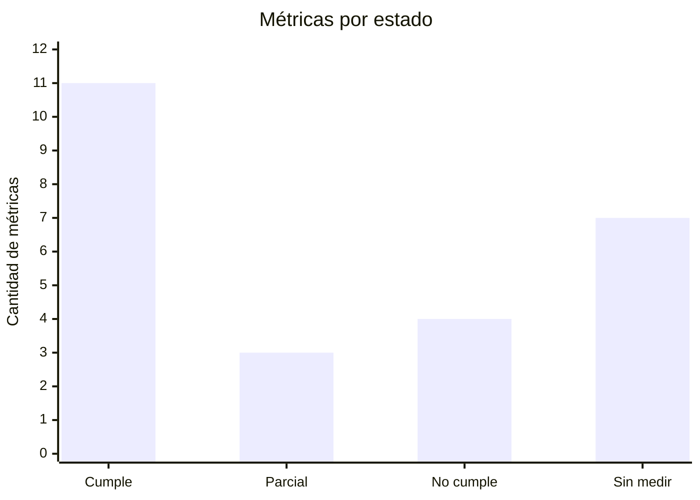

# Métricas de calidad

Define 25 métricas siguiendo el modelo de medición de la ISO/IEC 25020 y las medidas de la
ISO/IEC 25023 (producto) y 25022 (calidad en uso). La mayoría se expresa como una
proporción `X = A / B`, donde `A` es la cantidad que cumple la condición y `B` el total; el
resultado queda entre 0 y 1 y se compara con un umbral.

Cada métrica indica característica, propósito, fórmula, interpretación, umbral, valor
observado e instrumento. Los umbrales sin control automático todavía son **objetivo
propuesto**, con estado pendiente.

## Origen de los valores observados

- **Medición del 16-10-2026:** auditoría de calidad con ejecución completa de las suites, una
  muestra de carga de 20 lecturas simultáneas en desarrollo, el benchmark de escaneo previo
  al lanzamiento y la geolocalización de bodegas de octubre de 2026. Son mediciones
  puntuales: valen para esa fecha y ese entorno.
- **Medición del 29-10-2026:** ejecución completa de las suites web y móvil, y conteo
  estático de pruebas del backend.
- **Configuración vigente:** cuando el valor es un control configurado (alarma, gate o
  límite), se cita el archivo y se verificó contra el código actual.

## Resumen

| ID | Característica | Métrica | Umbral | Observado | Cumple |
|---|---|---|---|---|---|
| M-01 | Adecuación funcional | Completitud funcional | 100 % de los requisitos priorizados | 18 de 18 (16-10-2026) | Sí |
| M-02 | Adecuación funcional | Tasa de pruebas superadas | 100 % en el commit a liberar | Web 1.515 y app 2.375, sin fallas (29-10-2026) | Sí |
| M-03 | Adecuación funcional | Exactitud de pagos acreditados | 0 diferencias | Sin medir | — |
| M-04 | Adecuación funcional | Defectos críticos escapados a producción | 0 críticos y ≤ 2 altos por versión | Sin medir | — |
| M-05 | Eficiencia | Tiempo de respuesta p95 de lecturas | ≤ 500 ms (objetivo propuesto) | 2.913 ms con 20 lecturas simultáneas en desarrollo (16-10-2026) | No |
| M-06 | Eficiencia | Tiempo de escaneo p95 | ≤ 10 s | 11,2 s (16-10-2026) | No |
| M-07 | Adecuación / Eficiencia | Precisión del escaneo (primer resultado) | ≥ 90 % | 87,1 % (27 de 31) (16-10-2026) | No, desvío aceptado |
| M-08 | Eficiencia / Capacidad | Peticiones simultáneas sin errores | 20 con 0 % de errores | 20 de 20 (16-10-2026) | Sí |
| M-09 | Eficiencia / Recursos | Memoria libre del servidor | ≥ 256 MiB | Alarma configurada | Sí |
| M-10 | Compatibilidad | Webhooks de pago procesados | ≥ 99,9 % | Sin medir | — |
| M-11 | Usabilidad | Tasa de finalización de tareas | ≥ 90 % (objetivo propuesto) | Sin medir | — |
| M-12 | Usabilidad | Puntaje SUS | ≥ 70 (objetivo propuesto) | Sin medir | — |
| M-13 | Usabilidad | Cobertura de validación de entradas | 100 % de los campos | Validación en cliente y servidor | Sí |
| M-14 | Accesibilidad | Criterios WCAG 2.1 AA cumplidos | ≥ 95 % (objetivo propuesto) | Sin herramienta automática | — |
| M-15 | Fiabilidad | Disponibilidad mensual | ≥ 99,5 % (objetivo propuesto) | Sonda cada 5 min, sin reporte consolidado | — |
| M-16 | Fiabilidad | Tasa de errores 5xx | < 1 % (objetivo propuesto) | Alarma configurada al 5 % | Parcial |
| M-17 | Fiabilidad | RTO y RPO | RTO ≤ 4 h; RPO ≤ 24 h | Copia diaria; simulacro integral sin registrar | Parcial |
| M-18 | Seguridad | Vulnerabilidades altas o críticas | 0 | 0: el pipeline bloquea | Sí |
| M-19 | Seguridad | Cobertura de pruebas de control de acceso | 100 % de las rutas protegidas | Matriz de acceso probada | Sí |
| M-20 | Seguridad | Secretos expuestos | 0 | 0: análisis de todo el historial | Sí |
| M-21 | Seguridad | Resistencia a fuerza bruta | ≤ 10 intentos por minuto | 10 por minuto, luego HTTP 429 | Sí |
| M-22 | Mantenibilidad | Cobertura de código | Ver [RNF-23](non-functional-requirements.md#mantenibilidad-y-portabilidad) | Umbrales superados; web 92,7 % de ramas (16-10-2026) | Sí |
| M-23 | Mantenibilidad | Violaciones de reglas de arquitectura | 0 | 0: verificación en el pipeline | Sí |
| M-24 | Portabilidad | Plataformas con E2E aprobados | 100 % de la matriz | En CI, una especificación en Chromium; el resto y la matriz completa, a pedido | Parcial |
| M-25 | Calidad de datos | Bodegas con ubicación exacta | ≥ 80 % a mediano plazo | 834 de 5.051 bodegas argentinas, 16,5 % (octubre de 2026) | No |

### Estado de las métricas

[Ver diagrama de «Estado de las métricas» completo](https://images.vinnot.com/docs/diagrams/v1/es/quality-metrics-de161134ba82.svg)

Las métricas sin medir y las que no cumplen tienen una acción en el
[backlog de mejoras](improvement-backlog.md).

## Adecuación funcional

### M-01 Completitud funcional

- **Subcaracterística:** completitud funcional.
- **Propósito:** saber si todas las funciones especificadas están implementadas.
- **Fórmula:** `X = A / B`; `A` = requisitos implementados y verificados; `B` = requisitos especificados.
- **Interpretación:** cuanto más cerca de 1, mejor; menos de 1 indica funciones faltantes.
- **Umbral:** `X = 1` para los requisitos priorizados de los flujos críticos.
- **Observado:** 18 de 18 (16-10-2026). La [matriz de trazabilidad](../modules/traceability.md) cubre hoy 124 casos de uso y 536 casos de prueba, contando Actividad y Puntos y sellos.
- **Instrumento:** matriz de trazabilidad.

### M-02 Tasa de pruebas superadas

- **Subcaracterística:** corrección funcional.
- **Propósito:** medir qué proporción de las pruebas automáticas pasa.
- **Fórmula:** `X = A / B`; `A` = pruebas superadas; `B` = pruebas ejecutadas.
- **Interpretación:** cualquier falla bloquea la integración del cambio.
- **Umbral:** `X = 1` en el commit candidato a producción.
- **Observado:** web 1.515 pruebas en 296 archivos y app 2.375 pruebas en 340 suites, sin fallas (29-10-2026). Backend: 1.189 de 1.189 (16-10-2026); el conteo estático del 29-10-2026 da 2.125 métodos de prueba.
- **Instrumento:** CI con JUnit, Vitest y Jest.

### M-03 Exactitud de pagos acreditados

- **Subcaracterística:** corrección funcional.
- **Propósito:** verificar que cada inscripción pagada corresponda a un pago real aprobado.
- **Fórmula:** `X = A / B`; `A` = pagos acreditados que coinciden con Mercado Pago en monto y estado; `B` = pagos acreditados.
- **Interpretación:** debe ser exactamente 1; cualquier diferencia es un defecto crítico.
- **Umbral:** `X = 1`.
- **Observado:** pendiente; requiere una conciliación periódica contra el panel de Mercado Pago.
- **Instrumento:** base de pagos y reportes de Mercado Pago.

### M-04 Defectos críticos escapados a producción

- **Subcaracterística:** corrección funcional.
- **Propósito:** medir la eficacia de las pruebas antes de liberar.
- **Fórmula:** `X` = defectos de severidad crítica o alta detectados en producción por versión.
- **Interpretación:** cuanto menor, mejor.
- **Umbral:** 0 críticos y ≤ 2 altos por versión.
- **Observado:** pendiente; se mide con los issues `hotfix` y `bugfix` de cada versión.
- **Instrumento:** GitHub Issues ([tipos de trabajo](../governance/github-work-items.md#tipos-de-trabajo)).

## Eficiencia de desempeño

### M-05 Tiempo de respuesta p95 de lecturas

- **Subcaracterística:** comportamiento temporal.
- **Propósito:** medir la rapidez percibida de búsqueda y detalle.
- **Fórmula:** `X` = percentil 95 del tiempo de respuesta de las lecturas en un período.
- **Interpretación:** cuanto menor, mejor; el p95 representa al 5 % de usuarios más perjudicados.
- **Umbral:** objetivo propuesto de 500 ms en producción con carga normal.
- **Observado:** p50 2.063 ms y p95 2.913 ms con 20 lecturas simultáneas en desarrollo (16-10-2026). Desarrollo usa un servidor más chico que producción: la medición debe repetirse en producción.
- **Instrumento:** registro de peticiones lentas y prueba de carga ([CP-NF-04](non-functional-test-cases.md#cp-nf-04-medir-el-tiempo-de-respuesta-bajo-carga)).

### M-06 Tiempo de escaneo p95

- **Subcaracterística:** comportamiento temporal.
- **Propósito:** medir la espera desde la foto hasta el resultado.
- **Fórmula:** `X` = percentil 95 del tiempo de reconocimiento.
- **Interpretación:** cuanto menor, mejor.
- **Umbral:** 10 s.
- **Observado:** p50 4,1 s y p95 11,2 s (16-10-2026). El responsable de producto aceptó el desvío para el lanzamiento.
- **Instrumento:** [`benchmark-wine-label-scanning.mjs`](../../../scripts/benchmark-wine-label-scanning.mjs) con un conjunto fijo de etiquetas.

### M-07 Precisión del escaneo

- **Subcaracterística:** corrección funcional.
- **Propósito:** medir si el escaneo identifica el vino correcto.
- **Fórmula:** `X = A / B`; `A` = escaneos cuyo primer resultado es el vino correcto; `B` = escaneos evaluables.
- **Interpretación:** cuanto más cerca de 1, mejor.
- **Umbral:** 0,90.
- **Observado:** 27 de 31, 87,1 % (16-10-2026); desvío aceptado. Una repetición sobre un catálogo acotado dio 37 de 37.
- **Instrumento:** benchmark de escaneo.

### M-08 Peticiones simultáneas sin errores

- **Subcaracterística:** capacidad.
- **Propósito:** saber cuántas peticiones simultáneas soporta el sistema sin fallar.
- **Fórmula:** `X = A / B`; `A` = respuestas correctas; `B` = peticiones enviadas con N usuarios simultáneos.
- **Interpretación:** debe ser 1 para el N objetivo.
- **Umbral:** `X = 1` con N = 20.
- **Observado:** 20 de 20 (16-10-2026). Con un límite artificial de 6 conexiones, 3 peticiones se admitieron y 17 se rechazaron de forma controlada y recuperable.
- **Instrumento:** prueba de carga.

### M-09 Memoria libre del servidor

- **Subcaracterística:** utilización de recursos.
- **Propósito:** detectar saturación antes de que afecte a la persona usuaria.
- **Fórmula:** `X` = memoria disponible en MiB, medida cada 5 minutos.
- **Interpretación:** cuanto mayor, mejor.
- **Umbral:** 256 MiB; además, disco libre de 3 GiB y conexiones a la base por debajo del 80 % del pool.
- **Observado:** alarmas configuradas en [`config.example.json`](../../../infra/aws-low-cost/monitoring/config.example.json).
- **Instrumento:** colector de métricas y CloudWatch.

## Compatibilidad

### M-10 Webhooks de pago procesados

- **Subcaracterística:** interoperabilidad.
- **Propósito:** verificar la integración con Mercado Pago.
- **Fórmula:** `X = A / B`; `A` = notificaciones válidas procesadas; `B` = notificaciones válidas recibidas.
- **Interpretación:** cuanto más cerca de 1, mejor.
- **Umbral:** 0,999.
- **Observado:** pendiente.
- **Instrumento:** registros de la API de pagos.

## Usabilidad

### M-11 Tasa de finalización de tareas

- **Subcaracterística:** calidad en uso, efectividad.
- **Propósito:** medir si las personas completan tareas clave sin ayuda: registrarse, buscar un vino, reseñarlo y comprar una entrada.
- **Fórmula:** `X = A / B`; `A` = tareas completadas; `B` = tareas intentadas.
- **Interpretación:** cuanto más cerca de 1, mejor.
- **Umbral:** objetivo propuesto de 0,90 y tiempo medio de compra de una entrada de 3 minutos o menos.
- **Observado:** pendiente; requiere una prueba moderada con 5 a 8 usuarios.
- **Instrumento:** prueba de usabilidad.

### M-12 Puntaje SUS

- **Subcaracterística:** calidad en uso, satisfacción.
- **Propósito:** medir la satisfacción percibida.
- **Fórmula:** cuestionario SUS de 10 preguntas; puntaje de 0 a 100.
- **Interpretación:** más de 68 supera el promedio de la industria.
- **Umbral:** objetivo propuesto de 70.
- **Observado:** pendiente; se mide junto con M-11.
- **Instrumento:** cuestionario SUS.

### M-13 Cobertura de validación de entradas

- **Subcaracterística:** protección contra errores de usuario.
- **Propósito:** detectar datos inválidos antes de procesarlos.
- **Fórmula:** `X = A / B`; `A` = campos con validación en cliente y servidor; `B` = campos de formulario.
- **Interpretación:** debe ser 1.
- **Umbral:** `X = 1`.
- **Observado:** esquemas en el cliente y reglas de dominio en el servidor.
- **Instrumento:** revisión de código y pruebas de validadores.

### M-14 Criterios WCAG cumplidos

- **Subcaracterística:** accesibilidad.
- **Propósito:** medir la accesibilidad de las pantallas principales.
- **Fórmula:** `X = A / B`; `A` = criterios WCAG 2.1 AA cumplidos; `B` = criterios aplicables revisados.
- **Interpretación:** cuanto más cerca de 1, mejor.
- **Umbral:** objetivo propuesto de 0,95.
- **Observado:** pendiente; hoy se revisa a mano con teclado y lectores de pantalla.
- **Instrumento:** axe o Lighthouse (pendiente) y revisión manual.

## Fiabilidad

### M-15 Disponibilidad mensual

- **Subcaracterística:** disponibilidad.
- **Propósito:** medir el tiempo en que el servicio está operativo.
- **Fórmula:** `X` = tiempo operativo / tiempo total del período.
- **Interpretación:** 99,5 % equivale a unas 3,6 horas sin servicio por mes.
- **Umbral:** objetivo propuesto de 0,995.
- **Observado:** la sonda mide cada 5 minutos, pero no hay reporte mensual consolidado.
- **Instrumento:** sonda externa y CloudWatch.

### M-16 Tasa de errores 5xx

- **Subcaracterística:** madurez.
- **Propósito:** medir la frecuencia de fallas internas.
- **Fórmula:** `X = A / B`; `A` = respuestas 5xx; `B` = respuestas totales.
- **Interpretación:** cuanto menor, mejor.
- **Umbral:** objetivo propuesto de menos del 1 %.
- **Observado:** la alarma se dispara con 3 o más errores que sean al menos el 5 % ([`policy.py`](../../../infra/aws-low-cost/monitoring/policy.py)).
- **Instrumento:** colector de métricas.

### M-17 RTO y RPO

- **Subcaracterística:** capacidad de recuperación.
- **Propósito:** medir cuánto tarda el sistema en volver y cuántos datos se pueden perder.
- **Fórmula:** RTO = tiempo desde la caída hasta el servicio restaurado; RPO = tiempo entre la última copia y la falla.
- **Interpretación:** cuanto menores, mejor.
- **Umbral:** RTO de 4 h; RPO de 24 h.
- **Observado:** copia diaria fuera del servidor; falta registrar un simulacro integral ([Backup](../infra/operations/backup-and-disaster-recovery.md#rporto)).
- **Instrumento:** [CP-NF-05](non-functional-test-cases.md#cp-nf-05-restaurar-una-copia-de-seguridad).

## Seguridad

### M-18 Vulnerabilidades altas o críticas

- **Subcaracterística:** confidencialidad e integridad.
- **Propósito:** evitar componentes con vulnerabilidades conocidas.
- **Fórmula:** `X` = vulnerabilidades HIGH o CRITICAL en dependencias y en la imagen del servidor.
- **Interpretación:** debe ser 0.
- **Umbral:** 0.
- **Observado:** el pipeline de seguridad falla si encuentra alguna y corre además cada semana ([`security-checks.yml`](../../../.github/workflows/security-checks.yml)).
- **Instrumento:** Trivy, `npm audit` y SBOM CycloneDX.

### M-19 Cobertura de pruebas de control de acceso

- **Subcaracterística:** confidencialidad.
- **Propósito:** verificar que cada ruta protegida rechaza a quien no tiene permiso.
- **Fórmula:** `X = A / B`; `A` = rutas protegidas con prueba de acceso; `B` = rutas protegidas.
- **Interpretación:** debe ser 1.
- **Umbral:** `X = 1`.
- **Observado:** [`SecurityConfigAccessTest.java`](../../../backend/src/test/java/com/vinnot/shared/infrastructure/config/SecurityConfigAccessTest.java) valida la matriz de acceso.
- **Instrumento:** pruebas de seguridad del backend.

### M-20 Secretos expuestos

- **Subcaracterística:** confidencialidad.
- **Propósito:** evitar credenciales en el código o en el historial.
- **Fórmula:** `X` = secretos detectados.
- **Interpretación:** debe ser 0.
- **Umbral:** 0.
- **Observado:** Gitleaks analiza todo el historial en cada ejecución del CI ([`ci.yml`](../../../.github/workflows/ci.yml)).
- **Instrumento:** Gitleaks.

### M-21 Resistencia a fuerza bruta

- **Subcaracterística:** autenticidad y resistencia.
- **Propósito:** limitar los intentos de adivinar contraseñas.
- **Fórmula:** `X` = intentos de inicio de sesión aceptados por minuto y origen.
- **Interpretación:** cuanto menor, mejor, sin perjudicar al usuario legítimo.
- **Umbral:** 10; el intento siguiente recibe HTTP 429 con `Retry-After`.
- **Observado:** 10 por minuto configurado ([RNF-05](non-functional-requirements.md#límites-de-tasa)).
- **Instrumento:** configuración de límites de tasa y [CP-NF-01](non-functional-test-cases.md#cp-nf-01-limitar-intentos-de-inicio-de-sesión).

## Mantenibilidad

### M-22 Cobertura de código

- **Subcaracterística:** capacidad para ser probado.
- **Propósito:** medir qué parte del código ejercitan las pruebas.
- **Fórmula:** `X` = líneas (o ramas) ejecutadas / líneas (o ramas) del alcance medido.
- **Interpretación:** cuanto mayor, mejor. La cobertura no garantiza la calidad de las pruebas, pero su ausencia indica riesgo.
- **Umbral:** los gates de [RNF-23](non-functional-requirements.md#mantenibilidad-y-portabilidad).
- **Observado:** todos los umbrales se superan; la web llegó al 92,7 % de ramas en su alcance (16-10-2026).
- **Instrumento:** JaCoCo, Vitest y Jest; ver las estrategias de [backend](../backend/testing/strategy.md), [web](../frontend-web/testing/strategy.md) y [app](../frontend-mobile/testing/strategy.md).

### M-23 Violaciones de reglas de arquitectura

- **Subcaracterística:** modularidad.
- **Propósito:** mantener las capas desacopladas.
- **Fórmula:** `X` = violaciones detectadas, por ejemplo el dominio importando el framework.
- **Interpretación:** debe ser 0.
- **Umbral:** 0.
- **Observado:** [`verify-test-architecture.mjs`](../../../scripts/verify-test-architecture.mjs) corre en cada CI.
- **Instrumento:** verificación automática de arquitectura.

## Portabilidad

### M-24 Plataformas con E2E aprobados

- **Subcaracterística:** adaptabilidad.
- **Propósito:** verificar que la web funciona en los navegadores y dispositivos objetivo.
- **Fórmula:** `X = A / B`; `A` = plataformas de la matriz donde pasan las pruebas; `B` = plataformas de la matriz.
- **Interpretación:** debe ser 1.
- **Umbral:** `X = 1` con Chromium, Firefox, WebKit, Pixel 7 e iPhone 13.
- **Observado:** el CI ejecuta en Chromium solo `release-retention.spec.ts`; las 12 especificaciones E2E y la matriz completa se ejecutan a pedido ([`playwright.config.ts`](../../../frontend-react/playwright.config.ts)).
- **Instrumento:** Playwright ([CP-NF-07](non-functional-test-cases.md#cp-nf-07-ejecutar-los-flujos-críticos-en-la-matriz-de-navegadores)).

## Calidad de datos

### M-25 Bodegas con ubicación exacta

- **Característica ISO/IEC 25012:** exactitud y completitud.
- **Propósito:** medir si el mapa de cada bodega marca su dirección real.
- **Fórmula:** `X = A / B`; `A` = bodegas con coordenadas verificadas de su dirección; `B` = bodegas del catálogo.
- **Interpretación:** cuanto más cerca de 1, mejor.
- **Umbral:** 0,80 a mediano plazo.
- **Observado:** 834 de 5.051 bodegas argentinas, 16,5 % (octubre de 2026). El resto no tuvo un resultado confiable o quedó para el ciclo siguiente por el límite gratuito del servicio de mapas.
- **Instrumento:** geolocalización con verificación de nombre, provincia y tipo de lugar.
