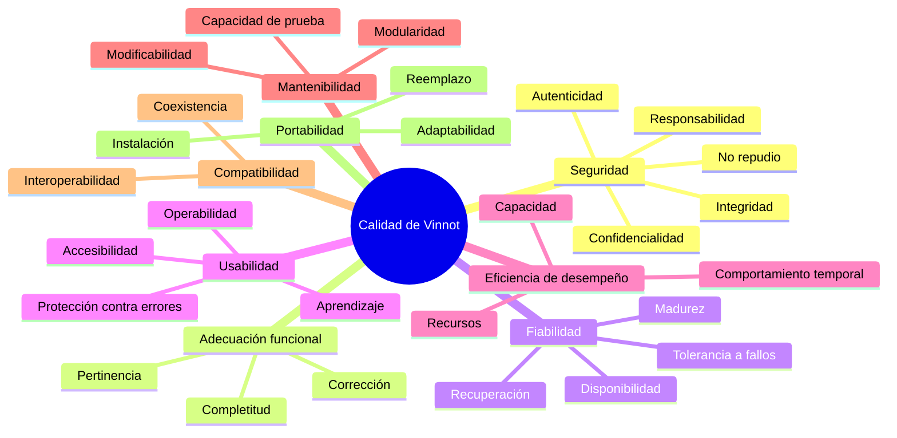

# Modelo de calidad

Aplica las ocho características de calidad del producto de la ISO/IEC 25010:2011 a Vinnot.
Para cada subcaracterística indica cómo se aplica, su prioridad y la evidencia en el código
o en la documentación. La prioridad depende del impacto de una falla:

- **Alta:** puede causar pérdida económica, filtración de datos o abandono masivo.
- **Media:** degrada la experiencia, pero hay alternativa.
- **Baja:** el impacto es acotado.

## Mapa del modelo

[Ver diagrama de «Mapa del modelo» completo](https://images.vinnot.com/docs/diagrams/v1/es/quality-quality-model-48c895d480d7.svg)

## Adecuación funcional

| Subcaracterística | Aplicación en Vinnot | Prioridad | Evidencia |
|---|---|---|---|
| Completitud funcional | Las funciones cubren los objetivos de cada rol: buscar y ver vinos, reseñar, gestionar la cava, inscribirse y pagar eventos, moderar | Alta | Requisitos `RF-WEB-*` y `RF-APK-*` por módulo y [matriz de trazabilidad](../modules/traceability.md) con 117 casos de uso y 496 casos de prueba |
| Corrección funcional | Promedio de reseñas recalculado, cupo nunca superado, comisión bien aplicada, pago acreditado solo si Mercado Pago lo confirma | Alta | Reglas en el dominio y [pruebas contra PostgreSQL real](../backend/testing/strategy.md#backend-persistencia-postgresql); [arquitectura de Pagos](../modules/payments/architecture.md) |
| Pertinencia funcional | Filtros combinables, búsqueda desde dos caracteres, escaneo de etiquetas para no tipear | Media | `RF-WEB-WIN-02` y `RF-APK-WIN-02` en [Requisitos de Vinos](../modules/wines/requirements.md) |

## Eficiencia de desempeño

| Subcaracterística | Aplicación en Vinnot | Prioridad | Evidencia |
|---|---|---|---|
| Comportamiento temporal | Respuesta de búsqueda, detalle de vino y checkout; el escaneo responde en pocos segundos | Alta | Umbral de petición lenta de 1000 ms y tiempo máximo de reconocimiento de 12 s en [`application.yml`](../../../backend/src/main/resources/application.yml) (líneas 184 y 168); tiempos máximos por proveedor en [RNF-16](non-functional-requirements.md#rendimiento-y-capacidad) |
| Utilización de recursos | Memoria, CPU, disco, conexiones y costo de IA | Media | Pool de 20 conexiones, hasta 3 llamadas de IA simultáneas y tope mensual de gasto de IA en [`application.yml`](../../../backend/src/main/resources/application.yml); compresión zstd/gzip en [`Caddyfile`](../../../infra/aws-low-cost/Caddyfile) |
| Capacidad | Tamaño de página, archivos y peticiones por período | Media | Página máxima de 200 en [`PageQuery.java`](../../../backend/src/main/java/com/vinnot/shared/domain/valueobject/PageQuery.java); 20 por página con ventana de 500 en [`PublicWineCatalogAccessPolicy.java`](../../../backend/src/main/java/com/vinnot/wine/infrastructure/web/policy/PublicWineCatalogAccessPolicy.java); límites de tasa en [RNF-05](non-functional-requirements.md#límites-de-tasa) |

## Compatibilidad

| Subcaracterística | Aplicación en Vinnot | Prioridad | Evidencia |
|---|---|---|---|
| Coexistencia | La app convive con otras apps: cámara, ubicación, notificaciones y almacenamiento | Baja | Permisos declarados en [`app.config.ts`](../../../frontend-mobile/app.config.ts), con texto de uso para cámara y ubicación |
| Interoperabilidad | Mercado Pago, OpenAI, Google Maps, inicio de sesión con Google y Apple, notificaciones push y vista previa Open Graph | Alta | Contrato OpenAPI (springdoc en [`pom.xml`](../../../backend/pom.xml)), firma de webhooks en [`MercadoPagoWebhookSignature.java`](../../../backend/src/main/java/com/vinnot/payment/infrastructure/security/MercadoPagoWebhookSignature.java), [compartir público](../infra/guides/public-sharing.md) |

## Usabilidad

| Subcaracterística | Aplicación en Vinnot | Prioridad | Evidencia |
|---|---|---|---|
| Reconocimiento de adecuación | Se entiende rápido para qué sirve cada sección | Media | Navegación por pestañas en la app y [manuales por rol](../manuals/README.md) |
| Capacidad de aprendizaje | Un usuario nuevo se registra, busca un vino y lo reseña sin ayuda | Media | [Manuales por rol](../manuals/README.md) |
| Operabilidad | Filtros, formularios, escaneo con la cámara y compra de entradas | Alta | Estados diferenciados de carga, vacío, error, límite, offline y timeout (`RF-WEB-SUP-05`, `RF-APK-SUP-05` en [Soporte](../modules/support/requirements.md)) |
| Protección contra errores de usuario | Validar antes de enviar y confirmar acciones destructivas | Alta | Validación con Zod en la web, frase de confirmación al borrar la cuenta ([Usuarios](../modules/users/requirements.md)) |
| Estética de la interfaz | Interfaz agradable y consistente | Media | [Sistema visual](../shared/design/visual-system.md) compartido entre web y app |
| Accesibilidad | Uso por personas con discapacidad, en español e inglés | Media | [Checklist de accesibilidad](../shared/design/layout-and-accessibility.md#checklist-de-accesibilidad); prueba automática pendiente ([backlog](improvement-backlog.md)) |

## Fiabilidad

| Subcaracterística | Aplicación en Vinnot | Prioridad | Evidencia |
|---|---|---|---|
| Madurez | Pocas fallas en uso normal | Alta | Quality gate de CI que bloquea pruebas fallidas o cobertura insuficiente ([CI/CD](../infra/guides/ci-cd.md)) |
| Disponibilidad | Servicio operativo, en especial durante la venta de entradas | Alta | Sonda externa cada 5 minutos y alarmas ([Observabilidad](../infra/operations/observability-and-incidents.md)). Limitación: un único servidor por entorno, sin alta disponibilidad |
| Tolerancia a fallos | Si falla IA, mapas o pagos, el resto sigue funcionando | Alta | Tiempos máximos por proveedor, errores diferenciados de red, timeout y HTTP, reembolso automático de pagos duplicados o tardíos ([Pagos](../modules/payments/README.md)) |
| Capacidad de recuperación | Restaurar datos y servicio | Alta | Copia diaria a S3 con alarma a las 30 h y control de salud cada 30 s en el [`Caddyfile`](../../../infra/aws-low-cost/Caddyfile) ([Backup](../infra/operations/backup-and-disaster-recovery.md)) |

## Seguridad

| Subcaracterística | Aplicación en Vinnot | Prioridad | Evidencia |
|---|---|---|---|
| Confidencialidad | Solo el rol habilitado accede a datos personales, pagos y paneles | Alta | Reglas por rol en [`SecurityConfig.java`](../../../backend/src/main/java/com/vinnot/shared/infrastructure/config/SecurityConfig.java), probadas en [`SecurityConfigAccessTest.java`](../../../backend/src/test/java/com/vinnot/shared/infrastructure/config/SecurityConfigAccessTest.java); credenciales de pago cifradas con AES-GCM en [`PaymentCredentialCipher.java`](../../../backend/src/main/java/com/vinnot/payment/infrastructure/security/PaymentCredentialCipher.java) |
| Integridad | Los datos no se modifican sin autorización | Alta | Webhooks firmados con HMAC-SHA256, validación de entradas, solo el autor o un administrador edita una reseña |
| No repudio | Demostrar que una acción ocurrió | Media | Aceptación de términos con versión, idioma y hash en [`TermsDocument.java`](../../../backend/src/main/java/com/vinnot/legal/domain/model/TermsDocument.java); recibos de pago |
| Responsabilidad | Trazar cada acción a quien la hizo | Media | `X-Request-ID` en cada respuesta ([`HttpRequestLoggingFilter.java`](../../../backend/src/main/java/com/vinnot/shared/infrastructure/web/HttpRequestLoggingFilter.java)) y registro de acciones de moderación |
| Autenticidad | Verificar la identidad de personas y sistemas | Alta | JWT de 15 minutos con renovación rotativa, BCrypt, verificación de correo, Google y Apple; ver [RNF-01 y RNF-02](non-functional-requirements.md#seguridad) |

## Mantenibilidad

| Subcaracterística | Aplicación en Vinnot | Prioridad | Evidencia |
|---|---|---|---|
| Modularidad | Un cambio en un módulo no afecta a otros | Alta | Monolito modular hexagonal con CQRS lógico ([Arquitectura](../architecture/README.md)) |
| Reusabilidad | Componentes y servicios reutilizados | Media | [Componentes compartidos](../shared/design/components.md) y servicios de aplicación por capa |
| Analizabilidad | Diagnosticar fallas rápido | Media | Formato de error estándar en [`GlobalExceptionHandler.java`](../../../backend/src/main/java/com/vinnot/shared/infrastructure/web/GlobalExceptionHandler.java) con código e identificador de petición |
| Capacidad para ser modificado | Cambiar sin degradar | Alta | Migraciones Flyway versionadas en [`db/migration`](../../../backend/src/main/resources/db/migration), revisión en pull requests |
| Capacidad para ser probado | Criterios de prueba claros y ejecutables | Alta | Más de 2.000 pruebas de backend, 1.515 web y 2.375 móviles; cobertura mínima obligatoria ([RNF-23](non-functional-requirements.md#mantenibilidad-y-portabilidad)) |

## Portabilidad

| Subcaracterística | Aplicación en Vinnot | Prioridad | Evidencia |
|---|---|---|---|
| Adaptabilidad | Navegadores, tamaños de pantalla y sistemas operativos | Alta | Matriz Playwright Chromium, Firefox, WebKit, Pixel 7 e iPhone 13 en [`playwright.config.ts`](../../../frontend-react/playwright.config.ts); iOS 16.4 o superior en [`app.config.ts`](../../../frontend-mobile/app.config.ts) |
| Capacidad para ser instalado | Instalación simple de la app y despliegue simple del servidor | Media | Tiendas oficiales; contenedores con imágenes fijadas por digest en [`docker-compose.yml`](../../../infra/aws-low-cost/docker-compose.yml) |
| Capacidad para ser reemplazado | Cambiar de proveedor de IA o de almacenamiento sin reescribir | Media | Cada proveedor externo está detrás de un puerto ([Arquitectura](../architecture/README.md)) |

## Calidad en uso

| Característica | Aplicación en Vinnot | Prioridad | Cómo se mide |
|---|---|---|---|
| Efectividad | Encontrar el vino, reseñarlo o comprar la entrada sin errores | Alta | [M-11](metrics.md#m-11-tasa-de-finalización-de-tareas) |
| Eficiencia | Lograrlo en poco tiempo y con pocos pasos, por ejemplo escaneando en lugar de tipear | Media | Tiempo medio de compra en M-11; [M-06](metrics.md#m-06-tiempo-de-escaneo-p95) |
| Satisfacción | Confiar en las reseñas y los pagos, y disfrutar de la app | Alta | [M-12](metrics.md#m-12-puntaje-sus) |
| Ausencia de riesgo | Sin pérdidas económicas ni filtración de datos | Alta | [M-03](metrics.md#m-03-exactitud-de-pagos-acreditados) y [M-18 a M-21](metrics.md#seguridad) |
| Cobertura de contexto | Celular, web y conexión limitada | Media | Estados offline de [Soporte](../modules/support/requirements.md) |

## Calidad de datos

El valor del catálogo depende de sus datos, por eso se aplican características de la
ISO/IEC 25012:

| Característica | Aplicación en Vinnot | Evidencia |
|---|---|---|
| Exactitud | Bodega, cosecha y graduación correctas; el mapa marca la dirección real de cada bodega y no un punto genérico en la capital provincial | [M-25](metrics.md#m-25-bodegas-con-ubicación-exacta) |
| Completitud | Cuántos vinos tienen imagen, descripción, uva y región; el detalle no inventa valores ausentes | [Requisitos de Vinos](../modules/wines/requirements.md) |
| Consistencia | Un vino no se duplica; las propuestas se revisan y pueden terminar en estado `DUPLICATE` | [`WineSubmission.java`](../../../backend/src/main/java/com/vinnot/wine/domain/model/WineSubmission.java), [propuestas de vinos](../modules/wines/submissions.md) |
| Actualidad | Los eventos terminados dejan de listarse | [Requisitos de Eventos](../modules/events/requirements.md) |

## Ranking de prioridades

| Prioridad | Característica | Justificación |
|---|---|---|
| 1 | Seguridad | Datos personales, pagos y paneles de administración; una falla expone información o permite fraude |
| 2 | Adecuación funcional (corrección) | Cupos, pagos, reembolsos y promedios deben ser exactos |
| 3 | Fiabilidad | Disponibilidad durante la venta de entradas y tolerancia a fallos de servicios externos |
| 4 | Usabilidad | App de consumo: si cuesta usarla, la persona la abandona |
| 5 | Eficiencia de desempeño | Búsqueda y escaneo deben sentirse inmediatos |
| 6 | Mantenibilidad | Sostiene la evolución del producto y la velocidad de corrección |
| 7 | Compatibilidad | Depende de varios proveedores externos |
| 8 | Portabilidad | Web y app multiplataforma, ya cubierta por el diseño |

## Interrelaciones entre características

| Relación | Tipo | En Vinnot |
|---|---|---|
| Seguridad ↔ Usabilidad | Compromiso | Verificación de correo, sesiones cortas y frase de confirmación agregan fricción |
| Seguridad ↔ Eficiencia | Compromiso | Cifrado, validaciones y límites de tasa agregan latencia |
| Mantenibilidad ↔ Eficiencia | Compromiso | Las capas desacopladas agregan indirecciones |
| Mantenibilidad → Fiabilidad | Sinergia | Código modular y probado reduce fallas en producción |
| Capacidad de prueba → Adecuación funcional | Sinergia | Lo fácil de probar se verifica mejor contra el requisito |
| Portabilidad ↔ Eficiencia | Compromiso | Una base React Native para iOS y Android puede rendir menos que una app nativa |
| Fiabilidad → Satisfacción | Sinergia | La estabilidad genera confianza para pagar dentro de la plataforma |
| Compatibilidad ↔ Seguridad | Compromiso | Cada servicio externo amplía la superficie de ataque |

## Equivalencias con la edición 2023

| ISO/IEC 25010:2011 | ISO/IEC 25010:2023 | Efecto en este modelo |
|---|---|---|
| Usabilidad | Capacidad de interacción | Estética pasa a *compromiso del usuario*; accesibilidad pasa a *inclusividad*; se suman *asistencia al usuario* y *autodescriptividad* |
| Portabilidad | Flexibilidad | Incorpora *escalabilidad*: un único servidor por entorno es la principal brecha |
| Fiabilidad / Madurez | Fiabilidad / Ausencia de fallas | Misma evidencia: quality gate y regresión automática |
| Seguridad | Seguridad + *resistencia* | Límites de tasa y bloqueo de dependencias vulnerables son evidencia de resistencia |
| (no existía) | Protección (safety) | Sin riesgo físico; aplica *protección ante fallos* en pagos: ninguna inscripción se confirma sin pago real |
| Calidad en uso dentro de la 25010 | ISO/IEC 25019:2023 | Mismas cinco características de calidad en uso |
